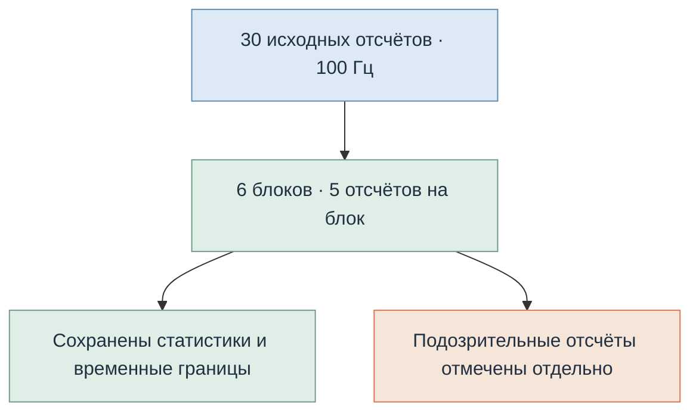
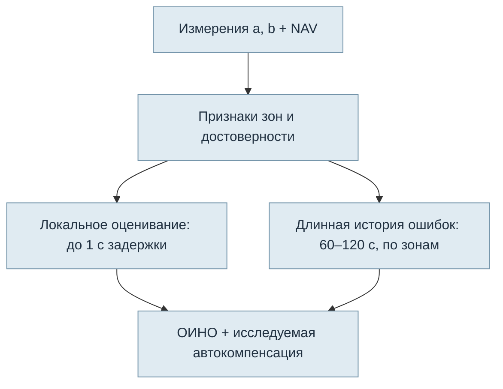
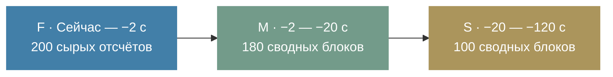
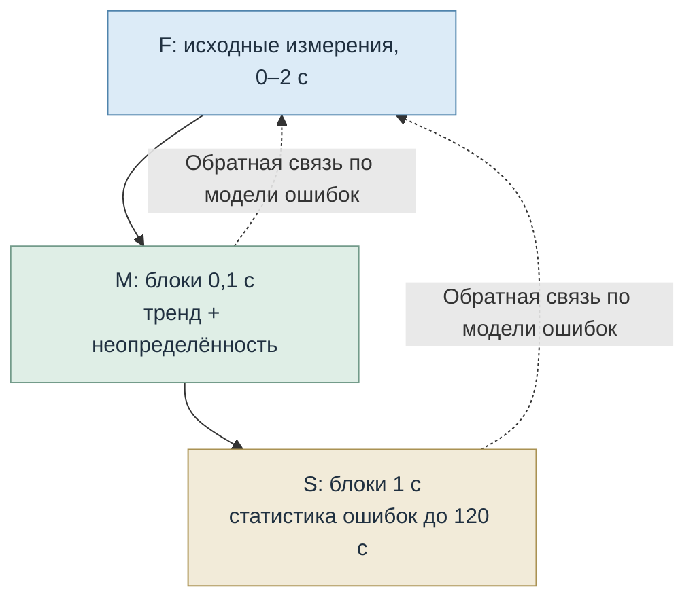

# LIBTR — Манифест многомасштабного временного оценивания ОИНО

**Область:** два угла $a,b$ к плоскостям симметрии ССК, преобразование направлений в NAV, автокомпенсационное оценивание и исследование ошибок фазового пеленгатора.  
**Содержание:** объединение двух инженерных разборов — длительного наблюдения, переходов зон, достоверности и сжатия потока; трёх временных слоёв F/M/S.  
**Дата:** 23 октября 2026 г.  
**Статус:** математико-архитектурное предложение; указанные временные границы являются начальными параметрами исследования, а не подтверждёнными оптимумами.

---

# Часть I. Длительное наблюдение, переходы зон и сжатие потока

Здесь я бы принципиально изменил организацию ОИНО: **накапливать историю ошибок до минуты и больше, но не пытаться аппроксимировать весь этот интервал одним полиномом движения направления.** Это разные временные масштабы одной задачи.

## 1. Как быстро наши углы меняются на 5°

Я пересчитал именно сохранённые синтетические датасеты `libtr`, используя истинные углы, а не шумные измерения.

| Сценарий | Изменение на 5° | Время |
|---|---|---:|
| Быстрый `phase_like_sine`, угол $a$ | 27,99° → 33,10° | **0,45 с** |
| `high_rate_sector`, угол $a$ | 12,22° → 17,23° | **0,49 с** |
| Обычный `white_independent`, угол $a$ | 18,39° → 23,40° | 4,45 с |
| NAV-азимут на тех же траекториях | 37,82° → 42,82° | 5,75 с |

Это минимальные интервалы изменения не менее чем на 5° внутри непрерывных участков наблюдения. Данные модельные, не натурные.

Различие между ССК и NAV здесь существенное: при вращении приёмника углы $a,b$ могут быстро меняться даже у сравнительно медленно перемещающегося направления в навигационной системе.

**Следствие:** минутная история нужна для исследования ошибок, но текущую динамику углов необходимо оценивать локально. Допустимая длительность локального окна определяется не только угловой скоростью, но и кривизной движения и погрешностью аппроксимации.

## 2. Как получить минутную историю при задержке всего 1 секунду

Предлагаю два временных горизонта, но в составе одного ОИНО, с общими входами, состояниями и историей.

| Контур | Горизонт | Назначение |
|---|---|---|
| Оценка направления | Адаптивный, условно 0,5–3 с | Углы, направления NAV и производные |
| Исследование ошибок | До 60–120 с | Дрейф, временная и межканальная корреляция, устойчивые структуры ошибок |
| История переходов | Через несколько посещений зон | Сравнение характеристик ошибок до перехода и после |

Интервалы здесь — стартовые параметры исследования, а не доказанные оптимумы.

Ограничение по задержке запишем:

$$
t_{\mathrm{pub}}-t_{\mathrm{core}}\leq 1\,\text{с}.
$$

Если основной результат находится точно посередине заполненного окна, при непрерывном поступлении данных можно использовать окно до 2 с с задержкой 1 с. Для точки $\tau=1/\sqrt5$ номинальный предел составит около 3,62 с. На практике из этого бюджета ещё вычитается доставка и вычисление.

**Минутный полином с оценкой посередине дал бы задержку около 30 с.** Нам это не нужно.

Длинная история вместо этого оценивает характеристики ошибок и обеспечивает информацию для автокомпенсации. Локальное окно продолжает отслеживать движение. Если потребуется использовать всю минуту для восстановления траектории, понадобится модель с локальными участками (например, сплайновая), а не единый полином Лежандра на 60 секунд.

## 3. Переходы зон — главный источник риска

Согласен, их нужно исследовать отдельно от обычных выбросов.

У фазового интерферометра ошибки разрешения неоднозначности могут приводить к переходу на неправильную угловую ветвь. Вблизи границ неоднозначности вероятность такого события зависит от ошибок фазовых измерений. Это известный механизм даже без многолучёвости.

При этом надо различать переход между зонами разрешения фазовой неоднозначности и выход из сектора обзора с последующим возвращением.

В нашем `high_rate_sector` уже существуют два разрыва наблюдения — **8,37 с и 9,84 с**. Но этот сценарий ещё не воспроизводит ошибочного выбора фазовой ветви. Поэтому прежние отличные результаты сглаживания внутри окна не доказывают устойчивость к переходам зон.

Я бы зафиксировал такое поведение:

- При обнаруженном переходе зоны закрывается текущий непрерывный участок оценивания. Новый участок не склеивается полиномом с предыдущим.
- Долговременная статистика ошибок сохраняется с идентификатором зоны, а не уничтожается при каждом переходе.
- Первые измерения после перехода проверяются на согласованность как новая серия; прежняя оценка не должна автоматически объявлять их выбросами.

Последовательный скачок всей серии и одиночный выброс требуют разных реакций. Это соответствует постановке обнаружения изменений статистического режима временного ряда.

## 4. Стоит ли сразу объявлять выбросы недостоверными?

**Подозрительными — сразу. Окончательно недостоверными — только при наличии достаточного основания.**

| Состояние входа | Решение |
|---|---|
| `VALID` | Измерение принято, участвует в оценивании |
| `SUSPECT` | Сохранено, вклад ограничен или временно исключён до проверки соседними измерениями |
| `INVALID` | Доказанное нарушение входного контракта или явная неисправность измерения |
| `MISSING` | Измерения нет; ничего не подставляется |

Если один отсчёт отклонился на 3° и следующий вернулся на прежний уровень, это похоже на импульсную ошибку. Если следующие 50 отсчётов продолжают новый тренд, это может быть изменение движения или переход зоны.

Задержка до 1 секунды позволяет сделать ретроспективную оценку подозрительной серии без вмешательства в математический сигнал.

Не стоит использовать правило «больше трёх паспортных СКО — удалить». Для негауссовой ошибки и неизвестного закона хвостов такой порог не определяет достоверную вероятность ложного отказа.

## 5. Сжатие частых данных — поддерживаю

Но сжимать нужно **с сохранением динамики и признаков ошибок**, а не просто брать каждый десятый отсчёт.

Предлагаю агрегировать короткие интервалы в статистические блоки.

### Иллюстрация уплотнения потока 100 Гц

> Цветом выделен смысловой участок с подозрительными отсчётами. Такой участок должен сохранять отдельную диагностическую информацию, а не растворяться в среднем значении.

Каждый блок должен сохранять время, число измерений, локальное направление, тренд, разброс, связь ошибок каналов, граничные отсчёты и признаки подозрительных измерений.

При скорости 12°/с направление меняется за 0,1 с на 1,2°. Поэтому блок нельзя считать измерением постоянного угла. Внутри блока нужна как минимум временная модель линейного изменения; допустимая длительность блока ограничивается уже его кривизной.

Кроме того, 100 Гц за минуту — всего 6000 отсчётов. Даже хранение времени, двух углов и навигационного кватерниона в `double` требует примерно **336 КБ** без служебных полей. Поэтому необратимое сжатие ради памяти пока не требуется. Для исследования неизвестного помехового базиса исходные данные особенно ценны.

При временной корреляции 6000 отсчётов не эквивалентны 6000 независимым наблюдениям. Оценка статистической точности должна учитывать эффективное число наблюдений.

## 6. Итоговая организация ОИНО

Это не два самостоятельных эвристических фильтра. Это раздельные вычислительные задачи внутри существующей архитектуры ОИНО, с единым управлением окном и неопределёнными состояниями.

**Самое важное изменение для следующей редакции манифеста:** переходы зон становятся самостоятельным объектом математического исследования. Восстановление после перехода, ошибка выбора ветви и статистическая память предыдущей зоны должны испытываться раздельно.

И ещё одна граница наших нынешних результатов: существующие синтетические записи для этой темы продолжаются максимум 44 секунды. Чтобы обоснованно оценить эволюцию ошибок порядка минуты, потребуются более длинные реализации — с повторными входами в зоны, медленными ошибками и независимой истиной. До такого исследования 60–120 секунд остаются гипотезой о полезной глубине статистической памяти, а не установленным оптимумом.

---

# Часть II. Три временных слоя: быстрый, средний и медленный

Я бы сделал **трёхмасштабное ОИНО с единой историей наблюдений, но разной временной детализацией**. При переходе данных в более длинную историю они сжимаются. Причём сохраняются не только средние значения, а математическая информация, необходимая оценивателю.

## 1. Три временных слоя

| Слой | Горизонт | Детализация при 100 Гц | Назначение |
|---|---|---|---|
| **Быстрый F** | 0–2 с | Все измерения, 100 Гц | Текущая динамика, углы и угловые скорости |
| **Средний M** | 2–20 с | Блоки по 0,1 с | Устойчивый тренд, локальная структура ошибок, переходы зон |
| **Медленный S** | 20–120 с | Блоки по 1 с | Медленная эволюция ошибок, корреляции, исследование помехового базиса |

Это начальная исследовательская конфигурация, не фиксированные оптимальные интервалы.

### Временная шкала хранения

| Быстрый | Средний | Медленный |
|---:|---:|---:|
| **200** сырых отсчётов | **180** сводных блоков | **100** сводных блоков |

**Итого около 480 записей вместо 12 000 исходных измерений за 120 секунд — в 25 раз меньше записей.** Экономия памяти в байтах зависит от состава одного блока.

Главное: **это не три независимых фильтра, усредняющих друг друга**. Это три масштаба одного процесса оценивания. Быстрый слой выдаёт оперативную оценку, средний и медленный уточняют статистическую модель ошибок и позволяют исследовать автокомпенсацию.

Оценивание в основном ядре остаётся задержанным — в центральной либо близкой к ней точке быстрого окна. Выход на текущий момент существует отдельно.

## 2. Как сжимать измерения математически корректно

Просто усреднять каждые 10 или 100 отсчётов нельзя. Например, при скорости 10°/с среднее за секунду будет отставать от угла в конце секунды примерно на 5° даже без шума.

Вместо этого для каждого блока $B$ сохраняем **достаточные статистики для локального полиномиального оценивания**.

Пусть $\boldsymbol\phi_i$ — вектор базисных функций в момент измерения, а $\mathbf y_i$ — две координаты направления в локальной касательной плоскости NAV.

$$
\boxed{
\begin{aligned}
M_B&=\sum_{i\in B}w_i\boldsymbol\phi_i\boldsymbol\phi_i^\mathsf T,\\
D_B&=\sum_{i\in B}w_i\boldsymbol\phi_i\mathbf y_i^\mathsf T,\\
C_B&=\sum_{i\in B}w_i\mathbf y_i\mathbf y_i^\mathsf T.
\end{aligned}}
$$

Матрицы соседних блоков складываются. Для фиксированного полиномиального базиса и весов это сохраняет необходимые суммы взвешенного МНК без хранения каждого измерения.

Но при неизвестной временной корреляции или изменяющихся робастных весах эти суммы уже не являются полным достаточным представлением. Поэтому в блок дополнительно сохраняем границы по времени, количество отсчётов, показатели разброса и выбросов, лаговые корреляции и признаки зоны.

Для ОИНО с ещё неизвестным помеховым базисом нельзя гарантировать сохранение всей информации для будущей идентификации. Поэтому особо интересные участки оставляем в исходном разрешении.

## 3. Передача данных между слоями

Данные стареют и агрегируются; новая статистика ошибок уточняет модель быстрого ОИНО, но не подменяет полезное движение.

Переход зон и разрыв наблюдений запрещают объединение данных в один обычный блок. Перед и после перехода статистики ведутся раздельно. Подозрительные выбросы сохраняются с признаком `SUSPECT`, а не безвозвратно удаляются.

При исследовании шума дополнительно полезно рассчитывать зависимость дисперсии разностей агрегированных остатков от интервала усреднения, в том числе по аналогии с дисперсией Аллана. Это позволяет изучать эволюцию ошибок на нескольких временных масштабах. Для коррелированных и нестационарных ошибок увеличение числа отсчётов не обязательно уменьшает погрешность как $1/\sqrt N$.

Простая децимация без подавления высокочастотных составляющих может исказить спектр ошибок, поэтому при последующем анализе частотных характеристик нужны специальные правила агрегации.

## 4. Как я предлагаю организовать вычисления

- **F** — непосредственно оценивает направление NAV и производные в задержанный момент, не более чем на 1 секунду относительно публикации. Длительность окна выбирается с учётом фактической кривизны движения и задержки.
- **M** — оценивает более длительный тренд и структуру остатков, обнаруживает изменения режима и формирует статистическую информацию для F.
- **S** — исследует медленную эволюцию ошибок и кандидатов помехового базиса на 60–120 секундах, с разделением по зонам и непрерывным эпизодам.

Результаты F, M и S не нужно механически усреднять. Если потребуется их объединение, оценки должны быть приведены к одному времени с учётом взаимной ковариации, потому что они основаны на общей истории.

**Предложение для `libtr`:** реализовать именно каскад временного уплотнения `F → M → S`, с сохранением статистических моментов и отдельного архива переходов зон. Это даст минутную историю для автокомпенсации без обработки всех 12 000 исходных измерений при каждом вычислении, сохранив быстрый контур ОИНО для реального движения направления.

А окончательные границы 2, 20 и 120 секунд выбрать после исследования негауссовых ошибок и переходов зон, а не назначать их постоянными законами фильтра.
