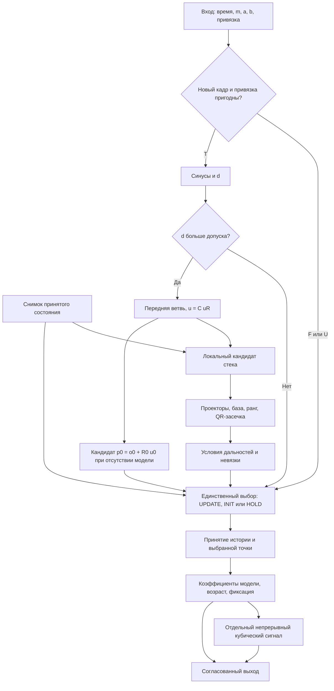
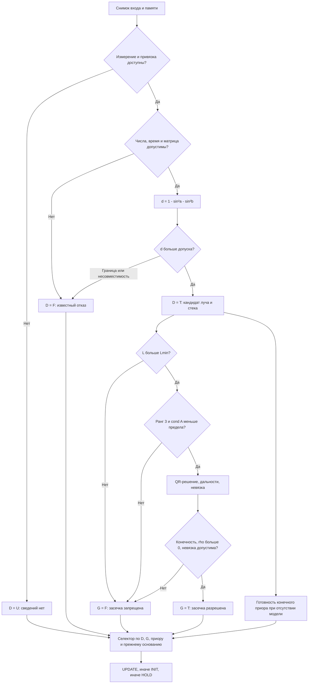
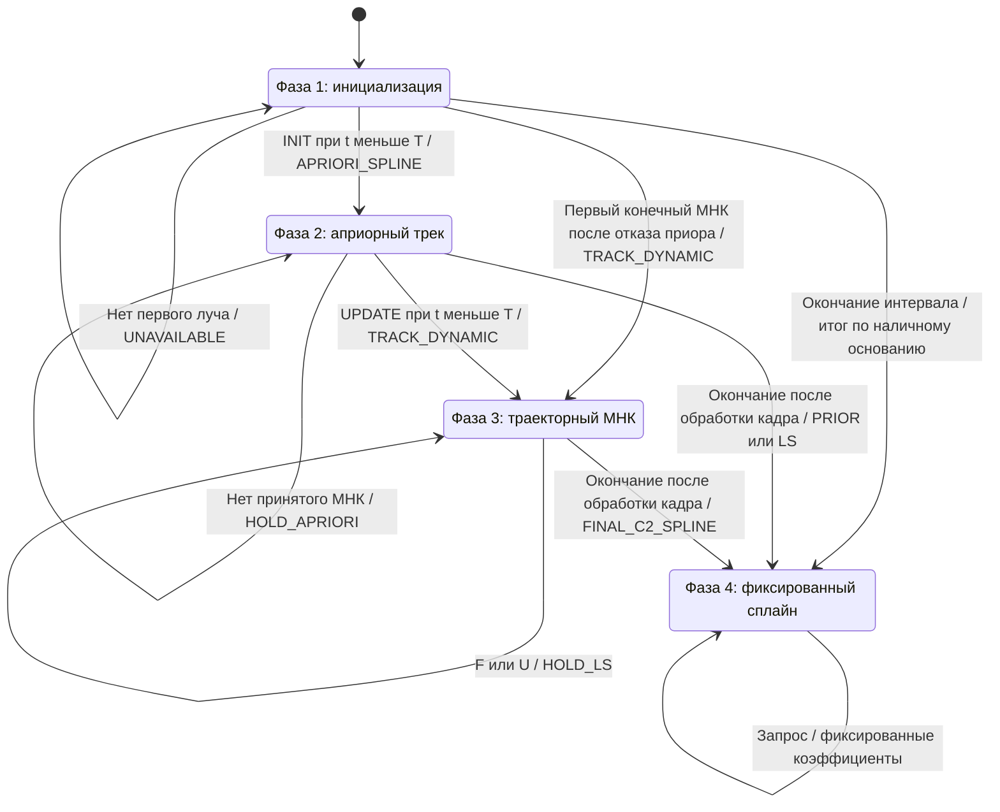

# ВОИ в 3D: углы к плоскостям, МНК-засечка и сплайн неподвижной цели

## 1. Геометрический базис и определение углов

### 1.1. Системы координат — F02

Система приёмника $R$ имеет правый ортонормированный базис $(\mathbf e_x,\mathbf e_y,\mathbf e_z)$. Положительные нормали плоскостей $xz$ и $xy$ равны соответственно $\mathbf e_y$ и $\mathbf e_z$. Принимаемая передняя полусфера открыта:

$$
\|\mathbf u_R\|_2=1,\qquad u_{R,x}>0.
$$

Все точки засечки выражаются в одной декартовой системе $G$, в метрах. Для каждого наблюдения заданы начало луча $\mathbf o_i$ и матрица $C_i$, переводящая компоненты из $R_i$ в $G$:

$$
\mathbf u_i=C_i\mathbf u_{R,i},\qquad
C_i^\mathsf TC_i=I,\qquad \det C_i=1.
$$

Положение и матрица относятся к моменту наблюдения $t_{\mathrm{obs},i}$. Текущие координаты и ориентация не заменяют исторические значения. Если системы совпадают, $C_i=I$.

Криволинейная, замкнутая или пространственная траектория наблюдателя допускается непосредственно: в стек поступает последовательность фактических пар $(\mathbf o_i,C_i)$. Прямолинейность движения, постоянная скорость и постоянный шаг времени не предполагаются.

### 1.2. Три различных вида углов — F02–F03

Для единичного вектора в системе приёмника определены следующие величины.

| Величина | Определение | Область определения |
|---|---|---|
| Знаковый угол $a$ к плоскости $xz$ | $a=\arcsin u_y=\operatorname{atan2}(u_y,\sqrt{u_x^2+u_z^2})$ | $[-\pi/2,\pi/2]$ |
| Знаковый угол $b$ к плоскости $xy$ | $b=\arcsin u_z=\operatorname{atan2}(u_z,\sqrt{u_x^2+u_y^2})$ | $[-\pi/2,\pi/2]$ |
| Угол проекции на $xy$ | $p_{xy}=\operatorname{atan2}(u_y,u_x)$ | Проекция $(u_x,u_y)\ne(0,0)$ |
| Угол проекции на $xz$ | $p_{xz}=\operatorname{atan2}(u_z,u_x)$ | Проекция $(u_x,u_z)\ne(0,0)$ |
| Сферический азимут | $\alpha=\operatorname{atan2}(u_y,u_x)$ | Проекция на $xy$ ненулевая |
| Сферический угол места | $\beta=\operatorname{atan2}(u_z,\sqrt{u_x^2+u_y^2})$ | Для любого единичного направления |

Следовательно, $\beta=b$, но в общем случае $\alpha\ne a$. Угол проекции $p_{xz}$ также не совпадает с $b$. В функции $\operatorname{atan2}(y,x)$ первым аргументом передаётся поперечная компонента, вторым — продольная; порядок определяет правильный квадрант [1].

Для **производных сферических углов** сохраняется формула F03:

$$
\mathbf u=
\begin{bmatrix}
\cos\beta\cos\alpha\\
\cos\beta\sin\alpha\\
\sin\beta
\end{bmatrix}.
$$

В вычислениях используются радианы. Перевод входных чисел из градусов производится один раз:

$$
a=a_{\deg}\frac{\pi}{180},\qquad
b=b_{\deg}\frac{\pi}{180}.
$$

IV квадрант означает $u_x>0,\ u_y<0$ **в проекции на $xy$**. Для пространственного направления дополнительно задаётся знак $u_z$.

### 1.3. Контрпример ошибочной сферической подстановки

Пусть истинные углы к плоскостям $a=b=-30^\circ$. Ошибочное присваивание $\alpha=a,\ \beta=b$ даёт:

$$
\mathbf u_{\mathrm{err}}=
\begin{bmatrix}
\cos b\cos a\\
\cos b\sin a\\
\sin b
\end{bmatrix}
=
\begin{bmatrix}
3/4\\
-\sqrt3/4\\
-1/2
\end{bmatrix}.
$$

При этом:

$$
\|\mathbf u_{\mathrm{err}}\|_2^2
=\frac9{16}+\frac3{16}+\frac14=1.
$$

Однако обратное восстановление первого входного угла даёт:

$$
a_{\mathrm{back}}
=\arcsin\!\left(-\frac{\sqrt3}{4}\right)
=-25.6589062733^\circ\ne-30^\circ.
$$

Второй угол сохраняется: $b_{\mathrm{back}}=-30^\circ$. Единичная норма подтверждает нормировку вектора, но не соответствие исходным угловым каналам.

## 2. Математическое ядро (расчёт направляющего вектора)

### 2.1. Прямое преобразование — F18

Для $a,b\in[-\pi/2,\pi/2]$:

$$
u_y=\sin a,\qquad u_z=\sin b,
$$


$$
d=1-\sin^2a-\sin^2b,
$$


$$
\boxed{
\mathbf u_R=
\begin{bmatrix}
+\sqrt d\\
\sin a\\
\sin b
\end{bmatrix},\qquad d>0.
}
$$

Положительный корень выбирается по условию передней полусферы. Компоненты направления и $d$ безразмерны. Тождество $\|\mathbf u_R\|_2=1$ следует из определения $d$.

В расчёте с double используется численный допуск:

$$
\varepsilon_d=32\varepsilon_{\mathrm{mach}}.
$$

В стек допускается $d>\varepsilon_d$. При $|d|\le\varepsilon_d$ возвращается граничный исход; при $d<-\varepsilon_d$ — несовместимость углов. Этот допуск относится к округлению вычислений, а не к неопределённости измерения. Замена произвольного отрицательного $d$ нулём запрещена.

### 2.2. Обратное преобразование

После восстановления вектора:

$$
a_{\mathrm{back}}
=\operatorname{atan2}\!\left(u_y,\sqrt{u_x^2+u_z^2}\right),
$$


$$
b_{\mathrm{back}}
=\operatorname{atan2}\!\left(u_z,\sqrt{u_x^2+u_y^2}\right).
$$

Независимый контроль использует $\arcsin u_y$ и $\arcsin u_z$. Для совместимого входа обе записи возвращают исходные $a,b$.

После перехода в общую систему $\mathbf u=C\mathbf u_R$ вычисляются её сферические углы:

$$
\alpha_G=\operatorname{atan2}(u_y,u_x),\qquad
\beta_G=\operatorname{atan2}\!\left(u_z,\sqrt{u_x^2+u_y^2}\right).
$$

Представление $\alpha_G$ в $[0,2\pi)$ требуется только для вывода. Векторный МНК не использует разрыв азимута на границе шкалы. При сравнении азимутов сохраняется F16:

$$
\delta_\alpha=
\operatorname{atan2}\!\left(
\sin(\alpha_2-\alpha_1),\cos(\alpha_2-\alpha_1)
\right).
$$

Для полуоборота результат $-\pi$ явно заменяется на $+\pi$; на вертикали сравнение азимутов не характеризует различие направлений. Эта операция относится к диагностике углов и не входит в векторную засечку.

### 2.3. Луч и конкретная модель наблюдения — F04, F06–F07

Каждое принятое наблюдение задаёт направленный луч:

$$
\mathbf X=\mathbf o_i+\rho_i\mathbf u_i,\qquad \rho_i>0.
$$

Одна пара углов не определяет $\rho_i$. Для принятой модели неподвижной цели $\mathbf X(t)=\mathbf X_*$ идеальный вход имеет вид:

$$
\mathbf v_{R,i}
=C_i^\mathsf T
\frac{\mathbf X_*-\mathbf o_i}{\|\mathbf X_*-\mathbf o_i\|_2},
$$


$$
a_i=\arcsin(v_{R,i,y}),\qquad
b_i=\arcsin(v_{R,i,z}),\qquad v_{R,i,x}>0.
$$

Погрешности углов изменяют лучи. Без заданной статистической модели нельзя объявлять геометрический МНК несмещённым, вычислять достоверную ковариацию или назначать вероятность правильной засечки.

## 3. Таблица вычислительного конвейера ВОИ

### 3.1. Вход, память и выход — F01, F05

Вызов получает текущее время $t_{\mathrm{cur},k}$, признак $m_k$ и, при $m_k=1$, наблюдение:

$$
z_k=
\left(t_{\mathrm{obs},k},a_k,b_k,\mathbf o_k,C_k,n_k\right).
$$

Здесь $n_k\in\{T,F,U\}$ означает наличие пригодной координатной привязки, известную ошибку или отсутствие сведений. В программном интерфейсе этим значениям соответствуют `nav_status=1`, `0`, `-1`. Отсутствующий `nav_status` означает U. При `nav_status=1` отсутствующая или некорректная матрица либо координата является известной ошибкой F. При $m_k=0$ углы и привязка не читаются. Пара $a=b=0$ является измерением.

В памяти хранятся только принятые реальные лучи:

$$
M_k=\{(t_{\mathrm{obs},i},\mathbf o_i,\mathbf u_i)\}.
$$

Ограниченная ёмкость задаётся явно. После заполнения вытесняется старейшая **по порядку приёма** запись; условие МНК пересчитывается по оставшимся лучам. Удаление истории не сбрасывает последнюю принятую модель цели. Повтор одного наблюдения не является новым независимым лучом. Точное совпадение `t_obs` с сохранённой записью отклоняется. После вытеснения записи эта локальная проверка её уже не обнаруживает: уникальность доставки за пределами буфера обеспечивает источник данных.

Параметры: $R_0>0$, $L_{\min}\ge0$, $\gamma_{\max}>1$, ёмкость стека, $t_0=0$, $T=240$ с. Дополнительные пределы возраста $\Delta_{\max}$ и поперечной невязки $r_{\max}$ задаются явно; отсутствие ограничения записывается как $+\infty$.

Для общего программного интерфейса допустимы иные конечные $t_0<T$, если разности $T-t_0$ и $t_{\mathrm{cur}}-t_0$ представимы конечными числами double. Это исключает переполнение возраста при формально конечных временных метках. Невозможность выделить заданный буфер является ошибкой инициализации, а не успешным тактом с частично созданным состоянием.

Выход содержит:

$$
Y_k=(S_k,\widehat{\mathbf X}_k,q_k,
\mathrm{basis}_k,\mathrm{status}_k,
t_{\mathrm{support},k},\Delta_k).
$$

Основание результата $\mathrm{basis}$ принимает значения NONE, PRIOR или LS. Наличие конечного априорного выхода не означает измеренную дальность. Фаза $q_k$, основание и диагностический статус имеют разные значения.

Отдельный выход $\widetilde S(t)$ — непрерывный кубический сигнал коррекции координат по §6.6. Он приближается к принятой $\widehat{\mathbf X}_k$, но не обозначает движение неподвижной цели. Его время окончания перехода и производные не смешиваются с моментом фиксации модели цели.


### 3.1.1. Подготовленные углы и происхождение результата — F22–F26

Исходный контракт фаз 1–4 остаётся допустимым для **готовых числовых углов**. При отсутствии статистической модели это равноточная *геометрическая* засечка, а не статистически оптимальный комплексный оцениватель. Если измерения предварительно сглаживаются или очищаются от мешающей составляющей, их происхождение должно оставаться доступно вызывающему коду: идентификаторы сырых отсчётов, фактические метки времени, окно, выбранный базис, значение функционала и ковариация (если она действительно задана).

В обзоре ТИС (§1.8.2) рассмотрены две различные организации входа: прямые **асинхронные** лучи на собственных `t_obs` и предварительно **синхронизированные** углы на общем `t_*`. В первой из них для неподвижной цели не требуется переводить все лучи на один момент. Во второй подготовленные углы должны сопровождаться согласованной навигацией **на тот же** `t_*`; время получения сообщения этого условия не заменяет. Повторно использовать те же сырые наблюдения как новые независимые данные нельзя.

Самостоятельный линейный подготовитель [voi_oino_linear.m](../matlab/function/voi_oino_linear.m) и контракт [voi_oino_theory.md](../docs/voi_oino_theory.md) добавлены как **необязательная внешняя стадия**. Автоматически подставлять его выход в статистически невзвешенный `voi_position` нельзя: последний не использует возвращаемую ковариацию и не учитывает корреляции перекрывающихся окон. Полный статистический тракт здесь **не заявлен реализованным**. При `t=0` нет оснований утверждать, что многоточечное сглаживание уже было выполнено; первый сплайн формируется только из реального луча и явно помеченного приора `R0`.

### 3.2. Сквозная последовательность

| Шаг | Входные данные | Математическая операция / Формула | Условие применимости | Выходные данные | Следующий потребитель |
|---|---|---|---|---|---|
| 1 | Параметры, память, $t_{\mathrm{cur},k}$ | Сопоставить конфигурацию с сохранённой; проверить конечность временных разностей; до фиксации потребовать строго возрастающее время | Первый вызов либо согласованный контекст; после фиксации разрешено $t_{\mathrm{cur}}\ge t_{\mathrm{last}}$ | Снимок состояния; при ошибке исходная память сохраняется | Шаг 2 |
| 2 | Признак завершения | Если интервал уже закрыт, вернуть фиксированные коэффициенты и возраст на время запроса | Фаза 4 | Итоговая модель без новой записи | Потребитель |
| 3 | $m_k$ | При $m_k=0$: $M^*=M_{k-1}$, $D=U$; пропустить тригонометрию и засечку | Каждый незавершённый такт | Ветвь пропуска | Шаги 13–15 |
| 4 | $a_k,b_k,t_{\mathrm{obs},k},n_k$ | Проверить конечность, диапазоны, $t_0\le t_{\mathrm{obs},k}\le\min(t_{\mathrm{cur},k},T)$; различить $n_k=F$ и $n_k=U$ | $m_k=1$ | Допустимые числа либо $D=F/U$ с причиной | Шаг 5 либо 13 |
| 5 | $a_k,b_k$ | $u_y=\sin a_k,\ u_z=\sin b_k,\ d=1-u_y^2-u_z^2$ | Допустимые углы | $u_y,u_z,d$ | Шаг 6 |
| 6 | $d$, передняя полусфера | При $d>\varepsilon_d$: $u_x=+\sqrt d$; иначе отбраковать вход для открытой полусферы | Определённая ветвь | $\mathbf u_R$ либо известный отказ | Шаг 7 либо 13 |
| 7 | $\mathbf o_k,C_k,\mathbf u_R$ | Проверить $C_k^\mathsf TC_k\approx I,\det C_k\approx1$; $\mathbf u_k=C_k\mathbf u_R$ | Привязка на $t_{\mathrm{obs},k}$ пригодна | Луч в общей системе; $D=T$ | Шаг 8 |
| 8 | Луч, предыдущий стек | Добавить фактическую запись в локальную копию стека; применить ограничение ёмкости | Новое допустимое наблюдение | Кандидат $M^*$ | Шаги 9–10 |
| 9 | Первый луч, $R_0$ | $\mathbf p_0=\mathbf o_0+R_0\mathbf u_0$; проверить конечность и $\mathbf u_0^\mathsf T(\mathbf p_0-\mathbf o_0)>0$ | Принятой модели ещё нет; представимый кандидат допускает INIT | Априорная точка либо численный отказ | Шаг 13 |
| 10 | $M^*$ | $P_i=I-\mathbf u_i\mathbf u_i^\mathsf T$; $L=\max_{i,j}\|\mathbf o_i-\mathbf o_j\|$; собрать центрированную систему §6.1 | Хотя бы один луч | $L,H,\mathbf y,A=H^\mathsf TH$ | Шаг 11 |
| 11 | $L,H$ | Вычислить сингулярные числа $H$; $\kappa_2(A)=(\sigma_{\max}/\sigma_{\min})^2$ | При $\sigma_{\min}\le\varepsilon_{\mathrm{rank}}$ назначить $+\infty$; допуск задан в §6.2 | Численный ранг и обусловленность | Шаг 12 либо 13 |
| 12 | Полноранговая система | Решить $H\boldsymbol\xi\approx\mathbf y$ через QR; $\widehat{\mathbf X}=\mathbf o_{\mathrm{ref}}+\boldsymbol\xi$; вычислить $\rho_i,r_{\mathrm{rms}}$ | $L>L_{\min}$, $\kappa_2(A)<\gamma_{\max}$ | Кандидат МНК; $G=T$ только при конечности, $\rho_i>0$, $r_{\mathrm{rms}}\le r_{\max}$ | Шаг 13 |
| 13 | Фаза, $D,G$, кандидаты | Выбрать INIT, UPDATE или HOLD по §5.3; решение не изменяет память | Каждый такт | Единственное действие | Шаг 14 |
| 14 | Выбранное действие | INIT: принять $\mathbf p_0$; UPDATE: принять $\widehat{\mathbf X}$; HOLD: сохранить точку и коэффициенты; сформировать $S_k$ по §6.4 | У действия имеются требуемые числа | Кандидат состояния и выхода | Шаг 15 |
| 15 | $t_{\mathrm{cur},k}$, кандидат выхода | После обработки входа при $t_{\mathrm{cur},k}\ge T$ зафиксировать модель; вычислить возраст; однократно опубликовать согласованные память и выход оценщика | Корректный вызов | $M_k,Y_k$, фактический результат такта | Следующий такт и шаг 16 |
| 16 | Новая принятая точка либо признак её отсутствия; прежний сигнал; $H_c>0$ | При новой точке взять текущие $\widetilde S,\widetilde S',\widetilde S''$ и решить систему §6.6; без новой точки сохранить коэффициенты и вычислить сигнал на текущее время | Первый конечный приор или готовый контекст коррекции | Три кубических участка либо постоянное удержание; отдельный статус | Числовой потребитель |

Ошибка новой записи не уничтожает прежнюю историю. Недостаточная геометрия принятого луча запрещает новую засечку, но допускает накопление этого луча для следующих тактов.

## 4. Четырёхфазная логика динамического сплайн-генератора

### 4.1. Фаза 1 — инициализация

При $t=0$ вычислить первый допустимый луч и записать его в стек. В этом же вызове выполнить фазу 2 и выдать коэффициенты начального сплайна. Промежуточный результат «инициализация завершена, сплайна нет» потребителю не публикуется.

Гарантия первого выхода требует первого допустимого луча, его координатной привязки, $R_0$, конечного результата $\mathbf o_0+R_0\mathbf u_0$ и положительного представимого смещения вдоль луча. Если луча или привязки нет, одно число $R_0$ не определяет точку в пространстве: результат UNAVAILABLE, фаза 1 сохраняется до допустимого входа или окончания интервала. При переполнении суммы либо её округлении точно в начало луча запись может быть накоплена, но непригодный приор не публикуется.

### 4.2. Фаза 2 — априорный трек

Первый луч задаёт опорную гипотезу:

$$
\mathbf p_0=\mathbf o_0+R_0\mathbf u_0,\qquad
S_0(\tau)\equiv\mathbf p_0,\quad \tau\in[t_0,T].
$$

Сигнал коррекции инициализируется в том же такте: $\widetilde S(t)\equiv\mathbf p_0$. Его начальные первая и вторая производные равны нулю.

Используются именно $\mathbf o_0,\mathbf u_0$. Подстановка текущих $\mathbf o_k,\mathbf u_k$ при неизменном $R_0$ перемещала бы гипотетическую цель вслед за наблюдателем.

При $L\le L_{\min}$ сохраняется априорная модель. Она сохраняется также при большой базе, если лучи вырождены, плохо обусловлены или направленные дальности кандидата неположительны.

### 4.3. Фаза 3 — траекторный МНК

Каждый новый допустимый луч дополняет историю. Засечка использует её геометрию, независимо от формы пути наблюдателя. При принятом решении:

$$
\mathbf p_k=\widehat{\mathbf X}_{\mathrm{LS},k},\qquad
S_k(\tau)\equiv\mathbf p_k.
$$

Динамическим является пересчёт координат по новым данным. Для неподвижной цели пространственно постоянная функция — согласованная траекторная модель. Изменение оценки по индексу $k$ не является скоростью цели по параметру $\tau$.

Смысл «стягивания» задаётся функционалом текущей истории:

$$
J_k(\widehat{\mathbf X}_{\mathrm{LS},k})
\le J_k(\mathbf p_{k-1}).
$$

Неравенство следует из минимизации §6.1. При шуме оно не гарантирует монотонного уменьшения расстояния до неизвестной истинной точки.

После принятия новой точки отдельный сигнал $\widetilde S$ перепланируется с сохранением текущих значения и двух производных. При пропуске или отказе нового решения сохраняются последняя МНК-точка, её модельные коэффициенты и фаза 3; уже построенный переход коррекции продолжается. Возврата к первоначальной гипотезе $R_0$ нет.

### 4.4. Фаза 4 — сглаженный сплайн и фиксация

На такте $t=240$ с сначала обработать допустимое последнее наблюдение, затем зафиксировать последнюю принятую модель:

$$
S_{\mathrm{final}}(\tau)\equiv\mathbf p_{\mathrm{final}},\qquad
S_{\mathrm{final}}'(t_0)=S_{\mathrm{final}}'(T)=\mathbf0.
$$

При основании LS выдаётся FINAL_C2_SPLINE. Если МНК не был принят, фиксируется FINAL_APRIORI; при отсутствии исходной точки — FINAL_UNAVAILABLE. Само наступление срока не создаёт дальность.

Если вызов точно в $T$ отсутствует, фиксация выполняется при первом $t_{\mathrm{cur}}\ge T$. В выходе сохраняются модельный конец $T$ и фактический момент фиксации; поздний вызов не обозначается как выполненный в прошлом.

Фиксация модели цели и завершение непрерывной коррекции различаются. Если последний кадр изменил точку в момент $t_f$, сигнал $\widetilde S$ достигает её к $t_f+H_c$, после чего становится постоянным. При $t_f=T=240$ это не позже $240+H_c$. В 240 с фиксируется стационарная модель с условиями Клэмпа на $[0,240]$; для сигнала коррекции нулевые производные гарантируются в конце его фактического перехода. Подмена этих двух времён нарушала бы причинность.

### 4.5. Таблица переходов — F09

| Текущая фаза | Входное событие | Проверяемое предусловие | Выполняемая операция | Условие перехода | Следующая фаза | Статус / Результат |
|---|---|---|---|---|---|---|
| 1 | Первый пригодный кадр | $D=T$, модели нет, $t<T$ | Записать луч; вычислить $\mathbf p_0$; сформировать четыре коэффициента | Инициализация выполнена | 2 | APRIORI_SPLINE в том же такте |
| 1 | Пропуск или отказ привязки | Нет полного первого луча, $t<T$ | Сохранить пустую модель | Нет допустимой инициализации | 1 | UNAVAILABLE; причина F или U |
| 1 | Первый конечный МНК после численного отказа приора | В стеке накоплены пригодные лучи, $D=G=T,\ t<T$ | Принять МНК-точку напрямую | Появилась конечная наблюдаемая модель | 3 | TRACK_DYNAMIC |
| 2 | Новый пригодный луч | $D=T,\ G\ne T,\ t<T$ | Принять допустимый луч; сохранить $\mathbf p_0$ | МНК пока непригоден | 2 | HOLD_APRIORI |
| 2 | Пропуск или непригодный вход | $D\ne T,\ t<T$ | Сохранить стек и априорные коэффициенты | Нового основания нет | 2 | HOLD_APRIORI |
| 2 | Принятая МНК-засечка | $D=T,\ G=T,\ t<T$ | Принять $\widehat{\mathbf X}_{\mathrm{LS}}$ и коэффициенты | Выполнены все условия принятия | 3 | TRACK_DYNAMIC |
| 3 | Принятая новая засечка | $D=T,\ G=T,\ t<T$ | Обновить координаты и коэффициенты | Результат принят | 3 | TRACK_DYNAMIC |
| 3 | Пропуск, плохая привязка или отказ МНК | $D\ne T$ либо $G\ne T$, $t<T$ | Сохранить последнюю принятую МНК-модель | Обновление запрещено | 3 | HOLD_LS |
| 1, 2 или 3 | Окончание интервала | $t_{\mathrm{cur}}\ge T$ | Сначала обработать допустимый кадр с $t_{\mathrm{obs}}\le T$, затем зафиксировать основание и коэффициенты | Финализация выполнена | 4 | FINAL_C2_SPLINE, FINAL_APRIORI или FINAL_UNAVAILABLE |
| 4 | Последующий запрос | Интервал закрыт | Вернуть фиксированные коэффициенты; вычислить возраст на время запроса | Новая сессия не начата | 4 | Сохранённый итоговый статус |

## 5. Граничные случаи, ошибки и матрица решений T/F/U

### 5.1. Геометрические исходы

| Условие | Математический результат | Действие |
|---|---|---|
| $d>0$, передняя полусфера известна | Единственный $(+\sqrt d,\sin a,\sin b)$ | При численно разрешённой границе допустить луч |
| $d>0$, полусфера неизвестна | Два направления $(\pm\sqrt d,\sin a,\sin b)$ | Геометрический вывод U; до вызова текущего интерфейса требуется определить ветвь |
| $d=0$ | Направление $(0,\sin a,\sin b)$ существует на границе | Геометрия определена, но открытая полусфера $u_x>0$ исключает запись |
| $d<0$ | Вещественного единичного направления с этими компонентами нет | F; новый кадр не записывать |
| $(u_x,u_y)=(0,0)$ | Направление вертикально; азимут не определён | Хранить вектор; не приписывать азимуту геометрический смысл |

Неизвестная полусфера отличается от известной ошибки. Поддержка двух гипотез потребовала бы двух отдельных историй. В текущем интерфейсе нет поля выбора полусферы: передняя ветвь является обязательным входным соглашением. Функция не обнаруживает отсутствие этого внешнего знания автоматически.

На границе $a=b=-45^\circ$:

$$
\mathbf u=(0,-1/\sqrt2,-1/\sqrt2)^\mathsf T,\qquad
\alpha=-90^\circ,\qquad \beta=-45^\circ.
$$

Азимут в этой точке **определён**. Плохо обусловлено восстановление по паре исходных углов при приближении к границе:

$$
\frac{\partial u_x}{\partial a}
=-\frac{\sin a\cos a}{\sqrt d},\qquad
\frac{\partial u_x}{\partial b}
=-\frac{\sin b\cos b}{\sqrt d},
$$


$$
\frac{\partial\alpha}{\partial a}
=\frac{\cos a}{\sqrt d}.
$$

При $d\to0+$ эти производные могут неограниченно расти. Это не равнозначно неопределённости atan2 на всей границе.

При $a=b=-60^\circ$:

$$
d=1-\frac34-\frac34=-\frac12<0.
$$

Отказ известен, поэтому исход F, а не U.

### 5.2. Возраст данных и временная привязка — F05, F08

Для публикуемой модели:

$$
\Delta_k=t_{\mathrm{cur},k}-t_{\mathrm{support},k}.
$$

Для априорной модели $t_{\mathrm{support}}$ — время первого луча. Для принятого МНК — максимальное время наблюдения среди лучей, использованных именно в этой принятой засечке. Отдельно хранится максимальное время принятого в стек наблюдения. Новая запись без успешного обновления модели не делает прежнюю модель более свежей.

Если $t_{\mathrm{obs}}=180$ с, а $t_{\mathrm{cur}}=240$ с:

$$
\Delta=60\ \text{с}.
$$

Луч строится из $\mathbf o(180)$ и $C(180)$. Для неподвижной цели задержка сама по себе не делает геометрическое уравнение неверным. Порог свежести задаётся отдельно:

$$
\mathrm{fresh}=(\Delta\le\Delta_{\max}).
$$

При $\Delta_{\max}=30$ с результат несвежий; при 60 с — ещё свежий по принятому включению границы; при $+\infty$ возраст не ограничивает выдачу. Признак свежести не является оценкой точности. Позднее наблюдение с известной исторической привязкой допускается; отсутствующая привязка не восстанавливается из текущего положения.

### 5.3. Детерминированная матрица конкурирующих действий

Определим:

- $D=T$: имеется новое допустимое наблюдение с полной привязкой; $D=F$: известное нарушение; $D=U$: наблюдение или необходимые сведения отсутствуют.
- $G=T$: кандидат МНК удовлетворяет всем условиям принятия; $G=F$: известно, какое условие нарушено; $G=U$: необходимые вычисления недоступны.

Разрешение обновления:

$$
g_{\mathrm{LS}}=D\land G.
$$

Применяется трёхзначная конъюнкция: F доминирует, $T\land T=T$, оставшиеся сочетания с U дают U.

| $D\backslash G$ | T | F | U |
|---|---|---|---|
| **T** | П1: принять МНК | П2: сохранить модель | П2: сохранить модель |
| **F** | П2: сохранить модель | П2: сохранить модель | П2: сохранить модель |
| **U** | П2: сохранить модель | П2: сохранить модель | П2: сохранить модель |

П1 — UPDATE. П2 — HOLD: до первой засечки сохраняется PRIOR, после неё — LS. Если сохранённой модели нет, результат UNAVAILABLE. Инициализация полного первого луча выполняется отдельным правилом INIT.

Правило удержания использует проверку $g_{\mathrm{LS}}\ne T$, а не трёхзначное отрицание: $\neg U=U$. Поэтому пропуск не оставляет выбор действия неопределённым. Одновременно разрешённых UPDATE и HOLD нет.

| Ситуация | $D$ | Основание отказа обновления | Результат |
|---|---|---|---|
| $m_k=0$ | U | Нет нового измерения | Сохранить точку, коэффициенты и стек |
| Привязка не поступила | U | Неизвестны $\mathbf o_i$ или $C_i$ на $t_{\mathrm{obs},i}$ | Сохранить прежний результат |
| Привязка помечена ошибочной | F | Известная непригодность | Новый луч не записывать |
| $d<-\varepsilon_d$ | F | Несовместимые углы | Новый луч не записывать |
| $L>L_{\min}$, но $\kappa_2(A)\ge\gamma_{\max}$ | T | $G=F$, плохая геометрия | Допустимый луч накопить; прежнюю модель сохранить |
| МНК дал $\rho_i\le0$ | T | $G=F$, решение не принадлежит направлениям лучей | Координаты кандидата не публиковать |

### 5.4. Криволинейный путь и потеря наблюдаемости

База определяется по принятым точкам наблюдения:

$$
L=\max_{i,j\in M_k}\|\mathbf o_i-\mathbf o_j\|_2.
$$

Расстояние $\|\mathbf o_k-\mathbf o_0\|$, пройденный путь и длина дуги не заменяют $L$. После полного оборота текущая точка может совпасть с исходной, хотя в стеке остаются сильные пространственные ограничения.

Обратный случай: большие смещения вдоль одной линии визирования могут оставить все направления параллельными. Тогда дальность не восстанавливается независимо от длины пути. После вытеснения старых лучей из ограниченного стека наблюдаемость может ухудшиться; это запрещает очередное обновление, но не отменяет уже принятую модель.

## 6. Триангуляция и построение пространственного сплайна

### 6.1. Проекторный МНК — F19

Для единичного $\mathbf u_i$:

$$
P_i=I-\mathbf u_i\mathbf u_i^\mathsf T,\qquad
P_i^\mathsf T=P_i,\qquad P_i^2=P_i.
$$

В вычислительном интерфейсе сначала проверяется $\lvert\|\mathbf u_i\|_2-1\rvert\le10^{-10}$, затем устраняется только эта допустимая ошибка округления: $\mathbf u_i\gets\mathbf u_i/\|\mathbf u_i\|_2$. Иначе небольшое отклонение нормы могло бы создать ложный численный ранг у параллельных направлений. Такая операция не исправляет несовместимую пару углов или заведомо неединичный вход.

Функционал равноточной геометрической засечки:

$$
J(\mathbf X)=\sum_{i=1}^{n}
\|P_i(\mathbf X-\mathbf o_i)\|_2^2.
$$

Условие стационарности:

$$
\nabla J(\mathbf X)
=2\sum_iP_i(\mathbf X-\mathbf o_i)=\mathbf0,
$$


$$
\boxed{
A\widehat{\mathbf X}=\mathbf c,\qquad
A=\sum_iP_i,\qquad
\mathbf c=\sum_iP_i\mathbf o_i.
}
$$

$A$ безразмерна, $\mathbf c$ измеряется в метрах, $J$ — в квадратных метрах. Равные веса являются выбранным критерием; они не утверждают независимость и равную дисперсию действительных угловых ошибок.

Для численного решения применяется центрирование:

$$
\mathbf o_{\mathrm{ref}}=\frac1n\sum_i\mathbf o_i,\qquad
\boldsymbol\xi=\mathbf X-\mathbf o_{\mathrm{ref}},
$$

При вычислении среднего используется эквивалентная центрированная запись

$$
\mathbf o_{\mathrm{ref}}
=\mathbf o_1+\frac1n\sum_i(\mathbf o_i-\mathbf o_1),
$$

чтобы не суммировать большие общие координатные смещения напрямую. Если даже разности не представимы конечными числами, возвращается численный отказ.

$$
H=
\begin{bmatrix}
P_1\\ \vdots\\ P_n
\end{bmatrix},\qquad
\mathbf y=
\begin{bmatrix}
P_1(\mathbf o_1-\mathbf o_{\mathrm{ref}})\\
\vdots\\
P_n(\mathbf o_n-\mathbf o_{\mathrm{ref}})
\end{bmatrix}.
$$

Решается исходная задача $\min_{\boldsymbol\xi}\|H\boldsymbol\xi-\mathbf y\|_2^2$ через экономное QR-разложение $H=QR$:

$$
R\boldsymbol\xi=Q^\mathsf T\mathbf y.
$$

В реализации явно вызывается `qr(H,0)`, затем решается треугольная система; свойства такого разложения описаны в [5]. После решения прибавляется $\mathbf o_{\mathrm{ref}}$. Явная обратная матрица не вычисляется. Сингулярные числа используются для диагностики ранга и обусловленности; усечённое решение при потере ранга не подменяет априорную гипотезу. Связь ранга с сингулярными числами и решение задачи МНК описаны в [2].

### 6.2. Разрешимость, направленные дальности и невязка

Для любого $\mathbf v$:

$$
\mathbf v^\mathsf TA\mathbf v
=\sum_i\|P_i\mathbf v\|_2^2,\qquad
\ker A=\bigcap_i\operatorname{span}(\mathbf u_i).
$$

Следовательно, $A$ положительно определена тогда и только тогда, когда направления не все параллельны одной прямой. Это условие не эквивалентно ненулевой базе: координаты $\mathbf o_i$ вообще не входят в $A$.

Для полноранговой системы:

$$
\kappa_2(A)=\frac{\lambda_{\max}(A)}{\lambda_{\min}(A)}
=\left(\frac{\sigma_{\max}(H)}{\sigma_{\min}(H)}\right)^2.
$$

В double численный ранг проверяется по порогу

$$
\varepsilon_{\mathrm{rank}}
=\max(3n,3)\operatorname{eps}(\sigma_{\max}(H)).
$$

Здесь $\operatorname{eps}(x)$ — шаг представимых чисел около $x$. При $\sigma_{\min}\le\varepsilon_{\mathrm{rank}}$ система считается численно вырожденной, а диагностическая обусловленность равна $+\infty$. Для принятия требуется строгое $\kappa_2(A)<\gamma_{\max}$; равенство предельному значению отклоняется.

Вычислять только $\det A\ne0$ недостаточно: почти вырожденная система может иметь ненулевой определитель.

Проекторы минимизируют расстояния до **прямых**, содержащих лучи. Для принятия направленной засечки дополнительно требуются:

$$
\rho_i=\mathbf u_i^\mathsf T
(\widehat{\mathbf X}-\mathbf o_i)>0
\quad\text{для всех сохранённых лучей},
$$


$$
r_{\mathrm{rms}}=
\sqrt{\frac1n\sum_i
\|P_i(\widehat{\mathbf X}-\mathbf o_i)\|_2^2}
\le r_{\max}.
$$

Дальности и невязка вычисляются от фактически возвращаемой глобальной точки $\widehat{\mathbf X}$, после округления при прибавлении $\mathbf o_{\mathrm{ref}}$. Проверка только внутреннего центрированного решения могла бы скрыть потерю точности выходных координат.

Если $\rho_i\le0$, текущий профиль отвергает кандидата. Минимизация расстояний непосредственно до полулучей была бы иной задачей:

$$
\min_{\mathbf X,\ \rho_i\ge0}
\sum_i\|\mathbf X-\mathbf o_i-\rho_i\mathbf u_i\|_2^2.
$$

Она не выполняется скрыто вместо объявленного МНК.

Положительная определённость, приемлемая обусловленность и малая невязка подтверждают согласованность с выбранными данными. Они не исключают согласованных ошибок координат или принадлежности наблюдений.

### 6.3. Общая кубическая запись и условия склейки — F10–F12

На узлах $\tau_0<\cdots<\tau_N$:

$$
S_j(\tau)=
\mathbf a_{j0}
+\mathbf a_{j1}(\tau-\tau_j)
+\mathbf a_{j2}(\tau-\tau_j)^2
+\mathbf a_{j3}(\tau-\tau_j)^3.
$$

Здесь $S_j\in\mathbb R^3$, $\tau$ — секунды, коэффициент $\mathbf a_{jr}$ имеет единицу $\mathrm{м}/\mathrm{с}^r$. Степень каждого участка не превышает трёх; постоянный участок допустим.

Для класса $C^2$ во внутренних узлах:

$$
S_{j-1}^{(r)}(\tau_j)=S_j^{(r)}(\tau_j),
\qquad r=0,1,2.
$$

Это условия геометрической склейки **выбранного представления**. Они не выводятся из наблюдения двух углов. Значения в узлах и два краевых условия задаются отдельно. Определение кусочно-кубической $C^2$-интерполяции и clamped-условий соответствует [3].

Для узловых значений $\mathbf q_j$, $h_j=\tau_{j+1}-\tau_j>0$ и вторых производных $\mathbf M_j=S''(\tau_j)$:

$$
h_{j-1}\mathbf M_{j-1}
+2(h_{j-1}+h_j)\mathbf M_j
+h_j\mathbf M_{j+1}
=
6\left(
\frac{\mathbf q_{j+1}-\mathbf q_j}{h_j}
-\frac{\mathbf q_j-\mathbf q_{j-1}}{h_{j-1}}
\right).
$$

При $S'(\tau_0)=S'(\tau_N)=\mathbf0$ крайние уравнения:

$$
2h_0\mathbf M_0+h_0\mathbf M_1
=6\frac{\mathbf q_1-\mathbf q_0}{h_0},
$$


$$
h_{N-1}\mathbf M_{N-1}+2h_{N-1}\mathbf M_N
=-6\frac{\mathbf q_N-\mathbf q_{N-1}}{h_{N-1}}.
$$

Коэффициенты восстанавливаются непосредственно:

$$
\begin{aligned}
\mathbf a_{j0}&=\mathbf q_j,\\
\mathbf a_{j1}&=
\frac{\mathbf q_{j+1}-\mathbf q_j}{h_j}
-\frac{h_j}{6}(2\mathbf M_j+\mathbf M_{j+1}),\\
\mathbf a_{j2}&=\frac12\mathbf M_j,\\
\mathbf a_{j3}&=\frac{\mathbf M_{j+1}-\mathbf M_j}{6h_j}.
\end{aligned}
$$

Для одного участка достаточно двух разных временных узлов и двух краевых условий. Требование четырёх успешных МНК-точек для существования кубического сплайна отсутствует.

### 6.4. Однозначный профиль неподвижной цели — F20

Гипотеза неподвижности сильнее нулевых производных только на концах: она задаёт $S'(\tau)\equiv\mathbf0$ на всём интервале. Поэтому для каждого такта:

$$
\mathbf p_k=
\begin{cases}
\mathbf o_0+R_0\mathbf u_0,&\text{при инициализации},\\
\widehat{\mathbf X}_{\mathrm{LS},k},&\text{при принятом обновлении},\\
\mathbf p_{k-1},&\text{при удержании},
\end{cases}
$$


$$
\boxed{
S_k(\tau)=\mathbf p_k
+0(\tau-t_0)+0(\tau-t_0)^2+0(\tau-t_0)^3.
}
$$

Два модельных узла $(t_0,\mathbf p_k)$ и $(T,\mathbf p_k)$ задаются уже на первом такте. Это граничные значения модели, а не два измерения. $T-t_0=240>0$; деления на время $t_{\mathrm{cur}}-t_0$, базу $L$ или ранг одноракурсной системы нет.

Один луч даёт $\operatorname{rank}P_0=2$. Априорная дальность выбирает точку на его неразличимом направлении, но не делает исходную засечку наблюдаемой. Априорная точка не добавляется в МНК как независимое наблюдение.

### 6.5. Что означают сглаживание и краевые условия

Нулевые краевые производные сами по себе не запрещают выбросы между узлами. Например, clamped-сплайн через скалярные точки

$$
(0,0),\ (1,1),\ (2,1),\ (3,0)
$$

имеет $S(1.5)=1.25$. Возможность выбросов у кубической интерполяции отмечена также в [4].

В текущем профиле итоговая постоянная модель удовлетворяет $C^2$ и обоим условиям Клэмпа непосредственно. МНК сглаживает несовпадающие пространственные ограничения по заданному квадратичному критерию; отдельная динамика движения цели не вводится.

Гладкость каждой версии $S_k(\tau)$ не означает гладкости изменения опубликованной точки между тактами. Непрерывное $C^2$-стягивание отдельного выходного сигнала требует дополнительных условий:

$$
\widetilde S_k^{(r)}(t_{\mathrm{cur},k})
=\widetilde S_{k-1}^{(r)}(t_{\mathrm{cur},k}),\qquad r=0,1,2,
$$

а также длительности перехода. Произвольное мгновенное принятие новой точки в момент $T$ несовместимо с одновременным требованием непрерывности в этом же моменте. Следующий подраздел задаёт этот дополнительный вычислительный контракт явно.

### 6.6. Непрерывный кубический сигнал коррекции — F21

Пусть $H_c>0$ — явно заданная длительность перехода, $h=H_c/3$. При новой принятой точке $\mathbf p_*$ в момент $t_k$ из прежнего сигнала вычисляются

$$
\mathbf r=\widetilde S(t_k),\qquad
\mathbf v=\widetilde S'(t_k),\qquad
\mathbf a=\widetilde S''(t_k).
$$

Это значение и производные математического сигнала координат, а не параметры движения цели. Новое продолжение удовлетворяет шести условиям по каждой координате:

$$
\begin{aligned}
\widetilde S(t_k)&=\mathbf r,&
\widetilde S'(t_k)&=\mathbf v,&
\widetilde S''(t_k)&=\mathbf a,\\
\widetilde S(t_k+H_c)&=\mathbf p_*,&
\widetilde S'(t_k+H_c)&=\mathbf0,&
\widetilde S''(t_k+H_c)&=\mathbf0.
\end{aligned}
$$

Один кубический полином имеет четыре коэффициента на координату и в общем случае не удовлетворяет шести независимым условиям. Два кубических участка после трёх условий $C^2$-склейки имеют пять степеней свободы. Три участка при фиксированных внутренних узлах имеют шесть и достаточны.

Обозначим постоянные третьи производные участков $\mathbf j_1,\mathbf j_2,\mathbf j_3$, а нормированные величины

$$
\mathbf V=h\mathbf v,\qquad
\mathbf A=h^2\mathbf a,\qquad
\boldsymbol\Delta=\mathbf p_*-\mathbf r,\qquad
\mathbf J_i=h^3\mathbf j_i.
$$

Три векторных неизвестных определяются одной постоянной системой:

$$
\begin{bmatrix}
1&1&1\\
5/2&3/2&1/2\\
19/6&7/6&1/6
\end{bmatrix}
\begin{bmatrix}
\mathbf J_1^\mathsf T\\
\mathbf J_2^\mathsf T\\
\mathbf J_3^\mathsf T
\end{bmatrix}
=
\begin{bmatrix}
-\mathbf A^\mathsf T\\
(-\mathbf V-3\mathbf A)^\mathsf T\\
(\boldsymbol\Delta-3\mathbf V-\tfrac92\mathbf A)^\mathsf T
\end{bmatrix}.
$$

Для локального времени $z=(t-t_i)/h\in[0,1]$ участок записывается как

$$
\widetilde S_i(t)
=\mathbf r_i+\mathbf V_i z+\frac{\mathbf A_i}{2}z^2
+\frac{\mathbf J_i}{6}z^3.
$$

Начальные данные следующего участка получаются точной подстановкой $z=1$:

$$
\begin{aligned}
\mathbf r_{i+1}&=\mathbf r_i+\mathbf V_i+\frac12\mathbf A_i+\frac16\mathbf J_i,\\
\mathbf V_{i+1}&=\mathbf V_i+\mathbf A_i+\frac12\mathbf J_i,\\
\mathbf A_{i+1}&=\mathbf A_i+\mathbf J_i.
\end{aligned}
$$

Совпадение этих величин в стыках обеспечивает $C^2$. После последнего участка продолжается константа $\mathbf p_*$; нулевые конечные первая и вторая производные обеспечивают $C^2$-склейку с удержанием.

При начальном покое $\mathbf v=\mathbf a=\mathbf0$:

$$
\mathbf J_1=\boldsymbol\Delta,\qquad
\mathbf J_2=-2\boldsymbol\Delta,\qquad
\mathbf J_3=\boldsymbol\Delta.
$$

При перепланировании производные берутся из прежнего сигнала; их произвольное обнуление запрещено. Пропуск измерения не останавливает время ранее рассчитанного перехода. Повторная выдача той же конечной точки не запускает новый интервал $H_c$.

Численный интерфейс хранит локальные смещения относительно начала перехода и коэффициенты по нормированному времени. Производные возвращаются по времени, выраженному в секундах. Проверяются конечность коэффициентов, различимость временных узлов и невязки конечных условий в локальном масштабе. Большая абсолютная координата не служит основанием для увеличения допустимого локального разрыва.

При больших абсолютных временных метках вычисленные узлы $t_k+(0,H_c/3,2H_c/3,H_c)$ могут иметь немного разные интервалы. В реализации используются их фактически представимые ширины $w_i>0$, а не принудительное равенство всех ширин $h$. Для $D=t_{\mathrm{end}}-t_k$, $r_i=w_i/D$, $q_i=(t_{\mathrm{end}}-t_i)/D$ столбец матрицы моментов равен

$$
\mathcal M_i=
\begin{bmatrix}
r_i\\
r_i(q_i-r_i/2)\\
r_i(q_i^2/2-q_i r_i/2+r_i^2/6)
\end{bmatrix}.
$$

При $\mathbf V_D=D\mathbf v$, $\mathbf A_D=D^2\mathbf a$ и $\mathbf J_{D,i}=D^3\mathbf j_i$ решается

$$
\mathcal M
\begin{bmatrix}
\mathbf J_{D,1}^\mathsf T\\
\mathbf J_{D,2}^\mathsf T\\
\mathbf J_{D,3}^\mathsf T
\end{bmatrix}
=
\begin{bmatrix}
-\mathbf A_D^\mathsf T\\
(-\mathbf V_D-\mathbf A_D)^\mathsf T\\
(\boldsymbol\Delta-\mathbf V_D-\tfrac12\mathbf A_D)^\mathsf T
\end{bmatrix}.
$$

Это та же интегральная постановка для реально переданных времён. Нормированные производные при перепланировании переносятся из коэффициентов прежнего участка через отношения длительностей. Поэтому не требуется отдельно вычислять потенциально непредставимое $D^3$. При совпадении соседних узлов переход отклоняется.

Допуск проверки стыков и конца

$$
\varepsilon_{\mathrm{corr}}
=512\operatorname{eps}\!\left(
\max(1,\|\mathbf p_*-\mathbf r\|_\infty)
\right)
$$

применяется к ошибке положения, ошибке первой производной, умноженной на $D$, и ошибке второй производной, умноженной на $D^2$. Все три величины выражены в локальных метрах. Это допуск согласованности double, а не метрологическая характеристика измерения.

При первом пригодном приоре сигнал сразу постоянен; переход из неизвестной пространственной точки не создаётся. Если новый приор или МНК отсутствует, до инициализации результат недоступен. Ошибка конфигурации, времени, контекста или численного расчёта сохраняет прежний контекст коррекции.

Такая конструкция обеспечивает гладкость и достижение заданной конечной точки. При произвольных повторных обновлениях она не гарантирует монотонность координат, отсутствие выбросов или ограничения производных: этих требований в геометрических измерениях нет.

### 6.7. Совместимость непрерывности с последним измерением

Пусть в момент $T$ новая засечка дала $\mathbf p_+\ne\widetilde S(T^-)$. Одновременно потребовать

$$
\widetilde S(T)=\mathbf p_+,\qquad
\widetilde S(T)=\widetilde S(T^-)
$$

невозможно уже по непрерывности нулевого порядка. Поэтому последний кадр включается в стационарную модель, фиксируемую в $T$, а непрерывный переход к новой точке заканчивается в $T+H_c$. Если точки совпали, прежний переход не перезапускается. В программном выходе отдельно передаются момент фиксации оценки и время окончания коррекции.


### 6.8. Подготовка по ОИНО и границы статистического комплексирования — F22–F26

Предоставленный обзор литературы ТИС (§§ 1.2.1–1.2.2, 1.5.2, 1.5.12, 1.8.2) различает **оценивание линейных функционалов угловой зависимости** и **восстановление пространственных координат**. Первое не подменяется вторым. В линейной постановке конечного окна с неравномерными фактическими метками:

$$
\mathbf y=F\boldsymbol\theta+G\boldsymbol\eta+\boldsymbol\varepsilon,
\quad\mathbb E\boldsymbol\varepsilon=0,
\quad\operatorname{Cov}(\boldsymbol\varepsilon)=\Sigma\succ0.
$$

Матрицы $F$ и $G$ задают соответственно полезный и мешающий функциональные базисы, а неизвестные $\boldsymbol\theta$ и $\boldsymbol\eta$ — их коэффициенты. Существование заданной ковариации не равнозначно нормальности шума. Для линейного функционала $\boldsymbol\ell=L^{\mathsf T}\boldsymbol\theta$ выбирается $\widehat{\boldsymbol\ell}=W^{\mathsf T}\mathbf y$ с ограничениями:

$$
F^{\mathsf T}W=L,\qquad G^{\mathsf T}W=0.
$$

Первое обеспечивает точное воспроизведение принятого полезного пространства, второе — инвариантность к **заданному** мешающему подпространству. Минимальная ковариация внутри этого линейного класса получается из QR-разложения после отбеливания по $\Sigma$, с ортогональным исключением $G$, без обращения нормальной матрицы. Это специальный вычислительный вариант условно инвариантного оценивания, **не утверждение об осуществлении всей процедуры ОИНО** из работ [29, 83, 153] обзора.

Для оценки существование требует как минимум $n\ge p+q$, а фактическая применимость — полной различимости столбцов полезного и мешающего базисов на **имеющихся узлах**, заданной положительно определённой ковариации и приемлемой обусловленности. При пропуске отсчёта недостающая строка **не создаётся**. При отсутствии указанных априорных сведений отдельный подготовитель возвращает отказ и не публикует статистическую оценку; это не критерий ложности самого физического наблюдения. Значение U относится к недоступности сведений для фазовой логики, а не к коду успеха математического ядра.

Для подготовки нескольких угловых оценок из общих исходных данных необходимо учитывать:

$$
\operatorname{Cov}(\widehat\ell_A,\widehat\ell_B)
=W_A^{\mathsf T}\Sigma_{AB}W_B.
$$

Две оценки из одного окна не становятся независимыми от того, что имеют разные временные метки выдачи. Их ошибочная повторная трактовка как независимых лучей приводит к искусственному росту информации. При переходе к геометрии производная правильного углового преобразования равна

$$
J_u=\frac{\partial \mathbf u_R}{\partial(a,b)}=
\begin{bmatrix}
-\sin a\cos a/\sqrt d & -\sin b\cos b/\sqrt d\\
\cos a&0\\0&\cos b
\end{bmatrix},\qquad d>0.
$$

Поэтому при $d\to0^+$ угловое преобразование может быть плохо обусловленным; это не тождественно неопределённости самого вектора на границе. Статистическая ковариация пространственной невязки зависит также от дальности, неопределённости исторических $\mathbf o_i,C_i$ и их корреляций. Простое присваивание весов $1/\sigma_{a,i}^2$ проекторам $P_i$ не доказывает оптимальность координатной оценки. До задания полной модели статистических ошибок сохраняется геометрический профиль §6.1, а не фиктивно взвешенная модель.

Контракт чистого подготовителя, пример двух каналов на неравномерной сетке, условия отказа и контроль происхождения оценки приведены в [docs/voi_oino_theory.md](../docs/voi_oino_theory.md). Он не меняет четыре фазы, априорное $R_0$, правило T/F/U, геометрический МНК или срок фиксации 240 с.


### 6.9. Граница расширения к криволинейной траектории самой цели

Криволинейное **движение наблюдателя** допускается в §§1.1, 5.4 и 6.1 без модели скорости. Иная задача — криволинейная **траектория самой цели**. Для неё постоянная $\mathbf X_*$ перестаёт быть моделью наблюдений. Формальное обобщение с заданным набором гладких временных базисов $\phi_j(t)$ имеет вид:

$$
\mathbf X(t)=\sum_{j=0}^{p-1}\phi_j(t)\mathbf c_j,\qquad
H_i=\begin{bmatrix}\phi_0(t_i)P_i&\cdots&\phi_{p-1}(t_i)P_i\end{bmatrix},
\quad\mathbf y_i=P_i\mathbf o_i.
$$

Тогда $\min_{\mathbf c}\|H\mathbf c-\mathbf y\|^2$ — формальная пространственно-временная **линейная** засечка при фиксированных функциях $\phi_j$. Каждый луч даёт не более двух независимых скалярных ограничений на три пространственных коэффициента каждой базисной функции. Необходимо $2n\ge3p$, но это **не обеспечивает** $\operatorname{rank}(H)=3p$. Неодновременные времена и форма траектории влияют на ранг и обусловленность. Для кубических B-сплайнов непрерывность $C^2$ задаётся кратностями внутренних узлов, а нулевые краевые производные неподвижной цели уже не следуют из геометрии.

Это **только математическая схема отдельного профиля**. Выбор $p$, узлов, регуляризации, статистического критерия, горизонта и допустимых динамических ограничений не задан. `voi_step`, `voi_position` и финальная фиксация статической модели при 240 с **не объявляются** реализацией сопровождения движущейся цели. Для проверки такого расширения необходимы независимые неколлинеарные пространственно-временные геометрии, случаи потери ранга и анализ ошибки выбора модели.

## 7. Графические схемы конвейера ВОИ

### 7.1. Поток данных и вычислительные зависимости ядра



### 7.2. Последовательность операций по фазам

```mermaid
sequenceDiagram
    autonumber
    participant RX as Приемник
    participant VOI as ВОИ
    participant MEM as Стек
    participant CTRL as Контур управления
    RX->>VOI: t=0, первый кадр и привязка
    VOI->>VOI: Фаза 1: направление и допустимость
    VOI->>VOI: Кандидат первого луча и выбор INIT
    VOI->>MEM: Принять первый реальный луч
    VOI->>VOI: Фаза 2: p0=o0+R0u0, S0=p0, коррекция постоянна
    VOI-->>CTRL: Коэффициенты и основание PRIOR в первом такте
    loop Каждый следующий вызов до закрытия интервала
        RX->>VOI: Время и кадр либо m=0
        alt Кадр и привязка пригодны
            VOI->>MEM: Прочитать снимок
            MEM-->>VOI: Сохранённые реальные лучи
            VOI->>VOI: Локальный кандидат, база, cond A, засечка
            VOI->>VOI: Выбрать UPDATE, INIT или HOLD
            VOI->>MEM: Принять допустимую запись выбранного шага
            alt МНК принят
                VOI->>VOI: Фаза 3: новая точка и непрерывное перепланирование
            else МНК непригоден
                VOI->>VOI: Удержать модель; продолжить прежнюю коррекцию
            end
        else Пропуск или непригодный кадр
            VOI->>VOI: Удержать модель и стек; продолжить коррекцию
        end
        opt Текущее время достигло 240 с
            VOI->>VOI: Фаза 4: зафиксировать оценку и последний переход
        end
        VOI-->>CTRL: Модель цели, сигнал коррекции и отдельные статусы
    end
```

### 7.3. Логика вычисления условий



### 7.4. Смена состояний и выдаваемый статус



## 8. Проверочные численные тесты (контрольные точки)

Числа ниже являются независимыми аналитическими эталонами. Они не обозначают запуск существующих тестов libtr. В расчётах используются точные выражения; округлённые десятичные записи предназначены для чтения.

### 8.1. Тест 1: $-30^\circ/-30^\circ$, IV квадрант, $t=240$ с

**Проверяемый смысл:** F02–F04, F18–F20; восстановление направления, накопленной базы, МНК и итогового сплайна.

Для последнего наблюдения:

$$
a=b=-\frac{\pi}{6},\qquad
u_y=u_z=-\frac12,\qquad
d=1-\frac14-\frac14=\frac12,
$$


$$
\mathbf u_2=
\begin{bmatrix}
1/\sqrt2\\-1/2\\-1/2
\end{bmatrix},\qquad
\alpha=-35.2643896828^\circ
=324.7356103172^\circ,
\qquad \beta=-30^\circ.
$$

Обе обратные проверки дают $-30^\circ$. Проекция на $xy$ лежит в IV квадранте; $z<0$.

Для полноценной засечки задаются три действительных наблюдения одной известной контрольной точки:

$$
\mathbf X_*=(1000/\sqrt2,-500,-500)^\mathsf T\ \text{м}.
$$

| $t_{\mathrm{obs}}$, с | $\mathbf o_i$, м | $a_i$ | $b_i$ | $\mathbf u_i$ |
|---:|---|---:|---:|---|
| 0 | $(0,0,0)$ | $-30^\circ$ | $-30^\circ$ | $(1/\sqrt2,-1/2,-1/2)$ |
| 120 | $(0,-500,0)$ | $0^\circ$ | $-35.2643896828^\circ$ | $(\sqrt{2/3},0,-1/\sqrt3)$ |
| 240 | $(0,0,0)$ | $-30^\circ$ | $-30^\circ$ | $(1/\sqrt2,-1/2,-1/2)$ |

Все $C_i=I$. Последняя строка — новое наблюдение, а не повторная доставка первого. Контрольные параметры: $R_0=800$ м, $L_{\min}=100$ м, $\gamma_{\max}=100$.

База:

$$
L=500\ \text{м}>L_{\min},
\qquad
\|\mathbf o_2-\mathbf o_0\|=0.
$$

Возвращение к исходной точке не уничтожило накопленную геометрию.

Проекторы:

$$
P_0=P_2=
\begin{bmatrix}
1/2&\sqrt2/4&\sqrt2/4\\
\sqrt2/4&3/4&-1/4\\
\sqrt2/4&-1/4&3/4
\end{bmatrix},
$$


$$
P_1=
\begin{bmatrix}
1/3&0&\sqrt2/3\\
0&1&0\\
\sqrt2/3&0&2/3
\end{bmatrix}.
$$

При $t=240$ с:

$$
A=2P_0+P_1=
\begin{bmatrix}
4/3&\sqrt2/2&5\sqrt2/6\\
\sqrt2/2&5/2&-1/2\\
5\sqrt2/6&-1/2&13/6
\end{bmatrix},
\qquad
\mathbf c=
\begin{bmatrix}0\\-500\\0\end{bmatrix}.
$$


$$
\lambda(A)=
\left(
\frac{3-\sqrt7}{2},
\frac{3+\sqrt7}{2},
3
\right),
\qquad
\kappa_2(A)=9+3\sqrt7
=16.9372539332<100.
$$

Подстановка $\widehat{\mathbf X}=\mathbf X_*$ в $A\widehat{\mathbf X}=\mathbf c$ даёт:

$$
\widehat{\mathbf X}=
(707.1067811865,-500,-500)^\mathsf T\ \text{м}.
$$


$$
(\rho_0,\rho_1,\rho_2)
=(1000,500\sqrt3,1000)\ \text{м},
\qquad J(\widehat{\mathbf X})=0.
$$

Уже по первым двум лучам $\kappa_2(A_2)=8+4\sqrt3=14.9282032303$; фаза 3 начинается в 120 с. Начальная гипотеза:

$$
\mathbf p_0=(565.6854249492,-400,-400)^\mathsf T,
\qquad
\|\mathbf X_*-\mathbf p_0\|_2=200\ \text{м}.
$$

После принятия засечки обе модельные узловые точки заменяются на $\widehat{\mathbf X}$. Априорное значение не остаётся ложным ограничением в $t_0$. На последнем такте:

$$
S_{\mathrm{final}}(\tau)\equiv
(707.1067811865,-500,-500)^\mathsf T,
$$


$$
S'_{\mathrm{final}}(0)
=S'_{\mathrm{final}}(240)=\mathbf0.
$$

Ожидаемый итог: фаза 4, основание LS, FINAL_C2_SPLINE.

### 8.2. Тест 2: критическая граница $-45^\circ/-45^\circ$

**Проверяемый смысл:** F18; различие граничной геометрии и недопустимого входа открытой полусферы.

$$
u_y=u_z=-\frac1{\sqrt2},\qquad d=0,\qquad u_x=0.
$$


$$
\alpha=-90^\circ,\qquad \beta=-45^\circ,\qquad
a_{\mathrm{back}}=b_{\mathrm{back}}=-45^\circ.
$$

Направление существует и имеет единичную норму. В текущем профиле запись отвергается с причиной BOUNDARY, поскольку $u_x>0$ не выполнено. Прежний результат сохраняется. При пустой памяти результат UNAVAILABLE.

В вычислениях double малое остаточное $d$, попадающее в $[-\varepsilon_d,\varepsilon_d]$, классифицируется так же. Азимут не объявляется неопределённым в этой конкретной точке.

### 8.3. Тест 3: несовместимость $-60^\circ/-60^\circ$

**Проверяемый смысл:** F18; известная несовместимость даёт F.

$$
u_y=u_z=-\frac{\sqrt3}{2},\qquad
d=1-\frac34-\frac34=-\frac12.
$$

Вещественного $u_x$ нет. Квадратный корень не вычисляется, запись в стек отсутствует, МНК не запускается. Причина INCOMPATIBLE_ANGLES; исход F; сохранённые точка и коэффициенты неизменны.

### 8.4. Тест 4: сплайн на первом такте, $t=0,\ L=0$

**Проверяемый смысл:** F01, F04, F10–F12, F20; отсутствие сингулярной засечки при первом выходе.

Дано:

$$
\mathbf o_0=\mathbf0,\qquad
\mathbf u_0=(1/\sqrt2,-1/2,-1/2)^\mathsf T,\qquad
R_0=1000\ \text{м}.
$$


$$
L=0,\qquad
A=P_0,\qquad
\lambda(A)=(0,1,1),\qquad
\kappa_2(A)=+\infty.
$$

Система засечки не решается. Вычисляется:

$$
\mathbf p_0
=\mathbf o_0+R_0\mathbf u_0
=(707.1067811865,-500,-500)^\mathsf T\ \text{м}.
$$

Выходные коэффициенты:

$$
\begin{bmatrix}
\mathbf a_0&\mathbf a_1&\mathbf a_2&\mathbf a_3
\end{bmatrix}
=
\begin{bmatrix}
707.1067811865&0&0&0\\
-500&0&0&0\\
-500&0&0&0
\end{bmatrix}.
$$

Для любого $\tau\in[0,240]$:

$$
S_0(\tau)=\mathbf p_0,\qquad
S'_0(\tau)=S''_0(\tau)=\mathbf0.
$$

Ожидаемый выход первого вызова: фаза 2, PRIOR, APRIORI_SPLINE, конечная точка и четыре конечных коэффициента по каждой координате. Для этого не требуются четыре измерения, ненулевая база или деление на прошедшее время.

Если в следующем такте $m_1=0$, стек содержит тот же один луч и коэффициенты не меняются. Если первый кадр отсутствует уже при $t=0$, ожидается UNAVAILABLE: один $R_0$ не заменяет направления и начала луча.

### 8.5. Независимые случаи для криволинейного движения

Для любой заданной последовательности точек и поворотов контрольный вход строится непосредственно из известной $\mathbf X_*$ по §2.3. Тем самым эталон не повторяет код МНК.

| Случай | Контрольный вход | Обязательное следствие |
|---|---|---|
| Замкнутая окружность | $\mathbf o(t)=\mathbf c+(r\cos\omega t,r\sin\omega t,0)^\mathsf T$ | Возврат в старт не обнуляет базу сохранённой истории |
| Пространственная спираль | $\mathbf o(t)=\mathbf c+(r\cos\omega t,r\sin\omega t,ht)^\mathsf T$ | Восстанавливаются все три координаты; плоское приближение не используется |
| Неравномерные моменты | Те же точки с произвольными возрастающими временами вызовов | Геометрическая засечка неизменна при тех же лучах |
| Вращающаяся система | Разные $C_i$, одинаковые направления в $G$ | Результат совпадает с вариантом, где общие направления заданы непосредственно |
| Большой общий перенос | $\mathbf o_i^+=\mathbf o_i+\mathbf d,\ \mathbf X_*^+=\mathbf X_*+\mathbf d$ | В точной арифметике засечка переносится на $\mathbf d$; в double требуется сохранение разрешения локальных координат |
| Длинная коллинеарная база | Все $\mathbf u_i$ параллельны | МНК блокируется независимо от $L$ |
| Поздний кадр | Наблюдение 180 с обработано в 240 с с привязкой 180 с | Используется исторический луч; возраст 60 с |
| Пропуск внутри поворота | $m_k=0$ при сохранённой LS-модели | Фаза 3 и коэффициенты сохраняются |
| Вытеснение геометрически полезных лучей | Заполненная конечная история | Условия считаются по фактически оставшимся данным; прежняя принятая точка сохраняется при отказе |

Эти случаи относятся к криволинейной траектории **наблюдателя**. Если перемещается сама цель, общая постоянная $\mathbf X_*$ перестаёт быть допустимой моделью. Тогда требуются параметры её изменения во времени и самостоятельное исследование наблюдаемости расширенной задачи.

Центрирование не возвращает разряды, уже потерянные при формировании входных double. Например, около $10^{12}$ м шаг представимых чисел равен $0.0001220703125$ м; смещение $5\cdot10^{-6}$ м может исчезнуть до вызова засечки. В таком случае исходная геометрия в переданных числах уже изменена.

Та же граница проверяется при инициализации: для $\mathbf o_0=(10^{12},10^{12},10^{12})^\mathsf T$, $a=b=0$ и $R_0=10^{-6}$ м сумма округляется в $\mathbf o_0$. Приор отвергается с NUMERIC_FAILURE, поскольку его фактическая направленная дальность равна нулю; реальный луч сохраняется для последующих засечек.

Для независимого контроля коррекции взять $H_c=3$ с, начальную точку $\mathbf0$, начальные производные $\mathbf0$ и новую точку $(6,0,0)^\mathsf T$ м. По первой координате:

| Время от начала перехода, с | $\widetilde S_x$, м | $\widetilde S'_x$, м/с | $\widetilde S''_x$, м/с² |
|---|---|---|---|
| 0 | 0 | 0 | 0 |
| 1 | 1 | 3 | 6 |
| 1.5 | 3 | 4.5 | 0 |
| 2 | 5 | 3 | -6 |
| 3 | 6 | 0 | 0 |

Для перепланирования в $t=0.5$ с текущие значения равны $(1/8,3/4,3)$. При новой конечной точке 0 и прежнем $H_c=3$ с контрольные тройки $(\widetilde S_x,\widetilde S'_x,\widetilde S''_x)$ составляют:

$$
\begin{array}{c|ccc}
t&\widetilde S_x&\widetilde S'_x&\widetilde S''_x\\ \hline
0.5&1/8&3/4&3\\
1.5&19/16&3/16&-33/8\\
2.5&5/16&-15/16&15/8\\
3.5&0&0&0
\end{array}
$$

Этот случай проверяет сохранение ненулевых первой и второй производных при смене конечной точки.

### 8.6. Связь по V-принципу и декомпозиция проекта

По [V_PROCESS_CONFIGURATOR.md](../Principes/V_PROCESS_CONFIGURATOR.md) здесь объединены материал №7 — вычислительное описание, №8 — вход, память и выход, применимая часть №2 — фазы и порядок одного вызова. [VPrincipe.md](../Principes/VPrincipe.md) требует независимого основания ожидаемых результатов; [PaeroPrincipe.md](../Principes/PaeroPrincipe.md) и [LOGIC_DESIGN_STANDARD.md](../Principes/LOGIC_DESIGN_STANDARD.md) разделяют вычисление условий, решение и публикацию.

| Уровень | Требование / формула | Реализация | Независимый контроль |
|---|---|---|---|
| Компонент | Углы к плоскостям, F18; §§1–2 | [voi_direction.m](../matlab/function/voi_direction.m) | Тесты 1–3; обратный arcsin |
| Компонент | Проекторный МНК, F19; §§6.1–6.2 | [voi_position.m](../matlab/function/voi_position.m) | Аналитические $A,\mathbf c,\mathbf X_*$ теста 1; параллельные лучи |
| Компонент | Кубическая запись, F10–F12, F20 | [voi_spline_eval.m](../matlab/function/voi_spline_eval.m) | Тест 4; производные постоянного полинома |
| Компонент и взаимодействие | Непрерывная коррекция, F21; §§6.6–6.7 | [voi_correction_step.m](../matlab/function/voi_correction_step.m), [voi_correction_eval.m](../matlab/function/voi_correction_eval.m) | Аналитические узловые значения §8.5; перепланирование с ненулевыми производными |
| Компонент / подготовка | Линейные функционалы с мешающим базисом и ковариацией; F22–F24, §6.8 | [voi_oino_linear.m](../matlab/function/voi_oino_linear.m) | [unit_test_voi_oino.m](../matlab/tests/unit_test_voi_oino.m): воспроизведение, инвариантность, ковариация, вырожденные базисы; запуск отдельно |
| Взаимодействие | Пропуск, время и локальный кандидат; §3 | [voi_conditions.m](../matlab/function/voi_conditions.m) | Задержанный кадр, отсутствующая привязка, сохранение стека |
| Взаимодействие | Единственное действие, F09; §§4–5 | [voi_transition.m](../matlab/function/voi_transition.m) | Девять сочетаний T/F/U и приоритет завершения |
| Взаимодействие | Однократная публикация; §3 | [voi_execute.m](../matlab/function/voi_execute.m) | Ошибка нового решения сохраняет прежние коэффициенты |
| Конвейер | Выход с первого такта и фиксация в 240 с | [voi_step.m](../matlab/function/voi_step.m) | Сквозные тесты 1,4; финал без МНК |
| Конвейер | Произвольная геометрия наблюдателя; §§1.1,5.4 | Тот же набор функций | Окружность, спираль, вращающиеся оси и общий перенос |

Обратная связь читается из той же таблицы: несоответствие контрольного случая ведёт к конкретной формуле, допущению или переходу. Отдельный реестр и новый цикл проверки из-за смены представления документа не требуются.

Сохраняется смысл прежних обозначений F01–F12 и F16 с явной специализацией входа на углы к плоскостям. F13–F15 относились к длине пути наблюдателя и здесь не переиспользуются. F17 относится к дополнительной статистической модели, которая в равноточный геометрический профиль не включена.

Существующий [lls_position.m](../matlab/function/lls_position.m) принимает сферические азимут и угол места. Его две строки на наблюдение образуют матрицу $B_i$, для которой $B_i^\mathsf TB_i=P_i$. Это даёт независимую связь математических постановок после правильного преобразования углов. Новый конвейер принимает векторы после $C_i$ и решает центрированную систему через QR; четыре фазы и $R_0$ не приписываются старому ядру.

Предметные случаи собраны в [unit_test_voi.m](../matlab/tests/unit_test_voi.m). Они проверяют математический контракт и взаимодействие функций. Пригодность конкретной системы-потребителя требует её собственных условий точности и применения.

### 8.7. Первичные источники

1. NumPy. [numpy.arctan2](https://numpy.org/doc/stable/reference/generated/numpy.arctan2.html). Порядок аргументов и выбор квадранта.
2. SciPy. [scipy.linalg.lstsq](https://docs.scipy.org/doc/scipy/reference/generated/scipy.linalg.lstsq.html). Задача линейного МНК, эффективный ранг и сингулярные числа.
3. SciPy. [CubicSpline](https://docs.scipy.org/doc/scipy/reference/generated/scipy.interpolate.CubicSpline.html). Кусочно-кубическое представление, $C^2$, краевые условия и отдельная политика экстраполяции.
4. SciPy. [1-D interpolation](https://docs.scipy.org/doc/scipy/tutorial/interpolate/1D.html). Кубическая интерполяция и возможность выбросов между узлами.
5. MathWorks. [qr](https://www.mathworks.com/help/matlab/ref/qr.html). Ортогональный и треугольный множители, экономное разложение прямоугольной матрицы.

Формулы углов к плоскостям, проекторная засечка и численные эталоны выведены в настоящем тексте. Значения $R_0$, $L_{\min}$, $\gamma_{\max}$ и срок 240 с являются условиями выбранного профиля и контрольных примеров, а не нормативами из перечисленных источников.

### 8.8. Соотнесение с предоставленным исследованием ТИС

Системный научный обзор [«Глава 1. Системные основания обработки угловых измерений в триангуляционной измерительной системе»] дан отдельным приложенным пользователем файлом. Его §§1.1–1.9 **не являются** готовой спецификацией входных `F,G,Sigma` для `libtr`, однако устанавливают границы допустимого математического утверждения:

| Положение исследования | Следствие для текущего кода | Состояние выполнения |
|---|---|---|
| §§1.2.1–1.2.2; [29,83,153] — отдельные полезный и мешающий базисы, моментное описание | F22–F24: чистое линейное ядро оценки функционалов с инвариантностью при известных `F,G,Sigma,L` | Необязательный подготовитель; не встроен в `voi_step` автоматически |
| §§1.5.1–1.5.2; [169] — неравномерные узлы и краевые производные | Базисы вычисляются на фактических `t_obs`; будущее недоступно первому такту | Обязательное предусловие подготовителя; сам выбор базиса принадлежит вызывающему коду |
| §§1.4, 1.5.12; [6,148] — наблюдаемость и обусловленность | Ранг и число обусловленности отдельно от длины базы | Выполняется геометрическим ядром |
| §§1.6, 1.8.2; [8,35,154] — зависимость ошибок и перекрытие окон | Не выдавать независимость подготовленных углов без `Sigma_AB` | Контракт и возвращаемые веса; полная межоконная сборка не реализована |
| §1.8.2 — прямая несинхронная засечка или синхронизация перед засечкой | Указание времени, к которому относятся углы, позиция и ориентация | Прямая историческая привязка в `voi_step`; подготовка общего времени — внешняя |
| §§1.3,1.9 — точность, достоверность, непрерывность, своевременность различны | Отделение текущего статуса, prior/LS, возраста и оценки точности | Первые три признака есть; достоверные интервалы/вероятности без модели не выдаются |

Имена ссылок [29] и др. здесь воспроизводят **номера библиографии переданного обзора**. Изложение опирается на предоставленный обзор, а не означает, что все первоисточники были заново прочитаны. Полная статистическая интеграция, оценивание движущейся цели, обработка неизвестных ковариаций и автоматический выбор базисов остаются самостоятельными математическими постановками, а не скрытыми возможностями этого обновления.

