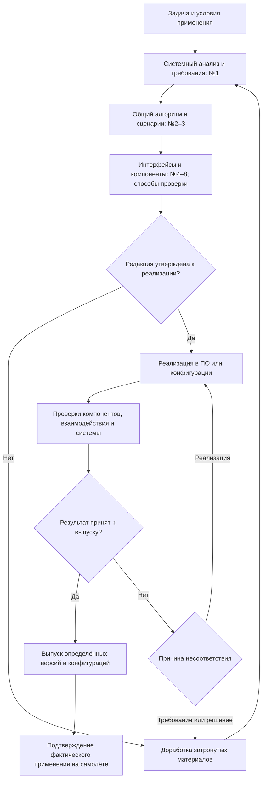

# Порядок разработки и изменения бортовых вычислительных подсистем

Методика определяет состав документов и порядок их разработки, согласования, реализации и проверки. Она применяется к бортовым вычислительным подсистемам с назначенным уровнем ПО C, D или E. КСУ находится за пределами рассматриваемой области. Состав данных для сертификации определяют по принятой основе проекта и назначенному уровню ПО.[2]

Общая база требований хранится в Git. Универсальное ПО использует конфигурации, которые подготавливает существующий конфигуратор. Классификация материалов 1–8 и три уровня V-модели сохраняются.

Заполняемые формы и пример приведены в [приложениях](V_PROCESS_TEMPLATES.md). Для небольшой функции формы можно включить разделами в один документ. Объём описания определяется тем, что требуется для согласования решения, его реализации и проверки.

## Применение в libtr

Задача пользователя и [.clinerules](../.clinerules) определяют объект и границы текущей работы. Классификация ниже задаёт содержание применимых материалов, а не число файлов или обязательных этапов. Для вычислительной библиотеки основной материал — №7; фактический обмен между вызывающим кодом и библиотекой описывают как №8. Если алгоритм имеет память, переходы или временные условия, включают соответствующие сведения №2: блок-схему, условия и приоритеты переходов, циклограмму чтения и публикации данных. Эти сведения можно вести в одном предметном Markdown.

Для filter2win таким документом является [docs/filter2win_theory.md](../docs/filter2win_theory.md). Математическое содержание уточняет [PaeroPrincipe.md](PaeroPrincipe.md), организацию логики с состоянием — [LOGIC_DESIGN_STANDARD.md](LOGIC_DESIGN_STANDARD.md), выбор содержательных проверок — [VPrincipe.md](VPrincipe.md). Локальное изменение обновляет затронутые требования и связи; оно не требует повторного заполнения всех форм. Требования имеют один основной текст и постоянные ID, а ссылки сохраняют связь с реализацией и проверками без отдельного реестра.

Для синхронного вызова описывают действительный порядок получения входа, расчёта и возврата результата. Периоды, малый, большой, внешний и полётные циклы добавляют только при наличии соответствующего расписания или системы. Если платформа, бюджет времени или требование к точности ещё не заданы, указывают известные ограничения и недостающие основания; численные пороги алгоритма не заменяют обоснование погрешности, а оценка сложности не является измеренным временем исполнения.

Проектные согласования, назначенные роли, уровни ПО и выпуск на самолёт из последующих разделов применяются в указанной бортовой области и по условиям конкретного проекта. Само использование численной библиотеки или этих форм не назначает ей уровень ПО и не вводит дополнительное согласование обычной правки. Представления HTML, PDF и Live Editor создаются отдельно по задаче; классификация материалов не делает преобразование или его проверку условием расчётной работы.

## 1. Системный анализ и протокол безопасности

Работа начинается с задачи пользователя и условий её выполнения. В материале №1 указывают требуемый результат, границы системы, внешних участников, основные сценарии и ограничения. Затем определяют функции системы, распределяют их между подсистемами и формулируют требования.

Для существенных вариантов решения указывают основание выбора. Для допущений определяют область действия. Каждое существенное численное ограничение связывают с источником, расчётом или явно принятым допущением.

**Протокол безопасности** входит в требования к системе. Он устанавливает:

- условия пригодности входных данных и результатов;
- обнаруживаемые нарушения и предусмотренные действия;
- состояние выходов и уведомление потребителя;
- условия продолжения работы или восстановления;
- ограничения времени и ресурсов.

Реакцию выбирают по последствиям для выполняемой функции. Отключение компонента рассматривают наряду с другими вариантами и обосновывают для конкретного случая.

Описание опирается на установленные условия применения и проверяемые правила работы. Исчерпывающий условный алгоритм для всех возможных ситуаций в воздухе не требуется. Существенные неопределённости, влияющие на безопасность или результат, разрешают до утверждения затронутого решения.

Системный анализ связывает потребность с функциями, требованиями и проектным решением. Такой порядок согласуется с NASA Systems Engineering Handbook, §§4.2–4.4 и 6.2.[1] Состав материалов и порядок согласования ниже устанавливаются этой методикой.

**Рабочая форма:** [приложение А](V_PROCESS_TEMPLATES.md#appendix-a).

## 2. Состав документов

Номер обозначает назначение материала. Материал может быть отдельным документом или разделом существующего документа.

| № | Наименование | Уровень V | Содержание | Форма |
|---|---|---|---|---|
| **1** | **Назначение, границы и требования системы** | Система | Задача, условия применения, результаты системного анализа, системные требования и протокол безопасности | [А](V_PROCESS_TEMPLATES.md#appendix-a) |
| **2** | **Поведение и взаимодействие подсистем** | Подсистемы | Распределение функций, общий алгоритм, блок-схема, состояния, переходы и циклограмма малого, большого, внешнего и применимых событийных циклов | [Б](V_PROCESS_TEMPLATES.md#appendix-b) |
| **3** | **Сценарии пользователя и правила индикации** | Подсистемы и система | Действия пользователя, реакции системы, наблюдаемые результаты, доступные действия и индикация | [В](V_PROCESS_TEMPLATES.md#appendix-v) |
| **4** | **Спецификация внешних интерфейсов** | Взаимодействие | Стороны обмена, смысл и состав данных, форматы, единицы, временные условия и действия при нарушениях | [Г](V_PROCESS_TEMPLATES.md#appendix-g) |
| **5** | **Спецификация компонентов пользовательского интерфейса** | Компоненты | Локальная логика элементов интерфейса, состояния, переходы и представление результатов | [Д](V_PROCESS_TEMPLATES.md#appendix-d) |
| **6** | **Спецификация компонентов встроенного ПО** | Компоненты | Входы, выходы, алгоритм, ограничения, запуск, сброс и обработка ошибок конкретного компонента | [Е](V_PROCESS_TEMPLATES.md#appendix-e) |
| **7** | **Спецификация вычислительных компонентов и библиотек** | Компоненты | Математическая постановка, алгоритм, допустимые области входов и результатов, погрешности и численные ограничения | [Ж](V_PROCESS_TEMPLATES.md#appendix-zh) |
| **8** | **Спецификация внутренних интерфейсов** | Взаимодействие | Участники, данные и управляющие события, порядок обмена, согласованность, признаки готовности и пригодности | [З](V_PROCESS_TEMPLATES.md#appendix-z) |

В №6 называют конкретный компонент, в №7 — модуль или состав библиотеки, в №8 — стороны каждого обмена. Интерфейсы №4 и №8 относятся к взаимодействию соответствующих частей.

Состав связей выбирают по функции. Например, вычисление без пользовательского интерфейса связывает материалы №1, №2, №6/№7 и применимые интерфейсы. Материалы №3 и №5 используют для функций, имеющих пользовательский интерфейс.

Требование имеет один основной текст и постоянный ID. Общий алгоритм размещают в №2, детализацию компонентов — в №5–7, определения обмена — в №4 или №8. В остальных местах ставят ссылки. Это сохраняет классификацию и устраняет повторное ведение одинаковых сведений.

## 3. Общий алгоритм, блок-схема и циклограмма

Материал №2 связывает системные требования с работой подсистем. По нему разработчик определяет последовательность действий, а проверяющий — условия проверки результата.

| Часть описания | Что указывают |
|---|---|
| Запуск | Событие, период или условие вызова |
| Входы | Источники данных, используемые настройки и момент фиксации входов |
| Действия | Последовательность, исполнители, вычисления и ссылки на №5–7 |
| Выбор ветви | Проверяемые условия, границы сравнения и приоритет одновременных событий |
| Состояние | Начальные значения, переходы, сброс и восстановление |
| Выходы | Состав результата, признаки состояния, момент и порядок обновления |
| Нарушения | Обнаруживаемое условие, предусмотренное действие и условие продолжения |
| Ограничения | Время, память, диапазоны и погрешности с указанием оснований |

Блок-схема показывает последовательность и ветвления. Таблица переходов раскрывает условия и приоритеты. Циклограмма связывает действия участников с моментами чтения и обновления данных. Для простой расчётной зависимости достаточно формулы и условий её применения; для логики с памятью или зависимостью от времени добавляют соответствующее описание.

Обозначения блоков сохраняют одинаковыми в схеме, циклограмме и проверках. Общие определения входов и выходов берут из спецификаций интерфейсов.

### 3.1. Уровни циклов

Для каждого алгоритма определяют состав циклов и их связь. Названия «малый», «большой» и «внешний» закрепляют в проекте вместе с назначением и условиями запуска.

| Цикл | Что описывают |
|---|---|
| **Малый** | Повторяющуюся обработку входов, вычисления и выдачу результата; период, фазу запуска и срок публикации |
| **Большой** | Выполнение набора функций и использование результатов малых циклов; порядок сбора данных и выдачи общего результата |
| **Внешний** | Повторение общей последовательности в выбранном режиме; обработку состояния задания, условия продолжения, смены режима и завершения |
| **Обработки полётных точек маршрута** | Текущую точку, повторяемые для неё действия, условие перехода, завершение маршрута и применение нового состояния |

Малый, большой и внешний циклы показывают на общей шкале времени. На каждой дорожке отмечают запуск, чтение входов, обработку и публикацию. Для связанного потребителя указывают, результат какой итерации он использует.

Период определяет повторение запусков; время выполнения определяет занятость внутри этого периода. Кратность периодов устанавливают для выбранного расписания. Для независимых или событийных запусков задают собственные условия и правила обмена.

### 3.2. Точки маршрута и обмен между циклами

Длительность обработки текущей полётной точки определяется условием перехода. Период вычислительного цикла задаёт момент проверки этого условия. Точка может оставаться текущей в течение нескольких больших и внешних циклов.

В описании указывают редакцию маршрута, источник подтверждения перехода, цикл принятия решения и момент применения новой точки. Определяют принадлежность события текущей точке, его однократную обработку и состояние после последней точки. Повтор маршрута задают отдельным условием.

Для уже начатого вычисления сохраняют установленную принадлежность входов, настроек и состояния задания. При смене точки определяют, когда новый набор принимают потребители и как завершается работа с предыдущим. Эти правила размещают в №2 и соответствующем интерфейсе №8.

Сквозную задержку определяют по всей цепочке: ожидание чтения → обработка → публикация → принятие следующим циклом. Время отдельного малого цикла характеризует только соответствующий участок.

**Форма описания:** [приложение Б](V_PROCESS_TEMPLATES.md#appendix-b). **Заполненный пример с общей циклограммой, обработкой точек маршрута и детализацией малого цикла:** [приложение М](V_PROCESS_TEMPLATES.md#appendix-m).

## 4. Порядок работы и утверждения

### 4.1. Путь от задачи до применения

Схема показывает движение документов и решений. Алгоритм работы самого ПО описывают по разделу 3.

Работу ведут по функции или связанному изменению. При возврате уточняют затронутые материалы и их связи. Ранее принятые решения сохраняют в истории. Оценку требований, моделей и пригодности решения выполняют также до появления готовой реализации.

### 4.2. Результаты этапов

| Этап | Результат этапа | Условие перехода |
|---|---|---|
| **1. Системный анализ** | Задача, границы, сценарии, ограничения и протокол безопасности в №1 | Определены назначение, условия применения, наблюдаемый результат и существенные допущения |
| **2. Требования и распределение функций** | Проверяемые требования и распределение функций в №1–4 | У требований есть основания, у функций — исполнители; границы взаимодействия согласованы |
| **3. Проектное решение** | Алгоритм, необходимые схемы и циклограммы, описания компонентов и интерфейсов, способы проверки | Определены существенные входы, ветви, время и выходы; заданы ожидаемые результаты проверок |
| **4. Утверждение к реализации** | Решение по указанной редакции затронутых материалов | Рассмотрены безопасность, интерфейсы, реализуемость и проверяемость; замечания, препятствующие реализации, устранены |
| **5. Реализация и проверки компонентов** | Версия ПО или конфигурации и результаты компонентных проверок | Предусмотренные проверки выполнены; несоответствия устранены либо урегулированы по принятому порядку |
| **6. Интеграция и проверка системы** | Результаты проверок взаимодействия, системных требований и сценариев использования | Подтверждены применимые требования; установлены область действия результатов и состояние замечаний |
| **7. Принятие результата и выпуск** | Решение по версиям требований, ПО и конфигурации | Замечания, препятствующие выпуску, урегулированы; определены условия применения |

### 4.3. Ответственность и запись решения

Автор готовит материалы. Назначенные участники согласования рассматривают затронутые требования, интерфейсы, безопасность, реализуемость и проверяемость. Ответственный за утверждение принимает решение по конкретной редакции. Состав участников и необходимую независимость работ определяют по процессу проекта и применимым целям назначенного уровня ПО.

Редакция проходит состояния **«В разработке → На согласовании → Утверждена к реализации»**. При замечаниях автор дорабатывает её и повторно передаёт затронутую часть на рассмотрение.

В существующей системе согласования или принятом Git-процессе фиксируют: кто принял решение, дату, редакцию материалов, область действия и содержание решения. Коммит определяет содержание; запись согласования определяет его статус. Изменённая редакция получает собственное решение.

| Решение | Что оно разрешает или подтверждает |
|---|---|
| **Утверждение к реализации** | Выполнение реализации по рассмотренной редакции требований и проектного решения |
| **Принятие результата к выпуску** | Выпуск определённых версий ПО и конфигурации на основании рассмотренных результатов |
| **Подтверждение применения на самолёте** | Фактическое применение выбранных версий после предусмотренных проверок |

Подготовка проектного решения, его рассмотрение и фиксация согласованной редакции описаны в NASA Systems Engineering Handbook, §§4.4 и 6.7.[1]

**Форма записи изменения и решений:** [приложение К](V_PROCESS_TEMPLATES.md#appendix-k).

## 5. Верификация, валидация и прослеживаемость

### 5.1. Проверки по трём уровням V-модели

| Уровень | Основание | Подтверждаемый результат |
|---|---|---|
| **3. Компоненты** | Требования и описания №5–7 | Выполнение локальных алгоритмов, переходов, вычислений и ограничений |
| **2. Подсистемы и взаимодействие** | Общий алгоритм №2, сценарии №3, интерфейсы №4/№8 | Совместная работа, обмен данными и событиями, порядок действий и время |
| **1. Система** | Требования №1; отдельно — назначение и условия использования | **Верификация:** выполнение системных требований. **Валидация:** пригодность системы для предусмотренной задачи |

Методика проверки задаёт условия, действия и ожидаемые результаты. Запись выполнения содержит фактические результаты и условия их получения. Решение о выпуске принимают по этим результатам.

Среду выбирают по проверяемому свойству. Интеграционную проверку можно выполнять с программными заменами, реальными участниками или на стенде. Пригодность выбранной среды определяют для конкретной проверки. Различие верификации и валидации изложено в NASA Systems Engineering Handbook, §§5.3–5.4.[1]

**Форма проверки и записи выполнения:** [приложение И](V_PROCESS_TEMPLATES.md#appendix-i).

### 5.2. Содержание связей

| Объект | Сохраняемые ссылки и сведения |
|---|---|
| Требование | Источник, вышестоящее требование или собственное обоснование; условие применения |
| Блок алгоритма, интерфейс, компонент, настройка | Требования, которые объект уточняет или реализует |
| Проверка | Проверяемые требования, условия и ожидаемый результат |
| Запись выполнения | ID и редакция проверки, версии ПО и конфигурации, условия и фактический результат |
| Решение о выпуске | Редакции требований, реализация, конфигурация и результаты, на которых основано решение |
| Запись самолёта | Фактические версия ПО и конфигурация, дата применения и подтверждение выполненных работ |

Требование, появившееся при детализации, получает собственное обоснование. Его влияние на системные требования и протокол безопасности рассматривают на соответствующем уровне.

Каждую связь хранят один раз. По тем же данным получают прямой и обратный поиск. Постоянный ID определяет требование, а версия материала или зафиксированного набора документов в Git — его редакцию. История сохраняет именно те редакции, по которым выполнялась проверка и принималось решение.

Такой порядок позволяет пройти три пути:

- от системного требования к алгоритму, реализации, проверкам и результатам;
- от несоответствия в проверке к требованию, его основанию и затронутым частям;
- от самолёта на выбранную дату к фактическим ПО и конфигурации, применимым требованиям и решению о выпуске.

Двусторонняя прослеживаемость рассматривается в NASA Systems Engineering Handbook, §6.2.1.2.3.[1]

**Форма связей и представления результатов поиска:** [приложение Л](V_PROCESS_TEMPLATES.md#appendix-l). **Пример по всем материалам 1–8:** [приложение М](V_PROCESS_TEMPLATES.md#appendix-m).

## 6. Конфигурации самолётов и изменения

Конфигуратор остаётся источником состава оборудования, распределения функций и настроек. Существующий учёт сохраняет историю каждого самолёта: **версия ПО, точная конфигурация и дата фактического применения**.

Конфигурация соответствует установленному оборудованию и позволяет восстановить действовавшие значения, включая настройки по умолчанию. При замене исполнителя обязательной функции само требование к функции сохраняется.

Результаты проверок имеют область действия: версии, условия и допустимые конфигурации. В этой области результаты используют повторно. Для нового сочетания оборудования, ПО и настроек оценивают применимость прежних результатов и объём дополнительных проверок.[3]

| Содержание изменения | Порядок работы |
|---|---|
| Предусмотренная настройка в подтверждённых пределах | Подготовить конфигурацию, выполнить предусмотренные проверки применения и зафиксировать фактическое состояние |
| Новая логика, интерфейс или ограничение | Рассмотреть влияние, уточнить затронутые требования и проектное решение, согласовать, реализовать, проверить и принять решение о выпуске |

Изменение конфигурации может менять логику при той же версии исполняемого файла. Объём работ определяют по влиянию на функцию, интерфейсы, безопасность и общие ресурсы.[3]

**Индивидуальное изменение.** Особое требование или его редакцию связывают с конфигурацией в общей базе. Для выбранной конфигурации определяется одна применимая редакция каждого требования. Такой порядок позволяет вести отдельные самолёты в общей базе требований и универсального ПО.

**Временное изменение.** В записи указывают цель, область применения, срок или условие завершения и конфигурацию последующего перехода. Затронутое решение проходит установленное согласование и проверку. По наступлении срока выполняют предусмотренные действия; автоматического переключения логики в полёте истечение срока не означает. Учёт сохраняет фактическую конфигурацию до подтверждения перехода. При изменении оборудования или ПО повторно проверяют пригодность конфигурации для возврата.

Подготовленную конфигурацию и подтверждённое применение учитывают раздельно. Проверка загрузки и правильности конфигурации самолёта рассматривается в FAA AC 43-216A, §§8.2.4–8.2.5.[4]

**Форма изменения, срока действия и фактического применения:** [приложение К](V_PROCESS_TEMPLATES.md#appendix-k).

## 7. Организация работы с материалами

Для очередной функции или изменения выбирают применимые материалы 1–8. Сведения берут из действующих источников и дополняют в месте их основного хранения. Согласование, результаты проверок и учёт самолётов ведут в принятых системах; формы приложений задают необходимое содержание записи.

Для базы из 70 000 требований автоматизируют проверку уникальности ID в выбранном наборе редакций, целостности ссылок, применимости редакций и обратный поиск. Матрицу прослеживаемости получают из этих данных. Инженер оценивает содержание связи и влияние изменения.

При необходимости из требований подготавливают заготовки модульных проверок. Условия и ожидаемые результаты рассматривают отдельно, с указанием их основания. Генерация кода бортового ПО в текущий объём работ не входит.

При локальном изменении повторяют работы по затронутым требованиям и зависимостям. Область повторного рассмотрения определяют по анализу влияния. Для неизменённой части сохраняют действующие решения и результаты в пределах их подтверждённой применимости.

## 8. Источники

1. NASA. **Руководство по системной инженерии** — *NASA Systems Engineering Handbook*, NASA SP-2016-6105 Rev2. §§4.2–4.4 — требования и проектное решение; §6.2 — управление требованиями; §6.7 — технические рассмотрения; §§5.3–5.4 — верификация и валидация. [PDF](https://www.nasa.gov/wp-content/uploads/2018/09/nasa_systems_engineering_handbook_0.pdf).
2. FAA. **Бортовое программное обеспечение и подтверждение соответствия** — *Airborne Software Development Assurance Using EUROCAE ED-12() and RTCA DO-178()*, AC 20-115D. §§4 и 6 — цели процессов, подтверждающие данные и назначенный уровень ПО. [PDF](https://www.faa.gov/documentLibrary/media/Advisory_Circular/AC_20-115D.pdf).
3. FAA. **Практические рекомендации по разработке и сопровождению ПО** — *Best Practices for Airborne Software Development Assurance Using EUROCAE ED-12() and RTCA DO-178()*, AC 00-69. §§3.1–3.3 — влияние изменений, взаимодействие компонентов и обработка ошибок. [PDF](https://www.faa.gov/documentLibrary/media/Advisory_Circular/AC_00-69.pdf).
4. FAA. **Управление программным обеспечением при техническом обслуживании воздушного судна** — *Software Management During Aircraft Maintenance*, AC 43-216A. §§8.2.4–8.2.5 — проверка загрузки и конфигурации самолёта. [PDF](https://www.faa.gov/documentLibrary/media/Advisory_Circular/AC_43-216A.pdf).

Перечисленные PDF содержат открытые руководства и рекомендации. Полные тексты DO-178C и DO-330 распространяет [RTCA](https://www.rtca.org/do-178/). Состав данных для конкретной сертификации устанавливают по принятой основе проекта; материалы 1–8 организуют инженерное описание системы.
