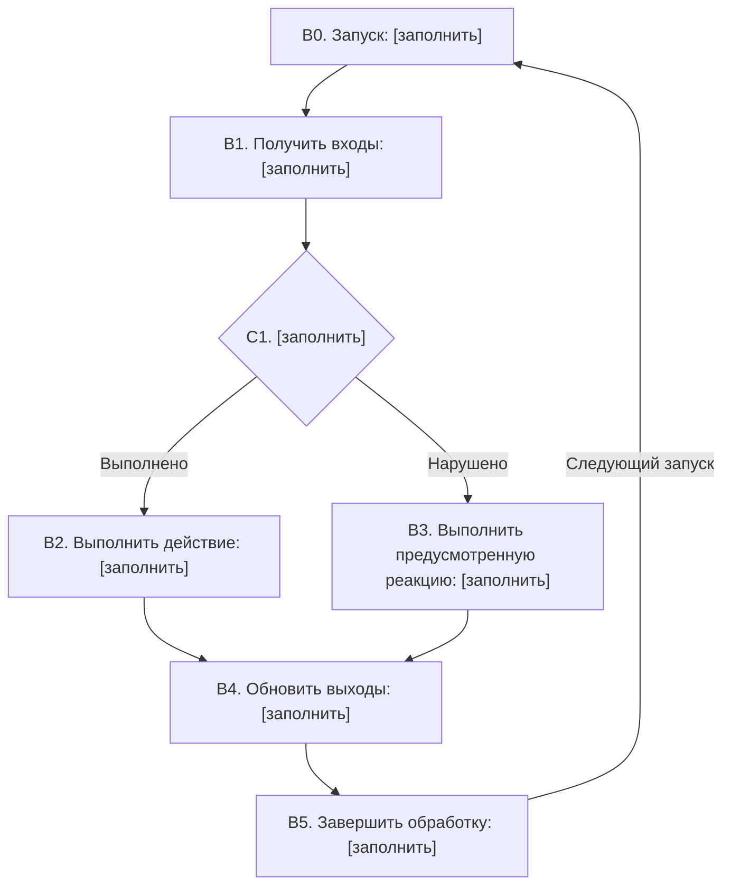
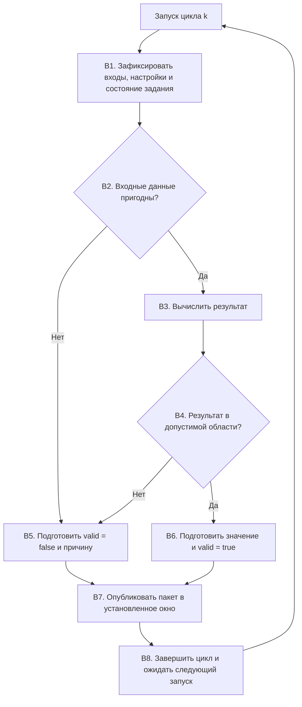
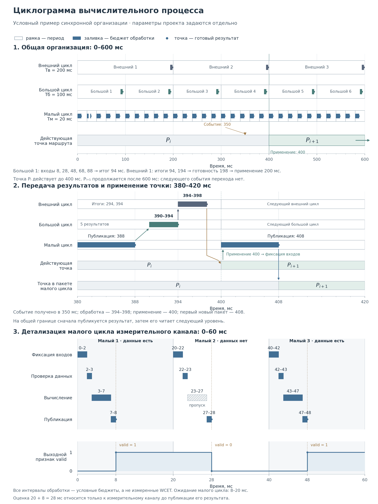
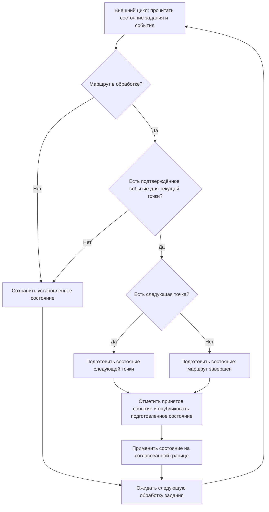

# Приложения. Формы документов и пример заполнения

Формы дополняют [методику разработки и изменения бортовых вычислительных подсистем](V_PROCESS_CONFIGURATOR.md). Их используют при подготовке новой функции или изменении существующей.

В libtr состав материалов выбирают по разделу [«Применение в libtr»](V_PROCESS_CONFIGURATOR.md#применение-в-libtr). Переносят нужное содержание, а не весь комплект приложений; общую границу применимости указывают один раз. Номера материалов и постоянные ID содержательных требований сохраняют смысл и при размещении в одном Markdown.

Выберите применимые разделы и перенесите их в действующий документ. Заполните поля `[заполнить]`, добавьте необходимые строки. Для неприменимого раздела укажите причину или ссылку на общее решение. Сведения, которые уже ведутся в конфигураторе, системе согласования или отчёте, используйте по ссылке.

Приложения А–Л содержат пустые формы. Приложение М содержит условный пример. Его значения и обозначения служат образцом оформления; проектные данные определяют по исходным требованиям.

## Состав приложений

| Приложение | Назначение |
|---|---|
| [А](#appendix-a) | Материал №1. Системные требования и протокол безопасности |
| [Б](#appendix-b) | Материал №2. Общий алгоритм, уровни циклов, переходы точек маршрута и циклограмма |
| [В](#appendix-v) | Материал №3. Сценарии пользователя и индикация |
| [Г](#appendix-g) | Материал №4. Внешние интерфейсы |
| [Д](#appendix-d) | Материал №5. Компоненты пользовательского интерфейса |
| [Е](#appendix-e) | Материал №6. Компоненты встроенного ПО |
| [Ж](#appendix-zh) | Материал №7. Вычислительные компоненты и библиотеки |
| [З](#appendix-z) | Материал №8. Внутренние интерфейсы |
| [И](#appendix-i) | Описание проверки и запись фактического выполнения |
| [К](#appendix-k) | Изменение, согласование, выпуск и применение на самолёте |
| [Л](#appendix-l) | Связи и представление прослеживаемости |
| [М](#appendix-m) | Пример: малый, большой и внешний циклы, точки маршрута, расчёт и связи по материалам 1–8 |

## Общие сведения о документе

Эти сведения указывают один раз в документе или получают из действующей системы. Для включённых в него форм используют ту же редакцию и статус.

| Поле | Содержание |
|---|---|
| ID и наименование документа | [заполнить] |
| Рассматриваемая система, функция или изменение | [заполнить] |
| Редакция, версия набора документов или коммит Git | [заполнить] |
| Автор или ответственное подразделение | [заполнить] |
| Статус и ссылка на фактическое решение | [заполнить] |
| Область применения: версии ПО, конфигурации, условия | [заполнить] |

Для каждого существенного числа укажите источник, воспроизводимый расчёт или принятое допущение. До рассмотрения материала сохраняйте его фактический статус разработки. Сведения о выполнении и утверждении заполняйте по состоявшимся действиям.

## Приложение А. Материал №1 — системные требования и протокол безопасности

Заполните форму для системы или выделенной функции. Общую шапку документа и сведения о редакции используйте из основного материала. Для каждого существенного численного значения укажите источник, расчёт или принятое допущение.

### А.1. Задача и границы

**Потребность пользователя:** [заполнить].

**Результат работы системы и способ его наблюдения:** [заполнить].

**Условия применения:** [заполнить].

**Границы системы, внешние участники и распределение ответственности:** [заполнить].

| Вход или выход | Смысл и назначение | Источник или получатель | Ссылка на интерфейс |
|---|---|---|---|
| [заполнить] | [заполнить] | [заполнить] | [заполнить] |

**Рассмотренные варианты и основание выбора решения:** [заполнить].

**Существенные допущения и область их действия:** [заполнить].

### А.2. Требования

Формулируйте требование через условие, действие и наблюдаемый результат. Ссылку на проверку добавляйте по мере её подготовки. Область применения задавайте для требований, зависящих от конфигурации.

| ID | Условие и требуемый результат | Источник или обоснование | Критерий и способ проверки | Применимость |
|---|---|---|---|---|
| [заполнить] | [заполнить] | [заполнить] | [заполнить] | [заполнить] |

### А.3. Протокол безопасности

Опишите установленные анализом нарушения и действия системы. Для каждого действия определите состояние результата, уведомление потребителя и условия продолжения работы. Реакцию выбирайте по последствиям для выполняемой функции.

| Условие или обнаруживаемое нарушение | Действие системы и выдаваемое состояние | Условие продолжения или восстановления | ID требования и основание |
|---|---|---|---|
| [заполнить] | [заполнить] | [заполнить] | [заполнить] |

**Ограничения времени и ресурсов:** [заполнить: ссылки на требования с численными значениями и их основаниями].

**Вопросы, требующие решения до передачи затронутой части в разработку:** [заполнить: вопрос, ответственное лицо, требуемое решение].

## Приложение Б. Материал №2 — общий алгоритм и взаимодействие подсистем

**Рассматриваемая функция и требования материала №1:** [заполнить].

**Событие запуска, период или условия вызова:** [заполнить].

**Входы, выходы и используемые настройки:** [заполнить: ссылки на №4, №8 и конфигурацию].

### Б.1. Распределение работы

| Блок алгоритма | Действие и результат | Исполнитель | Требования и детализация |
|---|---|---|---|
| [заполнить] | [заполнить] | [заполнить] | [заполнить: ID требований; №5, №6 или №7] |

**Вычисления и их математическое описание:** [заполнить: формула либо ссылка на соответствующий раздел №7].

**Порядок получения согласованного набора входов и обновления выходов:** [заполнить].

### Б.2. Блок-схема

Заполните действия и условие C1. При нескольких ветвлениях дополните схему. Сохраните одинаковые обозначения блоков в описании, циклограмме и проверках.

### Б.3. Состояния, переходы и приоритеты

Для логики с памятью заполните состояния и переходы. В условии укажите проверяемые величины, границы сравнения и момент проверки. Для длительности условия задайте правило накопления и сброса времени.

| Исходное состояние | Условие и момент проверки | Приоритет | Действие при переходе | Следующее состояние | Основание |
|---|---|---|---|---|---|
| [заполнить] | [заполнить] | [заполнить] | [заполнить] | [заполнить] | [заполнить] |

**Начальное состояние и действия при запуске или сбросе:** [заполнить].

**Порядок выбора при одновременном выполнении условий:** [заполнить: направление приоритетов, правило разрешения равного приоритета].

**Действие при отсутствии подходящего перехода и порядок обработки оставшихся событий:** [заполнить].

### Б.4. Циклограмма нескольких циклов

Укажите назначение малого, большого и внешнего циклов, условия их запуска и обмен результатами. Для каждого цикла задайте собственный момент чтения входов и публикации выходов. Периоды и ограничения времени берите из требований и расчётов.

**Общая шкала времени и начало отсчёта:** [заполнить].

| Цикл и его ID | Выполняемые функции и блоки | Условие запуска и период | Фаза запуска, срок завершения и допустимое отклонение | Основание |
|---|---|---|---|---|
| Малый, [заполнить] | [заполнить] | [заполнить] | [заполнить] | [заполнить] |
| Большой, [заполнить] | [заполнить] | [заполнить] | [заполнить] | [заполнить] |
| Внешний, [заполнить] | [заполнить] | [заполнить] | [заполнить] | [заполнить] |

**Связь запусков:** [заполнить: общий или независимые источники запуска; соотношение периодов и порядок совпадающих запусков, если они предусмотрены].

**Порядок работы при превышении времени или пропуске запуска:** [заполнить: действие, выдаваемое состояние и условие продолжения].

Циклограмму постройте на общей шкале. На каждой строке покажите чтение входов, выполнение блоков и публикацию результата. Для связанных циклов укажите, какая публикация доступна в момент чтения.

| Цикл и итерация | Чтение входов и используемый набор | Интервал обработки | Публикация результата | Потребитель и момент принятия |
|---|---|---|---|---|
| [заполнить] | [заполнить] | [заполнить] | [заполнить] | [заполнить] |

**Использование результата между обновлениями и допустимый возраст данных:** [заполнить: правило потребителя, предел и основание].

**Обмен между циклами:** [заполнить: ссылки на интерфейсы №8].

Порядок запусков описывает выполнение вычислительных задач. Изменение состояния функции задаётся условием перехода. Если запуска одного цикла требует результат другого, это условие укажите явно.

### Б.5. Цикл обработки полётных точек маршрута

Опишите повторяющуюся работу с текущей точкой и события, по которым выбирается следующая точка или завершается обработка маршрута. Частоту проверки условий и момент смены точки задайте раздельно.

**Маршрут, его редакция и источник данных:** [заполнить].

**Состав полётной точки и ссылка на интерфейс:** [заполнить].

**Начальная точка и условие начала обработки:** [заполнить].

**Место обработки — малый, большой, внешний цикл или отдельный обработчик события:** [заполнить].

**Действия, повторяемые для текущей точки:** [заполнить: блоки алгоритма и требования].

Для этого обработчика заполните Б.3 по следующей форме. Условия достижения, пропуска, замены точки и завершения маршрута задавайте по требованиям соответствующей функции.

| Случай обработки | Исходное состояние, условие и момент проверки | Приоритет | Действие и следующая точка либо состояние | Основание |
|---|---|---|---|---|
| Начало обработки маршрута | [заполнить] | [заполнить] | [заполнить] | [заполнить] |
| Работа с текущей точкой | [заполнить] | [заполнить] | [заполнить] | [заполнить] |
| Условие перехода к другой точке | [заполнить] | [заполнить] | [заполнить] | [заполнить] |
| Обработка последней точки | [заполнить] | [заполнить] | [заполнить] | [заполнить] |
| Обновление маршрута или нарушение условий обработки | [заполнить] | [заполнить] | [заполнить] | [заполнить] |

**Момент принятия смены точки и циклы, использующие новое задание:** [заполнить].

**Состояние, сохраняемое и обновляемое при смене точки:** [заполнить].

**Порядок при совпадении смены точки, обновления маршрута и другого управляющего события:** [заполнить].

**Срок реакции на событие, его основание и проверка:** [заполнить].

На общей циклограмме отметьте событие, принятие решения и момент доступности нового задания потребителям. Периодический вызов обработчика означает проверку условий. Смена точки выполняется по установленному условию.

**Принадлежность события редакции маршрута и текущей точке; однократное принятие перехода:** [заполнить].

**Приостановка, возобновление и повтор маршрута, если предусмотрены:** [заполнить: условия и состояние при продолжении].

**Проверки последовательности, межциклового обмена и сроков реакции:** [заполнить: ID проверок и критерии].

## Приложение В. Материал №3 — сценарии пользователя и правила индикации

**Сценарий и его ID:** [заполнить].

**Пользователь, задача и требование-основание:** [заполнить].

**Исходное состояние системы и условия начала:** [заполнить].

### В.1. Основной сценарий

Укажите действия пользователя и автоматические события в порядке выполнения. Наблюдаемый результат должен позволять пользователю определить состояние системы и дальнейшее действие.

| Шаг | Действие пользователя или событие | Действие системы | Наблюдаемый результат | Требование |
|---|---|---|---|---|
| [заполнить] | [заполнить] | [заполнить] | [заполнить] | [заполнить] |

**Критерий успешного завершения сценария:** [заполнить].

### В.2. Другие варианты выполнения

| Шаг и условие | Действие системы | Доступное действие пользователя | Продолжение сценария |
|---|---|---|---|
| [заполнить] | [заполнить] | [заполнить] | [заполнить] |

Опишите завершение по запросу пользователя, отказ операции и восстановление в применимых случаях. Для каждого случая укажите итоговое состояние и следующий доступный шаг.

### В.3. Индикация

| Состояние | Текст или вид индикации | Условие появления и снятия | Основание |
|---|---|---|---|
| [заполнить] | [заполнить] | [заполнить] | [заполнить] |

**Существенные сроки реакции и их основания:** [заполнить].

**Связь с компонентами материала №5 и проверками сценария:** [заполнить].

## Приложение Г. Материал №4 — внешние интерфейсы

**Интерфейс и его ID:** [заполнить].

**Участник внутри системы, внешний участник и направления обмена:** [заполнить].

**Назначение обмена и требования-основания:** [заполнить].

**Среда передачи, протокол и применимая редакция:** [заполнить].

### Г.1. Состав данных

Определите смысл каждого поля, представление, единицы и условия пригодности. Для диапазонов, разрешения и допустимой погрешности укажите основания. Общие определения используйте по ссылке.

| Сообщение и поле | Смысл | Тип, формат и единицы | Допустимые значения и признак пригодности | Основание |
|---|---|---|---|---|
| [заполнить] | [заполнить] | [заполнить] | [заполнить] | [заполнить] |

### Г.2. Порядок обмена

| Сообщение или событие | Кто передаёт и кому | Условие передачи | Период, срок или порядок | Основание |
|---|---|---|---|---|
| [заполнить] | [заполнить] | [заполнить] | [заполнить] | [заполнить] |

**Условия приёма полного согласованного сообщения, определение актуальности и принадлежности циклу:** [заполнить].

**Начальное состояние обмена, запуск и восстановление соединения:** [заполнить].

### Г.3. Действия при нарушениях

| Обнаруживаемое нарушение | Действие отправителя | Действие получателя и выдаваемое состояние | Требование и условие восстановления |
|---|---|---|---|
| [заполнить] | [заполнить] | [заполнить] | [заполнить] |

**Применимые варианты оборудования и конфигурации:** [заполнить].

**Проверки формата, порядка обмена, времени и предусмотренных реакций:** [заполнить: ID проверок и критерии].

Передайте описание на согласование сторонам обмена. Решение и перечень рассматриваемых редакций зафиксируйте в общей записи согласования.

## Приложение Д. Компонент пользовательского интерфейса — материал №5

**ID и наименование компонента:** [заполнить].  
**Назначение и место в интерфейсе:** [заполнить].  
**Применимые конфигурации:** [заполнить].

### Д.1. Основания и данные

**Требования и сценарии №1/№3:** [заполнить].  
**Функция и блок общего алгоритма №2:** [заполнить].  
**Используемые интерфейсы №4/№8:** [заполнить].

| Данные или действие пользователя | Источник | Представление или выдаваемое событие | Условие доступности и пригодности |
|---|---|---|---|
| [заполнить] | [заполнить] | [заполнить] | [заполнить] |

Для числового представления указывают единицы, разрядность и правила округления. Для управляющего элемента задают доступное действие, условие его принятия и обратную связь пользователю. При изменении состояния данных определяют вид индикации и доступные действия.

### Д.2. Логика компонента

**Состояние при открытии экрана, запуске и восстановлении:** [заполнить].  
**Ссылка на схему состояний или блок-схему:** [заполнить].  
**Условия и время обновления представления:** [заполнить].

| Исходное состояние | Событие и условие | Действие компонента и наблюдаемый результат | Следующее состояние |
|---|---|---|---|
| [заполнить] | [заполнить] | [заполнить] | [заполнить] |

В описании устанавливают приоритет одновременно поступивших событий, если их порядок влияет на результат.

### Д.3. Проверки и связи

| ID требования или сценария | Элемент и правило отображения | ID проверки | Действия пользователя и ожидаемый результат |
|---|---|---|---|
| [заполнить] | [заполнить] | [заполнить] | [заполнить] |

**Реализация и записи выполненных проверок:** [заполнить].

## Приложение Е. Компонент встроенного ПО — материал №6

**ID и наименование компонента:** [заполнить].  
**Функция, среда выполнения и применимые конфигурации:** [заполнить].  
**Требования №1/№2, правила протокола безопасности и блок общего алгоритма:** [заполнить].

### Е.1. Входы, выходы и вызов

| Вход, выход или параметр | Тип, единицы и допустимые значения | Источник или потребитель | ID интерфейса и условие обновления |
|---|---|---|---|
| [заполнить] | [заполнить] | [заполнить] | [заполнить] |

**Условие запуска, период или событие вызова:** [заполнить].  
**Момент фиксации входов и выдачи выходов:** [заполнить].  
**Ограничения времени, памяти и общих ресурсов с основаниями:** [заполнить].

**Циклы, в которых вызывается компонент, и выполняемые блоки:** [заполнить: ссылки на Б.4].  
**Порядок повторного вызова до завершения предыдущего:** [заполнить].

### Е.2. Алгоритм и состояние

**Блок-схема и используемые вычисления №7:** [заполнить].  
**Циклограмма и связь её интервалов с требованиями:** [заполнить].

Для компонента с состоянием заполняют следующие поля:

**Состав состояния и начальные значения:** [заполнить].  
**Условия сброса, сохраняемые данные и действия при повторном запуске:** [заполнить].

| Исходное состояние | Событие, условие и приоритет | Вычисление или действие | Выход и следующее состояние |
|---|---|---|---|
| [заполнить] | [заполнить] | [заполнить] | [заполнить] |

**Обнаруживаемые нарушения, выдаваемое состояние и условия продолжения работы:** [заполнить].

**Общие для нескольких циклов данные и порядок их обновления:** [заполнить].  
**Для работы с маршрутом — принадлежность состояния его редакции и текущей точке, момент принятия новой точки:** [заполнить: ссылка на Б.5].  
**Завершение ранее начатого вычисления и обработка повторного события:** [заполнить].

### Е.3. Проверки и связи

| ID требования | Блок алгоритма или переход | ID проверки | Входы, начальное состояние и ожидаемый результат |
|---|---|---|---|
| [заполнить] | [заполнить] | [заполнить] | [заполнить] |

**Реализация, версия ПО, конфигурация и записи выполненных проверок:** [заполнить].

## Приложение Ж. Вычислительный компонент или библиотека — материал №7

**ID и наименование:** [заполнить].  
**Назначение расчёта, функция или состав библиотеки:** [заполнить].  
**Требования, потребитель результата и блок общего алгоритма №2:** [заполнить].

### Ж.1. Математическая постановка

| Вход, выход или параметр | Обозначение и физический смысл | Тип, размерность и единицы | Допустимая область и основание |
|---|---|---|---|---|
| [заполнить] | [заполнить] | [заполнить] | [заполнить] |

**Искомый результат и исходные допущения:** [заполнить].  
**Формулы, последовательность вычислений и источники метода:** [заполнить].  
**Критерий завершения итерационного расчёта:** [заполнить].

Обозначения в формулах соответствуют таблице. Для функции с памятью указывают состав состояния, начальные значения, порядок обновления и сброса: [заполнить].

### Ж.2. Точность и численные ограничения

Заполняют свойства, которые определяют применимость выбранного вычисления.

| Свойство | Условие, допуск или действие | Основание и способ проверки |
|---|---|---|
| Погрешность результата и область действия допуска | [заполнить] | [заполнить] |
| Представление чисел и округление | [заполнить] | [заполнить] |
| Особые точки, переполнение и специальные значения | [заполнить] | [заполнить] |
| Ограничения времени и числа итераций | [заполнить] | [заполнить] |

**Признак пригодности результата и действия при выходе за установленные условия:** [заполнить].

### Ж.3. Проверки и связи

| ID требования | ID проверки и набор входов | Ожидаемый результат и его источник | Критерий сравнения |
|---|---|---|---|
| [заполнить] | [заполнить] | [заполнить] | [заполнить] |

Контрольные значения получают из указанного расчёта, аналитического решения, достоверных исходных данных или обоснованного сравнительного метода.

**Реализация, применимые конфигурации и записи выполненных проверок:** [заполнить].

## Приложение З. Внутренний интерфейс — материал №8

**ID и наименование интерфейса:** [заполнить].  
**Участники обмена и их роли:** [заполнить].  
**Функция, требования и взаимодействие в общем алгоритме №2:** [заполнить].  
**Применимые конфигурации и способ обмена:** [заполнить].

### З.1. Состав и смысл обмена

| Поле или управляющее событие | Источник → получатель | Тип, единицы и допустимые значения | Смысл и условие пригодности |
|---|---|---|---|
| [заполнить] | [заполнить] | [заполнить] | [заполнить] |

**Основание времени, принадлежность данных циклу и момент обновления:** [заполнить].  
**Владелец данных и условие передачи права на их изменение:** [заполнить].

### З.2. Порядок и согласованность

| Событие или фаза | Условие начала | Действие отправителя | Действие получателя и условие завершения |
|---|---|---|---|
| [заполнить] | [заполнить] | [заполнить] | [заполнить] |

**Ссылка на циклограмму обмена, сроки и основания ограничений:** [заполнить].  
**Состав согласованного набора данных и условие его чтения:** [заполнить].  
**Порядок принятия управляющего события и его связь с данными:** [заполнить].  
**Действия при запуске, перезапуске участника, пропуске, повторе и задержке передачи:** [заполнить].

Описание определяет, к какому набору данных относится управляющее событие и когда получатель может использовать результат.

Для обмена между циклами используйте определения пакетов из З.1 и циклограмму Б.4.

| Данные или событие | Цикл-источник → цикл-потребитель | Публикация и момент принятия | Допустимый возраст и действие при задержке | Основание |
|---|---|---|---|---|
| [заполнить] | [заполнить] | [заполнить] | [заполнить] | [заполнить] |

**Для данных маршрута — принадлежность редакции, точке и вычислительной итерации:** [заполнить].  
**Состав нового задания, момент вступления в работу и действия при повторном событии:** [заполнить].

### З.3. Проверки и связи

| ID требования | Проверяемое свойство обмена | ID проверки и условия | Ожидаемый результат у участников |
|---|---|---|---|
| [заполнить] | [заполнить] | [заполнить] | [заполнить] |

**Компоненты №5–7, версии участников и записи выполненных проверок:** [заполнить].

## Приложение И. Проверка и запись выполнения

Форму используют для проверки компонента, взаимодействия, системного требования или пригодности для задачи пользователя. Описание проверки готовят до выполнения. Фактические результаты заполняют после выполнения.

### И.1. Описание проверки

| Поле | Содержание |
|---|---|
| ID и наименование проверки | [заполнить] |
| Цель и уровень проверки | [заполнить] |
| Проверяемые требования или потребности и их редакции | [заполнить] |
| Объект и применимые конфигурации | [заполнить] |
| Способ: испытание, анализ, расчёт или рассмотрение | [заполнить] |
| Среда и основание её пригодности для этой проверки | [заполнить] |
| Исходное состояние, подготовка и входные данные | [заполнить] |
| Ограничения применимости результата | [заполнить] |

| Шаг | Действие и входные данные | Ожидаемый результат | Допуск или критерий | Основание ожидания |
|---|---|---|---|---|
| [заполнить] | [заполнить] | [заполнить] | [заполнить] | [заполнить] |

**Условия завершения и восстановления исходного состояния:** [заполнить].

Для расчётной проверки укажите формулу, исходные данные и способ получения контрольного результата. Для проверки времени определите начало и конец измеряемого интервала, средство измерения и условия нагрузки. Ожидаемый результат обоснуйте требованием или контрольным расчётом.

### И.2. Фактическое выполнение

| Поле | Содержание |
|---|---|
| ID записи, дата и исполнитель | [заполнить] |
| ID и редакция выполненной проверки | [заполнить] |
| Зафиксированная редакция требований | [заполнить] |
| Версия проверенного ПО и идентификатор сборки | [заполнить] |
| Точная конфигурация и её редакция | [заполнить] |
| Оборудование, среда, существенные условия выполнения | [заполнить] |
| Исходные данные, журналы, измерения или расчёт | [заполнить: ссылки на сохранённые материалы] |

| Шаг или проверяемое свойство | Фактический результат | Сопоставление с критерием | Несоответствие и ссылка на его рассмотрение |
|---|---|---|---|
| [заполнить] | [заполнить] | [заполнить] | [заполнить] |

**Вывод по проверке и область действия результата:** [заполнить].

**Оставшиеся вопросы и требуемые действия:** [заполнить].

Для серии проверок с одинаковыми версиями и условиями общие сведения можно указать один раз. Каждая запись сохраняет ссылку на этот набор. Успешное выполнение подтверждают фактическими данными. Описание проверки задаёт планируемые действия, условия и критерии оценки.

## Приложение К. Изменение, решения и применение

Поля включают в существующую запись изменения или согласования. Её разделы заполняют по мере выполнения работ. Одна запись может содержать ссылки на проектные материалы, результаты и учёт самолётов.

### К.1. Содержание и влияние изменения

| Поле | Содержание |
|---|---|
| ID изменения, инициатор и причина | [заполнить] |
| Требуемый результат | [заполнить] |
| Требования и материалы: исходная и предлагаемая редакции | [заполнить] |
| Изменяемые блоки алгоритма, компоненты и интерфейсы | [заполнить] |
| Версия универсального ПО и изменение конфигурации | [заполнить: сохраняемая или новая версия ПО; исходная и новая конфигурации] |
| Область применения | [заполнить: условие выбора конфигурации; при необходимости — конкретные самолёты] |
| Влияние на функции, протокол безопасности, обмен и общие ресурсы | [заполнить] |
| Прежние результаты, применимые после изменения, и основание их использования | [заполнить] |
| Дополнительные проверки и основания их выбора | [заполнить] |
| Условия последующего перехода или возврата | [заполнить] |

**Для отдельного самолёта:** [заполнить: идентификатор самолёта, применимая конфигурация и правило выбора особой редакции требования].

**Для временного изменения:** [заполнить: срок или событие завершения, ответственное лицо, последующая конфигурация и порядок проверки её пригодности].

**Действие при наступлении срока:** [заполнить].

**Подтверждение завершения:** [заполнить после перехода: ссылка на фактическую запись К.3].

Влияние оценивают по изменению поведения, в том числе при сохранении исполняемого файла. Для настройки в ранее подтверждённых пределах указывают соответствующее решение и предусмотренные проверки применения.

### К.2. Рассмотрение и решения

| Вид решения | Что рассматривают | Ответственный и дата | Решение и ссылка на запись |
|---|---|---|---|
| Утверждение к реализации | [заполнить: редакции требований и проектного решения, область действия, состояние замечаний] | [заполнить] | [заполнить] |
| Принятие результата к выпуску | [заполнить: версии ПО и конфигурации, результаты проверок, ограничения, состояние замечаний] | [заполнить] | [заполнить] |
| Подтверждение применения | [заполнить: самолёты, фактические версии, результаты предусмотренных работ] | [заполнить] | [заполнить] |

**Замечания по рассматриваемой редакции:** [заполнить: содержание, исполнитель, принятое решение и подтверждение выполнения].

Статус документа и решение указывают по фактам рассмотрения. Решение по требованиям, решение по результату и подтверждение применения имеют свои основания.

### К.3. Фактическое состояние самолётов

Запись ведут в принятой системе учёта. Конфигуратор сохраняет состав оборудования и настройки; здесь используют ссылку на точную конфигурацию.

| Самолёт | Версия ПО | Точная конфигурация | Дата фактического применения | Подтверждение загрузки и предусмотренных проверок |
|---|---|---|---|---|
| [заполнить] | [заполнить] | [заполнить] | [заполнить] | [заполнить] |

**Ссылка на предыдущее фактическое состояние:** [заполнить].

**Подготовленные, ожидающие применения изменения:** [заполнить: ссылка на планируемую конфигурацию и статус работ].

При временном изменении срок служит основанием выполнить предусмотренное действие. Переход на другую конфигурацию подтверждают отдельным фактом применения. До этого учёт сохраняет установленное состояние самолёта. Возможность возврата проверяют с учётом действующего оборудования и ПО.

## Приложение Л. Связи и прослеживаемость

### Л.1. Запись связи

Ссылку размещают в объекте, который уточняет требование, реализует его или подтверждает результат. Если такие ссылки уже есть в документах и проверках, используют их.

| Объект и его ID | Смысл связи | Связанный объект и ID | Редакция или набор версий | Условие применения |
|---|---|---|---|---|
| [заполнить] | [заполнить: основание, уточнение, реализация, проверка или подтверждение] | [заполнить] | [заполнить] | [заполнить] |

Редакцию можно задать общим зафиксированным набором документов. Для ссылки за его пределы указывают редакцию целевого материала. Постоянный ID сохраняют при изменении текста требования; актуальный текст выбирают по версии и применимости.

### Л.2. Представление для рассмотрения

Таблицу получают из сохранённых ссылок. При небольшом объёме она может служить единственным местом ведения связей. При автоматическом построении исправляют первичную запись и формируют таблицу заново.

| Требование и основание | Алгоритм, компонент или интерфейс | Реализация или настройка | Проверка | Фактический результат | Применимость и решение |
|---|---|---|---|---|---|
| [заполнить] | [заполнить] | [заполнить] | [заполнить] | [заполнить] | [заполнить] |

При отсутствии результата указывают фактический статус проверки, причину и следующее действие. Вывод о подтверждении требования делают по записи выполнения и её условиям.

### Л.3. Поиск при изменении

| Исходная точка | Что должно находиться по ссылкам |
|---|---|
| Системное требование | Уточняющие требования, блоки алгоритма, компоненты, интерфейсы, реализация, проверки и результаты |
| Несоответствие в результате | Проверка, требование, его основание и связанные части решения |
| Изменяемый интерфейс или компонент | Требования, участники взаимодействия, проверки и применимые конфигурации |
| Самолёт и дата | Фактические ПО и конфигурация, редакция требований, результаты и решение о выпуске |

Автоматическая проверка выявляет конфликты идентификаторов в выбранном наборе редакций, отсутствующие цели ссылок и неоднозначный выбор действующей редакции требования для конфигурации. Рассмотрение инженером подтверждает смысл связей, полноту охвата изменения и применимость результатов.

## Приложение М. Пример нескольких циклов и обработки точек маршрута

### М.1. Условия примера

Измерительный канал работает в малом цикле. Большой цикл собирает опубликованные результаты малых циклов. Внешний цикл использует готовые сводки и обрабатывает состояние задания. Текущая полётная точка сохраняется до подтверждённого перехода.

**Пример условный.** Периоды, окна выполнения и моменты событий выбраны для оформления схемы. Они не являются параметрами проекта, измеренными временами выполнения или длительностями полёта между точками. Испытания по этому примеру не выполнялись.

В начале малого цикла фиксируется согласованный набор входов, настроек и состояния задания. Вход пригоден, если получено измерение для этого цикла и выполнены предусмотренные входные проверки. Принятый маршрут активен; в рассматриваемом фрагменте текущее состояние меняется только по указанному событию перехода.

### М.2. Алгоритм малого цикла — материал №2

При отсутствии пригодного входа вычисление пропускают и подготавливают пакет с признаком `valid = false`. При выходе результата за допустимую область также устанавливают `valid = false` и указывают причину. До первой публикации `valid = false`.

Пакет содержит значение, `valid`, причину состояния и номер малого цикла. Для связи с заданием он сохраняет редакцию маршрута и ID точки, зафиксированные в B1. В этом примере при `valid = false` сохраняется последнее числовое значение; при запуске используют начальное значение из описания интерфейса №8. Потребитель рассматривает его только вместе с признаком пригодности и показывает состояние недоступности данных.

Публикация обновляет пакет согласованно. При чтении все поля берут из одной опубликованной версии пакета. Сохранённое числовое значение при valid = false передаётся по описанному правилу. До очередной публикации потребитель видит предыдущий пакет.

### М.3. Расчёт — материал №7

В блоке B3 используют зависимость:

$$
y_k = a x_k + b.
$$

| Обозначение | Значение в описании |
|---|---|
| $x_k$ | Входное измерение текущего цикла |
| $y_k$ | Результат расчёта |
| $a$, $b$ | Коэффициенты из принятой конфигурации |
| $k$ | Номер цикла |

Физический смысл, единицы, допустимые значения коэффициентов и результатов задают для конкретной функции в материале №7. Там же определяют представление чисел, погрешность и действия в особых численных случаях. B4 проверяет установленные условия пригодности результата.

### М.4. Общая циклограмма

Для примера выбрана синхронная организация: пять малых циклов входят в большой, два больших — во внешний. Начало общей шкалы — 0 мс. Это выбранное расписание, которое поясняет передачу данных.

| Уровень | Период в примере | Обработка относительно начала своего периода | Результат |
|---|---|---|---|
| Малый цикл | 20 мс | 0–8 мс | Пакет доступен в 8 мс; следующий запуск через 20 мс |
| Большой цикл | 100 мс = 5 × 20 мс | 90–94 мс | Сводка пяти малых пакетов доступна в 94 мс |
| Внешний цикл | 200 мс = 2 × 100 мс | 194–198 мс | Подготовленное состояние доступно в 198 мс и применяется на границе 200 мс |
| Обработка текущей точки | До принятого события перехода | Проверка события во внешнем цикле | Точка сохраняется или сменяется по установленному условию |

Большой цикл использует пакеты с публикациями в 8, 28, 48, 68 и 88 мс относительно начала своей группы. Он сохраняет их номера, принадлежность заданию и признаки пригодности. Пакет с `valid = false` остаётся в сводке с этим признаком. Пакеты текущей группы сохраняют до их чтения большим циклом; сформированные сводки сохраняют до чтения внешним циклом.

Внешний цикл получает готовые сводки с публикациями в 94 и 194 мс относительно начала своего периода. При совпадении моментов сначала завершается публикация, затем выполняется чтение. Подготовленное состояние задания применяют на следующей общей границе до фиксации входов нового малого цикла.

Рамки на рисунке обозначают периоды. Заполненные участки обозначают окна обработки. Средний фрагмент раскрывает передачу данных при смене точки; нижний — действия внутри малого цикла.

Векторная версия: [V_PROCESS_CYCLOGRAM.svg](V_PROCESS_CYCLOGRAM.svg).

При превышении установленного окна дальнейшее действие определяют по протоколу безопасности. Предложенные интервалы служат примером бюджета; для реализации их обосновывают расчётом и проверкой в принятой среде.

### М.5. Цикл обработки полётных точек маршрута

Обработчик использует подтверждённое событие для действующей редакции маршрута и текущей точки. Источник и условие формирования события определяют в требованиях соответствующей функции. Событие сохраняется до принятия обработчиком.

Ожидание относится к обработке задания. Малые и большие циклы продолжают выполняться по своему расписанию. Одно принятое событие вызывает один переход. Завершённый маршрут сохраняет этот статус до нового задания или отдельно заданного условия повторения.

| Момент | Действие и состояние |
|---|---|
| 0 мс | Текущая точка — P_i; её состояние используется малыми циклами |
| 350 мс | Получено подтверждённое событие перехода для P_i |
| 388 мс | Опубликован последний малый пакет перед рассматриваемой сводкой; он относится к P_i |
| 390–394 мс | Большой цикл формирует сводку готовых малых пакетов |
| 394–398 мс | Внешний цикл читает готовые сводки и событие; подготавливает P_i+1 |
| 400 мс | Подготовленная точка P_i+1 применяется до фиксации входов нового малого цикла |
| 408 мс | Опубликован первый малый пакет, относящийся к P_i+1 |
| 600 мс и далее | P_i+1 сохраняется до следующего принятого условия перехода |

В уже начатом малом цикле используется состояние, зафиксированное при его запуске. Результат сохраняет эту принадлежность. Смена активной точки сама по себе не меняет принадлежность ранее полученных данных.

Повторное событие, событие для другой редакции маршрута и одновременные изменения обрабатывают по правилам интерфейса и таблице переходов Б.5. Для последней точки определяют состояние завершения. Подробности начала, приостановки и замены маршрута заполняют для конкретной функции.

### М.6. Детализация малого цикла — материалы №2, №6 и №8

Время отсчитывается от запуска малого цикла. Нижняя часть общей циклограммы показывает первые три запуска. Принятые интервалы составляют условный бюджет.

| Фаза и блоки | Интервал | Действие и результат |
|---|---|---|
| Фиксация входов, B1 | 0–2 мс | Получен согласованный набор для цикла либо установлено отсутствие измерения |
| Проверка входов, B2 | 2–3 мс | Определена пригодность и выбрана ветвь |
| Вычисление и проверка результата, B3–B6 | 3–7 мс | При пригодном входе получен и проверен результат; при непригодном входе расчёт пропущен |
| Публикация, B7 | 7–8 мс | К моменту 8 мс потребителю доступен целиком обновлённый пакет |
| Ожидание, B8 | 8–20 мс | Текущий пакет сохраняется; следующий цикл запускается в 20 мс |

В первой и третьей итерациях пригодны вход и вычисленный результат. Во второй итерации измерение отсутствует. Публикация выполняется в окне 7–8 мс относительно начала каждого цикла, в том числе при пропуске вычисления.

| Итерация | Запуск | Публикация завершена | Значение valid после публикации |
|---|---|---|---|
| Первая | 0 мс | 8 мс | true |
| Вторая | 20 мс | 28 мс | false |
| Третья | 40 мс | 48 мс | true |

### М.7. Расчёт задержки реакции

Для измерительного канала задержка до собственной публикации учитывает интервал между выборками и время обработки малого цикла.

Для изменения входа, которое сохраняется до следующей выборки:

$$
P_{max} + L_{max} \leq D,
$$

где $P_{max}$ — максимальный интервал между выборками, $L_{max}$ — максимальное время от выборки до публикации, $D$ — допустимая задержка по системному требованию.

| Величина | Условное значение | Основание |
|---|---|---|
| $P_{max}$ | 20 мс | В примере принят период выборки с неизменной фазой относительно запуска цикла |
| $L_{max}$ | 8 мс | Верхняя граница до полной публикации по принятой циклограмме |
| Верхняя оценка задержки | 28 мс | Расчёт: 20 + 8 |

Расчёт предполагает периодическую работу без дополнительных задержек планировщика. В проекте границы определяют для принятой среды выполнения с учётом задержек и отклонений периода. Для краткого изменения входа, исчезающего до следующей выборки, применимость этой оценки рассматривают отдельно.

Ограничение $D$ из материала №1 распределяют в требованиях №2, №6 и №8 и проверяют в составе системы. По условной циклограмме можно оценить бюджет; заключение о выполнении проектного требования принимают по обоснованным значениям и фактическим результатам.

Оценка 28 мс относится к публикации результата измерительного канала. Для потребителя большого или внешнего цикла учитывают ожидание его чтения, обработку и последующую публикацию.

В эпизоде смены точки событие поступило в 350 мс, обработка началась в 394 мс, подготовленное состояние опубликовано в 398 мс, применено в 400 мс. Первый пакет малого цикла с новой точкой доступен в 408 мс.

| Участок | Условное время |
|---|---|
| Ожидание чтения внешним обработчиком | 394 − 350 = 44 мс |
| Обработка и подготовка состояния | 398 − 394 = 4 мс |
| Ожидание применения | 400 − 398 = 2 мс |
| Малый цикл до первой публикации с новой точкой | 408 − 400 = 8 мс |
| От поступления события до применения новой точки | 44 + 4 + 2 = 50 мс |
| От поступления события до первого такого пакета | 44 + 4 + 2 + 8 = 58 мс |

Это расчёт выбранного эпизода. Допустимую задержку изменения задания задают системным требованием с указанием конечного события: применение точки или доступность первого соответствующего пакета. Предельное время проверяют для наихудшего взаимного положения события и запусков циклов. Значения 28, 50 и 58 мс относятся к указанным исходным событиям и конечным результатам.

### М.8. Связи по материалам 1–8

Все ID в таблице относятся только к этому примеру.

| ID и место | Содержание | Основание | Следующая связь или проверка |
|---|---|---|---|
| **NEED-01, №1** | Пользователь различает пригодное измерение и состояние недоступности | Исходная задача | SYS-010; оценка пригодности для пользователя |
| **NEED-02, №1** | Потребитель определяет, к какому заданию и точке относится результат | Задача обработки маршрута | SYS-011 |
| **SYS-011, №1** | Смена точки применяется согласованно; результат сохраняет принадлежность заданию; срок применения задан требованием | NEED-02, протокол безопасности | SUB-021, IF-081; TEST-S03 |
| **SYS-010, №1** | Система выдаёт значение вместе с признаком пригодности; задержка изменения состояния ограничена D | NEED-01, протокол безопасности | SUB-020, UI-030; TEST-S01 |
| **SUB-020, №2** | При каждом запуске выполняются фиксация входов, проверка, обработка и публикация пакета | SYS-010 | B1–B8, циклограмма; CMP-060, CMP-070, IF-080 |
| **SUB-021, №2** | Малый, большой и внешний циклы используют определённые публикации; состояние точки принимается на согласованной границе | SYS-010, SYS-011 | Общая циклограмма М.4–М.5; CMP-061, CMP-062, IF-081 |
| **UI-030, №3** | При непригодных данных пользователь видит недоступность; сохранённое значение обозначено соответственно | SYS-010 | UI-050; TEST-S02 |
| **EXT-040, №4** | Определены поля входного измерения, единицы, признак состояния и принадлежность циклу | SUB-020 | CMP-060; TEST-I01 |
| **UI-050, №5** | Компонент отображения различает пригодный и непригодный результат | UI-030, IF-080 | Проверка компонента отображения; TEST-S02 |
| **CMP-060, №6** | Компонент фиксирует согласованные входы и состояние задания; при отсутствии измерения пропускает вычисление | SUB-020, EXT-040, протокол безопасности | B1–B2, B5; TEST-C01 |
| **CMP-061, №6** | Большой цикл собирает пять готовых малых пакетов с их состояниями и принадлежностью заданию | SUB-021 | TEST-C03, TEST-I03 |
| **CMP-062, №6** | Внешний обработчик принимает подтверждение перехода однократно и подготавливает состояние для согласованной границы | SYS-011, SUB-021, IF-081 | TEST-C04, TEST-S03 |
| **CMP-070, №7** | Компонент вычисляет y = ax + b и проверяет допустимость результата | SUB-020 и требования к выходу | B3–B4; TEST-C02 |
| **IF-080, №8** | Потребитель получает согласованные значение, valid, причину состояния и номер цикла в установленное время | SYS-010, SUB-020 | B6–B7; TEST-I02 |
| **IF-081, №8** | Межцикловой набор определяет публикацию, момент чтения, номера итераций, редакцию маршрута и точку; событие связано с действующим заданием | SYS-011, SUB-021 | TEST-I03, TEST-S03 |
| **RUN-01, запись выполнения** | Место для фактических результатов проверок | ID и редакции проверок, требований, ПО и конфигурации | Запись остаётся незаполненной до выполнения проверок |

| Проверка | Что требуется подтвердить |
|---|---|
| TEST-C01 | Выбор обеих ветвей по пригодности входа и подготовку предусмотренного состояния |
| TEST-C02 | Расчёт и границы допустимого результата по независимым контрольным значениям |
| TEST-C03 | Состав сводки и сохранение признаков пригодности каждого малого пакета |
| TEST-C04 | Сохранение текущей точки, однократный переход, завершение последней точки и предусмотренную обработку повторных событий |
| TEST-I01 | Формат, смысл и порядок входного обмена |
| TEST-I02 | Согласованность полей, публикацию обеих ветвей и удержание пакета до следующего обновления |
| TEST-I03 | Публикацию и чтение между циклами, принадлежность данных итерации и заданию, действия при задержке |
| TEST-S01 | Задержку от изменения входа до доступности малого пакета после B7 |
| TEST-S02 | Сквозной сценарий индикации пригодного результата и недоступности |
| TEST-S03 | Применение новой точки и первую публикацию с ней как отдельные конечные события; принадлежность результатов и сохранение точки до следующего события |

Описания проверок заполняют по приложению И. Для TEST-S01 задают момент изменения входа, условия сохранения изменения, среду выполнения и предел D. Для TEST-S02 определяют наблюдаемый результат в пользовательском сценарии. Оценку пригодности для задачи пользователя проводят по NEED-01 и условиям применения.

Для TEST-I03 указывают конкретные публикации источников и моменты чтения потребителями. Для TEST-S03 связывают критерий по SYS-011 с соответствующим конечным событием и проверяют разные положения события относительно границ циклов. Пример 350 → 400 → 408 мс даёт 50 мс до применения точки и 58 мс до первого малого пакета; он задаёт один сценарий оформления.

### М.9. Прямой и обратный поиск

**От требования:** SYS-010 → SUB-020 → CMP-060/CMP-070 и IF-080 → блоки алгоритма → TEST-C/TEST-I/TEST-S → фактические записи выполнения.

**От результата проверки:** RUN-01 → конкретная проверка → требование → системное основание. По этому же требованию находят реализацию и конфигурации, для которых оно действует.

**От самолёта:** самолёт и дата → фактические версия ПО и конфигурация → применимая редакция требований → результаты и решение о выпуске.

При изменении CMP-070 рассматривают расчёт, его потребителей, ограничения результата и связанные проверки. Область применения определяют через конфигурации. Решение об индивидуальном или временном применении оформляют по приложению К; фактические результаты и утверждения заполняют после выполнения соответствующих работ.

**Для изменения порядка циклов или перехода точки:** SYS-011 → SUB-021 → CMP-061/CMP-062 и IF-081 → общая циклограмма → TEST-C03/TEST-C04/TEST-I03/TEST-S03 → фактические записи выполнения. Область применения связывают с соответствующей конфигурацией.
