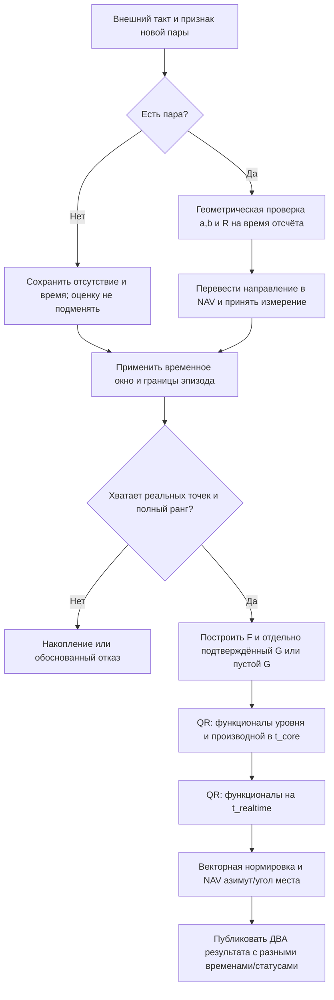

# Манифест ОИНО: двумерный фазовый пеленг, автокомпенсация и две временные точки оценки

**Проект:** `izio007/libtr`. **Редакция:** 23.10.2026. **Статус:** математическая спецификация и исследовательская MATLAB/Python-реализация; не аттестованное бортовое ПО и не натурная калибровка.

## 1. Принятое проектное решение

**Основной результат вычислительного ядра — ретроспективное оценивание внутри скользящего временного окна.** По умолчанию это его середина. Альтернатива — близкая к середине точка, выбранная для определённого функционала и явно отражённая во временной метке. **Отдельный результат для текущего момента** сохраняется ради совместимости с работающими в реальном времени потребителями. Он не заменяет и не пересчитывает задним числом основной выход.

Неподменяемые принципы:

1. Измеряются **два знаковых угла к плоскостям симметрии ССК**: `a` к плоскости `xz`, `b` к `xy`; это НЕ NAV-азимут/угол места.
2. Навигационная ориентация применяется **к каждому реальному отсчёту в его собственный момент времени**. Вращение ССК не должно приниматься за движение источника.
3. **Длительность окна измеряется секундами**, количество реальных пар в нём не фиксировано. Высокая частота не оправдывает децимации «чтобы влезло» без отдельного решения. При предельной выделенной памяти отказ выдаётся явно.
4. Входы, выходы, неопределённые состояния, окно и математическое ядро — разделённые ответственности. Дополнительный эвристический автомат состояний не вводится: в исходной архитектуре его не было.
5. Многолучёвость исключена. Негауссова фазоподобная модель генератора **синтетическая**, не объявляется измеренной с натурного прибора.
6. Из паспорта известна лишь одна числовая характеристика точности угла. В демонстрации принят условный `σпас = 0,35°` именно как СКО, это **не** характеристика конкретного прибора. Если паспорт задаёт предел, его не подменяют СКО.
7. Структура помех и истинная ковариация неизвестны. Ни частоту прибора, ни дрейф, ни истину из генератора в практический фильтр не передают. Помеховый базис `G` **по умолчанию пуст**.
8. Выдача оценки возможна отдельно от признания её достоверной: существуют `warming`, `ready`, `realtime`, `extrapolated`, `stale`, отказ вырожденного базиса и геометрическая неопределённость NAV-азимута.

## 2. Входной интерфейс и системы координат

Индекс $`k`$ задаёт действительный момент измерения $`t_k`$ (сек). Полная запись:

```math
Z_k=(t_k,m_k,a_k,b_k,R_{n\leftarrow s}(t_k)),\qquad m_k\in\{0,1\}.
```

При $`m_k=0`$ углов нет. Нули $`a=b=0`$ — допустимое существующее измерение. Для пары $`m_k=1`$:

```math
\begin{split} u_{s,y}&=\sin a_k,\qquad u_{s,z}=\sin b_k,\\ d_k&=1-\sin^2a_k-\sin^2b_k,\\ \mathbf u_{s,k}&=\left[\sqrt{d_k},\sin a_k,\sin b_k\right]^{\mathsf T},\qquad d_k>0,\\ \mathbf y_k&=R_{n\leftarrow s}(t_k)\,\mathbf u_{s,k}\in\mathbb R^3. \end{split}
```

Выбрана передняя ветвь ССК ($`u_{s,x}>0`$). При $`d_k<0`$ вход геометрически несовместим с этой моделью; при $`d_k=0`$ строгая передняя ветвь не определена. Нельзя молча выбирать другой знак, обрезать $`d_k`$ до нуля или трактовать $`a`$ как обычный азимут. Матрица ориентации $`R`$ должна быть собственным ортогональным преобразованием, **относящимся к $`t_k`$**, а не к моменту выдачи. Неизвестная погрешность навигационной ориентации пока не входит в паспортный параметр и в дальнейшем должна учитываться отдельно.

**Почему NAV-преобразование сделано ДО временного оценивания.** При известном во внешних осях постоянном направлении вращение приёмника создаёт видимое изменение $`a,b`$. Фильтрация их как будто в неподвижной ССК формирует ложные производные. Новое NAV-ядро сглаживает компоненты $`\mathbf y_k`$, а затем восстанавливает азимут и угол места. Это также исключает искусственный скачок азимута через $`\pm\pi`$; остаётся истинная геометрическая неопределённость на вертикали.

## 3. Временное окно и эпизод наблюдений

Пусть $`t_N`$ — последнее фактически наблюдавшееся время. При параметре $`T_w>0`$ выделяем реальные пары, удовлетворяющие

```math
t_N-T_w\le t_k\le t_N.
```

Дальше удаляются записи из предшествующих **несвязанных эпизодов** наблюдений. Функция `oino_ac_window_view` использует внешний наблюдаемый критерий: последовательные реальные пары принадлежат одному эпизоду, если временной разрыв $`\le T_{gap}`$. `T_gap` — **настраиваемое правило представления истории**, не оценка скрытой частоты шума. Явное состояние «вышли из сектора» может быть передано в отдельном менеджере событий; отсутствие одной пары само по себе не доказывает такой выход.

Фиксированная вместимость буфера — техническое ограничение памяти, не другое определение длины окна. Например, при $`100`$ Гц окно $`3{,}2`$ с содержит приблизительно $`321`$ отсчёт, включая оба конца, если они действительно есть. Если буфер заполнен до истечения окна, запись должна быть отвергнута с явным статусом, а не приводить к скрытому уменьшению временной глубины.

Во время пропуска допустим отдельный прогноз из **последнего известного эпизода** при явно заданном пределе времени прогноза. При возвращении данных после разрыва длиной более $`T_{gap}`$ новое окно начинает накопление заново. Пропуск не замещается фиктивными наблюдениями, нулём угла, усреднённой точкой или искусственным отсчётом из прошлой модели.

Существующая парадигма `oino2_track_*`/`oino2_time_window_*` сохранена. Добавлена необязательная величина `episode_gap_seconds` в инициализацию; старый вызов без неё имеет значение `Inf` и не меняет прежнего поведения. Новые экспликации: `oino_ac_window_view.m` (чистый срез без состояния) и `oino_ac_dual_epoch.m` (только вычисление, управление FIFO извне).

## 4. Две временные точки: строгие определения

Обозначим фактический диапазон **принятых** времён $`[t_0,t_N]`$, его середину $`c=(t_0+t_N)/2`$ и полудлину $`h=(t_N-t_0)/2`$. Для устойчивой реализации вычисляются разности $`t_k-t_0`$; абсолютное время не округляется до сотых/десятитысячных секунды.

```math
\tau_k=\frac{t_k-c}{h}\in[-1,1],\qquad\tau_q=\frac{t_q-c}{h},\qquad h>0.
```

Два выхода одного прохода:

| Поле | Момент | Смысл | Когда становится доступно |
|---|---|---|---|
| `core` | $`t_c=c+h\tau_c`$, $`\tau_c=0`$ или $`1/\sqrt5`$ | Основная **внутриоконная** оценка для математической обработки | Только после поступления последнего отсчёта $`t_N`$ данного окна |
| `realtime` | $`t_r=t_{pub}\ge t_N`$, $`\tau_r\ge1`$ | Совместимость с текущим временем / прогноз | При запросе потребителя; имеет самостоятельный статус |

Временная задержка основного выхода $`\Delta_c=t_{pub}-t_c`$ и возраст последнего измерения $`\Delta_m=t_{pub}-t_N`$ — **разные** показатели. Каждый результат публикует `time`, `publication_time`, `latest_measurement_time`, `latency_seconds` и `measurement_age_seconds`.

Политика `middle` — исходный приоритет, особенно при оценивании производных. Политика `near_middle` — разрешённая геометрическая точка $`\tau_c=1/\sqrt5`$ для квадратичного полинома $`P_0,P_1,P_2`$, уменьшающая номинальную дисперсию уровня на равномерной сетке при независимых равноточных ошибках. Это **не универсально оптимальное** положение при коррелированном негауссовом шуме, наличии $`G`$ или при быстро меняющемся полезном направлении. Оба результата вычисляются независимо по одним реальным данным: ретроспекция не подменяется простой экстраполяцией из середины.

## 5. Информационный базис, производные и краевая дисперсия

На текущем прототипе:

```math
F_{kj}=P_{j}(\tau_k),\quad j=0,1,2,\qquad P_0=1,\quad P_1=\tau,\quad P_2=\tfrac12(3\tau^2-1).
```

Для запроса $`t_*`$ вводятся векторы линейных функционалов

```math
\ell(t_*)=\begin{bmatrix}1&\tau_*&P_2(\tau_*)\end{bmatrix}^{\mathsf T}, \quad \ell'(t_*)=\frac1h\begin{bmatrix}0&1&3\tau_*\end{bmatrix}^{\mathsf T}.
```

Производная переводится из нормированного времени в физические секунды **множителем $`1/h`$**, а не оценкой среднего шага по количеству точек. В старом C-коде встречалось деление на приближение `gridstep` и снижение скорости для малого $`N`$; в новом математическом ядре ни численное округление результатов, ни искусственное занижение производной не применяются.

**Почему правый край хуже.** Для идеальной плотной равномерной независимой выборки и базиса степени 2 условная дисперсия оценки уровня пропорциональна

```math
V_{level}(\tau)\propto 1+3\tau^2+\tfrac54(3\tau^2-1)^2.
```

Её минимумы $`\tau=\pm1/\sqrt5`$; на краю $`\tau=1`$ дисперсия в **5 раз выше** минимальной. Для первой производной

```math
V_{rate}(\tau)\propto h^{-2}\,[3+45\tau^2],
```

минимум — $`\tau=0`$, а на краю дисперсия в **16 раз выше** середины. Отношения относятся только к указанной идеализированной модели, НЕ являются экспериментально измеренными характеристиками фазового пеленгатора.

Реальный критерий — $`\operatorname{MSE}=\operatorname{Var}+\operatorname{Bias}^2`$, а при разных требованиях к времени добавляется стоимость задержки. Выбор точки невозможно объявить оптимальным без модели ошибки аппроксимации, ограничений манёвра, статистики измерений и требований потребителя. Краевой эффект здесь преимущественно сочетание дисперсии и методического смещения, **не обязательно «эффект Гиббса»**.

## 6. Автокомпенсационный линейный функционал

На одном окне для любой NAV-компоненты $`y`$ исследуется локальная модель

```math
\mathbf y=F\theta+G\gamma+\varepsilon.
```

Матрица $`G`$ описывает **допущенное, исследуемое** помеховое подпространство. Если оно не установлено, $`G`$ имеет ноль столбцов; попытка компенсировать произвольное неизвестное воздействие строго математически невозможна. При работе в NAV приборная помеха исходно привязана к углам ССК, поэтому переход к точному линейному $`G`$ в NAV требует отдельного анализа временно меняющегося якобиана. Гармоники NAV-вектора здесь — **исследовательская модель**, а не окончательное описание прибора.

Для функционала $`L(y)=\ell^{\mathsf T}\theta`$ строится линейная оценка $`\widehat L=p^{\mathsf T}\mathbf y`$:

```math
\boxed{F^{\mathsf T}p=\ell,\quad G^{\mathsf T}p=0,\quad p^*=\underset{p}{\operatorname{argmin}}\;p^{\mathsf T}Kp.}
```

При заданной положительно определённой рабочей ковариации $`K`$ и полном ранге $`A=[F\;G]`$:

```math
p^*=K^{-1}A(A^{\mathsf T}K^{-1}A)^{-1} \begin{bmatrix}\ell\\0\end{bmatrix}.
```

Вычислительно используется **QR**, не явное обращение $`A^{\mathsf T}K^{-1}A`$. Условия несмещённости и инвариантности проверяются как $`\|F^{\mathsf T}p-\ell\|`$ и $`\|G^{\mathsf T}p\|`$. При линейной зависимости (например, $`G`$ содержит константу из $`F`$) возникает **отказ**; искусственный отсчёт не устраняет математическую неидентифицируемость.

Гауссовость не требуется для оптимальности в классе *линейных* оценок при правильно заданной ковариации. Но когда распределение и сама $`K`$ неизвестны, этот вывод не является гарантией оптимальности. Исследовательский вариант IRLS/Huber задаёт наблюдение-зависимые рабочие веса: он сохраняет **алгебраические** ограничения при фиксированных весах, но **не** доказывает безусловную линейность и несмещённость получившегося адаптивного статистического оценивателя. Ковариации, выдаваемые кодом, — `cov_work` (номинальные условные), а не автоматически доверительные интервалы с заявленным покрытием.

Автоматический поиск частоты в `oino_ac_discover.m` оставлен **вне штатного математического ядра**: обнаруженная периодичность может принадлежать самой цели. Запрещено без физической идентификации переносить её в рабочее $`G`$. Сравнение с `oracle_1p15` в датасете — только экспериментально заданная гипотеза для проверки предела возможностей.

## 7. Негауссова ошибка фазового пеленгатора и паспортное ограничение

Без многолучёвости один иллюстративный комплексный канал может описываться

```math
q_{j,k}=A_{j,k}\exp\!\big(i[\kappa_j\sin\theta_{j,k} +\delta\phi_{j,k}]\big)+n_{I,j,k}+i n_{Q,j,k},\quad j=a,b.
```

Операции `Arg` и `arcsin`, конечная амплитуда и редкие падения амплитуды делают ошибки итогового угла негауссовыми даже при условно гауссовых квадратурных добавках. В генераторе также есть общая временная корреляция, редкие импульсы и приборный дрейф. Набор параметров синтетический, поэтому его нельзя выдавать за «натурную» статистику приёмника.

Локальное рабочее преобразование паспортной неопределённости для данного фактического $`a_k,b_k`$:

```math
J_{s,k}=\begin{bmatrix} -\frac{\sin a_k\cos a_k}{u_{s,x,k}}&-\frac{\sin b_k\cos b_k}{u_{s,x,k}}\\ \cos a_k&0\\0&\cos b_k \end{bmatrix},\qquad J_{n,k}=R_{n\leftarrow s}(t_k)J_{s,k}.
```

Если **только в рабочем приближении** взять $`\operatorname{Cov}(a,b)=\sigma_{пас}^2I_2`$ и независимость разных моментов, то $`K_{n,k}^{work}=\sigma_{пас}^2J_{n,k}J_{n,k}^{\mathsf T}`$. Сначала для трёх компонент NAV-вектора учитывается это преобразование, затем веса функционалов и якобианы единичной нормировки/сферических координат. Истинные корреляции по времени и между каналами при этом остаются **неизвестными**; `cov_work` не следует рассматривать как калиброванную физическую неопределённость.

## 8. Из NAV-векторных оценок к азимуту, углу места и скоростям

По выбранной временной точке получаем невырожденные линейные функционалы от наблюдённых единичных направлений:

```math
\mathbf v(t_*)=\sum_k p_k(t_*)\mathbf y_k,\qquad \dot{\mathbf v}(t_*)=\sum_k p_k^{(1)}(t_*)\mathbf y_k.
```

Нормализация и касательная производная:

```math
\widehat{\mathbf u}=\frac{\mathbf v}{\|\mathbf v\|},\quad \widehat{\dot{\mathbf u}}= \frac{(I-\widehat{\mathbf u}\widehat{\mathbf u}^{\mathsf T})\dot{\mathbf v}}{\|\mathbf v\|}.
```

С ними, при $`h_{xy}=\sqrt{u_x^2+u_y^2}>0`$:

```math
\begin{aligned} \widehat\alpha&=\operatorname{atan2}(u_y,u_x),\\ \widehat\beta&=\operatorname{atan2}(u_z,h_{xy}),\\ \widehat{\dot\alpha}&=\frac{u_x\dot u_y-u_y\dot u_x}{h_{xy}^2},\\ \widehat{\dot\beta}&=\frac{\dot u_z}{h_{xy}}. \end{aligned}
```

Последняя формула использует единичную норму и касательность $`\widehat{\dot{\mathbf u}}\perp\widehat{\mathbf u}`$. При вертикали NAV-азимут геометрически не определён, нужно возвращать статус, а не число 0 как будто оно измерено. Линейная ОИНО-оптимальность относится **к компонентным функционалам** $`p^T\mathbf y`$, не автоматически к полученным нелинейным углам и нормализованной производной.

## 9. Численный воспроизводимый результат (контрольные данные, не натура)

Датасеты предоставлены из прежних синтетических исследований. Новый прогон: `tools/dual_epoch_reference.py`, 12 сохранённых файлов, $`T_w=3.2`$ с, $`T_{gap}=0.25`$ с как **параметр опыта**, P2, работающий робастный вес и **пустой** $`G`$. Значения сравниваются с истинными азимутом и его производной **строго на временной метке соответствующей оценки**, а не с истиной на последнем измерении. Истинные скорости численно дифференцированы по исходной сетке генератора, вне оценивающего кода. Перекрывающиеся окна не являются независимыми испытаниями, поэтому приведены описательные RMSE, не доверительные границы.

| Синтетический сценарий | NAV-азимут RMSE `realtime` | NAV-азимут RMSE `core` центр | `core` +1/√5 | Скорость азимута `realtime` | Скорость `core` центр |
|---|---:|---:|---:|---:|---:|
| Без регулярной периодики, негауссов шум | 0.5312° | **0.0945°** | 0.0903° | 0.3481°/с | **0.0766°/с** |
| Приборная периодика 1.15 Гц, без G | 0.4916° | **0.0762°** | 0.0629° | 0.4319°/с | **0.0862°/с** |
| Вращение ССК | 0.2857° | **0.0629°** | 0.0624° | 0.3195°/с | **0.0529°/с** |
| Высокая частота с выходами из сектора | 1.9994° | **0.0224°** | 0.0225° | 0.6410°/с | **0.0202°/с** |
| Белый шум | 0.1475° | **0.0638°** | 0.0521° | 0.2146°/с | **0.0392°/с** |
| Окрашенный шум и дрейф | 0.2648° | **0.1831°** | 0.1732° | 0.3661°/с | **0.1093°/с** |

В быстром сценарии очень плохой `realtime` — **не признак ошибки временной метки**, а зафиксированное ограничение продолжения одного квадратичного NAV-векторного полинома до правого края при резком изменении направления. Он остаётся доступным только как **совместимый, самостоятельно оцениваемый** выход. Разработчик/потребитель обязан учитывать его качество; нельзя подменять его центральным значением с текущей меткой. Это сравнение не говорит, что `core` всегда лучше для любой цели и любого сигнала, а демонстрирует необходимость выделения его в главный выход.

При $`T_w=3.2`$ с задержка `core` в рассматриваемых плотных сериях около 1.6 с для середины и 0.9 с для близкой точки. Это алгоритмическая задержка **наличия оценки относительно её физического аргумента**, а не задержка вычисления процессором.

**Контроль выполнения:** новый Python-тест `test_dual_epoch_reference.py`: 7/7 PASS; в прежнем исследовании имелись отдельные тесты автокомпенсации. MATLAB-тест `unit_test_oino_dual_epoch.m` подготовлен, но здесь не исполнялся (MATLAB Desktop отсутствует). Ни одна из тестовых CSV не используется как вход для оценки собственной статистики при вычислении выводимых в эксплуатации углов; колонки истины доступны только сценарию проверки.

## 10. Архитектура алгоритма и порядок шага



`core` публикуется после последнего отсчёта окна с меткой `t_core`, а `realtime` — в момент запроса. Их численная точность и пригодность независимы. Буфер и состояния остаются в `oino2_track_*` и `oino2_time_window_*`, чистое математическое ядро — в `oino_ac_dual_epoch.m`. Технический предел прогноза задаёт вызывающая система (`max_forecast_seconds`); по его превышении результат обозначается `stale`, даже если арифметически полином вычислен.

## 11. Пределы и незавершённые исследования

1. Неизвестная $`G`$: сам факт обнаружения частоты не идентифицирует её как приборную. При совпадении подпространств $`F`$ и $`G`$ нет линейной оценки, которая одновременно сохраняла бы полезный сигнал и полностью компенсировала такое воздействие.
2. Настоящие межканальные и временные корреляции ошибок не измерены, ковариация по одному паспортному числу оценена только условно. Негауссовый хвост и корреляции могут сделать рабочую оценку `cov_work` некалиброванной.
3. Криволинейная траектория может давать большую методическую ошибку квадратичного полинома, особенно на границе; недостаток модели движения нельзя исправить переносом $`t_c`$ без анализа адекватности базиса.
4. Линейная автокомпенсация после NAV-перехода не тождественна автокомпенсации исходных углов ССК: строгий приборный базис в NAV пока не идентифицирован.
5. Для эксплуатации требуется реальная запись фазового пеленгатора и синхронизированной навигации, расшифровка паспортной «погрешности», определение времени измерения, паспортной области и однозначности, допустимая задержка и критерии пригодности производных.
6. Результаты MATLAB / Python на одних и тех же входах необходимо сравнить отдельным фактическим прогоном; C99, резервирование памяти и контроль времени вычислений — дальнейшие этапы.

## 12. Файлы, интерфейсы и воспроизведение

| Назначение | Файл |
|---|---|
| Главный NAV-ОИНО с двумя временными точками | `matlab/function/oino_ac_dual_epoch.m` |
| Автокомпенсационные веса с QR | `matlab/function/oino_ac_weights.m` |
| Функционалы в исходных двух углах (эксперимент) | `matlab/function/oino_ac_functionals.m` |
| Обёртка двух точек для углов ССК | `matlab/function/oino_ac_functionals_dual.m` |
| Выбор реального эпизода без управления состоянием | `matlab/function/oino_ac_window_view.m` |
| Существующая NAV-GLS совместимость: основной и текущий запрос | `matlab/function/oino2_track_query_dual.m` |
| Менеджер временного окна и реконфигурация | `matlab/function/oino2_time_window_*.m` |
| Бортовой вход и состояния (без новой фильтрующей эвристики) | `matlab/function/oino2_track_*.m` |
| MATLAB аналитические и датасетные тесты | `matlab/tests/unit_test_oino_dual_epoch.m` |
| Python независимый датасетный расчёт | `tools/dual_epoch_reference.py` |
| Python аналитические тесты | `tools/test_dual_epoch_reference.py` |
| Результаты по конкретным временным точкам | `runtime/oino_dual_epoch/per_window.csv`, `summary.csv` |

Из корня объединённого `libtr`: `addpath('matlab'); status=run_tests;` запускает штатные unit-тесты MATLAB. Для локальной проверки только новой темы: `addpath('matlab/tests'); setup_test_paths; unit_test_oino_dual_epoch`. Не очищать рабочее пространство и не запускать чужие фоновые процессы.

В папке приложенного комплекта:

```bash
OPENBLAS_NUM_THREADS=1 python tools/dual_epoch_reference.py
OPENBLAS_NUM_THREADS=1 python -m unittest discover -s tools -p 'test_dual_epoch_reference.py'
```

Отчёты старого эксперимента `runtime/oino_ac/*` сохранены **как исторические результаты со старой правокраевой временной точкой**. Их нельзя без переоценки истины на той же временной метке объединять с новыми метриками. Рабочая ветка GitHub данным комплектом не изменялась.

## 13. Научные основания и внутренние принципы

- Ю. Г. Булычев, А. Г. Кондрашов, П. Ю. Раду, А. В. Ячменёв, «Численно-аналитический метод описания и оценивания входных и выходных параметров многомерного динамического объекта. Ч. II», *Автометрия*, 2020, т. 56, № 6, с. 107–119. DOI: [10.15372/AUT20200612](https://doi.org/10.15372/AUT20200612). **Особенно с. 115–116:** центральное положение узла скользящего окна и оценивание значения/производной по центральной временной метке.
- Ю. Г. Булычев, А. Г. Кондрашов, П. Ю. Раду, А. В. Ячменёв, «… Ч. I», *Автометрия*, 2020, т. 56, № 3. [Оригинал](https://sibran.ru/upload/iblock/89e/89e897dc92acbbdf783a9f024d173ae9.pdf).
- Ю. Г. Булычев, А. В. Мельников, «Численно-аналитический метод исследования поведения динамической системы по результатам некорректных наблюдений без расширения пространства состояний», *ЖВМиМФ*, 2019, т. 59, № 6. [MathNet](https://www.mathnet.ru/zvmmf10905).
- `libtr/.clinerules`, `Principes/PaeroPrincipe.md`, `Principes/VPrincipe.md`, `Principes/testing_methodology.md`, `Principes/V_PROCESS_CONFIGURATOR.md`: корректность математической модели, отдельные функции, проверяемые границы и минимум необходимого процесса.

*Примечание о соответствии исходному методу:* авторские работы рассматривают заданные информационные и помеховые подпространства и их инвариантные линейные функционалы. Здесь рассматривается дальнейшая исследовательская задача с неизвестным $`G`$, негауссовым фазовым выходом и меняющейся ориентацией ССК. Нельзя приписывать авторам доказанные свойства для этих расширений без отдельного вывода.
