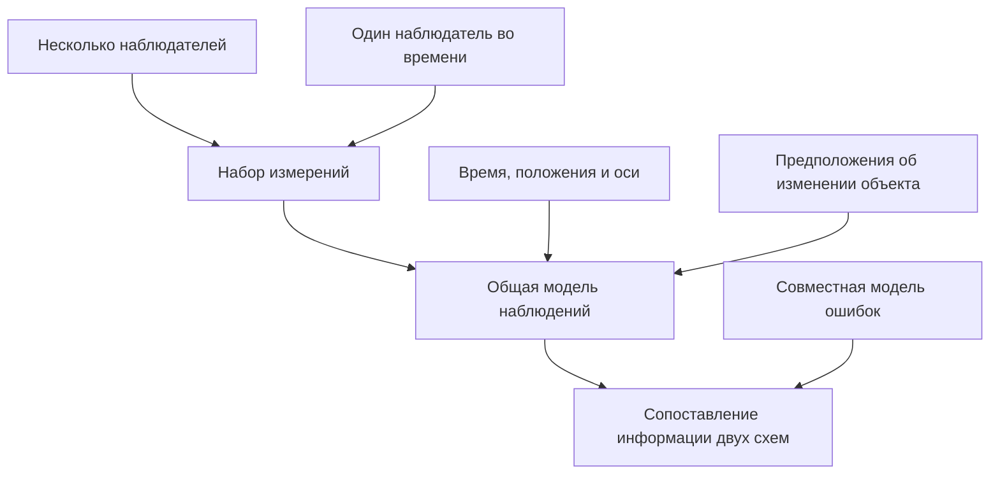
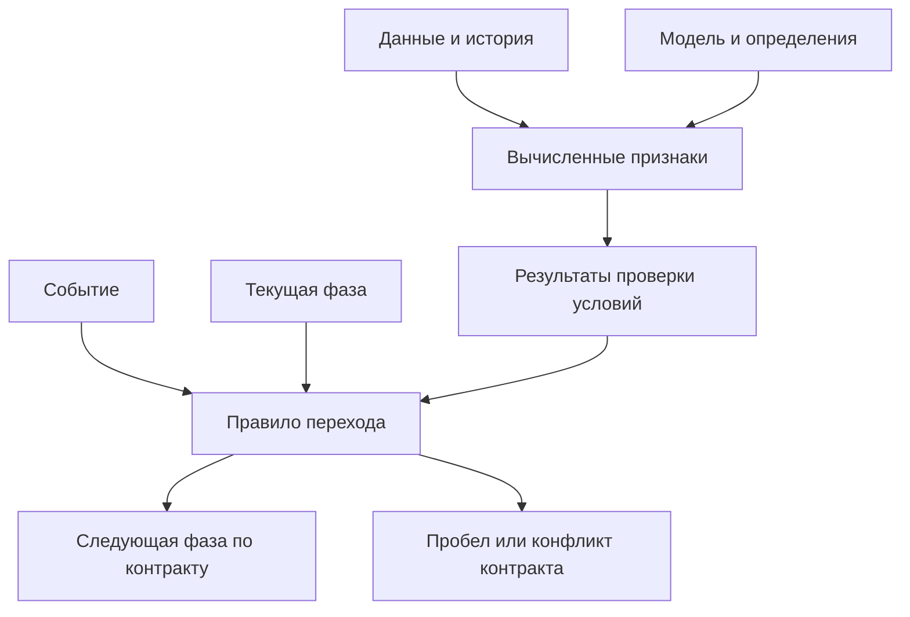
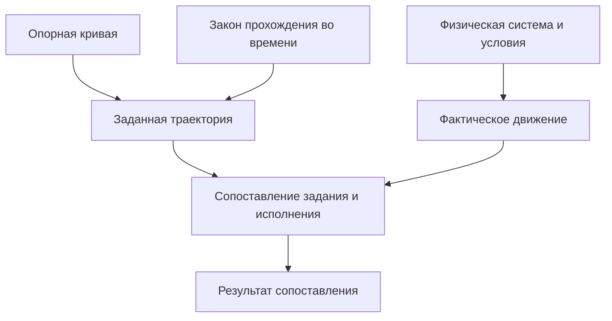
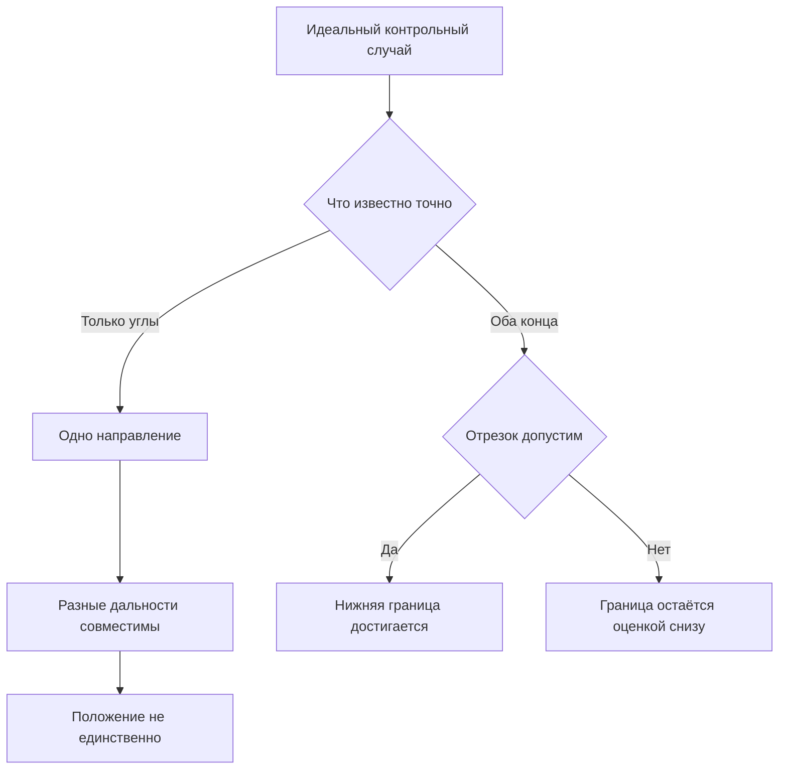

# Вторичная обработка АЗ/УМ: конспект, матрицы исходов и справочник формул

Конспект связывает исходные данные, геометрическую и временную модели, смысл вычислений, условия переходов и проверку результата. Все расчётные формулы собраны в разделе 13, без выводов и доказательств; в основном тексте стоят ссылки F01–F15. Для каждого обозначения указаны смысл и область применения.

Центральная мысль: несколько наблюдателей и один перемещающийся наблюдатель могут входить в общую модель наблюдений. Их эквивалентность зависит от условий наблюдения и предположений об изменении объекта. Выходной сплайн рассматривается как пространственная кривая; её представление, выбор и фактическое исполнение имеют разные основания.

**Порядок чтения:** разделы 1–7 — смысл задачи; раздел 8 — матрица исходов; разделы 9 и 11 — связь с предоставленными материалами; раздел 10 — смысл сплайна; раздел 12 — идеальные контрольные случаи; раздел 13 — все формулы; раздел 14 — связный устный ответ.

Проверены формулы, приведённые в этом конспекте. Разбор приложенных карточек и патента отделён от проверки оригинальных книжных формул: полных текстов книг среди использованных материалов нет.

## 1. Принятые границы задачи

Это уточнения условия, сообщённые пользователем. Далее они принимаются как исходные предпосылки.

| Положение | Как оно используется |
|---|---|
| Рассматривается главный лепесток антенны | Слово «сектор» далее относится к заданной в условии области главного лепестка |
| Приёмник находится вне рассматриваемой задачи | Его внутреннюю работу не моделируем |
| Приёмник постоянно регистрирует что-то в полосе | Этот факт не используется как отдельное событие появления углового измерения |
| Поиск или распознавание нового сигнала не требуется | Соответствующие проверки не вводятся |
| Если выдана пара АЗ/УМ, она пригодна | Пара непосредственно используется как измерение; повторной проверки пригодности нет |

**На рассматриваемом входе различаются два случая: новая пара АЗ/УМ выдана либо новой пары нет.**

Предыдущие рассуждения о выделении полезного сигнала, SNR/SINR, повторном подтверждении принадлежности сигнала и отбраковке выданных углов не входят в эту постановку. Они были добавлены в прежний конспект слишком широко.

Временная привязка и система координат нужны для математического смысла данных. Они не являются повторной проверкой работы приёмника.

### Что здесь означает вторичная обработка

В рассматриваемой постановке работа начинается с уже сформированных измерений. По их истории и принятой математической модели получают оценки интересующих величин и определяют, какие выводы позволяют сделать имеющиеся данные. Значение оценки, момент, к которому она относится, и её неопределённость имеют разный смысл.

Пригодность входного измерения не делает эту работу лишней. Даже пригодная пара углов описывает направление в определённый момент, а для вывода о процессе во времени нужна история. Если измерения имеют заданную неопределённость, её учитывают при оценивании [3]. Это не повторная проверка пригодности.

Термин «трасса» в таком обсуждении относится к связанным во времени сведениям об одном наблюдаемом объекте. Определять принадлежность измерений новому источнику в этой задаче не требуется: дополнительную задачу распознавания сюда не добавляем.

## 2. Как записать вход без лишних сущностей

На входе различаются **наличие новой пригодной пары** и **отсутствие новой пары**. Формальная запись находится в F01.

Пара содержит азимут и угол места. Если пары нет, угловое значение отсутствует: подстановка двух нулей изменила бы смысл входа, поскольку нулевые углы являются полноценным измерением. Сохранённую старую пару также нельзя выдавать за новую.

Индекс наблюдения — номер рассматриваемой позиции в данных. Сам по себе он не является физическим временем. Если дан только список успешно полученных измерений, количество пропусков из числа записей не определяется: нужно знать, когда наблюдение ожидалось, либо иметь отдельное сообщение об отсутствии пары.

Для обсуждения изменений во времени нужен момент, к которому относится выданная пара. Он может быть частью записи или следовать из заданного временного расписания. Момент получения сообщения может отличаться от момента наблюдения; это различие сохраняется и при точных углах.

## 3. Геометрический смысл двух углов

В справочнике приняты декартовы ортонормированные оси: z вертикальна; азимут отсчитывается в плоскости xy от x к y; угол места — от плоскости xy. Формулы углов и единиц приведены в F02, единичного направления — в F03. Это соглашение соответствует стандартному преобразованию сферических координат [1].

При точных углах и известном начале наблюдения возможные положения лежат на луче F04. **Дальность в одной паре углов отсутствует.** Две различные положительные дальности на этом луче дают разные точки с одним направлением. Это установленная неединственность положения для одной пары, включая случай совершенно точных измерений.

При наличии угловой неопределённости F04 описывает луч измеренного направления. Требовать, чтобы истинное положение лежало точно на этом луче, уже нельзя. Смысл идеального случая и случая с ошибками нужно различать.

Азимут периодичен. На вертикальном направлении он не определяет отдельную геометрическую степень свободы: все значения азимута дают один вертикальный вектор. Это свойство координат, а не основание повторно отбраковывать пригодную пару. Соответствующие проверки собраны в F02–F03.

### Что означает описание главного лепестка

Предмет определён: главный лепесток антенны. Для количественной проверки принадлежности его области нужны правило задания границы, оси и момент времени. Правило берётся из условия или описания антенны; его нельзя молча подменить любой удобной шириной, например шириной по половинной мощности [2].

Направление и область лепестка должны быть выражены в согласованных осях. Поворот измерительной системы может изменить относительные углы при неизменном внешнем направлении.

### Пригодность и точность

Условие «измерение пригодно» принимается полностью. Оно не задаёт численной ошибки угла. Если углы считаются точными, это отдельное допущение. Если задана их неопределённость, она учитывается в выводах без повторной проверки пригодности. Численная оценка и характеристика её неопределённости имеют разный смысл [3].

## 4. Один наблюдатель по оси времени и несколько наблюдателей

### Общая постановка

Количество приборов само по себе не определяет математический класс задачи. Существенны состав измерений, известные условия их получения и связь неизвестных величин во времени.

В общей модели F06 одно наблюдение связывает неизвестные характеристики объекта, известный контекст измерения и выданную пару углов. В контекст входят необходимые сведения о положении наблюдателя и ориентации осей. Индекс может относиться к разным приборам либо к разным моментам одного прибора.

Аддитивная запись угловой ошибки в F06 имеет локальную область применения. Обычное сложение двух чисел нельзя без оговорок переносить через разрыв шкалы азимута и на координатную особенность вертикального направления.

### Неподвижный и движущийся объект

Если рассматриваемые характеристики неизменны, наблюдения относятся к одному неизвестному состоянию. Если характеристики изменяются, нужна модель их связи во времени. Обе записи находятся в F07.

В идеальной геометрической постановке одинаковые условия наблюдения одного неизменного объекта задают одинаковые ограничения независимо от того, созданы они несколькими приборами одновременно или одним прибором последовательно. Это обоснованная часть идеи о «растягивании вторички по оси времени».

При изменяющемся объекте равенство схем требует отдельного обоснования. Известность движения наблюдателя не делает известным движение объекта. Длительное наблюдение без модели связи состояний также не создаёт такую связь.

Приближение «изменение объекта мало» оценивается относительно требований к результату. Медленное движение наблюдателя само по себе его не обосновывает.

### Три смысла эквивалентности

| Смысл | Что нужно сопоставить |
|---|---|
| Геометрический | Один неизменный объект либо согласованную модель его изменения; условия и смысл каждого наблюдения |
| Статистический | Дополнительно — совместную модель ошибок, включая смещения, различия точности и корреляцию |
| Практический | Время получения результата, длительность наблюдения и доступность необходимых сведений |

Общая модель допускает оба способа получения данных. Равенство информации и точности требует перечисленных условий. Из числа приборов нельзя автоматически вывести независимость ошибок; из последовательности измерений — их полную зависимость.

В карточке издания 2008 года отдельно отмечены ошибка неодновременности, известность положений пунктов и интервалов времени, специальные предположения о движении [6].

### Однозначный смысл времени

В этом конспекте $\tau$ — время наблюдения относительно общего начала; связь с $t$ задана в F05. Это соглашение о записи. Если в исходном задании $\tau$ имеет иной смысл, нужно явно установить связь обозначений.

Порядок записей не задаёт длительности промежутков. Параметр пространственной кривой $s$ также не объявляется временем.

## 5. Что можно заключить при пропуске

При пропуске достоверно установлено: **новое угловое измерение не выдано**.

Из того, что приёмник исключён из задачи, не следует, что причина пропуска уже известна. Если интерфейс содержит только АЗ/УМ либо отсутствие пары, отдельного сообщения о причине в нём нет.

Нужно различать:

| Утверждение | Его смысл |
|---|---|
| Нового измерения нет | Факт о выходе измерительного модуля |
| Направление находится вне заданной области главного лепестка | Утверждение о геометрии |
| Пропуск обусловлен помехой | Утверждение о физической причине |

Второе и третье утверждения не следуют автоматически из первого.

Сведения о геометрии могут дать основания для геометрического объяснения. Для этого они должны действительно быть известны в рассматриваемый момент. Последняя выданная пара относится к своему времени; при следующем пропуске она не устанавливает точное текущее направление сама по себе.

Если в учебной модели отдельно задана строгая связь между геометрией и выдачей измерений, выводы можно делать в рамках этого допущения. При отсутствии такой связи её нельзя добавлять только для получения однозначного ответа.

Также нельзя молча считать два объяснения взаимоисключающими: наличие геометрического изменения само по себе не исключает помехи.

**Вывод по одному сообщению об отсутствии пары:** факт пропуска установлен; сам символ отсутствия не кодирует его причину. Если несколько объяснений допускают один и тот же вход, правило единственного выбора причины из этого входа не обосновано. Для более сильного вывода нужно назвать конкретную дополнительную связь в модели, которая исключает альтернативы.

## 6. Новое измерение, история и расчётная оценка

| Вид данных | Как его трактовать |
|---|---|
| Новая выданная пара | Пригодное измерение на указанный момент наблюдения |
| Предыдущая выданная пара | Историческое измерение на прежний момент |
| Значение по математической модели | Расчётная оценка с явно заданными предположениями |
| Отсутствие новой пары | Нового углового наблюдения нет |

Пригодное измерение сохраняет статус исторического измерения при следующем пропуске. Оно не становится наблюдением нового момента.

Возраст последнего доступного наблюдения рассчитывается по F08. Используется время самого наблюдения, а не автоматически время поступления сообщения. До первой пары возраст отсутствует. Повторное чтение старого числа и получение задержанного сообщения не делают само наблюдение более свежим.

Для сравнения времён нужна одна шкала. Отрицательный возраст при заявленном прошлом наблюдении указывает на несогласованность временных данных или их толкования; его нельзя молча приравнивать к нулю.

## 7. Что это меняет в объяснении фаз

В этой постановке **не нужны фазы проверки пригодности выданной пары, распознавания нового сигнала или обследования приёмника**. Эти задачи не относятся к рассматриваемому уровню.

Содержательный вопрос о фазах остаётся: как изменяется работа с информацией, когда новые измерения поступают, отсутствуют или возобновляются? Ответ должен учитывать доступные сведения и принятую модель. Он не должен повторно решать задачу, которую уже выполнил измерительный модуль.

Появившаяся после перерыва пара сразу пригодна по входному контракту. Для использования самой пары не требуется вводить дополнительную фазу её подтверждения. Если отдельный вывод о процессе зависит от истории нескольких наблюдений, это другое требование; его нужно обосновать отдельно, а не называть повторной проверкой измерения.

### Фаза, событие и условие

| Понятие | Смысл в учебном разборе |
|---|---|
| Фаза | Сохраняемый режим работы с информацией |
| Событие | Факт, с которым связано рассмотрение возможного перехода |
| Признак | Вычисленная величина, например возраст последнего наблюдения |
| Условие | Логическое утверждение о доступных данных, признаках и памяти |
| Переход | Изменение режима согласно явно заданному правилу |

Формальная запись вычисления условий и выбора следующей фазы приведена в F09. Это обозначение двух разных ролей, а не готовые численные критерии переходов.

Отдельное вычисление условий означает, что функция признаков отвечает на вопрос о данных, а правило перехода — о смене режима. Различие события и условия перехода используется в общих описаниях конечных автоматов, в том числе SCXML [4]. Оно не требует специальной программной платформы.

Факт пропуска, его возможная причина и режим процесса остаются разными понятиями. Название фазы не должно приписывать пропуску недоказанную причину.

### Минимально полное описание одной фазы

| Часть описания | Что должно быть определено |
|---|---|
| Назначение | Какой результат обработки информации поддерживается в этой фазе |
| Память | Какие прежние сведения используются и к каким моментам они относятся |
| События | При каких фактах рассматривается изменение фазы |
| Признаки | Какие величины нужны для решения и из каких доступных данных они получаются |
| Условия | Точное утверждение, смысл его параметров и область применимости |
| Переходы | Следующая фаза для каждого разрешённого сочетания события и условий |
| Пограничные случаи | Равенство границе, недостаточность данных, конфликт условий и отсутствие подходящего правила |
| Выдаваемый результат | Что разрешено утверждать, на какой момент и при каких предположениях |

Это содержание описания, а не требование вводить отдельные классы, очереди или службы. Конкретное число фаз из этой таблицы не следует.

Нижние блоки показывают исход анализа описания: если правило полное, следующая фаза определена; если правила не хватает, это обнаруженный пробел. Диаграмма не превращает пробел в произвольное действие.

Проверки должны опираться на согласованный набор данных одного рассматриваемого шага. Если одновременно разрешены несовместимые переходы, нужно явно заданное правило приоритета либо исправление противоречия. Если условие неизвестно, его нельзя молча заменить значением «ложь». Автоматическое сохранение прежней фазы также не является универсальным правилом: такая реакция должна входить в описание конкретной задачи.

## 8. Матрицы исходов и полнота рассуждений

### 8.1. Что именно должно завершаться определённым результатом

Короткой записи «не установлено» недостаточно для содержательного ответа. Нужно указать **проверяемое утверждение, основание результата и точное ограничение вывода**.

| Ситуация | Содержательный итог |
|---|---|
| Найдены два допустимых варианта с разными значениями искомой величины | Единственность опровергнута; предъявляются оба варианта |
| Доказано, что ограничения несовместимы | Решения в указанной модели нет; называется противоречие |
| Получено одно допустимое решение | Существование подтверждено; единственность требует отдельного основания |
| Условия вывода выполнены и вывод получен | Результат подтверждён в названной области применения |
| Не задано необходимое определение | Указывается отсутствующее определение: например, правило включения границы области |
| Не хватает необходимого входа | Указывается конкретная величина или связь, которую нельзя восстановить из имеющегося входа |
| Вычисление не завершилось | Вычислительного результата нет; это не утверждение о физической ситуации |
| Свойство ещё не проверялось | Проверка отсутствует; это нельзя выдавать за доказанную невозможность |

Существование, единственность и устойчивость обратной задачи проверяются раздельно [10]. Наличие численного ответа не доказывает все три свойства. При оценивании с ошибками решение понимается в рамках выбранной постановки; отсутствие точного пересечения идеализированных ограничений не делает выданные пары непригодными.

**Пример завершённого отрицательного результата:** для одной точной пары углов единственность пространственного положения опровергается двумя разными положительными дальностями на одном луче — F04 и проверка К01. Это конкретный математический результат.

### 8.2. Полная матрица двух конкурирующих условий

Рассматриваются одна текущая фаза, одно событие и два перехода, которые по смыслу должны быть взаимоисключающими. Условие первого обозначено $b_1$, второго — $b_2$. Их значения: **T** — истинно, **F** — ложно, **U** — значение пока нельзя получить по имеющемуся определению и данным.

Для матрицы введены четыре результата:

- **П1:** разрешён только первый переход.
- **П2:** разрешён только второй переход.
- **Н:** ни один переход не разрешён этими условиями.
- **К:** оба перехода разрешены; без дополнительного правила имеется конфликт выбора.

| $b_1$ \ $b_2$ | F | T | U |
|---|---|---|---|
| **F** | Н | П2 | Н или П2 |
| **T** | П1 | К | П1 или К |
| **U** | Н или П1 | П2 или К | Н, П1, П2 или К |

В ячейках с несколькими вариантами перечислены возможные исходы после получения недостающего значения. Это точная область вариантов, а не разрешение произвольно выбрать один из них. Дополнительные связи между условиями могут исключить часть вариантов; такие связи должны быть заданы явно.

Матрица даёт девять проверяемых сочетаний вместо общей фразы «обработать все случаи». Для U указывается конкретная причина: недостающий вход, отсутствующее определение, незавершённая проверка или вычислительная ошибка.

**Если все условия определены и вычислимы, остаются четыре сочетания T/F.** Среди них по-прежнему есть Н и К. Отсутствие измерительного шума не устраняет пробелы и противоречия логики.

Для Н контракт должен явно сказать, допустимо ли отсутствие перехода и что это означает. Для К нужен согласованный приоритет либо исправление взаимоисключающих условий. Такие реакции относятся к описанию автомата. Сама эта матрица не назначает физические действия и не определяет причины пропусков.

Трёхзначная таблица используется здесь как средство анализа полноты. Она не объявляется стандартной семантикой SCXML: в SCXML условия переходов и правила разрешения конфликтов заданы собственной спецификацией [4].

### 8.3. Каталог существенных случаев входа и результата

| Ситуация | Явный результат анализа |
|---|---|
| До первого измерения | Углового наблюдения ещё нет; время последнего наблюдения и его возраст отсутствуют |
| Получена первая или возобновившаяся пара | Имеется пригодное измерение на указанное время; повторное подтверждение пары не требуется |
| Новая пара отсутствует, история есть | Исторические измерения сохранены; нового измерения нет |
| Получено значение по модели | Это расчётная оценка на указанный момент с указанными предположениями |
| Сообщение задержано | Момент получения не заменяет момент наблюдения |
| Время или согласование осей не заданы | Нужное сравнение не имеет определённого смысла до задания конкретной временной или координатной связи |
| Текущая геометрия отсутствует | Последнее историческое направление не устанавливает текущее без модели его изменения |
| Выход из области лепестка независимо установлен | Геометрический факт подтверждён; единственная физическая причина пропуска этим ещё не доказана |
| Текущее направление известно и находится внутри области, но пары нет | Геометрический выход для этого момента опровергнут; конкретная иная причина требует собственного основания |
| Направление лежит точно на границе | Результат определяется заранее принятым правилом включения границы; точность измерения этого правила не заменяет |
| Неопределённость пересекает границу | Доступная информация допускает положения по обе стороны; перечисляются соответствующие варианты |
| Связь состояний объекта во времени не задана | Объединение разновременных измерений в одно неизвестное состояние не обосновано |
| Два допустимых варианта дают разные значения искомой величины | Единственность опровергнута |
| Обнаружено противоречие модели | Указывается конкретное несовместимое требование; причина не приписывается приёмнику |
| Значение вычислено, устойчивость или точность не проверены | Значение получено; названное свойство ещё не проверено |
| Вычисление не завершилось | Результат вычисления отсутствует; входное измерение от этого не исчезает |
| Все заданные условия рассматриваемых переходов ложны | Получен результат Н; контракт определяет смысл отсутствия перехода |
| Одновременно разрешены несовместимые переходы | Получен результат К; нужен согласованный приоритет либо исправление условий |
| Поведение для ситуации вообще не описано | Обнаружена неполнота контракта; её нельзя подменять результатом Н |
| Сплайн есть, временного закона нет | Определена геометрическая кривая |
| Временной закон есть, физическая выполнимость не проверена | Задана траектория во времени; проверка выполнимости отсутствует |
| Выполнимость подтверждена в модели, исполнение не проверено | Подтверждение относится к модели; данных о фактическом соответствии ещё нет |

Это разные аспекты ситуации, поэтому их не следует сжимать в один общий статус. Например, наличие истории и отсутствие текущего геометрического знания совместимы.

Полнота достигается относительно объявленных входов, моделей и требований. Полный перечень исходов проверки не означает, что физическая причина любого события становится однозначно наблюдаемой.

## 9. Как связать это с Мельниковым

Прочитаны две приложенные Markdown-карточки [6, 7]. Они содержат записи о чтении книг и ограничениях использованных результатов. Сами книги в этом проходе не предоставлены и не объявляются прочитанными. Ниже приведена карта содержания по карточкам; собственные поясняющие формулы этого конспекта не приписываются авторам книг.

| Материал | Что отмечено в карточке | Связь с учебной задачей |
|---|---|---|
| Мельников, 2005 | Просмотрены оглавление и выбранные вводные страницы; основные главы не прочитаны | Системная связь общей эффективности с исходными данными и характеристиками аппаратуры; оснований приписывать этому просмотру конкретные алгоритмы нет |
| Мельников и Попов, 2008, глава 1 | Известность положения пунктов, принадлежности наблюдений, модель погрешностей; специальные условия отдельных результатов | Для каждого вывода нужно фиксировать исходные предпосылки |
| §§ 2.1–2.2, с. 66–85 | Неодновременность, редкость и нерегулярность измерений; интервалы времени входят в модель | Непосредственная связь с идеей распределения наблюдений вдоль оси времени |
| § 2.3, с. 85–92 | Предвычисленные углы и вклад прогнозирования в погрешность | Расчётное значение и новое измерение имеют разное происхождение |
| §§ 2.4–2.5, с. 92–109 | Роль дополнительных сведений о движении; различие оценки текущего положения и прогноза | Нужно указать, что известно о движении и к какому моменту относится результат |
| § 2.6, с. 110–116 | Роль дополнительных сведений о движении | Измерения и предположения совместно задают постановку, но не подменяют друг друга |

В карточке издания 2008 года специально различаются два основания классификации: **состав физически измеряемых величин** и **математический способ их обработки** [6]. Это полезная основа системного ответа: азимут, несколько пунктов наблюдения, модель движения, метод оценивания и сплайн описывают разные стороны задачи. Их нельзя перечислять как взаимозаменяемые методы одного уровня.

Для подготовки по данному вопросу приоритетны отмеченные в карточке §§ 2.1–2.5: они связывают время, исходные сведения и смысл результата. Это выбор темы для чтения, а не утверждение о наличии в этих разделах готовой фазовой спецификации.

## 10. Место сплайна

По уточнению условия, выходной сплайн представляет пространственный путь дальнейшего движения. Это не сглаженная зависимость азимута или угла места от времени.

### Геометрический путь, заданная траектория и исполнение

Слово «опорный» обозначает назначение кривой как задания. Оно не сообщает, как кривая выбрана, допустима ли она для физической системы и будет ли исполнена.

Используем разные обозначения:

| Объект | Обозначение | Что задано |
|---|---|---|
| Геометрический путь | $\gamma(s)$ | Точки выбранной кривой при изменении её параметра |
| Закон прохождения | $s(t)$ | Как параметр меняется с физическим временем |
| Заданная траектория | $\mathbf r_{\mathrm{ref}}(t)$ | Желаемое положение в каждый момент |
| Фактическое движение | $\mathbf r_{\mathrm{fact}}(t)$ | Реальное положение системы во времени |

Связь первых трёх объектов задана в F12. Запись участков кубического сплайна и условия их склейки находятся в F10–F11.

Разделение геометрического пути и временного закона является стандартным учебным представлением траектории [8]. Параметр $s$ не объявляется физическим временем. Один и тот же путь допускает разные расписания движения.

Схема разделяет предметы описания и не задаёт структуру системы управления. Отсутствие отдельного блока управления на рисунке не означает, что функция исполнения не нужна.

**Из наличия опорного сплайна необходимость управления не исчезает.** Можно вынести исполнение за границу рассматриваемой вторичной обработки или в идеализированной учебной модели явно постулировать точное следование заданию. Во втором случае это допущение модели, а не свойство сплайна. Фактическое соответствие заданию требует собственного основания.

### Три самостоятельных вопроса к опорному сплайну

| Вопрос | Что требуется установить | Чего недостаточно |
|---|---|---|
| Геометрическое соответствие | Выполнение заданных требований ко всей нужной части кривой | Красивого рисунка или проверки только выбранных точек |
| Физическая выполнимость | Возможность выполнить заданное движение рассматриваемой системой в указанных условиях | Гладкости кривой без временного закона и физических предпосылок |
| Соответствие фактического движения | Согласованность реального исполнения с заданием по установленному критерию | Факта построения математической функции |

У классического кубического сплайна со склейкой C² непрерывны сама функция и её первые две производные по параметру. Кусочно-кубическая запись без условий склейки этого не обеспечивает [11]. Между заданными точками возможны колебания и выход за диапазон их значений; гладкость и ограничения на значения — разные свойства [9]. Непрерывность производной также не задаёт численной границы её величины.

Если требование относится ко всему интервалу кривой, его подтверждение только в узлах не доказывает выполнение между ними. Конкретный способ проверки зависит от сформулированного требования. Повышение степени сплайна не заменяет это требование.

### Главный лепесток и пространственная кривая

Область главного лепестка описывает **относительные направления**, а сплайн — пространственный путь. Из одной диаграммы направленности не получается готовая область допустимых пространственных точек.

Чтобы утверждение о геометрическом соответствии имело определённый смысл, должны быть согласованы момент времени, положение наблюдателя, направление на объект и ориентация измерительных осей. Если необходимые сведения известны только в виде оценки, вывод должен сохранять её предположения и неопределённость. При недостатке сведений геометрическое соответствие остаётся неустановленным.

Само требование «на выходе сплайн» не определяет, какую именно кривую следует выбрать: нужны цель её выбора, граничные условия и ограничения. Одна пара углов этих требований не задаёт.

В прежнем учебном упрощении использовались заранее заданные пространственные точки. Это отдельная задача построения кривой, а не восстановление исходной задачи выбора пути из АЗ/УМ. Подменять одно другим при ответе на экзамене нельзя.

Наличие гладкой кривой не означает наличия нового измерения. Сплайн не добавляет дальность к одной паре углов и не устанавливает физическую причину отсутствия следующей пары.

## 11. Что даёт приложенный патент

Источник: RU 2842327 C1, представленный PDF [5]. Ниже указаны номера страниц PDF; они совпадают с печатной нумерацией документа. Это сопоставление содержания источника с учебным условием.

### Реальная постановка в источнике

Авторы описывают получение направлений от нескольких наблюдателей, обмен и накопление этих сведений, а затем совместное использование результатов трассовой обработки и триангуляционного оценивания. Описанный результат — сведения о местоположении; на странице 9 также обсуждаются параметры движения и ошибки оценивания [5, с. 6–9].

| Вопрос | Что написано в патенте | Следствие для подготовки |
|---|---|---|
| Откуда берутся измерения? | Используется группа наблюдателей и обмен их сведениями [5, с. 6–7] | Перенос к одному наблюдателю во времени требует сопоставления модели изменения объекта и условий наблюдения; сам по себе он не исключён |
| Какие углы используются? | В описании собственного способа указаны однокоординатные пеленгаторы, измеряющие азимут [5, с. 8] | Нельзя автоматически считать это готовым описанием задачи с АЗ/УМ |
| Почему в тексте встречается угол места? | Пара азимут/угол места упоминается при изложении другого решения в обзоре предшествующих работ [5, с. 5] | Следует различать обзор чужих решений и собственный способ авторов |
| Как отражено отсутствие данных? | Введён индикатор наличия замеров [5, с. 8, 11] | Индикатор сообщает о наличии данных; физическую причину отсутствия он не устанавливает |
| Есть ли нужная фазовая логика? | Полной таблицы состояний, событий и условий переходов не приведено | Готовые условия смены фаз из этого документа извлечь нельзя |
| Есть ли построение выходного сплайна? | Упомянуто формирование траекторий, но сплайн, его параметры и правило построения не определены [5, с. 6–7, 11] | Упоминание траектории не заменяет постановку задачи построения сплайна |

В описании также рассматриваются некорректные угловые наблюдения и компенсация помех заданного класса [5, с. 8]. Это особенности модели источника. Они не отменяют условие учебной задачи о пригодности каждой выданной пары и не обязывают добавлять обработку приёмника.

### Что нужно читать критически

1. **Порядок вычислений описан неоднозначно.** На страницах 6–7 и 11 говорится об одновременном применении двух видов обработки, а на странице 9 — об их разнесении во времени. Возможное объяснение: совместное использование результатов при разных моментах вычисления. Однако это интерпретация, а не приведённая авторами циклограмма [5].
2. **Формулировки о накоплении требуют уточнения.** Накопление входит в описание способа и пункт 1 формулы изобретения. На странице 10 одновременно заявляется отсутствие необходимости в накоплении. Возможно, имеется в виду дополнительное длительное накопление, но такое ограничение явно не сформулировано [5, с. 6–7, 10–11].
3. **Свойства оценок зависят от предпосылок.** Несмещённость, минимальная дисперсия и компенсация помех заявлены в контексте определённой модели и класса помех. В документе нет полного вывода и перечня условий, позволяющих распространить эти свойства на произвольные данные [5, с. 8–9].
4. **Универсальность геометрии не обоснована в изложении.** Фраза о возможности результата при любом расположении не сопровождается разбором неоднозначных или вырожденных случаев [5, с. 10]. Само существование нескольких наблюдений ещё не является доказательством однозначности любого результата.
5. **Эксперимент заявлен, но его результаты не раскрыты.** На странице 10 сообщается о проверке в лётном эксперименте. Численные ошибки, сценарии, сравнительные результаты и протокол испытаний в PDF не представлены. По этому документу нельзя независимо воспроизвести заявленное подтверждение [5].

Для строгой математической записи требуется также уточнить обозначения. Например, на страницах 8 и 11 величина $I$ названа вектором-столбцом индикаторов, но вид операции её применения к вектору наблюдений явно не пояснён. По записи нельзя без дополнительного соглашения решить, имеется ли в виду поэлементная операция или специальный оператор выбора. Это вопрос полноты записи; самовольное исправление формулы не является проверкой метода.

**Полезный вывод для экзамена:** патент показывает пример комплексной вторичной обработки и используемые в ней математические понятия. Он не содержит готового ответа о фазах, выходном сплайне или различении помехового и геометрического объяснения пропуска. Отсутствие этих правил в источнике не следует компенсировать выдуманными условиями.

## 12. Идеальные контрольные случаи и связь с проверками

Этот раздел проверяет главную цепочку рассуждений на случаях с заранее известным ответом. Ошибка здесь показывает, какое именно утверждение или условие в описании требует исправления.

### 12.1. Точные углы, дальность не дана

Допущения: одна пара АЗ/УМ известна точно; точка наблюдения и оси известны; дальность и дополнительные ограничения положения не даны.

По F03 направление определено. По F04 любая положительная дальность задаёт точку на этом направлении. Две разные дальности дают разные положения с одной парой углов.

**Ожидаемый результат: единственность положения опровергнута.** Не осталось вопроса «проверили ли мы это»: предъявлен контрпример. Отсутствие шума не добавило недостающую дальность.

Этот результат относится к одной паре при названных допущениях. Он не доказывает неразрешимость любой задачи с историей наблюдений и дополнительными сведениями.

### 12.2. Оба конца геометрического пути известны

Для отдельного геометрического эталона заданы две неподвижные точки A и B в одной системе координат. Пространство евклидово; отрезок целиком допустим; препятствий, обязательных обходов и заданных направлений касательной на концах нет. Сравнивается только длина линии.

Это явные предпосылки контрольного случая. Получать конечную точку из одной пары углов здесь не требуется. Если конечную точку на рисунке связывают с положением шара, её известность и неподвижность в пределах упражнения должны быть заданы.

По F13–F14 расстояние между концами является нижней границей длины любой соединяющей их ломаной. Отрезок достигает этой границы. Его разбиение на несколько последовательно расположенных звеньев сохраняет длину.

**Одной коллинеарности недостаточно:** если ломаная проходит конечную точку и возвращается назад, её длина увеличивается. При совпадении концов нижняя граница нулевая; любое ненулевое звено делает длину положительной.

Та же нижняя граница действует для длины гладкой кривой между известными концами — F15. Поэтому гладкая запись сплайном сама по себе не делает путь короче.

### 12.3. Какие условия упрощаются

| Элемент рассуждения | Что происходит в идеальном случае |
|---|---|
| Измерительная ошибка | При принятом условии точности равна нулю |
| Неполнота углового входа | Сохраняется, если дальность и дополнительные ограничения не заданы |
| Значения полностью определённых условий | Истинны или ложны; третьего значения не требуется |
| Отсутствие разрешённого перехода | По-прежнему возможно: оба условия могут быть ложными |
| Конфликт переходов | По-прежнему возможен: оба условия могут быть истинными |
| Правило включения границы | Сохраняется; точная точка может лежать на границе |
| Допустимость отрезка | Следует из отдельного допущения о свободной области, а не из точности углов |
| Закон прохождения во времени | Не возникает из геометрической длины |
| Физическая выполнимость и исполнение | Требуют своих предпосылок либо явно введённой идеализации |

Нулевой шум превращает часть количественных проверок в точные проверки. Он не делает все условия автоматически истинными.

### 12.4. Контрольные примеры с ожидаемым результатом

Координаты геометрических примеров даны в метрах, в одной системе; длина — в метрах. Это проверки математических утверждений, без назначения физических действий.

| Проверка | Данные | Ожидаемый результат | Связь |
|---|---|---|---|
| **К01. Одна пара, две дальности** | Начало в (0, 0, 0), оба угла нулевые; дальности 1 и 2 | Точки (1, 0, 0) и (2, 0, 0) имеют одно направление; положение не единственно | F03–F04; § 8.1 |
| **К02. Пропуск и нулевые углы** | Сравниваются отсутствие пары и выданная пара с двумя нулевыми углами | Это разные входы; только второй содержит новое направление | F01; § 2 |
| **К03. Граница азимута** | Азимуты 0° и 360°, одинаковый угол места | Геометрическое направление совпадает; численная граница шкалы не является скачком направления | F02–F03 |
| **К04. Вертикаль** | Угол места 90°, азимуты различны | Один вектор вверх; азимут не различает вертикальные направления | F03 |
| **К05. Время наблюдения** | Наблюдение сделано в 8 с, сообщение получено в 11 с, рассматриваемый момент 12 с | Возраст наблюдения 4 с; задержка получения не делает его равным 1 с | F05, F08; § 6 |
| **К06. Нет первого наблюдения** | История пуста | Время последнего наблюдения и возраст отсутствуют | F08; § 8.3 |
| **К07. Матрица условий** | Четыре сочетания T/F и пять сочетаний с U для двух конкурирующих переходов | Булевы сочетания дают П1, П2, Н и К; остальные пять ячеек дают ровно наборы вариантов из § 8.2 | F09; § 8.2 |
| **К08. Прямое разбиение** | A: (0, 0, 0); промежуточная точка: (1, 0, 0); B: (2, 0, 0) | Длина ломаной 2; расстояние между концами 2 | F13–F14 |
| **К09. Отклонение от прямой** | A: (0, 0, 0); промежуточная точка: (1, 1, 0); B: (2, 0, 0) | Длина ломаной около 2,828; расстояние 2; длина строго больше | F13–F14 |
| **К10. Возврат по прямой** | A: (0, 0, 0); промежуточная точка: (3, 0, 0); B: (2, 0, 0) | Длина ломаной 4; расстояние 2; коллинеарности недостаточно | F14 |
| **К11. Нулевое звено** | В примере К08 промежуточная точка совпадает с A | Длина остаётся 2 | F14 |
| **К12. Совпадающие концы** | A и B: (0, 0, 0); промежуточная точка: (1, 0, 0) | Длина ломаной 2; расстояние между концами 0 | F13–F14 |
| **К13. Недопустимый отрезок** | Часть отрезка между известными концами исключена из допустимой области | Нижняя граница длины сохраняется; сам отрезок не является допустимым решением | F14–F15; § 12.2 |
| **К14. Граница области** | Точное направление лежит на заданной границе | Ответ определяется правилом включения границы; без него само условие неполно | § 3; § 8.3 |
| **К15. Сплайн без времени** | Кривая задана, закон прохождения не задан | Геометрический путь определён; положения в заданные моменты из этих данных не следуют | F10–F12; § 10 |

Связь с V-подходом здесь содержательная: каждому проверяемому утверждению соответствует формула или правило, затем контрольный вход и ожидаемый результат. Например, требование различать пропуск и нулевые углы проверяется К02, корректность временного смысла — К05–К06, девять ячеек матрицы условий — К07, утверждение о кратчайшей длине — К08–К13.

Эта связь помогает проверять конспект; она сама по себе не является свидетельством соответствия международному стандарту жизненного цикла.

## 13. Единый справочник формул

Все формулы конспекта находятся в этом разделе. Они приведены без вывода. Записи F06–F07 и F09 обозначают общую модель и роли функций: наличие этих букв не заменяет конкретного определения соответствующей функции в отдельной задаче.

### Обозначения и единицы

| Обозначение | Смысл и единицы |
|---|---|
| $k$ | Индекс рассматриваемой позиции наблюдения; безразмерный |
| $m_k$ | Признак наличия новой пары; безразмерный |
| $z_k$ | Вектор углового измерения, существующий при наличии пары |
| $\alpha,\beta,\alpha_k,\beta_k$ | Азимут и угол места; индекс относится к наблюдению; в формулах — радианы |
| $\varphi_{\mathrm{deg}},\varphi_{\mathrm{rad}}$ | Числовые значения одного угла в градусах и радианах |
| $\mathbf u$ | Единичный вектор направления; безразмерный |
| $\mathbf o$ | Положение начала наблюдения; метры |
| $\mathbf p,\mathbf p_1,\mathbf p_2$ | Пространственные точки; метры |
| $\rho,\rho_1,\rho_2$ | Положительные дальности; метры |
| $t,t_k,t_0,t_{\mathrm{last}},\tau,\tau_k$ | Время в общей шкале или относительно общего начала; секунды |
| $\Delta$ | Возраст наблюдения; секунды |
| $x,x_*$ | Характеристики объекта; состав и единицы определяются выбранной моделью |
| $c_k$ | Известный контекст наблюдения: необходимые положения, оси и другие явно заданные сведения; единицы по компонентам |
| $h$ | Функция связи состояния и контекста с угловым измерением |
| $\varepsilon_k$ | Двухкомпонентная угловая ошибка в локальной модели; радианы |
| $g,\theta$ | Модель изменения характеристик и её параметры; единицы параметров определяются моделью |
| $D,M$ | Доступные данные одного шага и память; состав задаётся описанием обработки |
| $\Phi,\mathbf b,b_j,J$ | Функция вычисления условий, вектор результатов, отдельный результат и число условий |
| $\mathrm T,\mathrm F,\mathrm U$ | Истина, ложь, отсутствие вычисленного логического значения с конкретной причиной |
| $q,q_{\mathrm{next}},e,\delta$ | Текущая фаза, следующая фаза, рассматриваемое событие и правило перехода |
| $s,s_i,s_{\min},s_{\max}$ | Параметр кривой, его узлы и границы; единица параметра задаётся отдельно |
| $\gamma,\gamma_i,N$ | Пространственная кривая, её отдельный участок и число участков; значение кривой — в метрах |
| $\mathbf a_{ij}$ | Векторный коэффициент участка; единица — метр, делённый на единицу параметра в степени $j$ |
| $r,\gamma_i^{(r)}$ | Порядок производной и производная по параметру $s$; нулевой порядок означает значение функции |
| $s(t)$ | Закон изменения параметра с физическим временем |
| $\mathbf r_{\mathrm{ref}},\mathbf r_{\mathrm{fact}}$ | Заданное и фактическое положения; метры |
| $\mathbf A,\mathbf B,\mathbf P_i$ | Концы и промежуточные точки геометрического примера; метры |
| $d_{AB},L_{\mathrm{poly}},L_\gamma$ | Расстояние между концами, длина ломаной и длина кривой; метры |
| $n$ | Число звеньев ломаной; натуральное число |
| $\lVert\cdot\rVert_2$ | Евклидова норма вектора |
| $\mathbb R^3,\mathbb Z$ | Трёхмерное действительное пространство и множество целых чисел |

Локальные индексы пояснены возле формул. Угловые и временные величины разных записей сопоставляются после согласования осей, единиц и временной шкалы.

### F01. Наличие измерения

$$
m_k\in\{0,1\},\qquad
\begin{cases}
z_k=\begin{bmatrix}\alpha_k\\ \beta_k\end{bmatrix},&m_k=1,\\
z_k\text{ отсутствует},&m_k=0.
\end{cases}
$$

Ноль у признака наличия не означает нулевые углы. Умножение отсутствующего значения на нулевой индикатор не является способом задать это значение. Если во входе только успешные измерения, для описания пропусков требуется дополнительно заданное расписание либо сообщение об отсутствии.

**Связь:** § 2; К02.

### F02. Углы, диапазоны и единицы

$$
\varphi_{\mathrm{rad}}=\frac{\pi}{180}\varphi_{\mathrm{deg}},
\qquad
\alpha\in[0,2\pi),
\qquad
\beta\in\left[-\frac{\pi}{2},\frac{\pi}{2}\right].
$$

Здесь выбран один диапазон отображения азимута. Записи азимута, отличающиеся на полный оборот, описывают одно направление. На верхнем и нижнем пределе угла места азимут не единственен. Эти соглашения относятся к представлению; они не вводят отбраковку измерений [1].

**Связь:** § 3; К03–К04.

### F03. Единичное направление и проверки записи

$$
\mathbf u(\alpha,\beta)=
\begin{bmatrix}
\cos\beta\cos\alpha\\
\cos\beta\sin\alpha\\
\sin\beta
\end{bmatrix},
\qquad
\|\mathbf u(\alpha,\beta)\|_2=1.
$$

$$
\mathbf u(\alpha+2\pi\ell,\beta)=\mathbf u(\alpha,\beta),
\qquad \ell\in\mathbb Z.
$$

$$
\mathbf u\!\left(\alpha,\frac{\pi}{2}\right)=
\begin{bmatrix}0\\0\\1\end{bmatrix},
\qquad
\mathbf u\!\left(\alpha,-\frac{\pi}{2}\right)=
\begin{bmatrix}0\\0\\-1\end{bmatrix}.
$$

Оси и знаки определены в § 3; $\ell$ — целое число полных оборотов. Тригонометрические функции получают радианы. Направление безразмерно. Формула соответствует сферическим координатам с единичным радиусом [1].

**Связь:** § 3; К01, К03–К04.

### F04. Луч точного направления и неединственность дальности

$$
\mathbf p=\mathbf o+\rho\mathbf u,\qquad \rho>0.
$$

$$
\begin{aligned}
\mathbf p_1&=\mathbf o+\rho_1\mathbf u,\\
\mathbf p_2&=\mathbf o+\rho_2\mathbf u,
\end{aligned}
\qquad
\rho_1>0,\ \rho_2>0,\ \rho_1\ne\rho_2
\quad\Longrightarrow\quad
\mathbf p_1\ne\mathbf p_2.
$$

Обе точки имеют одно направление от начала наблюдения. Все положения выражены в одной системе координат. Положительная дальность исключает совпадение с началом, где направление на точку не определено.

При точных углах это множество возможных положений для одной пары без дополнительных ограничений. При неопределённых углах первая запись задаёт луч измеренного направления; она не утверждает точного нахождения истинной точки на луче.

**Связь:** § 3; § 8.1; § 12.1; К01.

### F05. Общее и относительное время

$$
\tau=t-t_0,\qquad \tau_k=t_k-t_0.
$$

$t_0$ — выбранное общее начало, $t_k$ — момент наблюдения. Все слагаемые имеют одну временную единицу. Индекс $k$ не заменяет время; интервалы должны следовать из самих времён или заданного расписания.

**Связь:** § 2; § 4; К05.

### F06. Общая модель существующего измерения

Для точных углов:

$$
z_k=h\bigl(x(\tau_k),c_k\bigr).
$$

Для локальной модели угловой ошибки:

$$
z_k=h\bigl(x(\tau_k),c_k\bigr)+\varepsilon_k.
$$

Обе записи применяются только к существующей паре в согласованном угловом представлении. Функция $h$ возвращает те же две угловые величины и в тех же единицах, что и измерение. На вертикальном направлении угловая запись требует соглашения об азимуте; само направление однозначно задаётся F03. Состав $x$ и $c_k$ определяется постановкой; им нельзя автоматически приписать одну общую физическую размерность.

Во второй записи выбраны согласованная локальная угловая область и ветвь азимута, где обычная разность углов имеет требуемый смысл. Это не глобальная модель на всей сфере: разрыв шкалы и вертикальное направление требуют подходящего представления. При точных измерениях угловая ошибка нулевая.

Здесь не задан метод решения обратной задачи и не предполагаются автоматически независимые или нормально распределённые ошибки.

**Связь:** § 4; § 8.1.

### F07. Неизменные характеристики и модель их изменения

Для неизменных рассматриваемых характеристик:

$$
x(\tau_k)=x_*.
$$

Для выбранной модели изменения:

$$
x(\tau)=g(\tau;\theta).
$$

$x_*$ — одно общее неизвестное состояние в рассматриваемой постановке. Функция $g$ возвращает характеристики того же состава, что $x$; $\theta$ — параметры этой модели. Наличие параметризации не доказывает определимости параметров из данных.

**Связь:** § 4; сопоставление разновременной и одновременной схем.

### F08. Возраст последнего доступного наблюдения

$$
\Delta(t)=t-t_{\mathrm{last}},
\qquad t\ge t_{\mathrm{last}}.
$$

$t_{\mathrm{last}}$ — наиболее поздний момент наблюдения среди уже доступных пар, а не автоматически время последнего полученного сообщения. До первого наблюдения эта величина и возраст не определены. Смена временного начала при согласованном пересчёте обоих времён не меняет возраст.

**Связь:** § 6; К05–К06.

### F09. Вычисление условий и правило перехода

$$
\mathbf b=\Phi(D,M),
\qquad
\mathbf b=(b_1,\ldots,b_J),
\qquad
b_j\in\{\mathrm T,\mathrm F,\mathrm U\}.
$$

$$
q_{\mathrm{next}}=\delta(q,e,\mathbf b).
$$

$j$ — номер условия, $J$ — их число. Для U указывается конкретная причина отсутствия вычисленного значения. Значения условий относятся к согласованным данным одного шага.

Вторая строка применяется в области, для которой контракт задаёт единственный исход. Неполная таблица правил ещё не определяет такую функцию для всех входов. Матрица § 8.2 обнаруживает отсутствие разрешённого перехода и конфликт; реакции на них фиксируются в контракте. Если отсутствие перехода должно сохранять фазу, это правило также задаётся явно.

Это математическая запись разделения обязанностей, без требования отдельных служб, очередей, классов или фреймворка. Трёхзначный результат — соглашение данного анализа, а не заявление о стандартной трёхзначной семантике SCXML [4].

**Связь:** § 7; § 8.2; К07.

### F10. Представление участков кубического сплайна

$$
\gamma:[s_{\min},s_{\max}]\to\mathbb R^3,
\qquad
s_{\min}=s_0<s_1<\cdots<s_N=s_{\max}.
$$

$$
\gamma(s)=\gamma_i(s)
=\sum_{j=0}^{3}\mathbf a_{ij}(s-s_i)^j,
\qquad
s\in[s_i,s_{i+1}],
\quad i=0,\ldots,N-1.
$$

$N$ — положительное число участков; $i$ — номер участка, $j$ — степень одночлена. Коэффициенты векторные, поэтому сразу задают три координаты. Каждый член суммы имеет единицу длины. На общих концах соседних интервалов значения согласуются условиями F11.

Это запись вида кривой. Она не вычисляет пространственные точки из углов и не выбирает коэффициенты. Для их определения нужны отдельные исходные условия. Степень каждого участка не превышает трёх; отдельные участки могут иметь меньшую степень.

**Связь:** § 10; К15; источник [11].

### F11. Склейка классического кубического сплайна C²

$$
\gamma_{i-1}^{(r)}(s_i)=\gamma_i^{(r)}(s_i),
\qquad
r=0,1,2,
\quad i=1,\ldots,N-1.
$$

Производные берутся по одному и тому же параметру $s$. Нулевой порядок означает совпадение положений, первый и второй — соответствующих производных.

Эти условия действуют во внутренних узлах. Они не заменяют условий на концах кривой и не задают допустимые величины производных. При одном участке внутренних узлов нет. Вид условий на концах должен быть назван, если по данным требуется однозначно определить сплайн [11].

**Связь:** § 10; различие гладкости, допустимости и физической выполнимости.

### F12. Переход от кривой к заданной траектории

$$
\mathbf r_{\mathrm{ref}}(t)=\gamma\bigl(s(t)\bigr),
\qquad s(t)\in[s_{\min},s_{\max}].
$$

Параметр $s$ не обязан быть временем или длиной дуги. Закон $s(t)$ задаётся отдельно [8]. Параметр должен оставаться в области кривой; продолжение за неё требует отдельного определения.

Требование монотонного прохождения, если оно нужно, должно входить в постановку. Заданную и фактическую траектории можно сопоставлять только в согласованных осях и времени. Сама эта формула не утверждает их равенства.

**Связь:** § 10; К15.

### F13. Расстояние между известными точками

$$
d_{AB}=\|\mathbf B-\mathbf A\|_2
=\sqrt{\sum_{j=1}^{3}(B_j-A_j)^2}.
$$

$A_j,B_j$ — декартовы координаты точек; $j$ — номер координаты. Оси ортонормированы, единицы согласованы. Обе точки известны в геометрическом эталоне § 12.2. Эта запись не добавляет дальность к исходному угловому измерению.

**Связь:** § 12.2; К08–К12.

### F14. Длина ломаной и нижняя граница

$$
\mathbf P_0=\mathbf A,\qquad
\mathbf P_n=\mathbf B,\qquad n\ge1.
$$

$$
L_{\mathrm{poly}}
=\sum_{i=1}^{n}\|\mathbf P_i-\mathbf P_{i-1}\|_2
\ \ge\ d_{AB}.
$$

Для разных концов равенство достигается, когда все ненулевые звенья направлены одинаково вдоль отрезка от A к B, а промежуточные точки следуют по нему без возвратов. Нулевые звенья разрешены. Коллинеарность с выходом за конец и последующим возвратом равенства не даёт.

Для совпадающих концов нижняя граница нулевая; равенство возможно только при нулевой длине всех звеньев. При препятствиях неравенство остаётся верным, но отрезок может быть недопустим.

Это элементарное геометрическое следствие неравенства треугольника; здесь оно используется как контрольный эталон.

**Связь:** § 12.2; К08–К13.

### F15. Длина гладкой кривой между известными концами

$$
\gamma(s_{\min})=\mathbf A,\qquad
\gamma(s_{\max})=\mathbf B,\qquad
s_{\min}<s_{\max}.
$$

$$
L_\gamma=
\int_{s_{\min}}^{s_{\max}}\|\gamma'(s)\|_2\,ds
\ \ge\ d_{AB}.
$$

Кривая непрерывна и кусочно непрерывно дифференцируема; классический кубический сплайн F10–F11 этим условиям удовлетворяет. Штрих означает производную по параметру. Единица производной — длина на единицу параметра; после интегрирования получается длина.

Для разных концов равенство требует прохождения отрезка без возвратов; остановки параметризованного движения по кривой не добавляют длины. Для совпадающих концов нулевой длине соответствует постоянная кривая. Нижняя граница относится к геометрии и не задаёт времени или физических условий исполнения.

**Связь:** § 10; § 12.2; К13.

## 14. Готовая формулировка для экзамена

> В моей постановке внутреннее устройство приёмника и распознавание сигнала находятся вне рассматриваемой задачи. На вход поступает готовая пара АЗ/УМ либо новая пара отсутствует. Каждая выданная пара по условию пригодна, поэтому повторная проверка её пригодности не выполняется.
>
> Геометрическая область связана с главным лепестком антенны. Для пространственного смысла используются согласованные системы координат и время наблюдения. Два угла задают направление; дальность в одной паре углов не содержится.
>
> Разные наблюдатели и разные моменты одного наблюдателя могут входить в общую модель. Для неизменного объекта одинаковые условия наблюдения дают одинаковые геометрические ограничения. При изменении объекта необходима модель связи его состояний во времени. Равенство геометрической информации ещё не устанавливает равенство точности и времени получения результата.
>
> Отсутствие следующей пары является фактом пропуска, но само по себе не сообщает его причину. Для вывода о выходе направления из области главного лепестка нужны соответствующие геометрические сведения. Если имеющихся данных недостаточно для различения объяснений, причина остаётся неопределённой.
>
> Фазы описывают режимы работы с доступной информацией. Условия переходов вычисляются отдельно по данным и памяти. В матрице исходов проверяются разрешение одного перехода, отсутствие разрешённого перехода и конфликт правил. Если значение условия получить нельзя, я называю конкретную причину и оставшиеся варианты.
>
> В идеальном случае я различаю точные углы и полностью известную геометрию. Одна точная пара всё ещё допускает разные дальности. Если обе точки уже известны и отрезок допустим, расстояние между ними достигает нижней границы длины. Разбиение этого отрезка без возвратов сохраняет длину; обход или возврат увеличивает её.
>
> Опорный сплайн задаёт геометрическую кривую; вместе с законом прохождения он задаёт траекторию во времени. Геометрическое соответствие, физическая выполнимость и фактическое исполнение требуют отдельных оснований.

Если отдельно спрашивают о патенте:

> В источнике рассматривается совместная обработка направлений от нескольких наблюдателей. Собственное описание использует азимутальные измерения; упоминание АЗ/УМ в обзоре относится к другому решению. Индикатор наличия данных не является классификатором причин пропуска. Полного контракта фаз и построения выходного сплайна в документе нет.

## Источники

Допущения раздела 1 заданы пользователем. Источники ниже подтверждают общие математические и логические понятия, но не добавляют требований к приёмнику.

1. MathWorks. [sph2cart — Transform spherical coordinates to Cartesian](https://www.mathworks.com/help/matlab/ref/sph2cart.html).
2. MathWorks. [Field Analysis](https://www.mathworks.com/help/antenna/ug/field-analysis.html).
3. NIST TN 1297. [Classification of Components of Uncertainty](https://www.nist.gov/pml/nist-technical-note-1297/nist-tn-1297-2-classification-components-uncertainty).
4. W3C. [State Chart XML (SCXML)](https://www.w3.org/TR/scxml/), разделы 3.5 и 3.13.
5. RU 2842327 C1, опубликован 24.06.2025. Представленный пользователем PDF: `RU2842327C1_2025_Radu_Complex_Localization.pdf`, 13 страниц. Ссылки на страницы приведены в разделе «Что даёт приложенный патент».
6. Приложенная карточка «Мельников и Попов 2008 — место в обзоре.md», записи от 14.10.2026. Это предоставленное описание чтения, а не оригинал книги.
7. Приложенная карточка «Мельников 2005 — предварительный отбор книги.md», записи от 14.10.2026. Это предоставленное описание чтения, а не оригинал книги.
8. Lynch K. M., Park F. C. Modern Robotics. [9.1 and 9.2. Point-to-Point Trajectories, Part 1](https://modernrobotics.northwestern.edu/nu-gm-book-resource/9-1-and-9-2-point-to-point-trajectories-part-1-of-2/). Использовано только различие пути, временного закона и траектории.
9. SciPy. [1-D interpolation](https://docs.scipy.org/doc/scipy/tutorial/interpolate/1D.html), разделы Cubic splines, Monotone interpolants, Parametric spline curves. Использованы общие свойства интерполяции, без выбора реализации.
10. Kekkonen H. [Bayesian Inverse Problems](https://www.damtp.cam.ac.uk/research/cia/files/teaching/Inverse_Problems_Lent_2018/19y_01m_16d_LectureNotes.pdf), University of Cambridge, § 1.1. Использовано разделение существования, единственности и устойчивости решения.

11. SciPy. [CubicSpline](https://docs.scipy.org/doc/scipy/reference/generated/scipy.interpolate.CubicSpline.html). Использованы кусочно-кубическая запись, гладкость C² и роль граничных условий.
