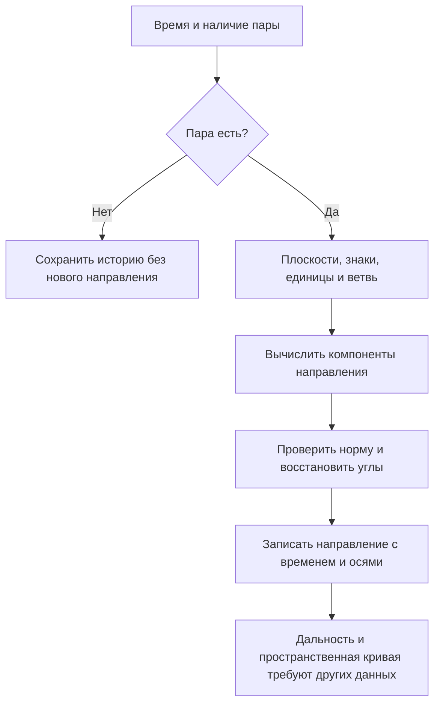
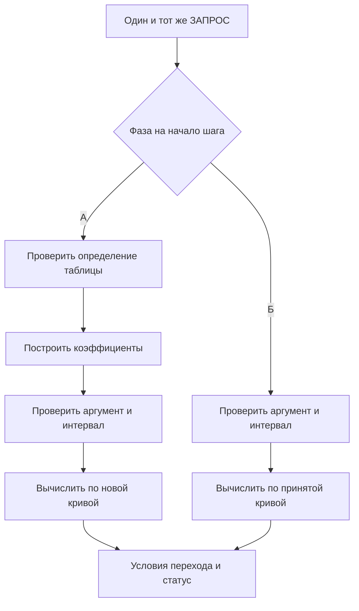
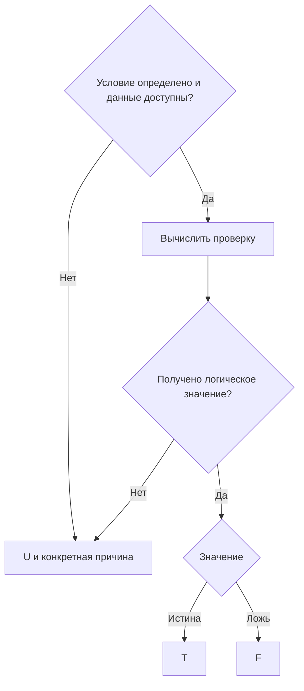
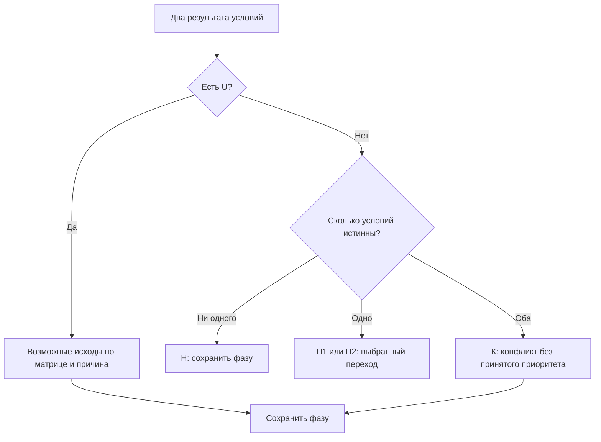

# Радионаблюдения в 3D — углы к плоскостям и конвейер обработки

**Предмет:** работа с двумя готовыми угловыми отклонениями от плоскостей симметрии приёмника. Обозначения входа — $a,b$; обычные азимут и угол места $\alpha,\beta$ вычисляются отдельно. **Выход по условию:** пространственный сплайн. Основной текст связывает вход, время, геометрию, выводы и логику фаз. Формулы стоят рядом с объяснениями; подробные проверки и разбор источников вынесены в приложения.

**Ключевой принцип:** текущая фаза вместе с событием задаёт последовательность вычислений. Условия перехода используют результаты именно этого шага; статус сообщает, что получилось.

## 1. Вход, уравнение наблюдения и время

### Что действительно дано

| Часть условия | Принятая трактовка |
|---|---|
| Два угловых канала $a,b$ | Отклонения от двух плоскостей симметрии; каждая выданная пара пригодна. В примере ниже явно выбраны знаковые углы к ортогональным плоскостям |
| Нет новой пары | Отсутствует новое угловое наблюдение |
| Приёмник | Его устройство и распознавание сигнала находятся вне задачи |
| Сектор | Заданная область главного лепестка антенны |
| История | Наблюдения одного рассматриваемого источника; принадлежность заново не проверяется |
| Сплайн | Пространственная кривая дальнейшего движения; это не график сглаженных углов |

**Фаза процесса** означает сохраняемый режим обработки. **Фаза радиосигнала** — другая физическая величина. Ни фаза радиосигнала, ни задержка его распространения в объявленный угловой вход не входят.

### Схема 1. Конвейер геометрического преобразования

Схема относится к геометрическому преобразованию одного наблюдения. Таблица § 2 показывает численный результат каждого звена. Выбор будущего пространственного пути остаётся отдельной задачей.

### Наблюдение и его возраст

**F01.** Индекс $k$ обозначает позицию наблюдения, $m_k$ — наличие новой пары:

$$
m_k\in\{0,1\},\qquad
z_k=\begin{bmatrix}a_k\\b_k\end{bmatrix}
\quad\text{только при }m_k=1.
$$

При $m_k=0$ значение $z_k$ отсутствует. Нулевые углы — полноценная пара. Пропуск определяется отдельным сообщением либо заданным расписанием; один список успешных измерений не задаёт количества пропусков.

**Принятое учебное соглашение:** один вызов обработчика — один шаг. Вызывающая сторона явно передаёт момент шага и признак $m_k$. При наличии пары известен её момент наблюдения $t_k$; оси и единицы заданы для записи либо всего набора. Отсутствие самого вызова не считается сообщением о пропуске. Это соглашение об интерфейсе, а не дополнительная проверка пригодности углов.

Открытый пример такого разделения: ROS Header хранит временную метку и обозначение системы координат [15]. В сообщении Image момент получения изображения явно отделён по смыслу от доставки сообщения [16]. Для конспекта перенесён только принцип явных метаданных; сам ROS не требуется.

**F05–F06.** Общая запись существующего измерения:

$$
\tau_k=t_k-t_0,\qquad
z_k=h\bigl(x(\tau_k),c_k\bigr)+\varepsilon_k.
$$

Здесь $t_k$ — момент наблюдения, $t_0$ — общее начало времени; $x$ — искомые характеристики объекта; $c_k$ — известные условия наблюдения; $h$ — модель связи с углами; $\varepsilon_k$ — угловая ошибка. Аддитивная запись понимается локально, в согласованном угловом представлении. В идеальном случае ошибка нулевая.

Время измеряется в секундах, углы — в радианах. Состав и единицы компонентов $x$ и $c_k$ задаются моделью. Общая буква $h$ не заменяет конкретного определения модели.

**F07.** Для неизменных характеристик используется $x(\tau)=x_*$; при изменении — явно выбранная связь $x(\tau)=g(\tau;\theta)$, где $\theta$ обозначает параметры модели. Один наблюдатель в разные моменты может дать те же геометрические ограничения, что несколько наблюдателей, если сопоставимы условия наблюдения и состояния объекта. Равенство точности дополнительно зависит от совместной модели ошибок [6].

**F08.** Возраст последнего доступного наблюдения:

$$
\Delta(t)=t-t_{\mathrm{last}},\qquad t\ge t_{\mathrm{last}}.
$$

$t_{\mathrm{last}}$ — наиболее поздний момент наблюдения среди доступных пар. Время поступления сообщения его не заменяет. До первой пары возраст отсутствует; отрицательное значение требует проверки согласования времён.

## 2. Математическое ядро геометрического преобразования

### 2.1. Сначала определить смысл двух углов

Для численного примера приняты ортонормированные оси приёмника $x,y,z$. Плоскости симметрии — $xz$ и $xy$. Их положительные нормали направлены соответственно по $+y$ и $+z$. Взаимная перпендикулярность плоскостей — явное условие примера.

- $a$ — знаковый угол пространственного направления к плоскости $xz$; знак определяется стороной $+y$.
- $b$ — знаковый угол того же направления к плоскости $xy$; знак определяется стороной $+z$.
- Основные значения $a,b$ находятся в $[-90^\circ,90^\circ]$.
- Для основного расчёта выбрана передняя ветвь $u_x>0$. Из самих двух углов знак $u_x$ не следует.

**Угол к плоскости и угол проекции — разные определения.** В частности, $a$ не является азимутом. Если документация прибора определяет каналы как наклоны проекций к оси $x$, формулы ниже для истинных углов к плоскостям неприменимы. Оси приёмника также не обязаны совпадать с неподвижными внешними осями.

### 2.2. Прямое и обратное преобразования

**F19.** Для единичного направления $\mathbf u=(u_x,u_y,u_z)^{\mathsf T}$:

$$
u_y=\sin a,\qquad u_z=\sin b,\qquad
d=1-\sin^2a-\sin^2b,\qquad
u_x=\pm\sqrt d.
$$

Вычислительные углы — в радианах, компоненты и $d$ безразмерны. Синусы задают компоненты по нормалям плоскостей; недостающая компонента следует из единичной нормы. Выбранная передняя ветвь использует положительный корень. Ограничение на две поперечные компоненты согласуется с представлением направления через направляющие косинусы [18].

| Геометрический случай | Точный вывод |
|---|---|
| $d>0$, ветвь задана | Одно направление для выбранного знака $u_x$ |
| $d>0$, ветвь не задана | Два направления, отличающиеся знаком $u_x$ |
| $d=0$ | $u_x=0$, ветви совпадают; это граница полусферы $u_x\ge0$, вне строгой области $u_x>0$ |
| $d<0$ | Выбранные определения несовместимы с парой: действительного единичного направления по этой формуле нет |

Последняя строка проверяет математическую интерпретацию и её предпосылки. Она не вводит отбраковку пригодных измерений: при таком результате нельзя молча менять смысл углов или заменять отрицательный подкоренной остаток нулём. Численные погрешности реализации рассматриваются отдельно от этой точной геометрии.

**F20. Обратная проверка:**

$$
a_{\mathrm{back}}=\arcsin u_y,\qquad
b_{\mathrm{back}}=\arcsin u_z,\qquad
u_x^2+u_y^2+u_z^2=1.
$$

Результаты должны воспроизвести исходные основные значения углов. Для вещественной реализации требуется явно выбранная численная точность; универсальный допуск из геометрии не следует.

**F02–F03. Производные азимут и угол места** в тех же осях [1, 18]:

$$
\alpha=\operatorname{atan2}(u_y,u_x)\pmod{2\pi},\qquad
\beta=\operatorname{atan2}\!\left(u_z,\sqrt{u_x^2+u_y^2}\right),
\quad
\alpha\in[0,2\pi),\quad\beta\in[-\pi/2,\pi/2].
$$

$$
\mathbf u=
\begin{bmatrix}
\cos\beta\cos\alpha\\
\cos\beta\sin\alpha\\
\sin\beta
\end{bmatrix}.
$$

Здесь $\beta=b$, но в общем случае $\alpha\ne a$. На вертикали $u_x=u_y=0$ азимут геометрически не определён; произвольное возвращаемое библиотекой число не устраняет эту неопределённость.

### 2.3. Численный конвейер: 240 секунд, IV квадрант

Для примера принят интервал $0\le t\le240$ с и существующее наблюдение в момент $t_k=240$ с. Заданы $a=b=-30^\circ$ и передняя ветвь. **IV квадрант относится к проекции на $xy$:** $u_x>0,u_y<0$. В трёхмерном пространстве дополнительно указан знак $u_z<0$.

| Шаг | Вычисление | Результат |
|---|---|---|
| 1. Прочитать запись | $t_k=240$ с, $m_k=1$, $a=b=-30^\circ$ | Одна существующая пара; длительность не заменяет историю |
| 2. Перевести единицы | $a=b=-30\pi/180$ | $a=b=-\pi/6$ |
| 3. Получить компоненты по нормалям | $u_y=\sin a$, $u_z=\sin b$ | $u_y=u_z=-0{,}5$ |
| 4. Получить продольную компоненту | $d=1-0{,}25-0{,}25$; $u_x=+\sqrt d$ | $d=0{,}5$; $u_x=0{,}7071067812$ |
| 5. Проверить норму | $0{,}5+0{,}25+0{,}25$ | $1$ |
| 6. Восстановить входные углы | $\arcsin(-0{,}5)$ для обоих каналов | $a_{\mathrm{back}}=b_{\mathrm{back}}=-30^\circ$ |
| 7. Вычислить производные углы | atan2 с обоими аргументами | $\alpha=324{,}7356103^\circ$; $\beta=-30^\circ$ |
| 8. Зафиксировать результат | Направление, время, система осей и выбранная ветвь | $\mathbf u=(0{,}7071067812;\,-0{,}5;\,-0{,}5)^{\mathsf T}$ при $t_k=240$ с |

**Контрпример прежней подстановке.** Если ошибочно считать $a=-30^\circ$ азимутом и подставить его вместе с $b$ в сферическую формулу, получится $(0{,}75;\,-0{,}4330127019;\,-0{,}5)^{\mathsf T}$. Его угол к $xz$ равен примерно $-25{,}6589^\circ$, а не заданным $-30^\circ$. Проверка одной единичной нормы эту ошибку не обнаруживает; обратная проверка обнаруживает.

Число $330^\circ$ может обозначать круговую запись $-30^\circ$ только при явно установленном соглашении. Основное значение знакового угла к плоскости здесь равно $-30^\circ$.

Время не входит в F19: оно определяет, к какому наблюдению относится направление. При текущем моменте 240 с и последнем наблюдении в 240 с возраст равен нулю; если последняя доступная пара относится к 180 с, возраст равен 60 с. Сами 240 секунд не задают дальности, скорости или числа измерений.

### 2.4. Что получилось и чего в этом результате нет

Результат этого ядра — единичное направление в осях приёмника с временной меткой. Для положения используется отдельная геометрическая запись:

**F04.**

$$
\mathbf p=\mathbf o+\rho\mathbf u,\qquad \rho>0.
$$

$\mathbf o$ — точка наблюдения; $\mathbf p$ — возможное положение; $\rho$ — дальность в метрах. Все величины должны относиться к одним осям. Одна пара и выбранная ветвь дают луч; разные положительные дальности дают разные положения. Положение в начале луча исключено: направление на совпадающую точку не определено.

Для перехода к внешней системе необходима её известная связь с осями приёмника. Для определения положения по истории нужна сама история и модель изменения объекта. Выход этого геометрического преобразования ещё не является пространственным сплайном.

### Геометрия пропуска

| Известный факт | Допустимый вывод |
|---|---|
| Новая пара отсутствует | Нового наблюдения нет; причина не закодирована этим сообщением |
| Текущее направление независимо известно и находится внутри области | Геометрический выход для данного момента опровергнут |
| Текущее направление независимо известно и находится вне области | Геометрический выход подтверждён; единственная причина пропуска этим не доказана |
| Известна только прежняя пара | Текущее направление требует модели изменения или иных текущих сведений |

Для проверки области нужны её граница, правило включения границы, ориентация осей и момент времени. Ширину главного лепестка нельзя произвольно подменять другой характеристикой диаграммы [2]. Геометрическое объяснение и помеха также не обязаны быть взаимоисключающими.

## 3. Ошибки измерений и круговая разность

Пригодность пары не означает нулевой ошибки. Вид и величины неопределённости берутся из условия [3].

**F16.** Для сравнения двух производных азимутов в одних осях используется краткая круговая разность:

$$
\delta_\alpha=
\operatorname{atan2}
\left(\sin(\alpha_2-\alpha_1),\cos(\alpha_2-\alpha_1)\right).
$$

$\delta_\alpha$ — ориентированная разность азимутов в радианах; atan2 получает сначала синус, затем косинус и учитывает квадрант [13]. Для полуоборота два знака равноценны; здесь для единой записи выбран результат $+\pi$, то есть результат $-\pi$ приводится к $+\pi$.

Переход от 359° к 1° даёт +2°, обратный переход — −2°. Это разность азимутов, а не пространственный угол между двумя произвольными направлениями. На вертикали сравнение азимутов не характеризует геометрическое различие направлений.

Ковариационная матрица нужна, если рассматривается количественная статистическая модель ошибок. Её определение сохранено в приложении А. Отсутствующую ковариацию нельзя считать нулевой; независимость ошибок разных наблюдений также не предполагается автоматически.

## 4. Фаза задаёт порядок вычислений

**Фаза** — сохраняемый режим, который вместе с событием выбирает последовательность операций. **Событие** запускает обработку. **Предусловие операции** проверяется перед её выполнением. **Условие перехода** разрешает смену режима. **Статус** описывает результат текущего шага.

«Новая пара», «только история» и «наблюдений ещё нет» — статусы наличия данных. Они сами по себе не описывают разные вычислительные последовательности.

### 4.1. Контракт одного шага

**F09.** Фаза должна участвовать уже в выборе вычислений:

$$
r=F_q(e,D,M),\qquad
\mathbf b=\Phi_q(e,D,M,r),\qquad
(q^+,a)=\delta(q,e,\mathbf b).
$$

$q$ — фаза на начало шага; $e$ — событие; $D$ — вход; $M$ — память; $F_q$ — упорядоченная последовательность вычислений этой фазы; $r$ — её результаты либо причина незавершения; $\mathbf b$ — результаты условий; $q^+$ — выбранная следующая фаза; $a$ — выбранное действие.

**Принятые здесь правила выполнения:**

1. Зафиксировать вход, текущую фазу и используемые данные. Новое сообщение относится к следующему вызову. Полученную пригодную пару сохранить независимо от успеха последующих вычислений.
2. Выполнить последовательность $F_q$. Предусловия проверять перед зависимыми операциями. После отказа не выполнять зависимые шаги и не подставлять нули вместо отсутствующих результатов.
3. Вычислить условия по этому же входу и результатам $r$. Условие, зависящее от нового результата, нельзя проверять до получения результата или по старому флагу.
4. Выбрать переход один раз. Действие $a$ только фиксирует уже подготовленные данные и статус; оно не выполняет новые вычисления, влияющие на переход, и не переписывает $q^+$. Отказ операции запрещает зависимые от неё результаты; реакция фазы задаётся явным условием, а не одним общим флагом ошибки.

Обычная обработка новой фазы начинается со следующего вызова. Разовые действия входа в фазу и действия при каждом событии описываются отдельно. Сохранение той же фазы не означает повторного входа в неё в этом договоре.

В SCXML различаются событие, условие и действия; для выбранного перехода определён порядок действий выхода, перехода и входа, а внутри блока — порядок записи [4]. Здесь задан более простой синхронный договор. Он не требует SCXML, очереди сообщений, отдельных служб или классов действий.

### 4.2. Пример разных последовательностей

**Самостоятельный учебный пример — скалярная интерполяция известной таблицы $y(s)$.** Его задача — показать организацию фаз. Он не определяет выбор пространственного пути по АЗ/УМ.

Два режима сохраняются между вызовами: **А — ПЕРВЫЙ РАСЧЁТ**, коэффициентов ещё нет; **Б — ПОВТОРНЫЕ РАСЧЁТЫ**, кривая построена. **Одно и то же событие ЗАПРОС передаёт аргумент $s$ в любой фазе.** Таблица узлов и краевые условия фиксированы на всё время примера.

Исполнитель — кубический интерполянт C² с явно выбранными условиями natural либо clamped. Узлов не меньше двух, аргументы конечны и строго возрастают; каждому соответствует одно конечное скалярное значение [11]. Успешное построение возвращает по четыре конечных коэффициента на участок без ошибки. Математические свойства задаются контрактом интерполянта; численные проверки приведены в § 5. Запрос проверяется на конечность аргумента и принадлежность замкнутому интервалу узлов.

#### Схема 2. Основные последовательности по фазам

Схема показывает основные успешные ветви. Остальные сочетания и отказы определены таблицей:

| Фаза и событие | Последовательность и исход | Следующая фаза; статус |
|---|---|---|
| А + ЗАПРОС; построение не удалось | Проверить определение → попытаться построить, если предусловия выполнены; запрос по отсутствующей кривой не вычислять | А; ОШИБКА ПОСТРОЕНИЯ с причиной |
| А + ЗАПРОС; построение удалось | Проверить определение → построить → проверить аргумент и область → вычислить, если запрос допустим | Б; ЗНАЧЕНИЕ, ВНЕ ОБЛАСТИ либо ОШИБКА ЗАПРОСА |
| Б + ЗАПРОС | Проверить аргумент и область → вычислить по сохранённым коэффициентам | Б; ЗНАЧЕНИЕ, ВНЕ ОБЛАСТИ либо ОШИБКА ЗАПРОСА |
| Любая + иное событие | Вернуть неподдерживаемый вид события | Фаза и кривая сохраняются; НЕПОДДЕРЖИВАЕМОЕ СОБЫТИЕ |

**Точное условие А → Б:** построение кривой завершилось успешно. Недопустимый аргумент запроса не отменяет готовые коэффициенты: возможны одновременно фаза Б и статус ВНЕ ОБЛАСТИ. Построение в фазе Б не повторяется.

Отсутствие вызова ничего не запускает. Изменение таблицы не входит в интерфейс этого примера. Проверка её определения не означает повторной отбраковки готовых угловых наблюдений.

Два режима показывают различие последовательностей **при одном событии**. Для реализации достаточно проверки наличия коэффициентов и обычных функций. Если операции всегда идут подряд, а различие поведения между вызовами не сохраняется, отдельная фаза не нужна.

### 4.3. Условие отдельно от выбора перехода

**T** — вычислена истина; **F** — вычислена ложь; **U** — значение не получено, с конкретной причиной.

#### Схема 3. Получение значения одного условия

Например, отсутствие определения области даёт U с этой причиной; проверенная принадлежность заданной области даёт T или F. Получение T/F/U ещё не меняет фазу. Исключение без поясняющего текста описывается хотя бы типом ошибки и операцией, где оно возникло.

### 4.4. Матрица исходов и решение

Рассматриваются два конкурирующих перехода для одной текущей фазы и события. **П1/П2** — единственный разрешённый переход; **Н** — ни один; **К** — разрешены оба и требуется разрешение конфликта.

| Первое условие \ Второе | F | T | U |
|---|---|---|---|
| **F** | Н | П2 | Н или П2 |
| **T** | П1 | К | П1 или К |
| **U** | Н или П1 | П2 или К | Н, П1, П2 или К |

При U перечислены возможные исходы после получения недостающего значения. Связь между условиями может исключить часть вариантов. Например, для взаимодополняющих условий при определённом входе Н и К недостижимы.

#### Схема 4. Выбор исхода по готовым условиям

Для этой учебной логики принято: при Н фаза сохраняется; при К без заданного приоритета и при U переход не выбирается, возвращается конкретный конфликт или недостающий результат. Изменение памяти при отсутствии перехода задаётся отдельно; таблица фаз выше это показывает.

Матрица — средство анализа конспекта, не нормативная трёхзначная логика SCXML. В SCXML ошибка вычисления условия даёт false и событие error.execution [4]; эта семантика здесь автоматически не переносится. Матрица также не является ковариацией или RAIM: официальное определение RAIM относится к контролю целостности GPS-навигации [12].

**Карточка предметной фазы:** назначение → память → событие → порядок операций и их предусловия → условия перехода → следующая фаза → выдаваемый результат. Конкретные предметные фазы выбора пространственного движения из этого учебного примера не следуют.

## 5. Сплайн и идеальные контрольные случаи

### Представление результата

**F10, F12.** Участок кубического сплайна и его связь со временем:

$$
\gamma_i(s)=\sum_{j=0}^{3}\mathbf a_{ij}(s-s_i)^j,
\qquad s\in[s_i,s_{i+1}],
$$

$$
\mathbf r_{\mathrm{ref}}(t)=\gamma(s(t)).
$$

$s$ — параметр кривой; $s_i$ — возрастающие узлы; $i$ — номер участка; $j$ — степень; $\mathbf a_{ij}$ — векторные коэффициенты трёх координат. Каждый член суммы имеет единицу длины. Кривая $\gamma$ получается склейкой участков; у классического сплайна C² совпадают значения и первые две производные по параметру [11].

$s(t)$ — отдельный закон прохождения, остающийся в области определения кривой; $\mathbf r_{\mathrm{ref}}$ — заданное положение в метрах [8]. Параметр не обязан быть временем или длиной дуги. Полная запись склейки F11 и длина кривой F15 находятся в приложении А.

Свойства проверяются последовательно: геометрическая допустимость, выполнимость с заданным временем, фактическое соответствие заданию. Гладкость не устанавливает эти свойства. Проверка только узлов не гарантирует соблюдения ограничений между ними [9].

### Два проверяемых примера интерполяции

Документация CubicSpline разделяет исходную таблицу, краевые условия и экстраполяцию [11]. По этим правилам составлены следующие контрольные примеры; это скалярные функции, не пространственный маршрут.

**F18.** Для безразмерных узлов $(0,0)$ и $(1,1)$:

$$
f_{\mathrm{natural}}(s)=s,\qquad
f_{\mathrm{clamped}}(s)=3s^2-2s^3,\qquad s\in[0,1].
$$

В первом случае вторые производные на концах нулевые; во втором нулевые первые производные. При $s=0{,}25$ значения равны $0{,}25$ и $0{,}15625$. **Одинаковые концы не определяют одну форму без краевых условий.**

Другой пример: натуральный кубический сплайн через $(0,0)$, $(1,1)$, $(2,1)$ при $s=1{,}5$ даёт $1{,}09375$. Все узловые значения лежат в $[0,1]$, промежуточное выходит за границу. Это конкретная проверка возможности выброса интерполянта, отмеченной в руководстве SciPy [9]. Допустимость узлов не доказывает допустимости всей кривой.

В примере § 4 экстраполяция исключена отдельным правилом. Выбор краевых условий сам по себе её не запрещает [11].

### Вариант А: точные углы, дальность не дана

В уравнении наблюдения ошибка нулевая. Направление определено точно, но разные положительные дальности из раздела 2 сохраняются. **Положение не единственно.** Это завершённый результат проверки одной пары, без утверждения о любой возможной истории наблюдений.

### Вариант Б: обе конечные точки известны

Для геометрического эталона заданы неподвижные точки A и B, евклидово пространство и допустимость всего отрезка. Препятствий, обязательных обходов и дополнительных ограничений формы нет; сравнивается длина.

**F13–F14.**

$$
d_{AB}=\|\mathbf B-\mathbf A\|_2,\qquad
L_{\mathrm{poly}}=\sum_{i=1}^{n}\|\mathbf P_i-\mathbf P_{i-1}\|_2
\ge d_{AB},
\qquad
\mathbf P_0=\mathbf A,\quad\mathbf P_n=\mathbf B.
$$

$\mathbf P_i$ — точки ломаной, $n$ — число звеньев, норма евклидова; обе длины в метрах. Для разных концов равенство достигается при прохождении отрезка без возвратов. Нулевые звенья допустимы. Коллинеарность с выходом за конец и возвратом увеличивает длину. При совпадении концов нулевая длина возможна только без ненулевых звеньев.

Если часть отрезка недопустима, нижняя граница сохраняется, но отрезок не является допустимым решением. Известность обоих концов — отдельное условие этого эталона; она не возникает автоматически из АЗ/УМ.

## 6. Какие пробелы закрыты, какие определения ещё нужны

### Исправления на открытых примерах

| Пробел и контрольный пример | Принятое исправление |
|---|---|
| Время наблюдения подменено доставкой: измерение в 8 с, получение в 11 с, проверка в 12 с | Возраст 4 с. Момент наблюдения назван явно; состав метаданных сопоставлен с ROS Header/Image [15, 16] |
| Одинаковые числа углов прочитаны в разных осях | Оси и единицы определяются заранее; их неизменное описание достаточно задать один раз. REP 103 — открытый пример такого соглашения [17] |
| Условие читает прежний успешный флаг, хотя новый расчёт завершился иначе | $F_q$ возвращает результат этого шага; $\Phi_q$ читает именно его. Событие, условие и действие разделены; порядок сопоставлен с SCXML [4] |
| Вычисление помещено только во вход в фазу, хотя требуется при каждом событии | Разовые действия входа и повторяемая последовательность разделены в § 4 |
| Название «сплайн» скрывает выбор краевых условий и поведение за пределами узлов | F18 показывает два разных результата по одним концам; область вычисления задаётся отдельно [11] |
| Проверены только узлы | Пример со значением 1,09375 показывает недостаточность такой проверки [9]; гладкость не заменяет ограничений |

Источники подтверждают общие свойства. Два режима примера, запрет экстраполяции и реакция на U/К — явные учебные решения, а не якобы требования международного стандарта.

### Что остаётся частью содержательной постановки

| Необходимое определение | Почему его нельзя восстановить одним соглашением о программе |
|---|---|
| Доступные положения наблюдателя, ориентации осей, временные связи | Эти физические сведения не содержатся в одной паре АЗ/УМ |
| Модель изменения объекта | Наблюдения в разные моменты относятся к разным состояниям, если постоянство не принято отдельным условием |
| Область главного лепестка и её граница | Нужна именно заданная геометрическая область и правило включения границы; ширина «по умолчанию» её не определяет |
| Назначение предметных фаз и правило выбора пространственной кривой | Нужны цели, доступные исходные сведения, ограничения и критерии принятия результата; библиотечная интерполяция их не выбирает |

Учебный договор закрывает порядок обработки, но не создаёт недостающих физических данных. Доказанная неединственность положения по одной паре и неразличимость причин по одному факту пропуска — содержательные результаты анализа.

### Что исключено из обязательной части

| Усложнение | Решение |
|---|---|
| Задержки распространения и фаза несущей | Не добавляются к угловому входу |
| RAIM и неопределённая «матрица состояний защиты» | Сохранена матрица исходов условий; другая задача контроля целостности не вводится |
| Численные ковариации без статистических данных | Определение остаётся в справке; значения не придуманы |
| Повторная отбраковка пары и подтверждение возобновившегося сигнала | Исключены по входному условию |
| Отдельная фаза для каждой операции, ошибки или пропуска | Фаза нужна для сохраняемого различия поведения; отдельной операции обычно достаточно функции |
| Очереди, службы, обязательные журналы и много классов | Синхронный вызов, явная память, таблица переходов и результат шага достаточны для учебного контракта |
| Повтор одних формул и правил в нескольких разделах | Формулы имеют основное место; приложения содержат проверки и сведения об источниках |

Завершённый вывод содержит факт, оценку по названной модели, доказанное ограничение, конкретно недостающее определение либо причину незавершённой проверки. Одно слово «не установлено» такой вывод не заменяет.

## Приложение А. Короткая математическая справка

### А.1. Единицы и особенности производных АЗ/УМ — F02–F04

$$
\varphi_{\mathrm{rad}}=\frac{\pi}{180}\varphi_{\mathrm{deg}},
\qquad
\|\mathbf u\|_2=1,
\qquad
\mathbf u(\alpha+2\pi\ell,\beta)=\mathbf u(\alpha,\beta),\quad\ell\in\mathbb Z.
$$

Здесь $\varphi_{\mathrm{rad}}$ и $\varphi_{\mathrm{deg}}$ — числовые значения одного угла в радианах и градусах; $\ell$ — целое число оборотов.

$$
\mathbf u(\alpha,\pi/2)=(0,0,1)^{\mathsf T},
\qquad
\mathbf u(\alpha,-\pi/2)=(0,0,-1)^{\mathsf T}.
$$

Две положительные разные дальности в F04 дают разные положения с одним направлением. Доказательство неединственности относится к одной паре без дополнительных ограничений положения.

### А.2. Полная запись склейки — F11

Для $N$ участков с узлами $s_0<\cdots<s_N$:

$$
\gamma_{i-1}^{(r)}(s_i)=\gamma_i^{(r)}(s_i),
\qquad i=1,\ldots,N-1,\quad r=0,1,2.
$$

$r$ — порядок производной по $s$; нулевой порядок означает значение. Условия на концах задаются отдельно. При одном участке внутренних узлов нет. Степень каждого участка в F10 не превышает трёх и может быть ниже.

Если единица параметра обозначена $U_s$, единица коэффициента $\mathbf a_{ij}$ — метр, делённый на $U_s$ в степени $j$. Продолжение кривой за её параметрический интервал требует отдельного определения.

### А.3. Длина кривой — F15

$$
L_\gamma=
\int_{s_{\min}}^{s_{\max}}\|\gamma'(s)\|_2\,ds
\ge \|\mathbf B-\mathbf A\|_2,
\quad
\gamma(s_{\min})=\mathbf A,\quad\gamma(s_{\max})=\mathbf B.
$$

$s_{\min}<s_{\max}$ — границы параметра, штрих — производная по нему, $L_\gamma$ — длина в метрах. Кривая непрерывна и кусочно непрерывно дифференцируема. Для разных концов равенство соответствует прохождению отрезка без возвратов; для совпадающих концов нулевая длина соответствует постоянной кривой. Это проверка геометрической длины.

### А.4. Что означает ковариационная матрица — F17

Это справочное определение для существующей статистической модели локальных угловых ошибок с конечными вторыми моментами:

$$
\mu_k=\mathbb E[\varepsilon_k],\qquad
R_k=\mathbb E\!\left[(\varepsilon_k-\mu_k)(\varepsilon_k-\mu_k)^{\mathsf T}\right].
$$

$$
R_k=
\begin{bmatrix}
\sigma_{a,k}^{2}&c_{ab,k}\\
c_{ab,k}&\sigma_{b,k}^{2}
\end{bmatrix}.
$$

$\mathbb E$ означает математическое ожидание; $\mu_k$ — средняя ошибка; $\sigma^2$ — дисперсии ошибок; $c_{ab,k}$ — их ковариация. Элементы $R_k$ имеют единицу рад². Диагональ содержит дисперсии, остальные элементы — ковариации [14].

Средняя ошибка и ковариация различаются: нулевая ковариация не исключает постоянного смещения. В идеальном случае с тождественно нулевой ошибкой нулевые и среднее, и ковариация. Матрица одного наблюдения не задаёт автоматически корреляцию ошибок разных моментов.

Это определение не является способом получить неизвестные статистические параметры из одной пары. В обязательную схему отдельный оцениватель ковариаций не добавлен.

## Приложение Б. Контрольные примеры

Координаты даны в метрах в одной системе; длины — в метрах. Случаи К08–К13 относятся к заранее известным концам. Обозначения формул сохранены для сверки.

| Проверка | Данные | Ожидаемый результат | Связь |
|---|---|---|---|
| **К01. Одна пара, две дальности** | Начало в (0, 0, 0), оба угла нулевые; дальности 1 и 2 | Точки (1, 0, 0) и (2, 0, 0) имеют одно направление; положение не единственно | F03–F04; § 2 |
| **К02. Пропуск и нулевые углы** | Сравниваются отсутствие пары и выданная пара с двумя нулевыми углами | Это разные входы; только второй содержит новое направление | F01; § 1 |
| **К03. Граница производного азимута** | Азимуты 0° и 360°, одинаковый угол места | Геометрическое направление совпадает; численная граница шкалы не является скачком направления | F02–F03 |
| **К04. Вертикаль** | Угол места 90°, азимуты различны | Один вектор вверх; азимут не различает вертикальные направления | F03 |
| **К05. Время наблюдения** | Наблюдение сделано в 8 с, сообщение получено в 11 с, рассматриваемый момент 12 с | Возраст наблюдения 4 с; задержка получения не делает его равным 1 с | F05, F08; § 1 |
| **К06. Нет первого наблюдения** | История пуста | Время последнего наблюдения и возраст отсутствуют | F08; § 4 |
| **К07. Матрица условий** | Четыре сочетания T/F и пять сочетаний с U для двух конкурирующих переходов | Булевы сочетания дают П1, П2, Н и К; остальные пять ячеек дают ровно наборы вариантов из § 4 | F09; § 4 |
| **К08. Прямое разбиение** | A: (0, 0, 0); промежуточная точка: (1, 0, 0); B: (2, 0, 0) | Длина ломаной 2; расстояние между концами 2 | F13–F14 |
| **К09. Отклонение от прямой** | A: (0, 0, 0); промежуточная точка: (1, 1, 0); B: (2, 0, 0) | Длина ломаной около 2,828; расстояние 2; длина строго больше | F13–F14 |
| **К10. Возврат по прямой** | A: (0, 0, 0); промежуточная точка: (3, 0, 0); B: (2, 0, 0) | Длина ломаной 4; расстояние 2; коллинеарности недостаточно | F14 |
| **К11. Нулевое звено** | В примере К08 промежуточная точка совпадает с A | Длина остаётся 2 | F14 |
| **К12. Совпадающие концы** | A и B: (0, 0, 0); промежуточная точка: (1, 0, 0) | Длина ломаной 2; расстояние между концами 0 | F13–F14 |
| **К13. Недопустимый отрезок** | Часть отрезка между известными концами исключена из допустимой области | Нижняя граница длины сохраняется; сам отрезок не является допустимым решением | F14–F15; § 5 |
| **К14. Граница области** | Точное направление лежит на заданной границе | Ответ определяется правилом включения границы; без него само условие неполно | § 2; § 4 |
| **К15. Сплайн без времени** | Кривая задана, закон прохождения не задан | Геометрический путь определён; положения в заданные моменты из этих данных не следуют | F10–F12; § 5 |
| **К16. Круговая разность** | Азимут изменился от 359° к 1°; отдельно рассматриваются обратный переход и полуоборот | Краткие разности: +2° и −2°; при полуобороте используется явно выбранное соглашение о знаке | F16; § 3 |
| **К17. Устаревший флаг** | Прежний результат успешен, новый расчёт завершился ошибкой | Условие использует новый результат; старый флаг не разрешает переход | F09; § 4.1 |
| **К18. Повторное событие** | Два события обрабатываются в одной сохраняемой фазе | Обычная последовательность выполняется при каждом событии; разовый вход не повторяется | § 4.1 |
| **К19. Краевые условия** | Узлы (0, 0), (1, 1); natural и clamped; аргумент 0,25 | Значения 0,25 и 0,15625; одинаковые концы дают разные формы | F18 |
| **К20. Между узлами** | Natural; узлы (0, 0), (1, 1), (2, 1); аргумент 1,5 | Значение 1,09375 вне диапазона узловых значений [0, 1] | § 5 |
| **К21. За границей интервала** | Принята кривая на [0, 1]; ЗАПРОС с аргументом 1,2 | Б сохраняется; ВНЕ ОБЛАСТИ; экстраполяция не выполняется | § 4.2 |
| **К22. Один запрос в разных фазах** | Узлы (0, 0), (1, 1), natural; два ЗАПРОСА с аргументом 0,25, начиная с А | Первый строит кривую и переводит в Б; второй использует коэффициенты без построения; оба дают 0,25 | § 4.2; F18 |
| **К23. Отказ первого построения** | В А задана таблица с повторяющимся аргументом узла; пришёл ЗАПРОС | ОШИБКА ПОСТРОЕНИЯ с причиной; А сохраняется; значение по кривой не вычисляется | § 4.2 |
| **К24. Неподдерживаемое событие** | В А или Б передано событие, отличное от ЗАПРОС | Фаза сохраняется; возвращён явный статус, вычисления не начаты | § 4.2 |
| **К25. Фаза и статус различаются** | В А задана корректная таблица на [0, 1]; первый ЗАПРОС имеет аргумент 1,2 | Кривая построена, установлена Б; статус ВНЕ ОБЛАСТИ; значение не вычисляется | § 4.2 |
| **К26. IV квадрант, 240 с** | $a=b=-30^\circ$, передняя ветвь | Направление $(1/\sqrt2;-1/2;-1/2)$; производный азимут 324,7356103° | F19–F20; § 2.3 |
| **К27. Неверный смысл угла** | Те же числа ошибочно подставлены как сферические АЗ/УМ | Норма остаётся единичной, но обратный угол к $xz$ равен −25,6589° вместо −30° | § 2.3 |
| **К28. Не выбрана полусфера** | $a=b=-30^\circ$ без знака $u_x$ | Два направления с $u_x=\pm1/\sqrt2$ | F19 |
| **К29. Граница полусферы** | $a=b=-45^\circ$ | $d=0$, $u_x=0$; направление принадлежит $x\ge0$, но не $x>0$ | F19 |
| **К30. Несовместимое определение** | $a=b=-60^\circ$ при принятых плоскостях | $d=-0,5$; действительного единичного направления в данной интерпретации нет | F19 |

Связь с V-подходом: утверждение или требование → формула либо правило → контрольный вход → ожидаемый результат. Таблица проверяет перечисленные утверждения; она не является испытанием готовой системы.

## Приложение В. Что подтверждают предоставленные материалы

Этот раздел сохраняет подробности источников для проверки формулировок. Основная цепочка рассуждений находится в разделах 1–6. Полное соответствие международным стандартам не заявляется: ссылки на понятия автоматов и проверяемые примеры не заменяют проверку требований выбранного стандарта.

### В.1. Карточки книг

Для сверки использованы две приложенные Markdown-карточки [6, 7]. Они содержат записи о чтении книг и ограничениях использованных результатов. Полные тексты книг для этой сверки не предоставлены. Ниже приведена карта содержания по карточкам; собственные поясняющие формулы этого конспекта не приписываются авторам книг.

| Материал | Что отмечено в карточке | Связь с учебной задачей |
|---|---|---|
| Мельников, 2005 | Просмотрены оглавление и выбранные вводные страницы; основные главы не прочитаны | Системная связь общей эффективности с исходными данными и характеристиками аппаратуры; оснований приписывать этому просмотру конкретные алгоритмы нет |
| Мельников и Попов, 2008, глава 1 | Известность положения пунктов, принадлежности наблюдений, модель погрешностей; специальные условия отдельных результатов | Для каждого вывода нужно фиксировать исходные предпосылки |
| §§ 2.1–2.2, с. 66–85 | Неодновременность, редкость и нерегулярность измерений; интервалы времени входят в модель | Непосредственная связь с идеей распределения наблюдений вдоль оси времени |
| § 2.3, с. 85–92 | Предвычисленные углы и вклад прогнозирования в погрешность | Расчётное значение и новое измерение имеют разное происхождение |
| §§ 2.4–2.5, с. 92–109 | Роль дополнительных сведений о движении; различие оценки текущего положения и прогноза | Нужно указать, что известно о движении и к какому моменту относится результат |
| § 2.6, с. 110–116 | Роль дополнительных сведений о движении | Измерения и предположения совместно задают постановку, но не подменяют друг друга |

В карточке издания 2008 года специально различаются два основания классификации: **состав физически измеряемых величин** и **математический способ их обработки** [6]. Это полезная основа системного ответа: азимут, несколько пунктов наблюдения, модель движения, метод оценивания и сплайн описывают разные стороны задачи. Их нельзя перечислять как взаимозаменяемые методы одного уровня.

Для подготовки по данному вопросу приоритетны отмеченные в карточке §§ 2.1–2.5: они связывают время, исходные сведения и смысл результата. Это выбор темы для чтения, а не утверждение о наличии в этих разделах готовой фазовой спецификации.

### В.2. Что даёт приложенный патент

Источник: RU 2842327 C1, представленный PDF [5]. Ниже указаны номера страниц PDF; они совпадают с печатной нумерацией документа. Это сопоставление содержания источника с учебным условием.

#### Реальная постановка в источнике

Авторы описывают получение направлений от нескольких наблюдателей, обмен и накопление этих сведений, а затем совместное использование результатов трассовой обработки и триангуляционного оценивания. Описанный результат — сведения о местоположении; на странице 9 также обсуждаются параметры движения и ошибки оценивания [5, с. 6–9].

| Вопрос | Что написано в патенте | Следствие для подготовки |
|---|---|---|
| Откуда берутся измерения? | Используется группа наблюдателей и обмен их сведениями [5, с. 6–7] | Перенос к одному наблюдателю во времени требует сопоставления модели изменения объекта и условий наблюдения; сам по себе он не исключён |
| Какие углы используются? | В описании собственного способа указаны однокоординатные пеленгаторы, измеряющие азимут [5, с. 8] | Нельзя автоматически считать это готовым описанием задачи с АЗ/УМ |
| Почему в тексте встречается угол места? | Пара азимут/угол места упоминается при изложении другого решения в обзоре предшествующих работ [5, с. 5] | Следует различать обзор чужих решений и собственный способ авторов |
| Как отражено отсутствие данных? | Введён индикатор наличия замеров [5, с. 8, 11] | Индикатор сообщает о наличии данных; физическую причину отсутствия он не устанавливает |
| Есть ли нужная фазовая логика? | Полной таблицы состояний, событий и условий переходов не приведено | Готовые условия смены фаз из этого документа извлечь нельзя |
| Есть ли построение выходного сплайна? | Упомянуто формирование траекторий, но сплайн, его параметры и правило построения не определены [5, с. 6–7, 11] | Упоминание траектории не заменяет постановку задачи построения сплайна |

В описании также рассматриваются некорректные угловые наблюдения и компенсация помех заданного класса [5, с. 8]. Это особенности модели источника. Они не отменяют условие учебной задачи о пригодности каждой выданной пары и не обязывают добавлять обработку приёмника.

#### Что нужно читать критически

1. **Порядок вычислений описан неоднозначно.** На страницах 6–7 и 11 говорится об одновременном применении двух видов обработки, а на странице 9 — об их разнесении во времени. Возможное объяснение: совместное использование результатов при разных моментах вычисления. Однако это интерпретация, а не приведённая авторами циклограмма [5].
2. **Формулировки о накоплении требуют уточнения.** Накопление входит в описание способа и пункт 1 формулы изобретения. На странице 10 одновременно заявляется отсутствие необходимости в накоплении. Возможно, имеется в виду дополнительное длительное накопление, но такое ограничение явно не сформулировано [5, с. 6–7, 10–11].
3. **Свойства оценок зависят от предпосылок.** Несмещённость, минимальная дисперсия и компенсация помех заявлены в контексте определённой модели и класса помех. В документе нет полного вывода и перечня условий, позволяющих распространить эти свойства на произвольные данные [5, с. 8–9].
4. **Универсальность геометрии не обоснована в изложении.** Фраза о возможности результата при любом расположении не сопровождается разбором неоднозначных или вырожденных случаев [5, с. 10]. Само существование нескольких наблюдений ещё не является доказательством однозначности любого результата.
5. **Эксперимент заявлен, но его результаты не раскрыты.** На странице 10 сообщается о проверке в лётном эксперименте. Численные ошибки, сценарии, сравнительные результаты и протокол испытаний в PDF не представлены. По этому документу нельзя независимо воспроизвести заявленное подтверждение [5].

Для строгой математической записи требуется также уточнить обозначения. Например, на страницах 8 и 11 величина $I$ названа вектором-столбцом индикаторов, но вид операции её применения к вектору наблюдений явно не пояснён. По записи нельзя без дополнительного соглашения решить, имеется ли в виду поэлементная операция или специальный оператор выбора. Это вопрос полноты записи; самовольное исправление формулы не является проверкой метода.

**Полезный вывод для экзамена:** патент показывает пример комплексной вторичной обработки и используемые в ней математические понятия. Он не содержит готового ответа о фазах, выходном сплайне или различении помехового и геометрического объяснения пропуска. Отсутствие этих правил в источнике не следует компенсировать выдуманными условиями.

## Источники

Исходные условия указаны в разделе 1. Источники подтверждают общие понятия; замечания к предоставленным материалам сохранены в приложении В.

1. MathWorks. [sph2cart — Transform spherical coordinates to Cartesian](https://www.mathworks.com/help/matlab/ref/sph2cart.html).
2. MathWorks. [Field Analysis](https://www.mathworks.com/help/antenna/ug/field-analysis.html).
3. NIST TN 1297. [Classification of Components of Uncertainty](https://www.nist.gov/pml/nist-technical-note-1297/nist-tn-1297-2-classification-components-uncertainty).
4. W3C. [State Chart XML (SCXML)](https://www.w3.org/TR/scxml/), §§ 3.5, 3.8–3.9, 3.13, 4.9 и 5.9. Использовано различие события, условия и действия; наш синхронный договор не объявляется реализацией SCXML.
5. RU 2842327 C1, опубликован 24.06.2025. Представленный пользователем PDF: `RU2842327C1_2025_Radu_Complex_Localization.pdf`, 13 страниц. Ссылки на страницы приведены в приложении В.2.
6. Приложенная карточка «Мельников и Попов 2008 — место в обзоре.md», записи от 14.10.2026. Это предоставленное описание чтения, а не оригинал книги.
7. Приложенная карточка «Мельников 2005 — предварительный отбор книги.md», записи от 14.10.2026. Это предоставленное описание чтения, а не оригинал книги.
8. Lynch K. M., Park F. C. Modern Robotics. [9.1 and 9.2. Point-to-Point Trajectories, Part 1](https://modernrobotics.northwestern.edu/nu-gm-book-resource/9-1-and-9-2-point-to-point-trajectories-part-1-of-2/). Использовано только различие пути, временного закона и траектории.
9. SciPy. [1-D interpolation](https://docs.scipy.org/doc/scipy/tutorial/interpolate/1D.html), разделы Cubic splines, Monotone interpolants, Parametric spline curves. Использованы общие свойства интерполяции, без выбора реализации.
10. Kekkonen H. [Bayesian Inverse Problems](https://www.damtp.cam.ac.uk/research/cia/files/teaching/Inverse_Problems_Lent_2018/19y_01m_16d_LectureNotes.pdf), University of Cambridge, § 1.1. Использовано разделение существования, единственности и устойчивости решения.

11. SciPy. [CubicSpline](https://docs.scipy.org/doc/scipy/reference/generated/scipy.interpolate.CubicSpline.html). Использованы кусочно-кубическая запись, гладкость C² и роль граничных условий.

12. FAA. [Navigation Aids](https://www.faa.gov/air_traffic/publications/atpubs/aip_html/chap1_section_1.html), Receiver Autonomous Integrity Monitoring. Использовано определение RAIM для разграничения задач.
13. NumPy. [arctan2](https://numpy.org/doc/stable/reference/generated/numpy.arctan2.html). Использованы порядок аргументов, выбор квадранта и диапазон угла; формула круговой разности является применением этих свойств.
14. NIST/SEMATECH. [Mean Vector and Covariance Matrix](https://www.itl.nist.gov/div898/handbook/pmc/section5/pmc541.htm). Использовано различие средних, дисперсий и ковариаций.
15. ROS 2, официальный репозиторий. [Header.msg](https://github.com/ros2/common_interfaces/blob/rolling/std_msgs/msg/Header.msg). Временная метка и обозначение системы координат.
16. ROS 2, официальный репозиторий. [Image.msg](https://github.com/ros2/common_interfaces/blob/rolling/sensor_msgs/msg/Image.msg). Пример явного определения временной метки как момента получения исходного изображения.
17. Foote T., Purvis M. [REP 103: Standard Units of Measure and Coordinate Conventions](https://raw.githubusercontent.com/ros-infrastructure/rep/master/rep-0103.rst). Официальный исходный текст информационного соглашения ROS; не универсальный стандарт этой задачи.

Интернет-примеры в §§ 4–6 сверены 22.10.2026. Численные примеры F18 и К20 составлены для конспекта по указанным правилам интерполяции; они не приписываются авторам предоставленных книг.

18. MathWorks. [azel2uv](https://www.mathworks.com/help/phased/ref/azel2uv.html). Использованы определения азимута/угла места, связь с поперечными направляющими косинусами и их область допустимости. Углы к плоскостям $a,b$ определены отдельно в § 2.1; численный пример и обратная проверка составлены для этого конспекта.
