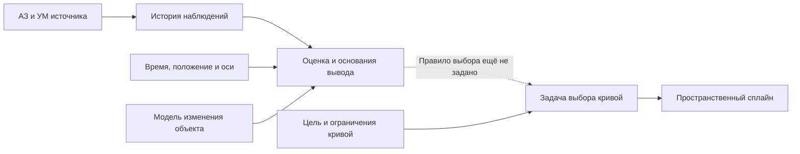
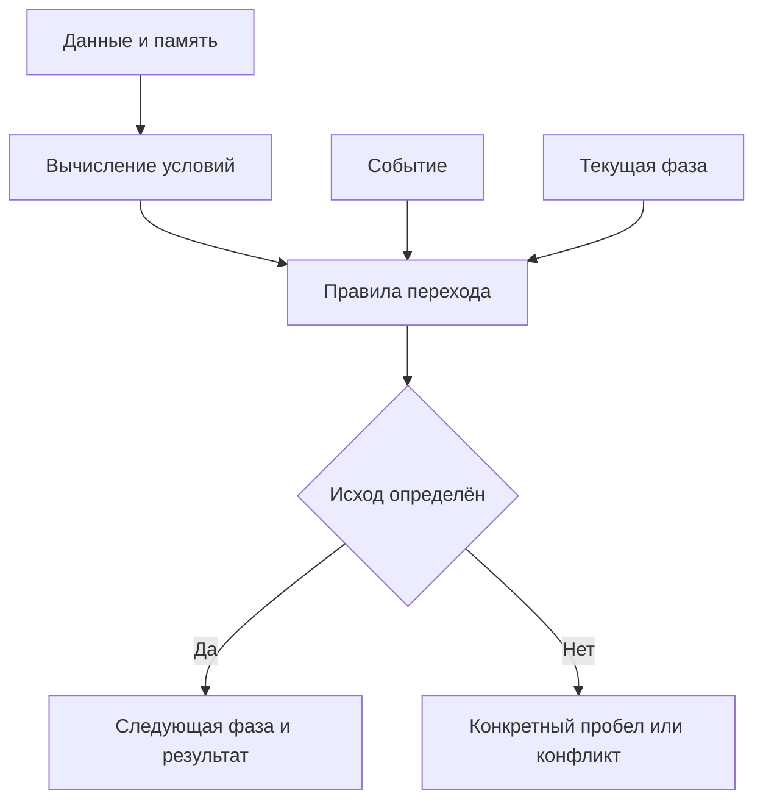

# Вторичная обработка АЗ/УМ — короткий конспект

**Предмет:** работа с готовыми угловыми наблюдениями источника на платформе под шаром. **Выход по условию:** пространственный сплайн. Основной текст связывает вход, время, геометрию, выводы и логику фаз. Формулы стоят рядом с объяснениями; подробные проверки и разбор источников вынесены в приложения.

## 1. Вход, уравнение наблюдения и время

### Что действительно дано

| Часть условия | Принятая трактовка |
|---|---|
| АЗ и УМ | Готовые азимут и угол места; каждая выданная пара пригодна |
| Нет новой пары | Отсутствует новое угловое наблюдение |
| Приёмник | Его устройство и распознавание сигнала находятся вне задачи |
| Сектор | Заданная область главного лепестка антенны |
| История | Наблюдения одного рассматриваемого источника; принадлежность заново не проверяется |
| Сплайн | Пространственная кривая дальнейшего движения; это не график сглаженных углов |

**Фаза процесса** означает сохраняемый режим обработки. **Фаза радиосигнала** — другая физическая величина. Ни фаза радиосигнала, ни задержка его распространения в объявленный угловой вход не входят.

### Общая схема слева направо

Схема показывает зависимости данных. Пунктир обозначает конкретный пробел: оценка по измерениям сама по себе не определяет, какую пространственную кривую выбрать. Сведения о времени, положении и осях должны действительно предоставляться или быть известны по условию.

### Наблюдение и его возраст

**F01.** Индекс $k$ обозначает позицию наблюдения, $m_k$ — наличие новой пары:

$$
m_k\in\{0,1\},\qquad
z_k=\begin{bmatrix}\alpha_k\\\beta_k\end{bmatrix}
\quad\text{только при }m_k=1.
$$

При $m_k=0$ значение $z_k$ отсутствует. Нулевые углы — полноценная пара. Пропуск определяется отдельным сообщением либо заданным расписанием; один список успешных измерений не задаёт количества пропусков.

**F05–F06.** Общая запись существующего измерения:

$$
\tau_k=t_k-t_0,\qquad
z_k=h\bigl(x(\tau_k),c_k\bigr)+\varepsilon_k.
$$

Здесь $t_k$ — момент наблюдения, $t_0$ — общее начало времени; $x$ — искомые характеристики объекта; $c_k$ — известные условия наблюдения; $h$ — модель связи с углами; $\varepsilon_k$ — угловая ошибка. Аддитивная запись понимается локально, в согласованном угловом представлении. В идеальном случае ошибка нулевая.

Время измеряется в секундах, углы — в радианах. Состав и единицы компонентов $x$ и $c_k$ задаются моделью. Общая буква $h$ не заменяет конкретного определения модели.

**F07.** Для неизменных характеристик используется $x(\tau)=x_*$; при изменении — явно выбранная связь $x(\tau)=g(\tau;\theta)$, где $\theta$ обозначает параметры модели. Один наблюдатель в разные моменты может дать те же геометрические ограничения, что несколько наблюдателей, если сопоставимы условия наблюдения и состояния объекта. Равенство точности дополнительно зависит от совместной модели ошибок [6].

**F08.** Возраст последнего доступного наблюдения:

$$
\Delta(t)=t-t_{\mathrm{last}},\qquad t\ge t_{\mathrm{last}}.
$$

$t_{\mathrm{last}}$ — наиболее поздний момент наблюдения среди доступных пар. Время поступления сообщения его не заменяет. До первой пары возраст отсутствует; отрицательное значение требует проверки согласования времён.

## 2. Геометрия и дальность

**F02–F04.** Оси декартовы и ортонормированные: z вертикальна; азимут отсчитывается от x к y; угол места — от плоскости xy [1].

$$
\alpha\in[0,2\pi),\qquad
\beta\in[-\pi/2,\pi/2],\qquad
\mathbf u=
\begin{bmatrix}
\cos\beta\cos\alpha\\
\cos\beta\sin\alpha\\
\sin\beta
\end{bmatrix}.
$$

$$
\mathbf p=\mathbf o+\rho\mathbf u,\qquad \rho>0.
$$

$\mathbf u$ — безразмерное единичное направление; $\mathbf o$ — точка наблюдения; $\mathbf p$ — возможное положение; $\rho$ — дальность. Положения и дальность выражаются в метрах и относятся к согласованным осям.

**Одна точная пара углов без дополнительных ограничений задаёт луч.** Например, при нулевых углах и начале в начале координат точки (1, 0, 0) и (2, 0, 0) дают одно направление. Единственность положения опровергнута. При угловой неопределённости запись задаёт луч измеренного направления, на котором истинная точка не обязана лежать точно.

На вертикальном направлении азимут геометрически не единственен; сам вектор направления определён. Положение в начале луча исключено: направление на совпадающую точку не определено.

### Геометрия пропуска

| Известный факт | Допустимый вывод |
|---|---|
| Новая пара отсутствует | Нового наблюдения нет; причина не закодирована этим сообщением |
| Текущее направление независимо известно и находится внутри области | Геометрический выход для данного момента опровергнут |
| Текущее направление независимо известно и находится вне области | Геометрический выход подтверждён; единственная причина пропуска этим не доказана |
| Известна только прежняя пара | Текущее направление требует модели изменения или иных текущих сведений |

Для проверки области нужны её граница, правило включения границы, ориентация осей и момент времени. Ширину главного лепестка нельзя произвольно подменять другой характеристикой диаграммы [2]. Геометрическое объяснение и помеха также не обязаны быть взаимоисключающими.

## 3. Ошибки измерений и круговая разность

Пригодность пары не означает нулевой ошибки. Вид и величины неопределённости берутся из условия [3].

**F16.** Для сравнения двух азимутов в одних осях используется краткая круговая разность:

$$
\delta_\alpha=
\operatorname{atan2}
\left(\sin(\alpha_2-\alpha_1),\cos(\alpha_2-\alpha_1)\right).
$$

$\delta_\alpha$ — ориентированная разность азимутов в радианах; atan2 получает сначала синус, затем косинус и учитывает квадрант [13]. Для полуоборота два знака равноценны; здесь для единой записи выбран результат $+\pi$, то есть результат $-\pi$ приводится к $+\pi$.

Переход от 359° к 1° даёт +2°, обратный переход — −2°. Это разность азимутов, а не пространственный угол между двумя произвольными направлениями. На вертикали сравнение азимутов не характеризует геометрическое различие направлений.

Ковариационная матрица нужна, если рассматривается количественная статистическая модель ошибок. Её определение сохранено в приложении А. Отсутствующую ковариацию нельзя считать нулевой; независимость ошибок разных наблюдений также не предполагается автоматически.

## 4. Фазы, события и матрица исходов

**Фаза** хранит режим работы. **Событие** служит поводом рассмотреть переход. **Условие** вычисляется по доступным данным и памяти. Поступившая пара, историческая пара и оценка по модели остаются разными видами сведений.

**F09.** Разделение вычислений:

$$
\mathbf b=\Phi(D,M),\qquad
q_{\mathrm{next}}=\delta(q,e,\mathbf b).
$$

$D$ — данные шага; $M$ — память; $\mathbf b$ — результаты условий; $q$ и $q_{\mathrm{next}}$ — текущая и следующая фазы; $e$ — событие. Функция $\Phi$ вычисляет условия, $\delta$ применяет правила перехода. Это роли обычных функций; отдельные службы и очереди для такого разделения не обязательны.

Для двух конкурирующих переходов: **T** — истина, **F** — ложь, **U** — значение условия не получено с указанной причиной. **П1/П2** означают единственный разрешённый переход; **Н** — ни один; **К** — оба разрешены и требуют разрешения конфликта.

| Первое условие \ Второе | F | T | U |
|---|---|---|---|
| **F** | Н | П2 | Н или П2 |
| **T** | П1 | К | П1 или К |
| **U** | Н или П1 | П2 или К | Н, П1, П2 или К |

При U перечислены возможные исходы после получения недостающего значения. Если условия связаны дополнительным правилом, оно может исключить часть вариантов.

Даже без неопределённости остаются Н и К. **Н не означает отсутствующего правила:** это вычисленный результат для заданных условий. Реакция на Н и приоритет при К должны быть определены. Трёхзначная таблица — средство анализа этого конспекта; SCXML имеет собственную семантику условий и ошибок [4].

Минимальное описание каждой предметной фазы включает её назначение, используемую память, события, вычислимые условия, переходы и выдаваемый результат. Конкретный перечень предметных фаз в текущем описании ещё не задан; общая формула не делает его готовым.

**Матрица называется матрицей исходов условий.** Она не является ковариационной матрицей или системой контроля целостности RAIM. RAIM в рассматриваемом официальном определении относится к контролю целостности GPS-навигации [12].

## 5. Сплайн и идеальные контрольные случаи

### Представление результата

**F10, F12.** Участок кубического сплайна и его связь со временем:

$$
\gamma_i(s)=\sum_{j=0}^{3}\mathbf a_{ij}(s-s_i)^j,
\qquad s\in[s_i,s_{i+1}],
$$

$$
\mathbf r_{\mathrm{ref}}(t)=\gamma(s(t)).
$$

$s$ — параметр кривой; $s_i$ — возрастающие узлы; $i$ — номер участка; $j$ — степень; $\mathbf a_{ij}$ — векторные коэффициенты трёх координат. Каждый член суммы имеет единицу длины. Кривая $\gamma$ получается склейкой участков; у классического сплайна C² совпадают значения и первые две производные по параметру [11].

$s(t)$ — отдельный закон прохождения, остающийся в области определения кривой; $\mathbf r_{\mathrm{ref}}$ — заданное положение в метрах [8]. Параметр не обязан быть временем или длиной дуги. Полная запись склейки F11 и длина кривой F15 находятся в приложении А.

Свойства проверяются последовательно: геометрическая допустимость, выполнимость с заданным временем, фактическое соответствие заданию. Гладкость не устанавливает эти свойства. Проверка только узлов не гарантирует соблюдения ограничений между ними [9].

### Вариант А: точные углы, дальность не дана

В уравнении наблюдения ошибка нулевая. Направление определено точно, но разные положительные дальности из раздела 2 сохраняются. **Положение не единственно.** Это завершённый результат проверки одной пары, без утверждения о любой возможной истории наблюдений.

### Вариант Б: обе конечные точки известны

Для геометрического эталона заданы неподвижные точки A и B, евклидово пространство и допустимость всего отрезка. Препятствий, обязательных обходов и дополнительных ограничений формы нет; сравнивается длина.

**F13–F14.**

$$
d_{AB}=\|\mathbf B-\mathbf A\|_2,\qquad
L_{\mathrm{poly}}=\sum_{i=1}^{n}\|\mathbf P_i-\mathbf P_{i-1}\|_2
\ge d_{AB},
\qquad
\mathbf P_0=\mathbf A,\quad\mathbf P_n=\mathbf B.
$$

$\mathbf P_i$ — точки ломаной, $n$ — число звеньев, норма евклидова; обе длины в метрах. Для разных концов равенство достигается при прохождении отрезка без возвратов. Нулевые звенья допустимы. Коллинеарность с выходом за конец и возвратом увеличивает длину. При совпадении концов нулевая длина возможна только без ненулевых звеньев.

Если часть отрезка недопустима, нижняя граница сохраняется, но отрезок не является допустимым решением. Известность обоих концов — отдельное условие этого эталона; она не возникает автоматически из АЗ/УМ.

## 6. Белые пятна и лишние усложнения

### Что ещё нужно определить для завершённой постановки

| Пробел | Какого именно определения не хватает |
|---|---|
| Временной интерфейс | Откуда известны моменты наблюдений и факт пропуска: расписание или отдельные сообщения |
| Контекст наблюдения | Какие положения, ориентации осей и временные связи действительно доступны |
| Изменение объекта | Какие характеристики считаются постоянными и какая связь принята между разными моментами |
| Геометрическая область | Как задана граница главного лепестка и включается ли она в область |
| Предметные фазы | Какие режимы сохраняются, зачем они нужны и какие конкретные условия меняют режим |
| Выходной сплайн | Цель выбора кривой, исходные и граничные условия, ограничения и критерий принятия результата |

Неполнота этих определений отличается от доказанной неединственности по одной паре. Невозможность получить единственную физическую причину из одного сообщения о пропуске также не исправляется введением нового названия статуса.

### Что исключено из обязательной части

| Усложнение | Решение |
|---|---|
| Задержки распространения и фаза несущей | Не добавляются к угловому входу |
| RAIM и неопределённая «матрица состояний защиты» | Не вводятся без соответствующей задачи; сохранена матрица исходов условий |
| Численные ковариации без статистических исходных данных | Оставлено определение в справке; значения не придуманы |
| Повторная отбраковка пары и подтверждение возобновившегося сигнала | Исключены по входному условию |
| Отдельная фаза для каждого пропуска, ошибки вычисления и вида результата | Сохраняются различия между режимом, событием и результатом |
| Очереди, службы и журналы как обязательная архитектура | Не требуются самим математическим разделением функций |
| Повтор формул в основном тексте, справочнике и отдельном устном ответе | Каждая формула имеет одно основное место; повторяющийся устный пересказ убран |

Для завершённого ответа фиксируется один из содержательных результатов: установленный факт, оценка по модели, доказанное ограничение, конкретно недостающее определение, незавершённая проверка или противоречие. Одно слово «не установлено» такой результат не заменяет.

## Приложение А. Короткая математическая справка

### А.1. Единицы и особенности углов — F02–F04

$$
\varphi_{\mathrm{rad}}=\frac{\pi}{180}\varphi_{\mathrm{deg}},
\qquad
\|\mathbf u\|_2=1,
\qquad
\mathbf u(\alpha+2\pi\ell,\beta)=\mathbf u(\alpha,\beta),\quad\ell\in\mathbb Z.
$$

Здесь $\varphi_{\mathrm{rad}}$ и $\varphi_{\mathrm{deg}}$ — числовые значения одного угла в радианах и градусах; $\ell$ — целое число оборотов.

$$
\mathbf u(\alpha,\pi/2)=(0,0,1)^{\mathsf T},
\qquad
\mathbf u(\alpha,-\pi/2)=(0,0,-1)^{\mathsf T}.
$$

Две положительные разные дальности в F04 дают разные положения с одним направлением. Доказательство неединственности относится к одной паре без дополнительных ограничений положения.

### А.2. Полная запись склейки — F11

Для $N$ участков с узлами $s_0<\cdots<s_N$:

$$
\gamma_{i-1}^{(r)}(s_i)=\gamma_i^{(r)}(s_i),
\qquad i=1,\ldots,N-1,\quad r=0,1,2.
$$

$r$ — порядок производной по $s$; нулевой порядок означает значение. Условия на концах задаются отдельно. При одном участке внутренних узлов нет. Степень каждого участка в F10 не превышает трёх и может быть ниже.

Если единица параметра обозначена $U_s$, единица коэффициента $\mathbf a_{ij}$ — метр, делённый на $U_s$ в степени $j$. Продолжение кривой за её параметрический интервал требует отдельного определения.

### А.3. Длина кривой — F15

$$
L_\gamma=
\int_{s_{\min}}^{s_{\max}}\|\gamma'(s)\|_2\,ds
\ge \|\mathbf B-\mathbf A\|_2,
\quad
\gamma(s_{\min})=\mathbf A,\quad\gamma(s_{\max})=\mathbf B.
$$

$s_{\min}<s_{\max}$ — границы параметра, штрих — производная по нему, $L_\gamma$ — длина в метрах. Кривая непрерывна и кусочно непрерывно дифференцируема. Для разных концов равенство соответствует прохождению отрезка без возвратов; для совпадающих концов нулевая длина соответствует постоянной кривой. Это проверка геометрической длины.

### А.4. Что означает ковариационная матрица — F17

Это справочное определение для существующей статистической модели локальных угловых ошибок с конечными вторыми моментами:

$$
\mu_k=\mathbb E[\varepsilon_k],\qquad
R_k=\mathbb E\!\left[(\varepsilon_k-\mu_k)(\varepsilon_k-\mu_k)^{\mathsf T}\right].
$$

$$
R_k=
\begin{bmatrix}
\sigma_{\alpha,k}^{2}&c_{\alpha\beta,k}\\
c_{\alpha\beta,k}&\sigma_{\beta,k}^{2}
\end{bmatrix}.
$$

$\mathbb E$ означает математическое ожидание; $\mu_k$ — средняя ошибка; $\sigma^2$ — дисперсии ошибок; $c_{\alpha\beta,k}$ — их ковариация. Элементы $R_k$ имеют единицу рад². Диагональ содержит дисперсии, остальные элементы — ковариации [14].

Средняя ошибка и ковариация различаются: нулевая ковариация не исключает постоянного смещения. В идеальном случае с тождественно нулевой ошибкой нулевые и среднее, и ковариация. Матрица одного наблюдения не задаёт автоматически корреляцию ошибок разных моментов.

Это определение не является способом получить неизвестные статистические параметры из одной пары. В обязательную схему отдельный оцениватель ковариаций не добавлен.

## Приложение Б. Контрольные примеры

Координаты даны в метрах в одной системе; длины — в метрах. Случаи К08–К13 относятся к заранее известным концам. Обозначения формул сохранены для сверки.

| Проверка | Данные | Ожидаемый результат | Связь |
|---|---|---|---|
| **К01. Одна пара, две дальности** | Начало в (0, 0, 0), оба угла нулевые; дальности 1 и 2 | Точки (1, 0, 0) и (2, 0, 0) имеют одно направление; положение не единственно | F03–F04; § 2 |
| **К02. Пропуск и нулевые углы** | Сравниваются отсутствие пары и выданная пара с двумя нулевыми углами | Это разные входы; только второй содержит новое направление | F01; § 1 |
| **К03. Граница азимута** | Азимуты 0° и 360°, одинаковый угол места | Геометрическое направление совпадает; численная граница шкалы не является скачком направления | F02–F03 |
| **К04. Вертикаль** | Угол места 90°, азимуты различны | Один вектор вверх; азимут не различает вертикальные направления | F03 |
| **К05. Время наблюдения** | Наблюдение сделано в 8 с, сообщение получено в 11 с, рассматриваемый момент 12 с | Возраст наблюдения 4 с; задержка получения не делает его равным 1 с | F05, F08; § 1 |
| **К06. Нет первого наблюдения** | История пуста | Время последнего наблюдения и возраст отсутствуют | F08; § 4 |
| **К07. Матрица условий** | Четыре сочетания T/F и пять сочетаний с U для двух конкурирующих переходов | Булевы сочетания дают П1, П2, Н и К; остальные пять ячеек дают ровно наборы вариантов из § 4 | F09; § 4 |
| **К08. Прямое разбиение** | A: (0, 0, 0); промежуточная точка: (1, 0, 0); B: (2, 0, 0) | Длина ломаной 2; расстояние между концами 2 | F13–F14 |
| **К09. Отклонение от прямой** | A: (0, 0, 0); промежуточная точка: (1, 1, 0); B: (2, 0, 0) | Длина ломаной около 2,828; расстояние 2; длина строго больше | F13–F14 |
| **К10. Возврат по прямой** | A: (0, 0, 0); промежуточная точка: (3, 0, 0); B: (2, 0, 0) | Длина ломаной 4; расстояние 2; коллинеарности недостаточно | F14 |
| **К11. Нулевое звено** | В примере К08 промежуточная точка совпадает с A | Длина остаётся 2 | F14 |
| **К12. Совпадающие концы** | A и B: (0, 0, 0); промежуточная точка: (1, 0, 0) | Длина ломаной 2; расстояние между концами 0 | F13–F14 |
| **К13. Недопустимый отрезок** | Часть отрезка между известными концами исключена из допустимой области | Нижняя граница длины сохраняется; сам отрезок не является допустимым решением | F14–F15; § 5 |
| **К14. Граница области** | Точное направление лежит на заданной границе | Ответ определяется правилом включения границы; без него само условие неполно | § 2; § 4 |
| **К15. Сплайн без времени** | Кривая задана, закон прохождения не задан | Геометрический путь определён; положения в заданные моменты из этих данных не следуют | F10–F12; § 5 |
| **К16. Круговая разность** | Азимут изменился от 359° к 1°; отдельно рассматриваются обратный переход и полуоборот | Краткие разности: +2° и −2°; при полуобороте используется явно выбранное соглашение о знаке | F16; § 3 |

Связь с V-подходом: утверждение или требование → формула либо правило → контрольный вход → ожидаемый результат. Таблица проверяет перечисленные утверждения; она не является испытанием готовой системы.

## Приложение В. Что подтверждают предоставленные материалы

Этот раздел сохраняет подробности источников для проверки формулировок. Основная цепочка рассуждений находится в разделах 1–6. Полное соответствие международным стандартам не заявляется: ссылки на понятия автоматов и проверяемые примеры не заменяют проверку требований выбранного стандарта.

### В.1. Карточки книг

Для сверки использованы две приложенные Markdown-карточки [6, 7]. Они содержат записи о чтении книг и ограничениях использованных результатов. Полные тексты книг для этой сверки не предоставлены. Ниже приведена карта содержания по карточкам; собственные поясняющие формулы этого конспекта не приписываются авторам книг.

| Материал | Что отмечено в карточке | Связь с учебной задачей |
|---|---|---|
| Мельников, 2005 | Просмотрены оглавление и выбранные вводные страницы; основные главы не прочитаны | Системная связь общей эффективности с исходными данными и характеристиками аппаратуры; оснований приписывать этому просмотру конкретные алгоритмы нет |
| Мельников и Попов, 2008, глава 1 | Известность положения пунктов, принадлежности наблюдений, модель погрешностей; специальные условия отдельных результатов | Для каждого вывода нужно фиксировать исходные предпосылки |
| §§ 2.1–2.2, с. 66–85 | Неодновременность, редкость и нерегулярность измерений; интервалы времени входят в модель | Непосредственная связь с идеей распределения наблюдений вдоль оси времени |
| § 2.3, с. 85–92 | Предвычисленные углы и вклад прогнозирования в погрешность | Расчётное значение и новое измерение имеют разное происхождение |
| §§ 2.4–2.5, с. 92–109 | Роль дополнительных сведений о движении; различие оценки текущего положения и прогноза | Нужно указать, что известно о движении и к какому моменту относится результат |
| § 2.6, с. 110–116 | Роль дополнительных сведений о движении | Измерения и предположения совместно задают постановку, но не подменяют друг друга |

В карточке издания 2008 года специально различаются два основания классификации: **состав физически измеряемых величин** и **математический способ их обработки** [6]. Это полезная основа системного ответа: азимут, несколько пунктов наблюдения, модель движения, метод оценивания и сплайн описывают разные стороны задачи. Их нельзя перечислять как взаимозаменяемые методы одного уровня.

Для подготовки по данному вопросу приоритетны отмеченные в карточке §§ 2.1–2.5: они связывают время, исходные сведения и смысл результата. Это выбор темы для чтения, а не утверждение о наличии в этих разделах готовой фазовой спецификации.

### В.2. Что даёт приложенный патент

Источник: RU 2842327 C1, представленный PDF [5]. Ниже указаны номера страниц PDF; они совпадают с печатной нумерацией документа. Это сопоставление содержания источника с учебным условием.

#### Реальная постановка в источнике

Авторы описывают получение направлений от нескольких наблюдателей, обмен и накопление этих сведений, а затем совместное использование результатов трассовой обработки и триангуляционного оценивания. Описанный результат — сведения о местоположении; на странице 9 также обсуждаются параметры движения и ошибки оценивания [5, с. 6–9].

| Вопрос | Что написано в патенте | Следствие для подготовки |
|---|---|---|
| Откуда берутся измерения? | Используется группа наблюдателей и обмен их сведениями [5, с. 6–7] | Перенос к одному наблюдателю во времени требует сопоставления модели изменения объекта и условий наблюдения; сам по себе он не исключён |
| Какие углы используются? | В описании собственного способа указаны однокоординатные пеленгаторы, измеряющие азимут [5, с. 8] | Нельзя автоматически считать это готовым описанием задачи с АЗ/УМ |
| Почему в тексте встречается угол места? | Пара азимут/угол места упоминается при изложении другого решения в обзоре предшествующих работ [5, с. 5] | Следует различать обзор чужих решений и собственный способ авторов |
| Как отражено отсутствие данных? | Введён индикатор наличия замеров [5, с. 8, 11] | Индикатор сообщает о наличии данных; физическую причину отсутствия он не устанавливает |
| Есть ли нужная фазовая логика? | Полной таблицы состояний, событий и условий переходов не приведено | Готовые условия смены фаз из этого документа извлечь нельзя |
| Есть ли построение выходного сплайна? | Упомянуто формирование траекторий, но сплайн, его параметры и правило построения не определены [5, с. 6–7, 11] | Упоминание траектории не заменяет постановку задачи построения сплайна |

В описании также рассматриваются некорректные угловые наблюдения и компенсация помех заданного класса [5, с. 8]. Это особенности модели источника. Они не отменяют условие учебной задачи о пригодности каждой выданной пары и не обязывают добавлять обработку приёмника.

#### Что нужно читать критически

1. **Порядок вычислений описан неоднозначно.** На страницах 6–7 и 11 говорится об одновременном применении двух видов обработки, а на странице 9 — об их разнесении во времени. Возможное объяснение: совместное использование результатов при разных моментах вычисления. Однако это интерпретация, а не приведённая авторами циклограмма [5].
2. **Формулировки о накоплении требуют уточнения.** Накопление входит в описание способа и пункт 1 формулы изобретения. На странице 10 одновременно заявляется отсутствие необходимости в накоплении. Возможно, имеется в виду дополнительное длительное накопление, но такое ограничение явно не сформулировано [5, с. 6–7, 10–11].
3. **Свойства оценок зависят от предпосылок.** Несмещённость, минимальная дисперсия и компенсация помех заявлены в контексте определённой модели и класса помех. В документе нет полного вывода и перечня условий, позволяющих распространить эти свойства на произвольные данные [5, с. 8–9].
4. **Универсальность геометрии не обоснована в изложении.** Фраза о возможности результата при любом расположении не сопровождается разбором неоднозначных или вырожденных случаев [5, с. 10]. Само существование нескольких наблюдений ещё не является доказательством однозначности любого результата.
5. **Эксперимент заявлен, но его результаты не раскрыты.** На странице 10 сообщается о проверке в лётном эксперименте. Численные ошибки, сценарии, сравнительные результаты и протокол испытаний в PDF не представлены. По этому документу нельзя независимо воспроизвести заявленное подтверждение [5].

Для строгой математической записи требуется также уточнить обозначения. Например, на страницах 8 и 11 величина $I$ названа вектором-столбцом индикаторов, но вид операции её применения к вектору наблюдений явно не пояснён. По записи нельзя без дополнительного соглашения решить, имеется ли в виду поэлементная операция или специальный оператор выбора. Это вопрос полноты записи; самовольное исправление формулы не является проверкой метода.

**Полезный вывод для экзамена:** патент показывает пример комплексной вторичной обработки и используемые в ней математические понятия. Он не содержит готового ответа о фазах, выходном сплайне или различении помехового и геометрического объяснения пропуска. Отсутствие этих правил в источнике не следует компенсировать выдуманными условиями.

## Источники

Исходные условия указаны в разделе 1. Источники подтверждают общие понятия; замечания к предоставленным материалам сохранены в приложении В.

1. MathWorks. [sph2cart — Transform spherical coordinates to Cartesian](https://www.mathworks.com/help/matlab/ref/sph2cart.html).
2. MathWorks. [Field Analysis](https://www.mathworks.com/help/antenna/ug/field-analysis.html).
3. NIST TN 1297. [Classification of Components of Uncertainty](https://www.nist.gov/pml/nist-technical-note-1297/nist-tn-1297-2-classification-components-uncertainty).
4. W3C. [State Chart XML (SCXML)](https://www.w3.org/TR/scxml/), разделы 3.5 и 3.13.
5. RU 2842327 C1, опубликован 24.06.2025. Представленный пользователем PDF: `RU2842327C1_2025_Radu_Complex_Localization.pdf`, 13 страниц. Ссылки на страницы приведены в приложении В.2.
6. Приложенная карточка «Мельников и Попов 2008 — место в обзоре.md», записи от 14.10.2026. Это предоставленное описание чтения, а не оригинал книги.
7. Приложенная карточка «Мельников 2005 — предварительный отбор книги.md», записи от 14.10.2026. Это предоставленное описание чтения, а не оригинал книги.
8. Lynch K. M., Park F. C. Modern Robotics. [9.1 and 9.2. Point-to-Point Trajectories, Part 1](https://modernrobotics.northwestern.edu/nu-gm-book-resource/9-1-and-9-2-point-to-point-trajectories-part-1-of-2/). Использовано только различие пути, временного закона и траектории.
9. SciPy. [1-D interpolation](https://docs.scipy.org/doc/scipy/tutorial/interpolate/1D.html), разделы Cubic splines, Monotone interpolants, Parametric spline curves. Использованы общие свойства интерполяции, без выбора реализации.
10. Kekkonen H. [Bayesian Inverse Problems](https://www.damtp.cam.ac.uk/research/cia/files/teaching/Inverse_Problems_Lent_2018/19y_01m_16d_LectureNotes.pdf), University of Cambridge, § 1.1. Использовано разделение существования, единственности и устойчивости решения.

11. SciPy. [CubicSpline](https://docs.scipy.org/doc/scipy/reference/generated/scipy.interpolate.CubicSpline.html). Использованы кусочно-кубическая запись, гладкость C² и роль граничных условий.

12. FAA. [Navigation Aids](https://www.faa.gov/air_traffic/publications/atpubs/aip_html/chap1_section_1.html), Receiver Autonomous Integrity Monitoring. Использовано определение RAIM для разграничения задач.
13. NumPy. [arctan2](https://numpy.org/doc/stable/reference/generated/numpy.arctan2.html). Использованы порядок аргументов, выбор квадранта и диапазон угла; формула круговой разности является применением этих свойств.
14. NIST/SEMATECH. [Mean Vector and Covariance Matrix](https://www.itl.nist.gov/div898/handbook/pmc/section5/pmc541.htm). Использовано различие средних, дисперсий и ковариаций.
