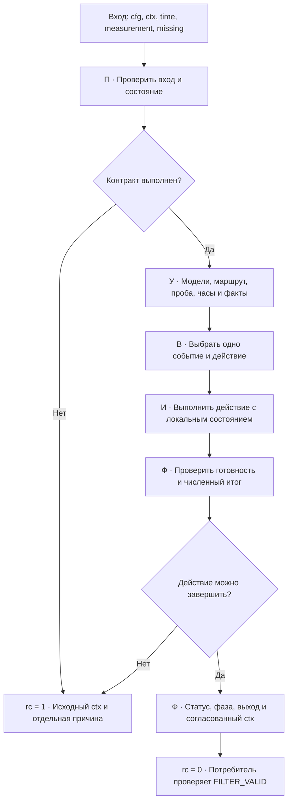
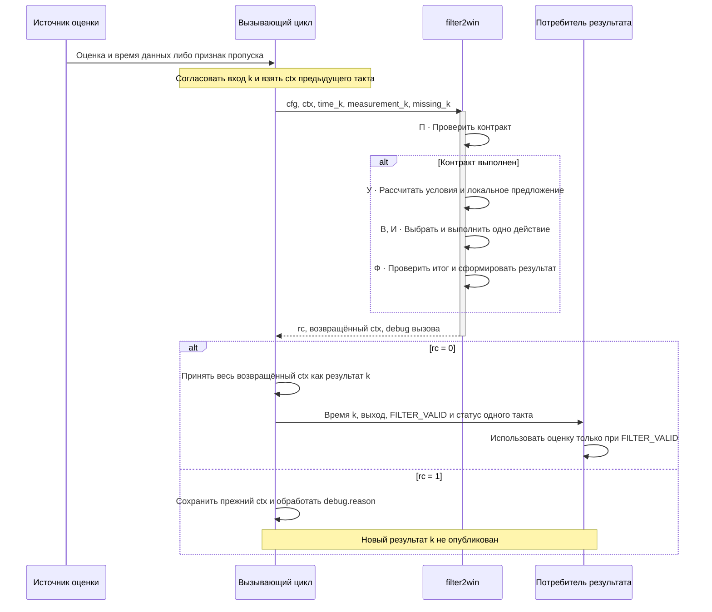

# FILTER2WIN: две сохраняемые базы, схема 3

## Назначение и область применения

Фильтр обрабатывает одну скалярную оценку координаты в каждый момент вызова. Он предназначен для последовательности, в которой наряду с обычным шумом встречаются одиночные выбросы, пропуски и компактные группы около другого решения оптимизатора. Основной профиль рассчитан на неподвижную цель; известная скорость и локальная линейная модель доступны как явно выбранные варианты.

Две базы нужны для сохранения двух статистических гипотез. При возврате наблюдений к ранее накопленной группе фильтр может использовать её сразу, если она по-прежнему готова. Смена выбранной базы и длительный пропуск сами по себе не уничтожают историю.

Фильтр не получает истинную координату, названия этапов сценария или признак «ошибочной полки». Статистически пригодная ложная группа может стать активной. Поэтому готовность означает пригодность по заданным численным условиям, а не доказанную истинность координаты. Если требуется немедленно выбирать готовую альтернативу, одиночное допустимое попадание в неё также способно вызвать выбор.

Все времена задаются в секундах на одной возрастающей шкале. Значения, радиусы и пределы разброса имеют единицы входной координаты; скорости — единицы координаты в секунду. Между вызовами не предполагаются ни постоянный период, ни скрытые синтетические наблюдения. Этот скалярный фильтр не является пространственным ковариационным оценивателем LLS/WLLS.

Рабочая точка входа — [filter2win.m](../matlab/function/filter2win.m). Далее описана схема 3, используемая обычным [практическим профилем](../matlab/tests/configs/filter2win_config.json). [Схема 2](filter2win_schema2_theory.md) сохранена для явно выбранной старой конфигурации; её очистка по времени, перенос базы и дополнительные состояния не переносятся на схему 3.

### Состав описания и связь с принципами

По [классификации V-процесса](../Principes/V_PROCESS_CONFIGURATOR.md) этот документ объединяет применимые материалы одной вычислительной библиотеки:

| Материал | Что описано здесь |
|---|---|
| №7, вычислительный компонент | Постановка, формулы, параметры, состояние, численные ограничения и независимые проверки — разделы 1–7, 10–13 |
| №8, внутренний интерфейс | Вызов с явным контекстом, владение, согласованный результат, пропуск и отказ — разделы 1, 2, 9 |
| Применимая часть №2, общий алгоритм | Ветвления одного вызова, приоритеты, блок-схема и циклограмма обмена — разделы 8, 9 |

Назначение и условия применения заданы выше. Системные требования конкретного потребителя, его внешние протоколы, пользовательский интерфейс и расписание задач описывает система, в которую включён фильтр. У библиотеки нет собственного полётного маршрута, фонового цикла или назначенного уровня ПО. Эти сведения не заменяются условными значениями из общего шаблона.

[LOGIC_DESIGN_STANDARD.md](../Principes/LOGIC_DESIGN_STANDARD.md) задаёт разделение условий, решения, исполнения и результата. Таблицы и схемы ниже раскрывают именно эту логику. Прежние обозначения `F2W-S3-01…07` сохранены в разделе 13 как устойчивые ссылки на соответствующие правила; описание, код и тесты не требуют отдельного реестра.

## 1. Вход, результат и граница одного такта

```matlab
[rc, ctx, debug] = filter2win(cfg, ctx, time, measurement, missing);
```

Первый вызов получает `ctx = struct()`. Конфигурация раскрывается один раз до обработки наблюдений. Изменение схемы или любого параметра требует нового контекста: сохранённый `ctx` содержит использованную конфигурацию и проверяется на совпадение.

| Вход | Смысл и ограничения |
|---|---|
| `cfg` | Полная конфигурация схемы 3: окна `main`, `alt`, сроки `flow`, параметры `handover` |
| `ctx` | Явно переданная скалярная структура состояния; вызов не использует глобальную или MATLAB-persistent память |
| `time` | Конечный вещественный `double`; после первого выполненного такта строго больше предыдущего времени |
| `measurement` | Вещественный скалярный `double`; при наличии наблюдения должен быть конечным |
| `missing` | Логическое значение или `double` 0/1; `NaN` в измерении также означает пропуск |

На пропущенном такте значение измерения не используется как точка. Вызов с пропуском всё равно имеет время и позволяет проверить срок выдачи. Ядро не запускает таймер самостоятельно: если вызывающая сторона хочет получить состояние при молчащем источнике, она должна вызвать фильтр с `missing=true`.

`rc=0` означает выполненный такт. Его результатом может быть принятая точка, предметный отказ в её приёме или недоступный выход. `rc=1` означает отказ API: переданный `ctx` возвращается полностью неизменным. Причина такого отказа находится в отдельном выходе `debug`; прежний `ctx.FILTER_DEBUG` при этом также не переписывается.

| Выход в `ctx` | Тип и единицы | Значение |
|---|---|---|
| `X_FILTERED_OUTPUT` | Скалярный `double`, единицы координаты | Конечная оценка либо `NaN`, когда выход недоступен |
| `FILTER_VALID` | Скалярный `logical` | В точности `isfinite(X_FILTERED_OUTPUT)` |
| `FILTER_STATUS` | Целый скалярный `double`, безразмерный код | Диагностика завершённого такта; совпадает с `FILTER_STATE.status` |
| `ACCEPTED` | Скалярный `logical` | Реальная входная точка записана в выбранный FIFO |
| `REACQUIRED` | Скалярный `logical` | На этом такте выбрано другое готовое окно, включая первый выбор; снятие выбора при потере готовности не является перезахватом |
| `W_ALT_POWER_OUTPUT` | Целый скалярный `double`, число точек | Фактическое число точек B после такта, независимо от активности B |
| `FILTER_STATE` | Скалярная структура | Состояние схемы 3 для следующего вызова того же потока |
| `FILTER_DEBUG` | Скалярная структура | Условия, выбранное действие и фактический результат такта |

Эти признаки независимы. Например, при накоплении B возможны `ACCEPTED=true` и прежний выход A; после окончания срока тот же приём B может сочетаться с `FILTER_VALID=false`. Отказ новой точки также может сочетаться с допустимым прогнозом старой базы.

`X_MAIN_REF` оставлен для совместимости: допустим конечный скаляр либо столбец $3\times1$, при конечном выходе обновляется первый элемент. Поле не является наблюдением, не заполняет FIFO и не участвует в выборе окна.

Контракт входа и сохранённого состояния реализован в [filter2win_persistent_prepare.m](../matlab/function/filter2win_persistent_prepare.m), конфигурации — в [filter2win_validate_persistent.m](../matlab/function/filter2win_validate_persistent.m).

## 2. Что именно хранится

### 2.1. Окна A и B сохраняют идентичность

`s.main` — FIFO A, `s.alt` — FIFO B. Названия не меняются при переключении. `s.active=0` означает, что ни одно окно не выбрано для выдачи; 1 выбирает A, 2 выбирает B.

В FIFO находятся только принятые реальные пары $(t_i,x_i)$. Прогноз, предыдущий опубликованный выход и промежуточные значения плавного перехода в них не записываются. Выделенная ёмкость массива не равна числу наблюдений: используется только `count` действительных элементов.

Для обеих баз действуют два способа удаления точек:

1. Успешная запись в полный FIFO вытесняет старейшую точку этого же окна.
2. Успешное робастное отсечение физически удаляет обнаруженные выбросы посредством `retain`.

Пропуск, отказ измерения, истечение срока выхода и смена `active` не очищают окна. Никаких «сроков жизни FIFO» у схемы 3 нет. Новый контекст — отдельная явная инициализация, а не скрытый переход по таймауту. Механика очереди описана в [fifo_double_theory.md](fifo_double_theory.md) и реализована в [fifo_double.m](../matlab/function/fifo_double.m).

### 2.2. Активное окно, фаза и статус — разные сведения

`active` определяет выбранный источник оценки. При запуске плавного перехода оно сразу указывает на **целевое** окно, хотя опубликованный выход ещё содержит вклад исходного значения.

Незавершённый переход определяется собственной памятью: `blend_duration>0`. Он не определяется равенством диагностического статуса 14. Поэтому такт ожидания встречного переключения может иметь статус 15 и сохранять незавершённый blend.

В диагностике `phase_before` и `phase` показывают выводимую фазу:

| Фаза | Определение |
|---|---|
| `ACCUMULATING` | Нет выбранного окна, `active=0` |
| `TRACKING` | Окно выбрано, незавершённого blend нет |
| `BLENDING` | Имеется незавершённый blend, `blend_duration>0` |

Это пояснение состояния, а не дополнительный автомат с отдельно изменяемым полем. Фаза не заменяет `FILTER_VALID`: выбранная сохранённая база может находиться в `TRACKING`, когда срок её выдачи уже истёк.

### 2.3. Часы и память решения

| Поля состояния | Что они означают |
|---|---|
| `last_tick` | Время последнего выполненного такта, включая пропуск или отказ новой точки |
| `last_input` | Время последнего непропущенного входа, включая отклонённое наблюдение |
| `last_accept(k)` | Последнее принятое попадание, поддержавшее выдачу из выбранного готового окна $k$; выбор готового окна также устанавливает эту отметку |
| `pending_window`, `pending_since` | Окно ожидаемого переключения и время первого принятого кандидата текущего ожидания |
| `blend_from`, `blend_start` | Исходное опубликованное значение и момент начала blend |
| `blend_duration`, `blend_elapsed` | Требуемая и уже накопленная длительность blend |
| `last_supported` | Предыдущий такт принял точку именно в выбранное готовое окно |
| `last_output` | Предыдущий фактически опубликованный выход, в том числе `NaN` |
| `status`, `status_since`, `tact` | Результат такта, время изменения кода и число выполненных тактов |

Принятая запись в неактивное окно изменяет его реальные данные, но не освежает срок активного. Поэтому время последней точки FIFO и отметка `last_accept` не являются взаимозаменяемыми.

Недоступные модель, прогноз и выход представлены `NaN`; отсутствующая начальная отметка времени — предусмотренным начальным значением. Невычисленная метрика не считается нулевым разбросом и не даёт готовность. При отсутствии достаточной модели данные всё ещё могут накапливаться в неготовом окне.

При первом корректном вызове подготовка создаёт следующие локальные начальные значения:

| Память | Начальное значение |
|---|---|
| A, B | Пустые FIFO заданной ёмкости; `count=0` |
| `active`, `pending_window` | 0 |
| `status`, `tact`, `blend_duration`, `blend_elapsed` | 0 |
| `last_tick`, `last_input`, оба `last_accept` | `-Inf`: ни один такт и ни одна опора ещё не приняты |
| `last_output`, `pending_since`, `blend_from`, `blend_start` | `NaN`: соответствующего значения пока нет |
| `last_supported` | `false` |
| `status_since` | Время первого вызова |
| `parameters`, `schema_version` | Переданная конфигурация и число 3 |

После исполнения первого такта публикуются уже его фактические состояние, время, код и выход. Начальные `-Inf` не разрешают неконечное время входа. Сброс выполняет вызывающая сторона новым пустым контекстом; параметр или пропуск не скрывают операцию сброса.

## 3. Численная модель одного окна

Пусть после чтения FIFO остались $n$ пар с возрастающими временами. Центр времени — последнее реальное наблюдение $t_n$. Прогноз имеет вид

$$
\widehat{x}(t)=a+v(t-t_n).
$$

Скорость выбирается по настройке `model`:

- `constant`: $v=0$.
- `known_velocity`: $v=v_{\mathrm{cfg}}$.
- `linear`: $v$ равна медиане допустимых попарных наклонов


$$
v_{ij}=\frac{x_j-x_i}{t_j-t_i},\qquad
  j>i,\quad t_j-t_i>0,\quad
  t_j-t_i\ge\texttt{linear\_min\_pair\_seconds}.
$$

Линейный вариант использует робастную оценку по попарным наклонам, а не метод наименьших квадратов. Если допустимых пар нет, модель недоступна. Для готовности линейной базы конфигурация требует не менее трёх точек.

После выбора скорости координаты приводятся к $t_n$:

$$
q_i=x_i-v(t_i-t_n),\qquad
a=\operatorname{median}_i q_i,\qquad
r_i=q_i-a.
$$

Для чётного числа элементов медиана — полусумма двух центральных значений. Реализация сначала делит каждое из них на два, чтобы не переполнить их сумму. Диагностики остатка:

$$
\operatorname{MAD}=\operatorname{median}_i |r_i|,
\qquad
R=\max_i r_i-\min_i r_i.
$$

Здесь MAD — исходная медиана абсолютных отклонений, без множителя 1,4826. Такой множитель применяется отдельно только в пороге отсечения. $R$ — полный размах остатков, а не размах исходных координат движущейся цели.

Окно имеет допустимое качество, если уровень, скорость, MAD и размах конечны и одновременно

$$
\operatorname{MAD}\le M_{\max},\qquad
R\le R_{\max},\qquad
|v|\le V_{\max}.
$$

Все три границы включены. Готовность добавляет два независимых условия:

$$
n\ge n_{\min},\qquad
t_n-t_1\ge T_{\min}.
$$

Количество не заменяет длительность. Длительность включает промежутки между сохранёнными точками и не доказывает непрерывность наблюдения. Ёмкость FIFO ограничивает память; `min_samples` задаёт минимальную базу и может быть меньше ёмкости.

Численные определения находятся в [filter2win_model.m](../matlab/function/filter2win_model.m) и [filter2win_window_view.m](../matlab/function/filter2win_window_view.m).

### 3.1. Численные границы и точность

Ядро принимает вещественный `double`. MATLAB хранит такой элемент в 8 байтах и использует представление двойной точности IEEE 754; расстояние от 1 до следующего числа составляет примерно $2{,}22\cdot10^{-16}$ ([описание типа](https://www.mathworks.com/help/matlab/ref/double.html)). Это характеристика представления числа, а не относительная погрешность всего фильтра.

Сравнения с порогами выполняются над полученными значениями `double`, без скрытого допуска: качество и окрестность используют `<=`, готовность и завершение ожидания — `>=`, новое время — строгое `>`. Округление рядом с порогом способно изменить ветвь. Допуск проверки численного результата не расширяет эти границы.

Центрирование времени на последней точке уменьшает величину аргументов линейной модели, но не восстанавливает разряды, утраченные при формировании входных меток. Если два момента уже представились одним числом, второй вызов отклоняется как повтор времени. Для небольшой длительности опыта с большим календарным началом вызывающая сторона может заранее передавать секунды от общего начала; эта шкала должна оставаться одной для всех сохранённых точек и последующих вызовов.

| Численная ситуация | Правило реализации |
|---|---|
| `NaN` измерения или `missing=true` | Пропуск; значение не становится наблюдением |
| `Inf` измерения при `missing=false`, неконечное время | Отказ API, исходный `ctx` сохранён |
| Нет допустимых пар для `linear`, переполнилась модель или размах | Модель не даёт готовности; её метрики не заменяются нулями |
| Ненулевое отклонение при маршрутизации | Остаток и радиус должны быть конечными, радиус — положительным; иначе попадания нет. Точное совпадение имеет расстояние 0 |
| Неконечный порог или остаток пробного отсечения | `NUMERIC_PROPOSAL_REJECTED`; предложение не принимается |
| Готовое окно получило предложение с недопустимым качеством | Предложение отклоняется вместе с пробным вытеснением |
| Невозможно вычислить обязательный прогноз или итоговый blend конечным числом | `rc=1`, `NUMERIC_OUTPUT_OVERFLOW`; весь исходный `ctx` сохранён, включая прежний `FILTER_DEBUG` |
| Недостаточная база, истечение срока, отмена blend или потеря готовности | Предусмотренная недоступность: `rc=0`, выход `NaN`, `FILTER_VALID=false` |

Таким образом, арифметический `NaN` при обязательной выдаче отличается от предусмотренного `NaN` при недоступности. Проверка конечности обязательного выхода выполняется после проверки готовности выбранной базы. Бесконечный разрешённый срок удержания не отменяет численных ограничений прогноза. Конечность отдельных входов также не гарантирует конечность их разности, произведения или суммы.

У точности здесь три разных основания:

| Свойство | Что действительно установлено |
|---|---|
| Пригодность набора наблюдений | Проверяются заданные MAD, размах, скорость, количество и временной интервал; это условия выдачи |
| Совпадение вычисления с математическим ожиданием | Для конкретного аналитического случая задаётся допуск в единицах координаты; статусы, выбранное окно и принятые точки проверяются отдельно |
| Ошибка относительно истинной координаты | Зависит от ошибок источника и выбранной группы; универсального предела для произвольных входов фильтр не устанавливает |

Например, гладкий переход между постоянными уровнями 10 и 25 при $u=1/4$ должен дать 12,34375. Такой ручной расчёт проверяет формулу и часы перехода. Он не устанавливает точность координаты реального объекта. Аналогично, совпадение двух реализаций на одной последовательности проверяет сохранение поведения, но не доказывает истинность выбранной группы.

Для линейного режима ошибка скорости влияет на прогноз пропорционально времени от последней опоры: при неизменном уровне вклад $\delta v$ равен $(t-t_n)\delta v$. Поэтому допуск координаты задают вместе с областью времени и данных. Единого абсолютного допуска для всех допустимых `double`, всех длительностей и всех масштабов у этой реализации нет. Поднормальные значения и изменение режима округления отдельно не квалифицированы; требования конкретного применения задаются до его проверки.

### 3.2. Объём вычислений и память

Пусть ёмкости FIFO равны $C_A$ и $C_B$, а число точек в рассматриваемой модели — $n$. Вызов синхронный и не содержит итерации до сходимости. За такт рассчитываются две исходные версии баз и, если выбран маршрут, одна пробная; после фактического отсечения может рассчитываться ещё одна. Итого не более **четырёх** вызовов `filter2win_window_view`. Пустые диагностические структуры не требуют обработки наблюдений. Сохранённые результаты вычислений используются при выборе и публикации повторно.

| Часть | Верхняя оценка по структуре кода |
|---|---|
| Реальные данные двух FIFO | По два массива `double` на окно: $16(C_A+C_B)$ байт только для времён и значений, без метаданных и копий |
| `constant`, `known_velocity` | Линейные проходы и сортировки массивов длины не более ёмкости; рабочие массивы порядка $O(n)$ |
| `linear` | Перебирается не более $n(n-1)/2$ пар; массив наклонов выделяется под это число даже при последующем исключении части пар |
| Робастное отсечение | Одна проверка остатка каждой точки и не более одного `retain`; повторов до сходимости нет |
| Дополнительное состояние и диагностика | Скалярная память решения и данные порядка $O(C_A+C_B)$, в том числе локальный кандидат; это не только полезная память FIFO |

Для двух ёмкостей 18 полезные массивы FIFO занимают 576 байт, а один массив всех попарных наклонов — не более 153 `double`, то есть 1224 байт. Эти числа не являются общим потреблением MATLAB: структуры, диагностика, локальные копии и сортировка требуют дополнительной памяти. Рост ёмкости особенно существенен для `linear`, где число пар квадратично. Валидность параметров не подтверждает доступность требуемой памяти.

В этой спецификации не назначен дедлайн в миллисекундах. Период вызова, допустимую задержку до потребителя и ресурсный бюджет задаёт использующая система. Их проверяют на её платформе, версии MATLAB и максимальных предусмотренных ёмкостях; время unit-теста не служит оценкой худшего времени вызова. Отсутствие фонового таймера и циклограмма синхронного обмена определены в разделе 9.

## 4. Пробная запись: что принимается и что откатывается

Маршрут выбирается по состоянию **до записи**. Затем только для выбранного окна вычисляется предложение:

1. Новую реальную точку добавляют в локальную копию FIFO. При заполнении пробно вытесняется старейшая точка.
2. Для полученной базы строят исходную модель и её MAD.
3. Если количество не меньше `trim.min_samples` и модель доступна, вычисляют порог


$$
\theta=
   \texttt{trim.k}\,
   \max\!\left(
       \texttt{trim.scale\_floor},
       \texttt{trim.mad\_scale}\,\operatorname{MAD}
   \right).
$$

4. Сохраняют точки с $|r_i|\le\theta$. Равенство порогу принимается; выбросом является строгое превышение.
5. Если новая точка оказалась выбросом, отклоняют предложение целиком. Иначе физически удаляют выявленные старые выбросы. Когда удаление изменило данные, заново вычисляют модель, качество и готовность; при неизменных данных используют уже рассчитанные величины.
6. Если окно **до записи было готовым**, а качество оставшегося предложения недопустимо, предложение отклоняют целиком. Если окно было неготовым, неоднородные реальные данные могут продолжить накопление без выдачи результата.

При отказе сохраняются исходный FIFO, его исходные точки и время последней опоры. Пробное вытеснение тоже отменяется. В опубликованных `removed` и `evicted` отражаются только состоявшиеся удаления, а не отвергнутые изменения копии.

Выполняется **один проход отсечения**. После пересчёта модели нет повторного удаления до сходимости. В схеме 3 `trim_fraction=0`: удаление заранее заданной доли хвостов не подменяет физическое удаление точек по порогу.

Множитель 1,4826 в обычном профиле является принятой нормальной калибровкой MAD. Он вместе с `trim.k` не задаёт гарантированную вероятность отказа на произвольной смеси распределений или коррелированных оценках оптимизатора.

### Потеря готовности после допустимой записи

Качество и готовность различаются. Очистка может оставить компактные данные с допустимым MAD и размахом, но слишком мало точек либо слишком короткий временной интервал. Такая запись может быть принята: полезные реальные данные остаются в FIFO, а готовность становится ложной.

Если это выбранное окно, `active` снимается, blend прекращается, выход становится `NaN`. Указывается причина `BASE_NO_LONGER_READY_AFTER_REMOVAL`, а статус возвращается к накоплению A (1) или B (4). Автоматического выбора другого окна без нового допустимого попадания нет. Прежний факт готовности не разрешает выдавать недостаточную текущую базу.

Пробный численный кандидат уже **вычислен**. Его использование при выборе действия не является выдачей ещё не полученного результата. Он остаётся локальным предложением до принятия; исходный контекст не изменён.

## 5. Маршрутизация наблюдения

Неготовое окно не имеет окрестности допуска. Для каждого готового окна используется его прогноз $\widehat{x}_k(t)$ до записи новой точки и собственные радиусы.

Сначала вычисляется адаптивная часть:

$$
A_k=\min\!\left(
    R_{\mathrm{adaptive,max},k},
    \mu_k\max(f_k,\operatorname{MAD}_k)
\right).
$$

Далее нижний и верхний радиусы:

$$
L_k(t)=\max(L_{0,k},A_k)+g_k(t-t_{n,k}),
\qquad
U_k(t)=\max(U_{0,k},A_k)+g_k(t-t_{n,k}).
$$

Здесь $g_k$ — `growth_per_second`, а $t_{n,k}$ — время последней сохранённой реальной точки этого окна. Возраст не вычисляется от последнего вызова функции.

Для остатка $e_k=x-\widehat{x}_k(t)$ берётся радиус соответствующей стороны: $L_k$ при $e_k<0$, иначе $U_k$. Нормированное расстояние равно $|e_k|/\text{радиус}$; точное совпадение имеет расстояние 0. При нулевом радиусе допустимо только точное совпадение. Неконечное сравнение не даёт попадания.

Порядок выбора маршрута:

1. Попадание только в одну готовую окрестность направляет точку в неё.
2. В пересечении выбирается меньшее нормированное расстояние. При точном равенстве сохраняется активное окно; если активного нет, выбирается A.
3. Если готовые окрестности не подошли, выбирается первое неготовое окно в порядке A, B.
4. Если оба окна готовы, но точка вне обеих окрестностей, маршрута нет: точка отклоняется.

Граница окрестности включена: расстояние $\le1$. Поэтому «ближе» означает близость с учётом масштаба окна, а не только меньший абсолютный остаток. Например, при центрах 10 и 25, радиусах 6 и 20 точка 15 имеет расстояния $5/6$ и $10/20$; выбирается B.

Если выбранное окно отклонило пробную запись, та же точка не перенаправляется в другое. Это сохраняет единственность решения и не позволяет пройти один и тот же такт через несколько меняющихся проверок.

Неготовая альтернатива не закрепляется навсегда за первой далёкой точкой: новые точки вне готовых окрестностей продолжают поступать в неё. Последующая компактная группа может вытеснить или удалить ранний выброс.

## 6. Срок выдачи, ожидание выбора и приоритет A

### 6.1. Доступность прежнего выхода

Возраст активного окна определяется как

$$
\operatorname{age}=t-\texttt{last\_accept(active)}.
$$

Для пропуска используется `flow.gap_hold_seconds`; для отклонения, накопления или ожидания кандидата — `flow.outlier_hold_seconds`. Прежний выход разрешён только при выбранной готовой базе и $\operatorname{age}\le H$. Граница включена.

Обычная пролонгация выдаёт прогноз активной модели на текущее время. Нулевой срок позволяет выход на такте нового принятого попадания, но не на следующем такте без поддержки: времена вызовов строго возрастают. Отказ измерения и запись в неактивное окно не продлевают срок выбранного.

Истечение срока делает выход `NaN`, сохраняя окна. Оно не обязано давать именно код 8: код сообщает причину такта. Например, за пределами срока отказ по качеству имеет статус 5 и недоступный выход. Код 8 обозначает истечение выдачи при пропуске либо отмену blend по политике пропуска.

### 6.2. Ожидание подтверждённого переключения

При первом принятом попадании в неактивное окно устанавливаются `pending_window` и `pending_since`. Это может произойти ещё до его готовности. Длительность ожидания считается от первого принятого кандидата, а не от готовности окна и не по числу тактов:

$$
T_{\mathrm{wait,elapsed}}=t-\texttt{pending\_since}.
$$

Пропуск и отказ новой точки сохраняют начало ожидания. Они не создают принятого попадания. Принятая точка активного окна прекращает ожидание другого; принятый кандидат другого направления начинает ожидание для этого направления. Удаление старой точки при последующей очистке FIFO само по себе не переносит начало уже начатого ожидания.

Для выбора B требуется `handover.wait_seconds`, для возврата в A — `return_wait_seconds`. Граница $\text{elapsed}\ge\text{wait}$ включена. Само истечение времени без нового принятого попадания в готовую целевую базу переключения не вызывает.

### 6.3. Асимметрия A → B

Пока активна A, её разрешённая пролонгация имеет дополнительный приоритет перед выбором B. Принятая готовая B может ждать, даже если её `wait_seconds` уже истекло:

$$
\operatorname{age}_A\le
\texttt{flow.outlier\_hold\_seconds}
\quad\Longrightarrow\quad
\text{сохранить A}.
$$

Это статус 15 с причиной `MAIN_PROLONGATION_ACTIVE`. Запись в B при этом принимается. Для переключения A → B нужна строгая противоположная граница по возрасту и выполненное ожидание B.

Для B → A аналогичное дополнительное удержание B не введено. При `return_wait_seconds=0` первое принятое попадание в готовую A разрешает немедленный выбор. При нулевой длительности возврата оно сразу становится выходом.

Такой приоритет закреплён численной политикой схемы 3. Он не означает, что A достовернее по внешней истине. При бесконечном сроке удержания A выбор B не произойдёт, пока A остаётся выбранной готовой базой; это следствие настройки, а не обещание прогресса при любых входах.

## 7. Плавный переход

### 7.1. Начало и форма

После разрешённого выбора целевой базы берётся длительность `duration_seconds` для B или `return_duration_seconds` для A.

Если длительность нулевая, новая модель публикуется сразу. **Если предыдущий опубликованный выход равен `NaN`, выбор также немедленный**, даже при ненулевой настроенной длительности: интерполировать недоступное отображённое значение нельзя.

Иначе исходное значение $y_0$ берётся из разрешённого текущего прогноза прежней базы. При уже идущем blend это последнее опубликованное значение. Если прежняя пролонгация истекла, но предыдущий опубликованный выход ещё конечен, началом служит именно он. Последнее правило сохраняет возможность сглаживания после большого интервала между вызовами; оно не объявляет старую оценку свежей.

В момент начала:

$$
E=0,\qquad D>0,\qquad
\texttt{active}=\text{целевая база}.
$$

Для накопленной длительности $E$ вычисляются

$$
u=\min(1,\max(0,E/D)),\qquad
w(u)=
\begin{cases}
u,&\texttt{linear},\\
u^2(3-2u),&\texttt{smoothstep}.
\end{cases}
$$

Выход:

$$
y(t)=(1-w)y_0+w\,\widehat{x}_{\mathrm{target}}(t).
$$

Исходное значение фиксировано на старте; целевой прогноз берётся из текущей принятой модели. При движущейся модели неизменный вес сам по себе не означает неизменную координату. Ни $y_0$, ни промежуточный $y(t)$ не становятся измерениями.

При $E\ge D$ выход равен прогнозу целевого окна, такт имеет статус 6, а память blend закрывается. Само завершение не меняет `active` повторно и не является ещё одним `REACQUIRED`.

### 7.2. Какие интервалы учитываются

Пусть $\Delta t=t-\texttt{before.last\_tick}>0$. Прибавление к $E$ определяется поддержкой, а не диагностическим кодом предыдущего такта:

| Текущий такт | Прибавление $\Delta t$ |
|---|---|
| Принятое попадание в активное готовое окно; предыдущий такт также поддерживал его | Да |
| Такое же попадание после пропуска, `on_missing=continue` | Да |
| Такое же попадание после пропуска, `on_missing=pause` | Нет: это первый такт возобновления |
| Такое же попадание после отказа или принятого встречного кандидата в ожидании | Нет, в том числе при `continue` |
| Пропуск при `continue` и допустимой пролонгации | Да |
| Пропуск при `pause` и допустимой пролонгации | Нет |
| Отклонённая точка либо встречный кандидат в ожидании | Нет |

Таким образом, `on_missing` определяет поведение пропуска. Оно не превращает отклонённое наблюдение или встречный кандидат в поддержку перехода. Временной интервал через неподдержанный такт не начисляется задним числом при возобновлении.

При `on_missing=cancel` пропуск прекращает blend и делает выход недоступным, сохраняя обе базы. Истечение срока пролонгации при пропуске также прекращает blend при любом режиме. Если вместо поддержки поступил отказ, неготовый кандидат или ожидание встречного переключения за пределами соответствующего срока, прежний blend также прекращается. Выбранное окно и оба FIFO сохраняются, если сама запись не лишила выбранную базу готовности.

### 7.3. Ожидание встречного переключения во время blend

Если во время движения к B принято попадание в A, но возврат пока не разрешён, выполняется `SWITCH_WAIT`. Пока срок активной B допускает выдачу:

- принятое наблюдение сохраняется в A;
- `active` остаётся B;
- `blend_from`, длительность и накопленное время сохраняются;
- при допустимом сроке выдаётся последнее опубликованное значение;
- статус такта — 15, фаза остаётся `BLENDING`.

Следующий поддержанный такт B возобновляет этот же blend. Первый такт возобновления не добавляет неподдержанный интервал. Статус 15 сам по себе не является командой удалить память перехода.

Если к такту ожидания срок B уже истёк, принятая точка A всё равно сохраняется, но выход становится NaN, blend закрывается и фаза становится `TRACKING`. Статус остаётся 15 с причиной `WAITING_FOR_SWITCH`: ожидаемая цель пока не выбрана, а истёкший переход не продолжает скрыто существовать.

Если встречное переключение уже разрешено, оно выбирает новую цель; при ненулевой длительности новый blend начинается от текущего допустимого отображения. Потеря готовности выбранной базы, напротив, прекращает blend и возвращает фильтр к накоплению.

## 8. Порядок выбора действия

Один такт последовательно выполняет подготовку, расчёт условий, выбор одного действия, исполнение и окончательное принятие результата:

1. **Подготовка** проверяет конфигурацию, вход, состояние и строгое увеличение времени. Отказ прекращает вызов без изменения `ctx`.
2. **Условия** вычисляют модели сохранённых баз, маршрут, одно пробное предложение, возраст, ожидание и возможность продвижения blend. Вычисленные численные данные и факты относятся к локальному такту.
3. **Переход** получает только эти факты и выбирает `event` и `action`. Он не читает FIFO заново, не подгоняет модель и не выполняет ещё одну пробную запись.
4. **Именованный исполнитель** выполняет выбранное действие: `accumulate`, `track`, `switch`, `blend`, `wait`, `hold`, `reject` или `unavailable`. Это соответственно накопление, сопровождение, выбор окна, смешивание, ожидание, пролонгация, отказ и недоступность.
5. **Завершение** проверяет итоговую готовность и допустимость выхода, определяет окончательный статус и публикует один согласованный `ctx`.

Для непропущенной точки предложение может быть численно вычислено до выбора действия: это чистая проба с известным результатом, а не преждевременная запись в контекст. Дополнительный универсальный движок правил для этой последовательности не требуется.

### 8.1. Блок-схема одного вызова

Обозначения П, У, В, И и Ф используются также в циклограмме. Диспетчер вызывает эти части в установленном порядке. Численные условия и локальное предложение, включая часы ожидания, формируются в У; выбор предметного действия — в В; исполнитель И применяет выбранные изменения. Ф завершает выбранное действие и единственный раз формирует итоговый статус.



Потеря готовности в Ф — предусмотренный результат с `NaN`, а не отказ API: принятое полезное подмножество FIFO сохраняется. Напротив, арифметическая невозможность обязательного выхода отменяет публикацию всего такта. Блок-схема показывает границы ответственности; предметные ветви внутри В раскрыты ниже.

### 8.2. Приоритеты выбора

Приоритеты предметных случаев:

1. Пропуск рассматривается отдельно от наблюдения: отсутствие выбранной базы, истечение/отмена, обслуживание blend или обычная пролонгация.
2. Принятое предложение готовой базы определяет первую готовность, сопровождение активной базы или попытку переключения. Встречное ожидание имеет собственное действие и не скрывается под «продолжить blend».
3. Для оставшихся случаев незавершённый допустимый blend обслуживается без фиктивной поддержки. Принятые реальные данные сохраняются; отказ объясняется своей причиной.
4. Вне этого случая принимается накопление неготового окна либо возвращается отказ: стартовый, по качеству выбранного окна или вне обеих готовых окрестностей.
5. Итоговая потеря готовности активной базы запрещает её выдачу независимо от предварительно выбранного действия.

Последний пункт — проверка реального результата, а не второй независимый выбор предметного действия. Она не назначает успех только потому, что исходный guard был истинным.

### 8.3. Таблица тактов

В таблице «записать» означает принять уже проверенное предложение в один выбранный FIFO. Второй FIFO остаётся неизменным. «Прежний выход по сроку» — прогноз обычной активной базы или сохранённое отображение незавершённого перехода; при истёкшем сроке это `NaN`.

| Случай | Действие | Статус | Фаза после такта | Выход | FIFO |
|---|---|---:|---|---|---|
| Пропуск, базы ещё пусты и активного нет | `unavailable`: ожидать данные | 0 | ACCUMULATING | NaN | Оба сохранены |
| Пропуск, накопленные данные есть, активного нет | `unavailable`: сохранить накопление | 12 | ACCUMULATING | NaN | Оба сохранены |
| Пропуск, срок активной базы истёк или blend отменён по `cancel` | `unavailable`: прекратить выдачу и blend | 8 | TRACKING | NaN | Оба сохранены |
| Пропуск, обычная активная база в сроке | `hold`: пролонгировать | 7 | TRACKING | Прогноз активной базы | Оба сохранены |
| Пропуск во время допустимого blend | `blend`; `switch` при завершении | 14; 6 при завершении | BLENDING; TRACKING при завершении | По формуле blend | Оба сохранены |
| Принята первая готовая база, активного не было | `track`: выбрать и выдать | 13 | TRACKING | Прогноз принятой базы | Записать выбранный |
| Принято готовое предложение активного окна без blend | `track`: сопровождать | 2 | TRACKING | Обновлённый прогноз | Записать активный |
| Принято готовое предложение активного окна с blend | `blend`; `switch` при завершении | 14; 6 при завершении | BLENDING; TRACKING при завершении | По формуле blend | Записать активный |
| Принята готовая другая база, выбор ещё запрещён | `wait`: сохранить кандидата и ожидать | 15 | BLENDING сохраняется только в пределах срока; иначе TRACKING | Прежний выход по сроку | Записать целевой |
| Принята готовая другая база, выбор разрешён, длительность нулевая или прошлый выход NaN | `switch`: выбрать немедленно | 6 | TRACKING | Прогноз выбранной базы | Записать целевой |
| Тот же выбор с конечным прежним выходом и ненулевой длительностью | `blend`: начать переход | 14 | BLENDING | Исходное значение, вес 0 | Записать целевой |
| Принята неготовая A при отсутствии активного окна | `accumulate`: накапливать A | 1 | ACCUMULATING | NaN | Записать A |
| Первое принятое попадание в пустую неактивную базу | `accumulate`: начать альтернативу | 3 | TRACKING | Прежний выход по сроку | Записать целевой |
| Остальное принятие неготовой базы вне обслуживания blend | `accumulate`: продолжить накопление | 4 | TRACKING либо ACCUMULATING | Прежний выход по сроку либо NaN | Записать целевой |
| Неготовый кандидат или отказ при допустимом незавершённом blend | `blend`: сохранить без продвижения | 14 | BLENDING | По сохранённому весу; причина отказа сохранена | Записать только если предложение принято |
| Пробная запись отклонена до первого выбора базы | `reject`: отклонить точку | 11 | ACCUMULATING | NaN | Оба сохранены |
| Пробная запись выбранного маршрута отклонена без допустимого обслуживания blend | `reject`: отклонить точку | 5 | TRACKING | Прежний выход по сроку | Оба сохранены |
| Точка вне обеих готовых окрестностей без допустимого обслуживания blend | `reject`: отклонить точку | 10 | TRACKING | Прежний выход по сроку | Оба сохранены |
| После принятой очистки выбранная база больше не готова | Завершить накоплением, снять выбор и blend | 1 для A, 4 для B | ACCUMULATING | NaN | Принятые остатки сохранены |

Некоторые строки имеют уточняющие предпосылки; применяется изложенный выше порядок, а не поиск произвольного совпадения в таблице. Например, первое попадание в пустую альтернативу во время допустимого blend обрабатывается как обслуживание blend, а потеря готовности выбранной базы имеет окончательный результат последней строки.

Числовые коды сохраняются. Имена: 0 `WAITING_FOR_DATA`, 1 `ACCUMULATING`, 2 `STEADY_TRACKING`, 3 `TRACKING_WITH_OUTLIERS`, 4 `ALT_ACCUMULATING`, 5 `QUALITY_REJECTED`, 6 `WINDOW_SELECTED`, 7 `GAP_PROLONGATION`, 8 `OUTPUT_EXPIRED`, 10 `OUTSIDE_BOTH_WINDOWS`, 11 `WARMUP_REJECTED`, 12 `WARMUP_GAP`, 13 `INITIAL_BASE_READY`, 14 `TRANSITIONING`, 15 `WAITING_FOR_SWITCH`. Коды 9 и 16 относятся только к схеме 2.

Структуре соответствуют [filter2win_persistent.m](../matlab/function/filter2win_persistent.m), [conditions](../matlab/function/filter2win_persistent_conditions.m), [transition](../matlab/function/filter2win_persistent_transition.m) и [execute](../matlab/function/filter2win_persistent_execute.m). Это обычные функции с фиксированным выбором; таблицы `rules`, DSL `ALL/ANY` и отдельного реестра действий нет.

## 9. Отказы, владение и принятие результата

Исходным контекстом владеет вызывающая сторона. Во время такта ядро работает с локальным состоянием. Успех отдельной пробной операции ещё не разрешает частично публиковать FIFO, статус или выход.

| Исход | Примеры | Что возвращается |
|---|---|---|
| Отказ API до предметного такта | Неверный параметр, несовместимый контекст, повторное/обратное время, переполнение разности времени | `rc=1`, исходный `ctx` полностью сохранён |
| Предметный отказ новой точки | `NEW_POINT_OUTLIER`, `PROPOSED_SPREAD_REJECTED`, `OUTSIDE_BOTH_READY_WINDOWS` | `rc=0`, точка не принята, время такта и диагностика обновлены, FIFO сохранены |
| Неудачное численное предложение | Например, неконечный порог или остаток: `NUMERIC_PROPOSAL_REJECTED` | Предложение отклонено; готовая база не заменяется непроверенной |
| Нормальная недоступность | Недостаточная база, истёкший срок, отмена blend, потеря готовности | `rc=0`, `FILTER_VALID=false`, выход NaN; полезная память сохранена |
| Невозможность закончить выбранное действие или опубликовать конечный результат | Нарушенная предпосылка исполнителя, `NUMERIC_OUTPUT_OVERFLOW` | `rc=1`, весь исходный `ctx` сохранён |

Отказ наблюдения не отменяет факта выполненного такта. Поэтому меняются `last_tick`, диагностические поля и отметка поддержки; это необходимо для последующего расчёта времени. Но он не изменяет реальные данные окон и не продлевает срок активного.

Окончательный результат публикуется после действия и общих проверок: FIFO, выбранное окно, память blend, выход и его диагностический код относятся к одному такту. Такая атомарность относится к одному синхронному вызову чистого ядра. Здесь нет внешних эффектов, распределённой транзакции, очереди повторов или неизвестного результата удалённой команды.

Диагностика сохраняет `event`, `action`, `reason`, фазу до/после, `active`, маршрут, исходные и итоговые количества, модель/MAD/размах, порог отсечения, удалённые и вытесненные точки, возраст, ожидание и вес blend. Она объясняет вычисленное решение и фактический результат. Само название события не является свидетельством успешной записи.

### 9.1. Циклограмма вызова и использования результата

Нужно различать время данных $t_k$, передаваемое фильтру, и моменты исполнения $\tau$ на часах вызывающей системы. Сроки удержания, ожидание и blend вычисляются только по $t_k$. Затраты процессорного времени между чтением входа и возвратом результата не прибавляются к этим срокам.



Для принятого вызова порядок моментов таков:

$$
\tau_{\mathrm{read},k}\le\tau_{\mathrm{call},k}
\le\tau_{\mathrm{return},k}\le\tau_{\mathrm{use},k}.
$$

Это порядок, а не расписание с заданным периодом. В каждый момент чтения потребитель получает выход и признаки пригодности одной завершённой итерации. `rc=1` оставляет в `ctx` прошлый результат; само присутствие прежнего `FILTER_VALID=true` не означает успех нового вызова. Для передачи результата другой задаче вызывающая сторона формирует и публикует согласованный набор после возврата, включая время данных. Ядро не реализует межпоточную синхронизацию.

| Событие у вызывающей стороны | Принадлежность и реакция |
|---|---|
| Запуск или намеренный сброс | Новый `ctx=struct()`; начинается отдельная история окон |
| Следующее наблюдение | Тот же контекст потока, прежняя конфигурация, строго большее время данных |
| Пропуск или контроль срока при молчащем источнике | Вызов с `missing=true` и новым временем; без вызова состояние не меняется |
| Задержанное поступление с ещё допустимым возрастающим временем | Обрабатывается по переданному времени данных; давность относительно настенных часов проверяет вызывающая система |
| Повтор или нарушение порядка времени | `rc=1`, `NONINCREASING_TIME`; старый контекст сохранён, повтор не является новым тактом |
| Отказ API либо арифметическая ошибка обязательного результата | Новая итерация не принята; причина читается из отдельного `debug`, решение о следующем входе принимает вызывающая сторона |
| Смена конфигурации или другого скалярного потока | Отдельный новый контекст; контексты разных осей и объектов не разделяются |

Для библиотеки малым циклом является обработка одного входа. Большой и внешний циклы принадлежат использующей системе и не запускаются внутри ядра. В существующем [интеграционном опыте](../matlab/tests/integration_filter2win.m) сначала вычисляются оценки WLLS для всей последовательности, затем каждая из трёх независимых осей последовательно проходит через свой `filter2win`; метрики и графики строятся после получения результатов. Это пакетный опыт с принадлежностью данных индексам, а не уже реализованное расписание реального времени «WLLS → три фильтра» на каждом периоде. Полётные точки и смена маршрутного задания в этом опыте отсутствуют.

## 10. Четыре численные истории

Истории ниже используют простые постоянные уровни из [filter2win_schema3_cases.json](../matlab/tests/configs/filter2win_schema3_cases.json). Это аналитическое объяснение ожидаемого поведения, а не заявление о запуске MATLAB в текущей среде.

Если не оговорено иное: ёмкость 12, `min_samples=4`, минимальный интервал 2 с, радиус 2, `max_mad=0.2`, `max_range=1`, отсечение начиная с 3 точек, $k=4$, масштаб 1,4826, нижний масштаб 0,1. Оба срока удержания — 8 с. Ожидания и длительности переключений — нулевые. Каждая история — отдельный запуск с конфигурацией, заданной до первого такта.

### История 1. Четыре точки ещё не означают готовность

Все значения равны 10, поэтому MAD и размах равны нулю.

| Время, с | Число A | Интервал A, с | Статус | Выход |
|---:|---:|---:|---:|---:|
| 0 | 1 | 0 | 1 | NaN |
| 0,1 | 2 | 0,1 | 1 | NaN |
| 1 | 3 | 1 | 1 | NaN |
| 3 | 4 | 3 | 13 | 10 |

На последнем такте выполнены и $n\ge4$, и интервал $\ge2$. Выбрана A, B остаётся пустой.

Если те же четыре значения поступают во времена 0; 0,1; 0,3; 0,8, количество и качество те же, но интервал равен 0,8 с. Последний статус остаётся 1, выход — NaN. Плотная серия не заменяет требуемое время.

### История 2. Ранний грубый выброс не уничтожает будущую B

Сначала A накоплена значениями 10 во времена 0, 1, 2, 3. Она готова, выбрана, выход равен 10. Затем поступают значения 100 и 25.

| Время, с | Вход | Что остаётся в B | Статус | active | Выход |
|---:|---:|---|---:|---|---:|
| 4 | 100 | $100$ | 3 | A | 10 |
| 5 | 25 | $100,25$ | 4 | A | 10 |
| 6 | 25 | $25,25$, точка $t=4$ удалена | 4 | A | 10 |
| 7 | 25 | Три значения 25 | 4 | A | 10 |
| 8 | 25 | Четыре значения 25, B готова | 15 | A | 10 |
| 11 | 25 | Пять значений 25 | 15 | A | 10 |
| 12 | 25 | Шесть значений 25 | 6 | B | 25 |
| 13 | 10 | B не меняется; точка принята в A | 6 | A | 10 |

На $t=6$ медиана пробной B равна 25, MAD равен нулю, $\theta=4\cdot0{,}1=0{,}4$. Остаток точки 100 равен 75, поэтому она удаляется. Новая точка имеет нулевой остаток и принимается. Неготовая B не была заранее запрещена из-за первой точки 100.

На $t=8$ B готова, но возраст A равен 5 с. На $t=11$ он равен ровно 8 с: граница удержания включена, причина ожидания — `MAIN_PROLONGATION_ACTIVE`. Только на $t=12$ возраст 9 с разрешает выбор B. A всё это время сохраняет свои четыре исходные точки. Возврат в A на $t=13$ немедленный; B не копируется в A и не очищается.

Теперь отсутствие наблюдения на $t=21$ даёт возраст A ровно 8 с, статус 7 и выход 10. На $t=21{,}001$ выход уже NaN и статус 8. Оба FIFO остаются теми же, в том числе после пропуска на $t=1000$. Новое допустимое попадание 25 в готовую B может выбрать сохранённую базу без повторного накопления.

Из состояния после $t=13$ можно отдельно проверить два отказа на $t=14$. Значение 17,5 находится вне обеих окрестностей и даёт статус 10. Значение 11,2 попадает в радиус A, но его остаток 1,2 превышает порог 0,4: статус 5, `NEW_POINT_OUTLIER`. В обоих случаях A и B не меняются.

### История 3. Ожидание возврата сохраняет незавершённый blend

В отдельном запуске сохраняем те же исходные A=10, B=25 и входы до $t=12$, но с самого начала задаём переход в B длительностью 4 с, `smoothstep`, `on_missing=pause`, ожидание возврата в A 10 с. Длительность возврата остаётся нулевой.

На $t=12$ выбор B разрешён: `active=B`, исходное значение 10, $E=0$. Далее:

| Время, с | Вход | Смысл такта | $E$, с | Вес | Статус / фаза | Выход |
|---:|---:|---|---:|---:|---|---:|
| 12 | 25 | Начало перехода в B | 0 | 0 | 14 / BLENDING | 10 |
| 13 | 25 | Поддержка B | 1 | 0,15625 | 14 / BLENDING | 12,34375 |
| 14 | 10 | Принята A; возврат ещё ждёт | 1 | — | 15 / BLENDING | 12,34375 |
| 15 | 25 | Возобновление B после встречного кандидата | 1 | 0,15625 | 14 / BLENDING | 12,34375 |
| 16 | Пропуск | Пауза, срок выдачи не истёк | 1 | 0,15625 | 14 / BLENDING | 12,34375 |
| 17 | 25 | Первый такт B после пропуска | 1 | 0,15625 | 14 / BLENDING | 12,34375 |
| 19 | 25 | Поддержка B, добавлены 2 с | 3 | 0,84375 | 14 / BLENDING | 22,65625 |
| 20 | 25 | Достигнута длительность 4 с | 4 | 1 | 6 / TRACKING | 25 |

Например, при $E=1$ имеем $u=1/4$, $w=(1/4)^2(3-2/4)=0{,}15625$, поэтому $y=10+15w=12{,}34375$.

На $t=14$ A получает реальную точку, но код 15 не стирает параметры blend. Интервал через встречный кандидат не засчитывается на $t=15$. Интервал через пропуск не засчитывается на $t=17$. После завершения B содержит только реальные значения 25, без 12,34375 или 22,65625.

Если вместо `pause` с самого начала задано `continue`, интервалы пропуска учитываются при допустимом сроке. Ожидание встречного кандидата всё равно не поддерживает blend. При `cancel` пропуск прекращает его.

Отдельный важный случай: если до разрешённого выбора новой базы уже был опубликован NaN, ненулевая длительность не создаёт blend из старого, не отображаемого значения. Новая готовая база выбирается сразу, статус 6.

### История 4. Принятая очистка может снять готовность

Это отдельный случай с более жёстким отсечением, соответствующий граничному испытанию: у B ёмкость 5, готовность требует 4 точки, отсечение начинается с 5 точек, $k=0{,}5$, масштаб MAD равен 1, нижний масштаб 0,01.

В B хранятся четыре точки:

| Время, с | Значение |
|---:|---:|
| 5 | 25 |
| 6 | 25,1 |
| 7 | 25,2 |
| 8 | 25,3 |

Уровень равен 25,15, MAD — 0,1, размах — 0,3, интервал — 3 с. При остальных указанных ограничениях B готова. Начальное условие опыта явно выбирает B и задаёт её незавершённый переход; это проверка сохранённого состояния, а не скрытое создание измерений.

На $t=14$ поступает 25,2. В пробной базе пять значений; медиана равна 25,2, MAD — 0,1:

$$
\theta=0{,}5\max(0{,}01,0{,}1)=0{,}05.
$$

Остаются только два значения 25,2 — при $t=7$ и $t=14$. Новая точка не является выбросом, итоговые MAD и размах равны нулю, поэтому запись принимается. Однако $n=2<4$: готовности больше нет.

Итог: `ACCEPTED=true`, статус 4, фаза `ACCUMULATING`, `active=0`, выход NaN, причина `BASE_NO_LONGER_READY_AFTER_REMOVAL`. Сохранены две полезные точки B и вся A; blend прекращён. Последующие реальные наблюдения могут снова набрать готовую базу. Возврат прежней отметки «была готова» или дополнение FIFO интерполированными значениями здесь недопустимы.

## 11. Настройки и совместимость

Практический профиль версии 1 раскрывает [filter2win_settings.m](../matlab/function/filter2win_settings.m):

| Раздел профиля | Что задаёт |
|---|---|
| `window` | Общие ёмкость, число/время готовности, радиус, пределы MAD и размаха |
| `main`, `alt` | Необязательные отличия параметров конкретного окна |
| `hold` | Отдельные сроки для отклонений и пропусков |
| `handover` | Ожидание и длительность перехода в B |
| `return_to_main` | Ожидание и длительность возврата в A |
| `advanced` | Только явно заданные отличия модели, отсечения, окрестности и формы/политики пропуска |

Текущий обычный профиль задаёт ёмкость 18, минимум 8 точек за интервал не менее 5 с, радиус 1,5, предел MAD 0,25, размах 0,9 и оба срока удержания 8 с. Ожидания и длительности равны нулю. Эти значения относятся к поставляемому профилю, а не ко всем возможным применениям.

Математические значения по умолчанию: `constant`, `trim_fraction=0`; отсечение при $\min(5,\text{capacity})$ точках, $k=4$, масштаб MAD 1,4826, нижний масштаб 0,12; адаптивный множитель и рост радиуса равны нулю. Нижний масштаб окрестности `band.mad_floor=0.12`; пределы адаптивного радиуса и абсолютной скорости равны `Inf`. Форма — `smoothstep`, политика пропуска — `pause`. Короткий профиль рассчитан на ёмкость не меньше трёх. Числовые пределы, допускающие отсутствие ограничения, раскрываются в `Inf`; обязательные основные настройки и неизвестные имена полей проверяются.

Готовность и пределы качества имеют одно место задания в `window/main/alt`; их нельзя повторно переопределить через `advanced`. `advanced` не является языком правил. Поля `rules` и `advanced.rules` явно отвергаются: пользовательская политика не заменяется стандартной молча.

Схема 2 продолжает использовать свой отдельный профиль и числовые коды. Состояния разных схем не смешиваются. Изменения диагностических полей не означают переноса очищающей семантики схемы 2 в сохраняющие окна схемы 3.

## 12. Как проверить описание на данных

[unit_test_filter2win_persistent.m](../matlab/tests/unit_test_filter2win_persistent.m) и [аналитические случаи схемы 3](../matlab/tests/configs/filter2win_schema3_cases.json) проверяют независимые постоянные уровни, включённые границы времени и разброса, smoothstep, сдвиг начала времени/координаты, сохранение FIFO и атомарный отказ API. Настройки и совместимость схемы 2 проверяются своими отдельными unit-тестами.

Сохранённые последовательности ошибок оптимизатора используются для наблюдения полной траектории. Истинная координата в таких материалах принадлежит представлению и проверке; в производственный фильтр она не передаётся. Явно заданная предыстория окон — начальное условие опыта.

В MATLAB Desktop из корня проекта:

```matlab
addpath('matlab');
status = run_tests;                                  % unit: статусы и PNG без окон
status = run_tests('integration', {'filter2win'});     % выбранная полная траектория с графиками
```

Другие способы запуска и расположение результатов описаны в [руководстве по запуску](guides/PIPELINE.md). Сервер и Python не являются частью метода. Повторный расчёт ради перевода этого Markdown или открытия уже сохранённых изображений не требуется.

Этот документ задаёт смысл вычислений и ожидаемое поведение. Фактический результат конкретной версии определяется выполнением её тестов; наличие формулы, графика или прежнего отчёта само по себе не означает PASS изменённого кода.

## 13. Преемственность правил и проверки

`F2W-S3-01…07` были обозначениями разделов с несколькими связанными правилами. Они сохраняют прежний смысл и служат постоянными ссылками; это не семь новых независимых требований и не новый формат хранения правил. Основной текст каждого правила находится в указанных разделах этого документа. Таблица связывает его с обычными именами функций и смыслом проверки.

| Сохранённое обозначение | Основное описание | Реализация и проверяемое свойство |
|---|---|---|
| `F2W-S3-01` — память | Раздел 2 | `fifo_double`, `persistent_prepare/execute`; сохраняются идентичность A/B, только реальные принятые точки и явное владение контекстом |
| `F2W-S3-02` — пробная запись и качество | Разделы 3, 4 | `model`, `window_view`, `persistent_conditions`; ручные MAD/размах/порог, откат отвергнутого вытеснения, потеря готовности после принятой очистки |
| `F2W-S3-03` — накопление | Разделы 2, 4, 5; история 1 | `persistent_conditions/transition/execute`; количество и временной интервал проверяются независимо, ранний выброс не закрепляет альтернативу |
| `F2W-S3-04` — маршрутизация и выбор | Разделы 5, 6 | `persistent_conditions/transition`; пересечение окрестностей, нормированное расстояние, равенство, приоритет A и включённая граница ожидания |
| `F2W-S3-05` — доступность выхода и форма перехода | Разделы 6, 7; истории 2, 3 | `persistent_conditions/execute`; сроки, аналитический smoothstep, WAIT без уничтожения blend, pause/continue/cancel, немедленный выбор после NaN |
| `F2W-S3-06` — переходы и статусы | Раздел 8; история 4 | `persistent_transition/execute`, `status_name`; одно выбранное действие, окончательный статус после исполнения, фаза отдельно от кода, причина потери готовности |
| `F2W-S3-07` — интерфейс и отказы | Разделы 1, 3.1, 9 | `persistent_prepare/execute`; неверное время и конфигурация, неизменный контекст при отказе, согласованность статуса/выхода, различение арифметической ошибки и нормального NaN |

Основные проверки этих правил находятся в `unit_test_filter2win_persistent.m`; он использует [данные аналитических случаев](../matlab/tests/configs/filter2win_schema3_cases.json). Механика FIFO проверяется также в [unit_test_fifo_double.m](../matlab/tests/unit_test_fifo_double.m). Каждое ожидание по конкретной численной истории задаётся входами и ручным расчётом, а не извлекается из селектора проверяемого алгоритма. Новая численная граница проверяется отдельным случаем в том же профильном unit-тесте.

Интеграция проверяет другой уровень: действительные оценки WLLS поступают в FIFO соответствующих осей, пропуски сохраняют память, срок выдачи соблюдается, конечный выход имеет готовую выбранную базу. Ошибки относительно известной траектории рассчитываются как метрики опыта; условие «фильтр всегда уменьшает RMSE» не заявлено. Истина доступна генератору и проверке, но не условиям фильтра.
