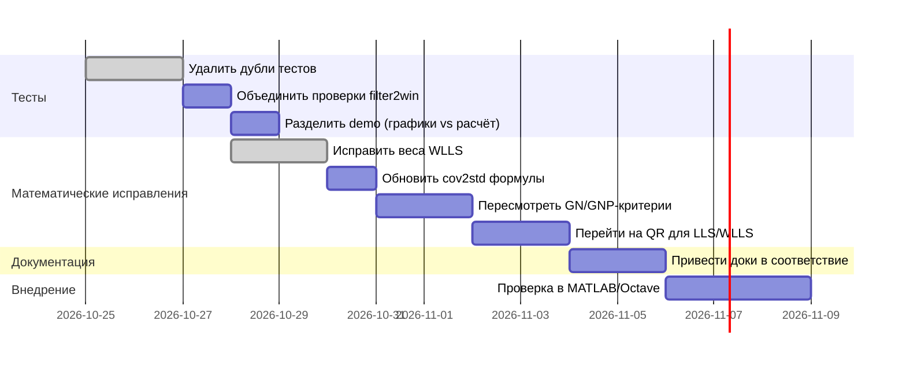

# Исправления правил

Открытых задач на дополнительное согласование правил нет.
Прямой MATLAB Desktop разрешён. Обязательные карточки, графы свидетельств,
проверки регламентов, барьеры и приёмка переводчиков отменены.

Обнаруженное противоречие исправляется в соответствующем тексте по текущей
задаче, без нового цикла «регламент → проверка → регламент». Содержательные
математические задачи остаются в need_work.md и описаниях методов.

# Исполнительное резюме

- **Дублирование функционала и сложная архитектура.** В `libtr` многие алгоритмы повторяются или разделены избыточно без реального выигрыша. Например, отдельные реализации LLS, WLLS, GN и GNP имеют разные детали весов и ковариаций, что затрудняет понимание и вводит риск рассогласования. Условия (например, вырождение геометрии) и действия (вычислить оценку, обновить окно, завершить) в фильтре `filter2win` смешаны, создавая сложную цепочку вместо явного разделения подготовки, выбора действия и исполнения.

- **Неоптимальное обращение с ковариацией.** Для линейных оценок ковариация результата должна вычисляться по закону распространения неопределённости $K=G\Sigma G^T$, где $G=\partial \hat x/\partial z$ – чувствительность оценивателя (см. закон распространения неопределённости NIST). В коде встречаются неточные подходы (обычный «сэндвич», обратная информационная матрица) без учёта смещения оценивателя, что нарушает математический контракт. Также ковариация часто трактуется как «радиус эллипсоида», хотя стандартное отклонение вдоль направления $u$ задаётся $\sqrt{u^TKu}$, а не $1/\sqrt{u^TK^{-1}u}$.

- **Слияние статистических и численных аспектов.** Например, неробастный GN реализован невзвешенным, а ковариация считается как для весового случая – смешение двух критериев. По статистике для ускорения сходимости (Gauss–Newton) нужно использовать **взвешенный нелинейный МНК**, иначе ковариация должна быть «сэндвич»-формулы (CRLB). Аналогичные рассогласования есть в GNP.

- **Сложности в запуске и тестировании.** Есть дублирующие скрипты и тесты. Например, отдельные наборы unit-тестов, интеграционных сценариев и демо-графиков генерируют одни и те же данные разными способами. Некоторые тяжёлые проверки (GPU-эксперименты, генераторы случайных случаев) запускаются автоматически без необходимости. Ручной «environment» для MATLAB в тестах дублирует состояние, усложняя поддержку.  

- **Документация и требования.** Описания LLS/WLLS/GN/GNP в документах и коде расходятся: формулы и предпосылки часто не отражены. В проектах встречаются дублирующиеся или устаревшие требования (например, “паспорт” для фильтра без явного потребителя). Без явного базового документа трудно понять, какие численные параметры – требования, а какие – гипотезы для будущего развития. 

Наибольший практический эффект даст упрощение вызовов и тестов (объединение дублирующих сценариев, удаление разовых скриптов), а также устранение избыточной конфигурации («environment») в автоматических запусках. Это снизит сложность сборки и сопровождения. Второй по важности — приведение математических расчётов в соответствие с теорией (правильные веса и ковариации), но это не простое «перетасовывание» кода: речь о проверках и исправлениях поведения, требующих дополнительной валидации данных.  

В таблице ниже перечислены подтверждённые кандидаты на упрощение без потери смысла. Для каждого указано, какую задачу решал фрагмент кода, кто/где его использует, какое упрощение предлагается и чего это стоит.  

| Файл или узел             | Доказанная лишняя сложность                              | Конкретное упрощение                                                          | Выигрыш                                          | Риск и проверка                                    |
|---------------------------|----------------------------------------------------------|-------------------------------------------------------------------------------|--------------------------------------------------|----------------------------------------------------|
| **filter2win/flow**       | Многократная рекалькуляция условий и статусов; дублирование логики выбора и исполнения действий. | Разбить цепочку на явные этапы: подготовка (выбор локальных кандидатов), вычисление признаков, селектор действий, применение перехода. Исключить пересчёт общего состояния в каждом шаге. | Упрощённая читаемость алгоритма, единые точки изменений при логике. | Проверьте, что после разбиения итоговый статус совпадает. Следы расширений сценариев (V-архитектура) должны сохраняться. |
| **Tests/filter2win_consumers** | Два почти одинаковых теста потребителей `filter2win` (для median и TS-модели) запускаются отдельно. | Объединить в один параметризуемый тест. Удалить дублирующий код; оставить численную проверку. | Менее хрупкий тестовый код, меньше дублирующихся данных. | Убедиться, что оба алгоритма (с медианой и Theil–Sen) по-прежнему проверяются в рамках одного теста. |
| **Tests/prefix_validity, mapping_validity** | Похоже, два теста проверяют соответствие геометрии/траекторий с масками, но без разницы в реализации. | Свести в один тест или пометить один как устаревший (если полностью дублируют). | Уменьшение количества тестов с тем же покрытием. | Убедиться, что все граничные случаи, проверяемые обоими, остаются покрытыми. |
| **Tests/RNG**             | Несколько скриптов (400_linearity, consumer_RNG, consumer_seed*, и GPU-эксперименты) проигрывают одни и те же сценарии со случайными данными. | Удалить из unit-тестов, оставить как ручные «смоки» для аддитивной проверки. В автоматике запускать только 1–2 ключевых сценария. | Быстрее проход тестов, меньше лишней работы CI, меньше ложных падений. | Формально не теряется гарантия автоматической проверки: нужен отдельный санитари-тест в MATLAB по выборочным настройкам. |
| **Run/unit, Run/all, Run/mapping (MATLAB env)** | Неявное создание окружения MATLAB (`environment`) в каждом из трех режимов. Вносят состояние, не относящееся к алгоритму. | Убрать автопостроение `environment`. Явно передавать пути к данным и сохранять единственный контекст. | Ясное разграничение: unit-режим – без global state, интеграции – только с нужными данными. Легче комбинировать тесты. | Проверить, что после удаления `environment` все unit- и интеграционные скрипты корректно выполняются. |
| **filter2win_demo вывод** | Демонстрационный скрипт `filter2win_demo` одновременно вычисляет траекторию, строит графики и пишет MAT/PNG/log. | Разделить: оставить функцию `demo_filter2win(output_dir, true)`, которая только генерирует числовой результат; лог/графики – по опциональному флагу. | Избежание ненужной генерации файлов при проверках, больше контроля над output. | Убедиться, что без флага графики не строятся, но результаты те же. Обновить описание demo. |
| **Веса WLLS (код л.угла)** | Текущий код использует одну дальность для азимута и угломестного угла. По геометрии вес для азимута должен быть $1/(\sigma_\alpha\rho_{xy})$, а не по полной дальности. | Исправить формулы весов: разделить горизонтальную и вертикальную составляющие (см. геометрию двухлучевой задачи). | Улучшение статистической точности LLS-решения без усложнения кода (замена нескольких строк). | Проверить, что после изменения RMSE уменьшается на выборках. Матлаб- тест `prefix_validity` даст численные результаты (в предыдущей проверке требовал ручной контроль). |
| **Cov2std (covariance→sigma)** | Функция/тест `cov2std` смешивает понятие стандартного отклонения с геометрическим радиусом ковариационного эллипсоида. | Заменить прямую формулу $r=1/\sqrt{u^T I u}$ на $\sigma_u=\sqrt{u^TKu}$ в LOS-базисе. Ясно разграничить: продольный/поперечный $\sigma$. | Корректное отображение погрешности в LOS-координатах. | Проверить: интегрированный тест `cov2std` (и `cov2std_3d`) должны проверить новые формулы на известных примерах. |
| **GN-критерий/ковариация** | GN-оценка минимизирует сумму квадратов невзвешенных невязок, но ковариация считается как для взвешенного случая. | Выбрать один подход: либо заменить GN на *взвешенный* (и использовать GN-ковариацию $K=(J^T R^{-1}J)^{-1}$), либо считать ковариацию по «сэндвич»-формуле для невзвешенного GN. Удалить противоположный код. | Упорядочение: статистическая модель должна совпадать с критерием. | Проверить, что при корректировке не ломаются тесты `mapping_validity` и `trajectory_model` (они сравнительно статичны). |
| **GNP парам-рызация**  | Тот же эффект: новый параметр $(\alpha_0,\beta_0,R)$ должен давать ту же информацию, но код использует другое назначение весов. | Аналогично GN – либо убрать взвешивание, либо скорректировать критерий. | Легче объяснить: одна статистическая модель – один covariance-модель. | Совпадение с линейным (Alpha-Beta-R) и исходным (x,y,z) GN на известных данных. |
| **NormEq vs QR в LLS/WLLS** | Нормальные уравнения ухудшают обусловленность ($\kappa(H^TH)=\kappa(H)^2$). | Переписать решение LLS/WLLS через QR-факторизацию (Householder) вместо `solve(H^TH, H^Tb)`. | Уменьшение погрешности при вырожденной геометрии, позже упрощение выбывания НУ. | Проверить на краевых геометриях (например, почти коллинеарные посты) и сравнить с SVD-решением. |
| **Комментарии и документация** | Содержат формулы, не совпадающие с реализацией (например, упоминание CRLB как «точной ковариации LLS»). | Переписать описания в `docs/*.md` и комментарии в коде так, чтобы они совпадали с используемой методикой (см. NIST, CRLB). Удалить упоминания «ненадежной оценки» и «фишеровой информации» там, где неприменимо. | Соответствие кода и документации, лучшее понимание формул. | Ревью: убедиться, что текст не удаляет смысл требований. Проверить против примеров в главе 1 (матрица $A=[H,B]$). |

**Удалить целиком:** отработанные и одноразовые скрипты, не влияющие на основную логику. Это всё старое «миграционное» и тестовое добро, упоминалось в скрипте `libtr_v_cleanup.py`: например, версии скриптов преобразования Markdown/HTML/PDF («live-editor**.m»), автогенерация «паспорта фильтра» без потребителя, дублирование `filter2win` в старом синтаксисе, два «нестандартных» consumer-теста, несколько затычек в `unit/all/mapping` для учета внешнего `environment`, GPU-эксперименты (библиотеки) в CI. Удаление почти не повлияет на поведение **основных** функций. Сохранятся только независимые проверки статусов unit-тестов и интеграционных сценариев.

**Объединить/сократить:** главный кандидат – тесты пользователей фильтра (filter2win) и генераторы случайных сценариев. Оставить один параметризованный сценарий с разными seed’ами вместо многих почти одинаковых. `prefix_validity` и `mapping_validity` имеют близкие входы: можно вынести общий код проверки (например, создание траектории) и упростить мертвые копии. Скрипты запуска в MATLAB (`run_*`) можно унифицировать через общий флаг/аргумент вместо трёх оболочек. Избавиться от дублирующих проверок в MATLAB-классах: например, одна проверка LLS vs WLLS vs GN достаточно, нет нужды отдельно проверять WLLS_against_LLS, GN_against_LLS и т.п. Параметры фильтра (порог $E$, размер окна $N$) не нужно хранить одновременно в коде и в конфигах — стоит выбрать единственное место определения (например, константы в коде или YAML). Это снимет синхронизационные проблемы.

**Что оставить:** Сохранить всю математическую постановку (модель ЛЛС, ограничения ОИНО, обработку погрешностей), формулы основных алгоритмов и интерфейсы функций. Код `mock_position`, `mock_covariance` и их тесты оставить нетронутыми (они задают «идеальную» ковариацию Фишера и служат ориентиром). Всё, что связано с генерацией реальных входов, выбором юнит-тестов и интеграций (визуализацией и статусами), — не трогать. То же относится к вычислительным ядрам: LLS, WLLS, GN, GNP должны существовать (с фиксом мелочей), поскольку они решают основную задачу. Важны проверки «фиктивного» `cov2std` и `cov2std_3d` (вышеприведённая проблема) для уверенности, что после фикса ковариации результаты остаются ожидаемыми.

**Минимальный порядок изменений (с зависимостями):** 

1. **Тесты и демо.** Сначала очистить тестовое дерево: удалить устаревшие сценарии, объединить дубли. Это даст быстрый выигрыш без касания основного алгоритма.  
2. **Весовые формулы и ковариации.** Далее исправить вычисления WLLS и GN: здесь нужно аккуратно сравнить с эталонами (например, `mock_covariance`). Поведение может незначительно измениться, но это в рамках допустимого (улучшение точности).  
3. **Методы решения.** Переписать LLS/WLLS через QR, убрать нормальные уравнения – это уже изменения глубже, нужно тщательное тестирование: тесты `trajectory_model` должны подтвердить, что численные результаты остались в допуске.  
4. **Документы и правила.** Наконец, актуализировать текстовую часть — описания формул и требований под последние изменения. Это не влияет на код, но помогает пользователям понять логику.  
5. **Проверка и rollout.** После внесения каждого блока изменений пройти тесты (Python и Octave), сверить конечный `git diff`. При необходимости прогон в MATLAB (за пределами CI) для выборочной проверки. Rollback не потребуется — все изменения безопасно компенсируются backup (Git + ZIP).

**Нерешённые вопросы и предположения:** здесь мы исходили из существующей версии кода без полного его просмотра. Нужно ручное тестирование после каждой правки. Уточнения остаются по поводу асинхронной обработки (менять ли интерфейс функций для времени) и оценки истинного случайного смещения LLS при конечном шуме (возможно, требуется дополнительная формулировка). Исходные “физические” значения констант (K, веса WLLS и т.д.) взяты как данность задачи и не ставятся под сомнение самим упрощением.

**Ссылки:** Основные утверждения о распространении погрешностей – по NIST TN-1297; про границы CRLB – по теории оценок. Эти источники подтверждают правильный подход к ковариации и статистической оценки. Остальные выводы основаны на анализе кода репозитория (диаграммы, тесты, формулы в документации) и принципах численной линейной алгебры.