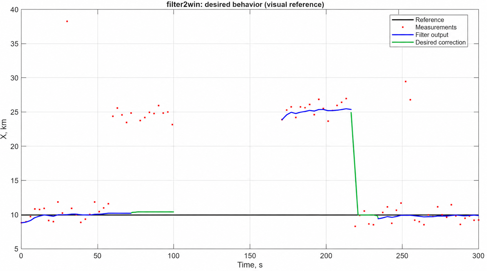

# filter2win — замысел и методика испытаний

Документ сохраняет цели, численные свойства и сценарии filter2win. Он не
требует отдельной карточки, графа покрытия или процедуры приёмки для каждой
правки. Проверки выбираются по задаче и изменённому поведению. Результаты
06.10.2026 ниже относятся к прежней версии; новый MATLAB-прогон не заявляется.

## Уточнённый принцип памяти и выбора окна

Вход фильтра — **оценка координаты, полученная оптимизатором**. Основной физический случай: неподвижная цель и ошибочные решения оптимизатора.

Постоянные окна A и B сохраняются через обрыв и смену активного окна. Обычные точки остаются до естественного вытеснения. **Согласованное исключение: выявленные крайние выбросы физически удаляются из FIFO.** Недоступность выхода не означает очистку памяти.

Неготовое B собирает кандидатов, но не используется для выхода. Первая далёкая точка не должна запирать его окрестность: последующей компактной группе разрешено накопиться, после чего выявленные крайние точки удаляются. У готового окна новая точка сначала проверяется на пробной базе; отказ не меняет ни FIFO, ни модель.

Готовое сохранённое окно принимается на первом подходящем наблюдении, прошедшем контроль, в том числе после пропусков. Возврат к готовому A выполняется сразу. Дополнительное подтверждение тремя попаданиями исключено из текущего варианта.

[Восемь сценариев ошибок оптимизатора с графиками](filter2win_optimizer_scenarios.md) показывают эти правила, включая физическое удаление первой плохой точки. Сейчас графики атласа получены рабочим MATLAB-ядром; исходное исследование сохранено отдельно. [Первый атлас](filter2win_memory_scenarios.md) остаётся историей сравнения вариантов.

## Зачем нужен фильтр и что должны доказать испытания

Фильтр должен стабилизировать отображение координаты по нерегулярным результатам оптимизатора: ослаблять влияние одиночных и групповых ошибочных решений, сохранять накопленные базы и прекращать выдачу устаревшей оценки при недостатке данных.

**Цель испытаний — установить, при каких настройках и условиях входа фильтр обеспечивает одновременно устойчивость к помехам, своевременную реакцию и обоснованную доступность результата.**

Различаем готовность базы и физическую истинность её уровня. Компактная ошибочная группа может пройти статистические условия. Неготовое окно не используется для выхода. Готовое B принимает допустимую точку, но не заменяет A, пока действует пролонгация A. После её окончания подходящая точка может выбрать B. Возврат в готовое A при нулевых настройках возврата немедленный. P06 проверяет сохранение A при одиночном попадании в готовое B.


Схема показывает логику доказательства. Она не задаёт внутренний алгоритм фильтра.

## Граница проверки

На входе — времена, оценки координаты от оптимизатора, признаки отсутствия данных и выбранный профиль настроек. Наблюдаем выход, его доступность, статусы и причины переходов. Проверяем совместную работу накопления, основной и альтернативной баз, переключения и обработки пропусков на целой истории.

Физический уровень для сравнения задаётся независимым источником опыта. Название этапа «помеха» или «настоящая полка» известно проверяющему, но не передаётся фильтру как подсказка. Если по доступным входам две истории неразличимы, требовать разных решений без дополнительного условия нельзя.

Эта методика относится к поведению функции со своим состоянием. Взаимодействие с вызывающим приложением, транспортом и системой запуска требует отдельного интеграционного опыта. Время выполнения и ресурсы здесь не оцениваются: требований к ним в обсуждении не задано.

## Что означает успех

| Цель | Почему это нужно | Наблюдаемый признак успеха | Где проверяем |
|---|---|---|---|
| **Удерживать полезное сопровождение** | Неготовая помеховая группа не должна определять выход | На заданном участке выход остаётся в разрешённой области | Основной рисунок; неровные полки и помехи |
| **Принимать допустимое изменение** | Излишняя инерция делает фильтр бесполезным | Готовая база выбрана по первому допустимому попаданию; новый кандидат проходит накопление | Допустимая новая полка; варианты переключения |
| **Не выдавать устаревшее как пригодное** | После потери данных прежняя оценка имеет ограниченный срок жизни | Пролонгация ограничена, затем выход недоступен; обе базы сохраняются для продолжения | Обрыв и восстановление; временные границы |
| **Подчиняться настройкам и физическому времени** | Одинаковое число точек не означает одинаковую длительность наблюдения | Изменение сетки и настроек приводит к предусмотренному решению | Плотные/редкие замеры; нулевая пролонгация; полное/неполное окно |
| **Объяснять решения и воспроизводиться** | По одному графику нельзя установить причину ошибки | Известны вход, профиль и версия; каждому переходу соответствует проверяемая причина | Все опыты; остальные режимы и ошибочный вход |

Конкретные допуски и сроки задаются до исполнения. Итог относится только к проверенным условиям и профилям, а не ко всем возможным входам.

## Как читать и применять документ

1. Посмотрите основной опыт ниже: это общая история поведения по вашему рисунку.
2. Выберите дополнительные сценарии из перечня. Они раскрывают свойства, которые один рисунок не проверяет.
3. Задайте вход, профиль и ожидаемое поведение выбранного опыта в данных или тесте; справочник настроек находится в конце.
4. Выполните нужную численную проверку, сообщите результат и закончите задачу.

**Текущее состояние:** замысел и желаемая последовательность зафиксированы. Для численной оценки основного рисунка ещё нужны точный вход, количественные условия готовности альтернативы, допуски и сроки. Markdown объясняет опыт и не является исполняемым описанием теста.

## Основной сценарий — ваш контрольный рисунок

**Название:** «Помеховая полка → обрыв → новое сопровождение → возврат».

**Целевое поведение подтверждено пользователем 06.10.2026:** [очищенный контрольный рисунок](filter2win_reference_clean.png). Параметры фильтра для этого сценария должны обеспечивать показанную траекторию: удержание исходного уровня на первой помеховой полке и своевременный возврат вниз после сопровождения новой полки. Синие и зелёные участки вместе задают желаемую траекторию; зелёным сохранены пользовательские коррекции.

Рисунок является согласованным визуальным ориентиром для настройки и оценки фильтра. Конкретные значения параметров ещё предстоит подобрать и проверить; изображение не является результатом расчёта с уже настроенным фильтром. [Первоначальный рисунок с пометками](filter2win_user_reference.png) сохранён как источник.

**Начало опыта:** пустая память фильтра. Входы содержат реальные времена наблюдений; интервалы между ними могут различаться. Значения уровней и времена событий выбираются для опыта и не встраиваются в алгоритм.

| Этап | Что поступает на вход | Что хотим увидеть на выходе |
|---|---|---|
| 1. Накопление | Неровные измерения около исходного уровня | Пока базы недостаточно, результат недоступен. После выполнения условий накопления — сопровождение этого уровня. |
| 2. Одиночная помеха | Один далёкий замер, затем прежние измерения | Помеха не переносит основную полку. Выход сохраняет допустимое сопровождение прежнего уровня. |
| 3. Первая верхняя полка | Серия измерений на другом уровне | На этом участке вашего рисунка выход остаётся около прежнего уровня. Скачок на верхнюю синюю полку запрещён. Нужно задать, какое условие готовности альтернативы пока не выполнено; само название «ложная полка» не является входным признаком. |
| 4. Обрыв | Новых измерений нет; время продолжает идти | Сначала выбранная пролонгация, затем недоступный выход. Память обоих FIFO сохраняется независимо от доступности выхода. |
| 5. Новые данные | Неровные измерения около нового уровня | Если B уже готово, первое допустимое попадание сразу выбирает его. Если не готово, продолжается накопление без выхода из B. A сохраняется. |
| 6. Возврат вниз | Измерения возвращаются на нижний уровень | Возврат соответствует раннему спуску на согласованном рисунке. Готовое A выбирается на первой подходящей оценке, прошедшей контроль; дополнительного накопления нет. |
| 7. Продолжение | Измерения около нижнего уровня с шумом | Устойчивое сопровождение нижнего уровня. |

### Общая картина во времени



Рисунок — очищенный визуальный ориентир, подтверждённый пользователем. Таблица ниже показывает смысл последовательности; ширина столбцов не обозначает длительность.

| Линия опыта | Накопление | Помеха и первая верхняя полка | Долгий обрыв | Новая база | Возврат вниз |
|---|---|---|---|---|---|
| **Измерения** | Около исходного уровня | Отклоняются от него | Отсутствуют | Около нового уровня | Около нижнего уровня |
| **Желаемый выход** | Недоступен → сопровождение | Удерживает прежний уровень в разрешённых пределах | Пролонгация → недоступен | Дополнение базы → переключение | Своевременно переходит вниз |
| **Главный вопрос** | Достаточно ли данных? | Не захвачен ли помеховый уровень? | Вовремя ли прекращена выдача при сохранённых FIFO? | Продолжено ли накопление сохранённой базы? | Соответствует ли возврат целевой траектории? |

Полный сброс из раннего примера статусов не применяется к этому сценарию. Обрыв сохраняет точки; доступность ограничена сроком удержания, готовая база не требует повторного подтверждения. Начало возврата нельзя ставить раньше доступного фильтру основания для реакции.

### Что меняется в этом опыте

Эта таблица показывает, какие данные определяют основной опыт; переносить их в отдельную карточку не нужно. Можно указать файл готовых наблюдений вместо описания генерации. Для воспроизводимости нужны сами времена и измерения либо полностью заданный способ генерации.

| Входной параметр | Значение для выбранного опыта |
|---|---|
| Исходный, верхний и конечный уровни | Указать значения или диапазоны; номиналы свободные |
| Времена начала и окончания этапов | Указать относительно начала опыта |
| Времена наблюдений | Указать список или закон нерегулярной сетки |
| Шум на каждом этапе | Указать распределение, разброс и ограничения |
| Одиночные помехи | Указать время и величину |
| Обрыв | Указать начало и длительность |
| Что задерживает первое переключение | Указать ещё не выполненные условия готовности B: количество, длительность или качество |
| Почему следующая полка допустима | Указать сохранённую готовность B или момент выполнения недостающих условий |

**Пока не задано:** точный численный вход вашего рисунка, условия задержки первого переключения, допустимые ошибки выхода и сроки реакции. Поэтому это описание задаёт нужный опыт, но ещё не является готовым численным тестом. Захват после готовности базы и допустимого попадания ожидаем даже для физически ложной полки; первый участок проверяет отсутствие преждевременного переключения.

## Как записать ожидаемый результат

Окрестность фильтра отвечает на вопрос «какую точку он принимает». Допуск испытания отвечает на вопрос «какой выход мы считаем приемлемым». Это разные условия. Ожидаемый результат не расширяется автоматически вслед за настройкой фильтра.

| Участок | Ожидаемый выход | Допустимая ошибка | От какого события считаем срок | Предельный срок |
|---|---|---|---|---|
| До готовности базы | Недоступен | Не применяется | Первый реальный замер | До выполнения условий накопления |
| Сопровождение исходной полки | Около исходного уровня | Задать в единицах измерения | Готовность базы | Задать |
| Первая верхняя полка | Около прежнего уровня, без захвата верхнего | Задать | Начало отклонений | Весь указанный участок |
| Обрыв | Пролонгация → недоступен; оба FIFO сохранены | Задать ошибку прогноза | Выбранные часы обрыва | По выбранной политике; отдельно проверить границу доступности выхода |
| Альтернатива после обрыва | Готовое B → после окончания удержания A; неготовое → продолжить накопление | Задать | Первый замер после обрыва | Задать |
| Возврат вниз | Переход на нижний уровень | Задать область допустимого перехода | Указать наблюдаемый сигнал возврата | Задать задержку и длительность |

Для каждой строки сравниваются фактическая траектория, доступность выхода и причина смены режима с записанным ожиданием. Нарушение хотя бы одной обязательной строки означает несоответствие этого сценария. Незаданный допуск или срок означает «оценить пока нельзя», а не успешный результат.

## Дополнительные численные сценарии

Выбирайте сценарии по задаче и изменённому поведению. Вход, настройки и ожидания
можно задать непосредственно в тесте или файле данных. Отдельные карточки
и полный повтор этого списка для каждой правки не требуются.

| Сценарий | Что изменяем | Что проверяем |
|---|---|---|
| Допустимая новая полка | Кандидат выполняет выбранные условия количества, времени и качества | Автономный захват без внешнего подтверждения |
| Столько же замеров за разное время | Одинаковое количество за короткий и длинный интервал | Количество не подменяет длительность; решение соответствует обоим условиям |
| Нулевая и ненулевая пролонгация | Меняем отдельно hold.outliers_seconds и hold.missing_seconds | Удержание действительно отключается или длится заданное время |
| Резкий и плавный переход | Меняем duration_seconds, curve и wait_seconds | Заданные ожидание и форма; промежуточные точки не считаются реальными наблюдениями |
| Готовое и неготовое окно | Меняем количество, длительность и качество оставшейся базы | Неготовое окно никогда не даёт выход; готовность не равна заполнению всех ячеек FIFO |
| Неровные полки и помехи | Меняем шум, асимметрию и редкие далёкие точки | Контроль окрестности и качества в объявленной области применимости |
| Разрыв около временной границы | Точки до, на и после выбранной границы | Верное удержание, недоступность, сохранение и продолжение накопления |
| Возврат или обрыв во время перехода | Прерываем переход соответствующим входом | Выбранные отмена, пауза или другая предусмотренная реакция |
| Первый выброс в B | Далёкая первая точка, затем компактная группа | Группа накапливается; крайний выброс физически удаляется; готовность пересчитывается |
| Отказ пробной записи | Новая точка внутри окрестности нарушает качество | Оба FIFO и модели без изменений, включая отмену намеченного вытеснения |
| Готовое окно после пропусков | Сохранённая база, пауза, одно допустимое попадание | Выбор на первом попадании без повторного подтверждения |
| Остальные режимы и ошибочный вход | Отдельные короткие истории входа | Каждый предусмотренный режим и отказ; отсутствие случайной порчи памяти |

## Оценка выбранного численного опыта

**До начала:** выбран сценарий, сохранены его вход и профиль, определены ожидаемые области выхода, события начала отсчёта и сроки. Неопределённое условие блокирует оценку только тех пунктов, которые от него зависят.

**Во время:** фиксируются фактические выходы, доступность и переходы. Ошибка исполнения означает «опыт не завершён»; она не доказывает ни правильность, ни неправильность функции.

**После:** результат относится к выполненному опыту и его условиям. Если
проверяемое свойство подтверждено, сообщите это и остановитесь. Другие
сценарии запускаются из-за конкретного изменения, дефекта или новой задачи;
дополнительный отчёт и полный обход целей не нужны.

При нарушении предъявляется конкретный участок: что подавалось, какой профиль действовал, что ожидалось и что произошло. После исправления повторяется затронутый опыт и связанные проверки. Менять критерий ради получения успеха нельзя.

### Справочник свойств

Номера связывают цели с сохранёнными ниже 27 содержательными свойствами.
Таблица помогает выбрать численную проверку; она не требует отдельного
графа, генератора покрытия или отчёта для каждой правки.

| Цель | Пункты перечня |
|---|---|
| Удерживать полезное сопровождение | 1, 7, 11, 12, 24, 25 |
| Принимать допустимое изменение | 2, 6, 9, 14, 18, 26, 27 |
| Не выдавать устаревшее как пригодное | 8, 13, 15, 16, 17, 23 |
| Подчиняться настройкам и физическому времени | 5, 10, 19 |
| Объяснять решения и воспроизводиться | 3, 4, 20, 21, 22 |

## Сохранённые численные свойства и случаи

1. До готовности B первая верхняя полка не вызывает преждевременного переключения.
2. Первое допустимое попадание в сохранённое готовое A возвращает его без повторного накопления.
3. Текущий статус однозначно определяет выполняемый режим.
4. Проверены также режимы, которых нет на рисунке.
5. Изменение настройки перехода действительно изменяет соответствующее поведение.
6. Допустимая новая полка захватывается автономно.
7. Недопустимая полка отвергается даже при достаточном количестве и времени.
8. Начальная база проверяется отдельно по количеству и длительности.
9. Неготовое B не используется для выхода; после очистки одновременно проверяются количество, длительность и качество.
10. Используются реальные нерегулярные времена.
11. Окрестности основной и альтернативной полок задаются отдельно.
12. Неровные полки и ограниченная выборка проверяются в заявленной области помех.
13. Пролонгации отклонений и пропусков настраиваются отдельно, включая ноль.
14. Выбор готового окна и сглаживание отображаемого перехода различаются; в основном профиле ожидание и длительность равны нулю, ненулевые значения проверяются отдельно.
15. Прогноз не создаёт новых наблюдений в базе.
16. Обрыв любой длительности сам по себе не удаляет точки из обоих FIFO.
17. После обрыва продолжается сохранённая база; при смене активного окна прежняя база остаётся.
18. После захвата качество каждой новой записи контролируется до изменения окна.
19. Нет привязки к номиналам и абсолютным временам картинки.
20. Листинг объясняет фактические режимы и причины переходов.
21. Решения используют только доступное прошлое и текущий вход.
22. Ошибочные входы обрабатываются по контракту без непредусмотренной порчи состояния.
23. Признак доступности результата соответствует накоплению и пролонгации.
24. Выявленные крайние выбросы физически удаляются из FIFO; каждое удаление объяснено в журнале.
25. Отказ новой точки отменяет всю пробную запись, включая вытеснение и изменения модели.
26. Неготовое B допускает компактную группу после первой далёкой точки; первая точка не запирает его окрестность.
27. Одиночное попадание в готовое B в пределах пролонгации A сохраняет выход A, но пополняет B. На границе удержание действует; после границы допускается выбор B. Нулевая пролонгация не задерживает выбор. Возврат в готовое A немедленный при нулевых настройках возврата. Контрольный сценарий дополнительно проверяет A на 255 и 258 с, B на 171 с и A на 219 с.

## Что предъявляется по окончании опыта

Краткий результат выбранной проверки. При ошибке — вход, профиль,
ожидание и фактический выход; график или переходы только если они помогают
увидеть причину. Отдельная карточка и полный комплект документов не нужны.

Список посещённых статусов и число внутренних проверок не доказывают соответствие траектории. Прежний результат 5088 проверок не является подтверждением вашего рисунка.

## Запуск численных проверок

Из корня репозитория в MATLAB Desktop:

```matlab
addpath('matlab');
status = run_tests;
```

Для отдельного дефекта можно вызвать нужный тест непосредственно.
Сервер, Python и Cygwin не являются условием численной проверки. Состав
обычных проверок и графиков задаёт matlab/run_tests.m. Полный запуск не
повторяется ради описания опыта, нового отчёта или перевода документа.

**Исторические свидетельства:** ссылки и отметки PASS в следующей таблице
относятся к версиям до текущего упрощения. MATLAB-проверка изменённого кода
при подготовке очистки не выполнялась; прежние результаты не заменяют её.

| Что проверяется | Вход и профиль | Свидетельство |
|---|---|---|
| P01–P08: одиночные/групповые ошибки, возврат, сохранение, промежуточные точки | [Времена, значения, предыстории и ожидания](../matlab/tests/configs/filter2win_optimizer_experiments.json); [профиль схемы 3](../matlab/tests/configs/filter2win_config.json) | [16 сценарных критериев — PASS](../runtime/pipeline/ed2843566d684734a3db33e735e54795/isolated_filter2win/filter2win_system_checks.json), 244 такта; графики и CSV в [атласе](filter2win_optimizer_scenarios.md) |
| Начальное накопление, количество и время, нулевая пролонгация, пересечение окрестностей, все 15 действующих статусов, отказы API | [Аналитические данные и независимые ожидания](../matlab/tests/configs/filter2win_schema3_cases.json) | [Журнал всех режимов](../runtime/pipeline/ed2843566d684734a3db33e735e54795/isolated_filter2win/FILTER_STATUS_schema3.log), [расчётные записи](../runtime/pipeline/ed2843566d684734a3db33e735e54795/isolated_filter2win/filter2win_schema3_contract.mat) |
| Ожидание выбора, плавный переход, пауза/продолжение/отмена, потеря готовности после очистки | Тот же набор аналитических данных; отдельные профили проверки | Выход сопоставлен с независимой формулой и условиями готовности |
| FIFO: порядок, вытеснение, физическое удаление, отказ без изменения памяти | [Данные FIFO](../matlab/tests/configs/fifo_double_cases.json) | PASS в [изолированном прогоне](../runtime/pipeline/ed2843566d684734a3db33e735e54795/isolated_filter2win/../report.json) |
| Существующий сценарный потребитель нового ядра | [Наблюдения](../matlab/tests/configs/filter2win_observations.json) явно ссылаются на [свой профиль](../matlab/tests/configs/filter2win_observation_filter.json) | [PASS](../runtime/pipeline/6b98956f8b634d8e9fb5470a639cd011/report.json) |

Дополнительные границы полного FIFO и пересечения окрестностей разной ширины проверены [последующим адресным прогоном ядра — PASS](../runtime/pipeline/bd641be2ce524c82b6d85e29955e8676/report.json): отказ по полному диапазону отменяет вытеснение, точное равенство порогу допускается, выбор определяется нормированным расстоянием.

Восемь опытов начинаются с **явно сохранённой предыстории** A/B; начальное накопление с пустого состояния проверяется отдельно. Графики строятся по тем же расчётным записям. Метки ошибок и истинная координата используются только проверяющим. Настоящий оптимизатор в этих опытах не запускается.

Изолированный прогон использует копию явного набора исходников и проверяет отсутствие подмены функциями из рабочего дерева. Это проверка зависимостей, не выпуск пакета. Старая схема 2 проверяется с отдельным [старым профилем](../matlab/tests/configs/filter2win_schema2_config.json).

Markdown объясняет опыт: редактирование таблицы само по себе не меняет испытание. Для P01–P08 изменяют соответствующий объект в файле наблюдений; параметры алгоритма меняют в профиле. Численное ожидание задаётся независимо от полученного выхода. Специального подключения Markdown к исполнителю не требуется.

**Область вывода:** PASS относится к перечисленным последовательностям и аналитическим границам. Он не подтверждает точное совпадение с изображением основного референса и весь диапазон шумов реального оптимизатора. Ещё нужны численные входы и ожидания исходного рисунка, конкурирующие группы сопоставимого размера, требование временного покрытия и пространственная координата.

Краткая [памятка о численных проверках](../Principes/testing_methodology.md); [пример заметки](../Principes/testing_methodology_template.md) необязателен.

## Как настроить фильтр

Рабочий файл — [filter2win_config.json](../matlab/tests/configs/filter2win_config.json). В нём **12 чисел**, сгруппированных по смыслу. Профиль имеет profile_version=1; перед работой он раскрывается в конфигурацию ядра схемы 3.

### 1. Сколько данных хранить и когда доверять окну

Общие настройки раздела window действуют на оба окна.

| Параметр | Сейчас | Что означает |
|---|---:|---|
| window.capacity | 18 | Сколько принятых точек хранит каждый FIFO |
| window.min_samples | 8 | Минимум точек после удаления выбросов |
| window.min_span_seconds | 5 с | Минимум времени между первой и последней оставшейся точками |

Готовность требует одновременно количества, длительности и качества. Восемь точек за одну секунду не заменяют восемь точек за пять секунд. Промежутки без измерений входят в длительность базы; непрерывность наблюдения она не доказывает.

### 2. Какие оценки принимать

| Параметр | Сейчас | Что означает |
|---|---:|---|
| window.radius | 1,5 | Окрестность вокруг модели готовой полки в единицах координаты |
| window.max_mad | 0,25 | Допустимое медианное абсолютное отклонение |
| window.max_range | 0,9 | Допустимый полный диапазон остатков после удаления выбросов |

Попадание в окрестность разрешает пробную проверку. Новая точка, не прошедшая проверку, не меняет FIFO. Неготовое B собирает кандидатов без привязки к первому выбросу.

### 3. Как долго продолжать выдачу и как переключаться

| Параметр | Сейчас | Что означает |
|---|---:|---|
| hold.outliers_seconds | 8 с | Удержание при отклонённых измерениях или накоплении другого окна |
| hold.missing_seconds | 8 с | Удержание при пропусках |
| handover.wait_seconds | 0 | Ожидание перед выбором B |
| handover.duration_seconds | 0 | Длительность плавного перехода в B |
| return_to_main.wait_seconds | 0 | Ожидание возврата в A |
| return_to_main.duration_seconds | 0 | Длительность плавного возврата в A |

Удержание отсчитывается от последнего принятого попадания в активное готовое окно. Пока действует hold.outliers_seconds для A, готовое B не выбирается; принятая в B точка не продлевает этот срок. Ожидание выбора — от первого принятого кандидата в текущей серии; готовность и новое подходящее попадание всё равно обязательны. Пропуск сохраняет память. Ноль отключает соответствующее удержание, ожидание или плавность.

### Если окна должны отличаться

В разделах main и alt указываются только отличия от window. Например:

```json
"alt": {
  "min_samples": 15,
  "radius": 2.5
}
```

Остальные параметры B наследуются из window; A сохраняет общие значения. Разделы main и alt необязательны. Для обоих окон доступны те же шесть полей, что в window. Так не приходится сопровождать две одинаковые копии настроек.

### Расширенная настройка

Необязательный раздел advanced нужен для изменения математических деталей:

- advanced.main / advanced.alt: model, known_velocity, linear_min_pair_seconds, trim и дополнительные поля band.
- advanced.handover: curve (linear/smoothstep) и on_missing (pause/continue/cancel).

По умолчанию используется постоянная медианная модель, отсечение по MAD с k=4, mad_scale=1,4826 и scale_floor=0,12; отсечение начинается с пяти точек, либо с вместимости FIFO, если она меньше пяти. Минимальная поддерживаемая вместимость такого профиля — три точки. Радиусы симметричны, рост со временем выключен. Плавность — smoothstep, реакция на пропуск в переходе — pause. Приоритет событий задан в коде; параметры выдержки и формы перехода перечислены выше.

Для асимметричной окрестности можно отдельно задать advanced.main.band.lower_margin / upper_margin и аналогично для alt. Другие допустимые поля band: mad_multiplier, mad_floor, growth_per_second, max_adaptive_radius, max_abs_velocity. В trim доступны min_samples, k, mad_scale, scale_floor. Поля готовности и допустимого разброса задаются только в window/main/alt: конфликтующих копий в advanced нет.

Задержку выбора B задаёт handover.wait_seconds, например:

```json
"handover": {
  "wait_seconds": 2,
  "duration_seconds": 0
}
```

Неизвестное поле или недопустимое сочетание параметров вызывает ошибку до начала расчёта. null разрешён для верхних пределов и сроков удержания и означает бесконечный предел; ноль имеет отдельный смысл.

### Что получает ядро и что проверено

Производственная функция filter2win_settings(profile) один раз раскрывает профиль и проверяет его. Загрузчик filter2win_config автоматически вызывает её для компактного JSON. В расчёт передаётся полная cfg; она сохраняется в отчёте опыта. Изменение профиля требует нового состояния фильтра.

Полные конфигурации схем 2 и 3 поддерживаются в текущем составе полей с фиксированным выбором событий. Тесты сравнивают раскрытые численные настройки основного и шумного профилей с независимыми полными реперами. Проверяются отличия A/B, нулевые сроки, настройки моделей и переходов, отказ опечаток и устаревшей таблицы правил. Это описание состава тестов, а не заявление об исполнении изменённой версии.

Чтобы не дублировать эталон, сохранена одна полная исходная конфигурация;
репер шумного потребителя содержит только её численные отличия. Ожидаемая
конфигурация в тесте собирается независимо от производственного преобразователя.

Отдельный [профиль наблюдений](../matlab/tests/configs/filter2win_observation_filter.json) использует ту же короткую форму: шум ±2, окрестность 2,5, MAD 2, диапазон 4, минимум B — 15, удержание 45/20 с. Только нижний масштаб отсечения 0,5 вынесен в advanced.
